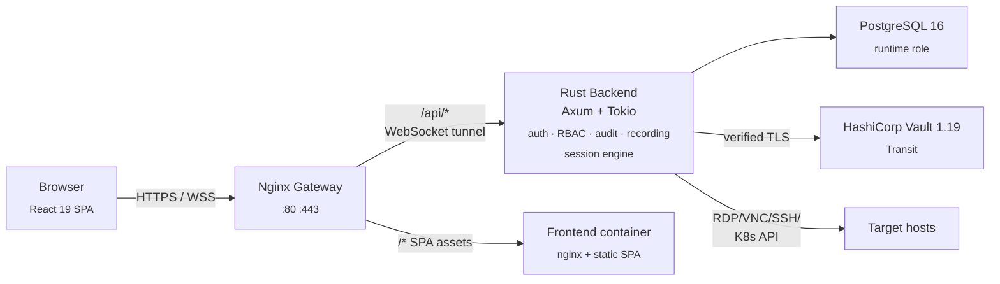

# Architecture (1-page summary)

This file is the **fast read** for evaluators and new contributors. For the
full deep dive — every container, every patch, every data flow, every trust
boundary — see [docs/architecture.md](docs/architecture.md).

## At a glance

Strata Client replaces the legacy Java/Tomcat + AngularJS Apache Guacamole
stack with a Rust proxy and a React 19 SPA. It runs as a small set of Docker
containers behind a single Nginx gateway (hardened with NJS):

## Containers

| Container        | Tech                           | Role                                                                                                                                                                                    |
| ---------------- | ------------------------------ | --------------------------------------------------------------------------------------------------------------------------------------------------------------------------------------- |
| `frontend`       | Nginx + static React SPA       | TLS termination, `/api/*` reverse proxy, SPA delivery.                                                                                                                                  |
| `backend`        | Rust (Axum + Tokio + sqlx)     | REST API, WebSocket tunnel, native session engine (RDP/VNC/SSH/K8s), OIDC, RBAC, audit, recording, web kiosk + VDI orchestration.                                                        |
| `postgres-local` | PostgreSQL 16                  | Optional bundled DB; can be swapped for an external Postgres at any time.                                                                                                               |
| `vault`          | HashiCorp Vault 1.19           | Optional bundled Vault, auto-initialised, auto-unsealed; Transit engine for envelope encryption and the audit-checkpoint signing key. Listens on TLS only.                                 |
| `vault-tls-init` | Backend image, one-shot        | Issues the bundled Vault's certificate from a private CA (renewed within 30 days of expiry) and exits. Vault gets the key; the backend gets only the CA certificate.                      |
| `clamav`         | ClamAV `clamd` (opt-in)        | Opt-in via the `av` Docker compose profile; scans every Quick Share upload over `clamav:3310` INSTREAM. Internal-only network exposure. See [docs/av-scanning.md](docs/av-scanning.md). |

## Trust boundaries (top-down)

1. **Browser ↔ Nginx** — TLS terminated at Nginx; everything beyond is on a private Docker network (`guac-internal`).
2. **Nginx ↔ Backend** — `/api/*` over plaintext on the internal bridge; auth enforced by every handler. `X-Forwarded-For` is believed only from peers listed in `STRATA_TRUSTED_PROXIES`.
3. **Backend ↔ Vault** — Transit-engine API over TLS verified against Vault's private CA; the backend holds a Transit-only token (never root) and never sees raw KEKs, only wraps/unwraps DEKs.
4. **Backend ↔ Postgres** — `sqlx` parameterised queries only; requests run as the least-privilege `<owner>_runtime` role, which cannot change the schema or rewrite audit history.
5. **Backend ↔ target hosts** — RDP/VNC/SSH/K8s-API; outbound from the `backend` container to whatever the connection points at. RDP always negotiates CredSSP/NLA, so a target that will not do NLA fails closed rather than downgrading to an in-session login screen. Web kiosks run Chromium sandboxed and may only reach `web_allowed_networks`.

## Key data flows

- **Authentication** — OIDC (Authorization Code + PKCE, `nonce`, browser-binding cookie, issuer-scoped identities) or local username/password, limited in PostgreSQL so the limits hold across replicas. Access token (20 min) + refresh cookie (8 h, `HttpOnly`) that rotates on every use within a token family; a replayed token revokes the family, and no sign-in outlives 12 h. Tokens signed with a persistent `JWT_SECRET` for stability across restarts. Tokens validated by JWT middleware on every privileged route. See [docs/security.md](docs/security.md).
- **Connection tunnel** — Browser opens a WebSocket to `/api/tunnel/...`; backend authenticates the JWT, admits the session against a process-wide memory budget (sized from the memory the backend can use, re-read on every session start) and the role's session limit, materialises a `connections` row + per-user credential profile, opens the target connection with the native session engine, forwards frames both ways under per-stream limits, mirrors the stream into the recording writer, and runs the auth watchdog (revocation polling + `MAX_TUNNEL_DURATION = 8h`). A protocol the engine cannot serve is refused with the reason rather than routed elsewhere, and any refusal after authentication is sent over the socket as a Guacamole `error` (v2.3.5) because browsers cannot read an upgrade's HTTP status. See [docs/architecture.md](docs/architecture.md#connection-tunnel) and [docs/security.md](docs/security.md#websocket-tunnel-auth-watchdog-v132-revised-v141).

- **Session end** — Every way a session can end — sign-out, disconnect, idle limit, takeover by another connection, network failure, engine failure, administrator kill, watchdog — reaches the browser as one Guacamole `error` instruction carrying a **cause-specific status code** and a plain-language sentence. The browser titles its overlay from the code, never from the wording. RDP's Set Error Info codes are translated in the engine; raw engine errors stay in the backend log. A session that cannot *start* — rejected credentials, unreachable target — is refused the same way (v2.3.8), so the browser never retries a wrong password; a tunnel that drops *without* an instruction is retried automatically at most 5 times in 10 minutes. See [docs/architecture.md](docs/architecture.md#how-a-session-ends-v211).

- **Remote display & input (RDP)** — The browser sends the desktop size in **device pixels** and DPI 96 unless the user opts in to matching their local scale; printable keystrokes are typed as **key presses on the target user's layout** (guacd's keymaps, embedded; blank `server-layout` = UK English), with Unicode events only for characters that layout cannot type, because console prompts such as PSReadLine on Server Core ignore Unicode input (v2.3.1); Caps Lock and Num Lock stay with the browser and the target is held at Num Lock on / Caps Lock off; audio arrives over RDPSND, which Windows serves only when an (empty) RDPDR channel is advertised beside it. See [docs/architecture.md](docs/architecture.md#native-rdp-input-display-and-audio-v211).

- **Clipboard sync** — Both directions are Guacamole streams (`clipboard` → `blob`… → `end`), which is still the wire protocol the browser speaks. The engine caps a transfer at 8 MiB per direction and says so when it truncates, rather than dropping an oversize copy silently as the guacd path did. Opt-in, content-free tracing in the browser via `window.strataClipboard`. The local clipboard is pushed on pointer and focus events and, since v2.3.1, before any Ctrl+V or Shift+Insert typed in a session, which is held until the push lands; the engine advertises it to the target only after CLIPRDR Monitor Ready. See [docs/architecture.md](docs/architecture.md#paste-shortcuts-wait-for-the-clipboard-v231).

- **DMZ link liveness (split‑topology)** — When deployed in DMZ mode the backend dials an outbound HTTP/2-over-mTLS link to the `strata-dmz` relay. To avoid long-lived half-open sockets the link supervisor applies two complementary probes: a kernel-level TCP keepalive (30 s idle → 10 s probe interval) on the `TcpStream` and an application-level HTTP/2 PING watchdog that PINGs the peer every 30 s with a 10 s deadline. On probe failure the connection is gracefully shut down and the supervisor immediate reconnects, restoring public request service within ~60 s. See [CHANGELOG.md](CHANGELOG.md#1108--2026-06-03) for full rationale and operator guidance.

- **Credential-profile resolution & Safeguard JIT** — Credential profiles of kind `safeguard` resolve their password from OneIdentity Safeguard at tunnel-open time (Just-In-Time checkout). Tunnel tickets that carry a `credential_profile_id` (one-off profiles) are now consumed early and canonicalised so they route through the same Safeguard JIT + password-cache path as mapped profiles; the backend also skips local Vault `unseal` attempts on empty local placeholders when a Safeguard password is present. This avoids transient `missing ciphertext` decryption errors and produces consistent credential resolution behaviour whether the profile was pre-mapped or supplied via a ticket at connect time. Since v1.13.1 the password cache's `expires_at` is clamped to the appliance's authoritative `ExpiresOn` (`min(now + profile TTL, appliance ExpiresOn)`), so the cached credential can never be advertised past the point Safeguard rotates it. See [CHANGELOG.md](CHANGELOG.md#1109--2026-06-08) and [docs/security.md](docs/security.md#privileged-account-password-management).
- **Credential checkout (PAM)** — Request → approver decision → LDAP `unicodePwd` reset → Vault-sealed return → user reveal → check-in or expiry → automatic rotation. See [docs/security.md](docs/security.md) § Privileged Account Password Management.
- **In-session approval popup (v1.11.1+)** — A `PendingApprovalWatcher` component is mounted once in the SPA shell and polls the two approval queues the active user is gated for (`/api/user/pending-approvals` for credential checkouts and `/api/admin/outbound-shares/pending` for outbound shares, the latter only when the user has `can_manage_system` or `is_outbound_approver`). Each new pending item surfaces as a toast (since v2.2.0, through the same `ToastProvider` stack as every other notification) with Approve / Deny (with inline reason composer) / View all actions wired to the existing decide endpoints, so approvers can action work without leaving a live session, the dashboard, or wherever they happen to be in the SPA. Cards auto-dismiss after 30 s, cross-tab de-duplicated via `localStorage`, with a 45 s poll cadence plus extra polls on tab focus / visibilitychange; since v2.3.0 hidden tabs do not poll and open tabs share one fetch per interval (Web Locks + BroadcastChannel). Both `POST /api/user/checkouts/:id/decide` and `POST /api/admin/outbound-shares/{id}/decide` accept an optional `reason` field that is persisted to the row and threaded into the rejection email; the credential side gained this in v1.11.1 via migration 077 to match the outbound side which already persisted a `decision_reason` in v1.11.0.
- **Credential leases (v2.2.0)** — `CredentialProfileExpiryWatcher` polls credential profiles every 60 s, raises batched expiry toasts, and publishes each lease to an in-memory `leaseStore`; the header lease pill and slide-over lease manager only read that store, so they add no requests. Extend and check-in call the existing Safeguard and checkout endpoints. See [docs/architecture.md](docs/architecture.md#notifications-and-credential-leases-v220).
- **Access decisions (RBAC)** — A connection is reachable when the user's role holds `can_manage_system` or `can_manage_connections`, maps the connection directly (`role_connections`), or maps the folder it is filed in (`role_folders`). Folder grants are **not recursive**. The v2.2.0 role editor displays exactly this rule and describes each permission by what its handler enforces. See [docs/security.md](docs/security.md#granular-admin-permissions).
- **Audit log** — Every privileged action is appended through the `audit_append` database function to `audit_logs`, which refuses updates, deletes and truncation. Each entry hashes its id, time, user, action, details and the previous digest; a verifier checks new entries every 10 minutes and the whole chain daily, and signs checkpoints with a Vault ed25519 key into an anchor file outside the database. See [docs/security.md](docs/security.md#audit-trail).
- **File transfers** — Quick Share uploads, outbound shares and SFTP file-browser transfers all pass the same antivirus scan, and anything leaving a session goes through outbound approval; outbound files are sealed in 64 KiB AES-256-GCM chunks. Through a DMZ, bodies stream end to end in flat memory.
- **Recording & Export** — Tunnel bytes mirrored to a per-session `.guac` recording on disk with a `complete` / `incomplete` / `failed` status (optionally required for the session to run); optional Azure Blob Storage offload, where a background pass every 60 s first applies retention and then uploads finished recordings oldest first in 8 MiB blocks, backing off a failing file rather than letting it block the rest (v2.3.10); in-browser playback with seek/speed, where a background seek index lets deep seeks start from a saved screen; on-demand H.264 MP4 video conversion via `guacenc` (`ffmpeg`) for native Windows playback and download.
- **Supply chain** — Third-party code is treated as untrusted until a gate clears it. Eight gates run on every push and pull request — `gitleaks`, `cargo audit` (`--deny unsound --deny unmaintained`), `cargo deny` (licences / bans / sources), `npm audit` on both Node graphs, OSV-Scanner, Trivy image scanning, CodeQL (with first-party sanitiser barrier models in [`bails309/strata-rust-models`](.github/codeql/extensions/strata-rust-models/) so rules stay enabled workspace-wide), and Dependency Review — and a red gate blocks the merge. Lockfiles are committed for both ecosystems and CI installs with `npm ci`, so an audit result is reproducible. Advisory triage, suppression rules, and the handled-advisory ledger live in [docs/security.md](docs/security.md#dependency--supply-chain-security). Note that `h2 >= 0.4.16` is a **hard floor** since v1.14.5 (the DMZ edge terminates HTTP/2 for anonymous internet clients, so an HTTP/2-layer denial of service there is pre-authentication) and `russh >= 0.65.0` is the floor for the SSH engine since v2.3.11.

## Where to read next

- **[docs/architecture.md](docs/architecture.md)** — full container, network, and data-flow detail; the native session engine; the web-kiosk and VDI runtimes.
- **[docs/security.md](docs/security.md)** — threat model, encryption details, RBAC matrix, auth watchdog, audit chain, PAM workflow.
- **[docs/api-reference.md](docs/api-reference.md)** — REST + WebSocket surface, request/response shapes, audit-event enum.
- **[docs/deployment.md](docs/deployment.md)** — production deployment, version-by-version upgrade notes, HA notes.
- **[docs/adr/](docs/adr/)** — Architecture Decision Records: _why_ a given design was chosen and what alternatives were rejected.
- **[docs/runbooks/](docs/runbooks/)** — operational runbooks for cert rotation, DB ops, disaster recovery, security incidents, SMTP, Vault, clipboard and session-disconnect triage, session capacity, and recording storage.
