# Architecture

## Overview

Strata Client is a microservices system that replaces the legacy Java/Tomcat + AngularJS Apache Guacamole stack with a Rust proxy and React SPA. Since **v2.0.0** it also replaces Apache's `guacd` C daemon: every protocol is served by a **native Rust session engine** (`crates/strata-session`) running in-process inside the backend. The core stack runs three containers (frontend/nginx, backend, Vault); optional profiles add a bundled PostgreSQL instance and a ClamAV sidecar. The backend image (Debian trixie-slim) additionally ships `Xvnc` and `chromium` baked in to support the `web` protocol out of the box; the `vdi` protocol is gated behind the [`docker-compose.vdi.yml`](../docker-compose.vdi.yml) overlay because it requires mounting `/var/run/docker.sock` (= host root).

The browser is unaffected by the engine change: it still speaks the Guacamole
wire protocol, and `.guac` recordings written under either engine are
interchangeable. See [ADR-0015](adr/ADR-0015-native-rust-session-engine.md) for
the rationale and [CHANGELOG](../CHANGELOG.md#200--2026-09-09) for the removal.

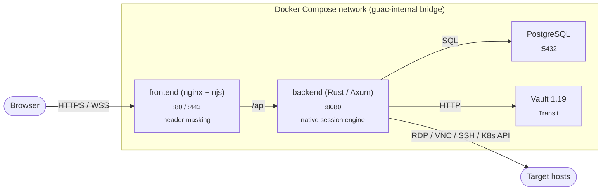

## Containers

### 1. Session engine (in-process, not a container)

Up to v1.14.6 this section described a `guacd` container built from
`guacd/Dockerfile` with five FreeRDP patches, reached over TCP 4822 and
optionally scaled with round-robin sidecars. **None of that exists now.**

| Item | Value |
| ---- | ----- |
| Location | `crates/strata-session`, linked into the backend binary |
| Concurrency | One Tokio task per session. RDP ran on a dedicated thread with its own current-thread runtime until the `ironrdp` 0.17 upgrade, because `ironrdp-async` 0.7's connection future was not `Send`; since 0.10 made it `Send`, an RDP session is an ordinary `tokio::spawn` like the others |
| RDP | `ironrdp` — CredSSP/NLA only, PNG/WebP-encoded damage regions, opt-in MS-RDPEGFX H.264 passthrough (v2.1.0), RDPSND audio paired with an empty RDPDR channel (v2.1.1), printable characters typed on the target's layout with a Unicode fallback (v2.3.1; Unicode-only in v2.1.1–v2.3.0), numeric keypad as keypad scancodes (v2.3.1), Display Control resize, CLIPRDR clipboard, Set Error Info codes translated for the user (v2.1.1) |
| SSH | `russh` — interactive PTY, mandatory host-key pinning, key or password auth, keyboard-interactive |
| VNC | `vnc-rs` — standard RFB security types, repeaters, reverse connections |
| Kubernetes | native exec client over `v4.channel.k8s.io` with client-certificate auth |
| File transfer | `russh-sftp`, decorating any protocol rather than being one |
| Terminal | `alacritty_terminal` grid + a rasteriser, so SSH and Kubernetes render wire-compatibly |
| Wire protocol | `winnow` zero-copy Guacamole parser/encoder; length prefixes counted in Unicode characters, not bytes |
| Scaling | Scale the backend. There is no separate daemon pool to size — see [deployment.md](deployment.md#high-availability) |

<details>
<summary>Historical — the custom guacd container (up to v1.14.6)</summary>

### Custom guacd

| Item       | Value                           |
| ---------- | ------------------------------- |
| Base image | Alpine 3.19 (multi-stage)       |
| Source     | `guacd/Dockerfile`              |
| Network    | `guac-internal` (internal only) |
| Port       | 4822 (not exposed externally)   |

The official Apache Guacamole server daemon, custom-compiled with:

- **FreeRDP 3** (`ARG FREERDP_VERSION=3`) for modern RDP support. The
  custom guacd builds against whichever FreeRDP 3.x ships with the
  base image (Alpine 3.23 community + edge currently resolves to
  `freerdp-3.25.0-r0`; Debian 13 / Trixie still ships
  `freerdp-3.24.x`). Upstream GUACAMOLE-2273 now selects between the
  legacy four-argument
  `Authenticate(freerdp*, char**, char**, char**)` callback (FreeRDP
  ≤ 3.24) and the five-argument
  `AuthenticateEx(freerdp*, char**, char**, char**, rdp_auth_reason)`
  callback (FreeRDP ≥ 3.25), so the same source tree compiles cleanly
  on both Alpine edge and Debian Trixie. Our local patch 006, which
  did this from v1.3.2 until the pin moved to `main`, has been
  removed.
- **Kerberos** (`krb5-dev` at build, `krb5` + `krb5-libs` at runtime) for GSSAPI/NLA authentication
- **H.264 GFX** — `ffmpeg-dev` / `ffmpeg-libs` for FreeRDP 3 GFX pipeline with H.264 encoding, dramatically lowering bandwidth for RDP sessions

The build pipeline applies a numbered series of unified-diff
patches under [`guacd/patches/`](../guacd/patches/) to the
upstream `apache/guacamole-server` tree (pinned to commit
`be83001` on `main`, 2026-08-07) before `autoreconf -fi && ./configure`.
The patches are applied in lexicographic order via the loop in
[`guacd/Dockerfile`](../guacd/Dockerfile), with `git apply`
preferred and a `patch -p1 -F3` fallback for fuzz tolerance:

| Patch                                  | Purpose                                                                                                                                                                                                                                                  |
| -------------------------------------- | -------------------------------------------------------------------------------------------------------------------------------------------------------------------------------------------------------------------------------------------------------- |
| `001-freerdp3-debian13.patch`          | Build fixes for FreeRDP 3 on Debian 13 / Trixie.                                                                                                                                                                                                         |
| `002-kerberos-nla.patch`               | Routes Kerberos credential prompts through guacd's auth callback so SSO + NLA actually work.                                                                                                                                                             |
| `003-null-guard-and-config-h.patch`    | Hardening: NULL guards on a handful of hot paths and consistent `config.h` inclusion.                                                                                                                                                                    |
| `004-h264-display-worker.patch`        | Hooks FreeRDP's RDPGFX `SurfaceCommand` callback and emits the custom `4.h264` Guacamole instruction (see "[H.264 GFX passthrough]" below).                                                                                                              |
| `005-refresh-rect-on-resize.patch`     | Marks the entire layer dirty after `gdi_resize` and asks the RDP server to re-send pixels for the full new desktop area, eliminating black "ghost regions" along the edge of the canvas after a server-driven RDP resize (v1.3.2).                       |

After the loop, the Dockerfile runs two `grep -q` assertions
against the upstream tree: `AuthenticateEx` in
`src/protocols/rdp/rdp.c`, and `"clipboard-buffer-size"` in
`src/protocols/rdp/settings.c`. Both guard against a future pin
silently regressing — the first would mean patch 006 needs
reinstating, the second that RDP has lost the configurable
clipboard buffer and large copies would be dropped without
error. Patch files are pinned to LF line endings via
[`guacd/patches/.gitattributes`](../guacd/patches/.gitattributes)
because byte-sensitive unified-diff hunks fail to apply when CRLF
sneaks in via `core.autocrlf=true` on Windows.

Multiple `guacd` instances could be deployed via the `--profile scale` Compose profile (e.g. `guacd-2`), with the backend round-robining across them through a `GuacdPool`. Neither the profile nor the pool exists in v2.0.0.

Volumes:

- `guac-recordings` → `/var/lib/guacamole/recordings` — session recording storage
- `krb5-config` → `/etc/krb5` — dynamically generated `krb5.conf`
- `backend-config` → `/app/config` (read-only) — custom `resolv.conf` written by the backend for DNS configuration

**Recording write semantics (v1.1.0+):** guacd writes session recordings into the shared `guac-recordings` volume as `guacd:guacd` (uid/gid 100/101 inside the Alpine guacd container) at mode `0640` — group-only-read. The upstream `guacamole-server` `recording.c` `open()` hard-codes mode `0640`, so this is independent of the in-container `umask`. This gid is the integration point with the backend: the backend's `entrypoint.sh` reads the gid off the volume at startup and adds the `strata` user to a matching local group via `usermod -aG`, so historic playback works under standard POSIX group-read without requiring `DAC_OVERRIDE`. The fix is volume-agnostic — Docker named volumes, bind-mounts, NFSv3/v4 with preserved gids, and CIFS with `uid=,gid=` mount options all work transparently.

</details>

> **Still live from the block above:** the recordings-gid handling in
> `backend/entrypoint.sh` is **retained as upgrade compatibility**.
> Recordings written before v2.0.0 are still owned by `guacd:guacd`, and
> both playback and the retention sweeper need the backend to hold that
> supplementary group. Recordings written by the native engine are owned
> by `strata` directly.
>
> **Since v2.3.1 (#470)** the entrypoint joins `strata` to a group for
> *every* numeric gid (`%G`) the existing files carry, and takes ownership
> of the recordings **directory** itself (`chown strata:strata`, not
> recursive, `u+rwx,g+rwxs`) so the native engine can create files in a
> directory a guacd-era volume left owned by guacd. Before that, a
> mismatch between the one file's gid it joined and the directory's own
> group made every new recording fail at start with `EACCES`. A startup
> `ERROR` line reports a directory that is still not writable. See
> [security.md § Recordings Volume](security.md#recordings-volume--cross-container-posix-permissions-model).
>
> **Custom DNS** is no longer applied by copying a `resolv.conf` into a
> container at startup — see [Target hostname resolution](#target-hostname-resolution-v200) below.

### Target hostname resolution (v2.0.0)

The session engine resolves *target* hostnames itself, against the
nameservers configured in **Admin → Network**, applying the search suffix
to short names. Strata's own infrastructure lookups (`postgres-local`,
`vault`, `clamav`) continue to use the container's resolver.

This is not how it worked before. `guacd` resolved every target, so its
container's `resolv.conf` was what mattered, and its entrypoint copied one
in from the shared `backend-config` volume. The backend cannot use the
same mechanism, for two reasons that compound:

1. It reaches postgres, vault and clamav through Docker's embedded
   resolver at `127.0.0.11`. Replacing its `resolv.conf` would lose them.
2. *Appending* the operator's nameservers after `127.0.0.11` does not
   help either, because glibc only advances to the next nameserver on
   timeout or SERVFAIL — never on the `NXDOMAIN` that Docker's resolver
   returns for a name it does not know. The lookup would stop before it
   ever reached them.

Resolving in-process (`backend/src/services/dns.rs`, `hickory-resolver`)
avoids both, and makes the setting take effect on the next session rather
than requiring a container restart. The resolver is cached against the
settings value, so an administrator's edit is picked up without
rebuilding one per connection.

Only the **socket** uses the resolved address. `TargetSpec::connect_addr`
sits alongside `hostname`, and every engine dials the address while still
passing the *name* to TLS certificate verification and the Kerberos SPN —
otherwise pre-resolving would silently convert a name-based handshake into
an address-based one and break NLA against Active Directory. A lookup that
fails falls back to the system resolver rather than refusing the session.

**Recording MP4 conversion (v1.14.0+):** Raw `.guac` session recordings store Guacamole instruction streams that are streamed to `guacamole-common-js` for playback. To support native playback and downloading on Windows, the backend service `convert_guac_to_mp4` (`backend/src/services/recordings.rs`) invokes Apache Guacamole's native `guacenc` encoding binary (compiled against `ffmpeg` in `backend/Dockerfile`) with the `-f` flag. `guacenc` renders the `.guac` stream frame-by-frame into an H.264 video container (`.mp4` / `.m4v`). Converted MP4 files are cached locally adjacent to the raw recording file for fast subsequent downloads. The `prepare_recording_for_download` function resolves local disk files as well as Azure Blob Storage objects, serving `video/mp4` downloads with sanitized filenames (`<connection_name>_<recording_id>.mp4`).

> `guacenc` is a **build-time** Guacamole component in the backend image
> and is unrelated to the removed `guacd` daemon. It reads the `.guac`
> format, which v2.0.0 still writes, so recordings from either engine
> convert identically.

### 2. Rust Backend

| Item      | Value               |
| --------- | ------------------- |
| Language  | Rust (2021 edition) |
| Framework | Axum 0.8 + Tokio    |
| Source    | `backend/`          |
| Port      | 8080                |

The central orchestrator. Responsibilities:

- **Bootstrap & config** — detects `config.toml` on startup; enters setup mode if missing
- **Database** — connects to local or external PostgreSQL; runs advisory-lock-protected migrations
- **Auth** — multi-method authentication system:
  - **SSO/OIDC (v1.9.0)** — multi-tenant OIDC configurations managed dynamically, allowing multiple custom-labeled sign-in buttons on the login screen. It features dynamic IdP discovery via JWKS, in-memory state tracking to prevent provider mismatches, secure client secret envelope encryption via Vault Transit, and automated session establishment.
  - **Local Auth** — built-in credentials (Argon2id, hashed on the blocking pool with bounded concurrency since v2.3.0) with global enable/disable toggle, 12–256-character password policy, dedicated password change / admin reset endpoints, and sign-in and password-change limits kept in PostgreSQL so every replica shares them (v2.3.0; see [Capacity, integrity and scale-out](#capacity-integrity-and-scale-out-v230)).
  - **Session tokens** — short-lived access tokens (20 min) with `HttpOnly` refresh cookies (8 hr) that **rotate on every refresh** within a token family (v2.3.0; reuse of a spent token revokes the family), a **12-hour absolute sign-in limit**, proactive activity-based silent refresh shared across tabs by a Web Lock, per-user session tracking (`active_sessions` table), and a pre-expiry countdown warning toast. A password change or reset refuses every earlier token (`users.sessions_valid_after`). Cookies (`csrf_token`, `session_expires`) include a 60s buffer (v1.8.2) for improved SPA refresh reliability. Tokens are signed with a persistent `JWT_SECRET` (v1.8.3) to maintain sessions across container restarts.
  - **Global Security Headers (v1.8.2/1.8.3)** — implements a global `tower-http` middleware that applies `Cache-Control: no-store, no-cache, must-revalidate, proxy-revalidate` to every API response. Public-facing headers (`Server`, `X-Powered-By`, and `Content-Security-Policy: frame-ancestors`) are managed at the Nginx gateway layer via NJS (v1.8.3).
  - **Enforcement** — strict backend policy check on every login attempt ensures disabled methods cannot be accessed.
- **Vault** — envelope encryption for stored credentials via Vault Transit
- **Session engine** — in-process RDP / VNC / SSH / SFTP / Kubernetes implementations ([`crates/strata-session`](../crates/strata-session/)) driving a Guacamole-style instruction stream over the WebSocket; supports H.264 GFX passthrough for RDP
- **Tunnel** — authenticates the WebSocket upgrade, resolves the target, and hands the socket to the engine ([`backend/src/tunnel.rs`](../backend/src/tunnel.rs), ~190 lines since v2.0.0)
- **Metrics** — per-session bandwidth tracking (bytes in/out) with aggregate metrics endpoint
- **Config push** — generates `krb5.conf` (multi-realm), toggles recordings, manages SSO settings
- **AD sync** — scheduled LDAP/LDAPS queries against Active Directory to discover and import computer accounts; supports simple bind and Kerberos keytab auth, custom CA certificates, multiple search bases per source, gMSA/MSA exclusion filters, and configurable connection defaults (RDP performance flags, session recording parameters, keyboard layout, and since v2.3.1 a stored Trusted CA that every synced RDP connection verifies its host against). Since v2.3.2 a sync replaces a connection's parameters with the defaults **except** the per-host trust pins the connection already holds (`host-key`, `host-key-fingerprint`, `sftp-host-key`, `cert-fingerprints`), so keys approved through **Verify Host Keys** survive re-syncs (`PER_HOST_PINS` / `merged_extra_sql()` in [`services/ad_sync.rs`](../backend/src/services/ad_sync.rs))
- **Password management** — privileged account password checkout and rotation for AD-managed service accounts; configurable password generation policy, LDAP `unicodePwd` reset, Vault-sealed credential storage, approval workflows with explicit account-to-role scoping (each approval role is mapped to specific managed AD accounts), dedicated "Search Base OUs" for user discovery (allowing separate scoping from device discovery), **scheduled future-dated checkouts** (requests between now + 30 s and now + 14 days sit idle with no credential material until the scheduled moment, at which point the existing 60-second expiration worker activates them), **emergency approval bypass (break-glass)** per AD sync config — gated by `pm_allow_emergency_bypass`, requires ≥ 10-character justification, **hard-capped at 30 minutes** server-side, writes a dedicated `checkout.emergency_bypass` audit event, surfaces an ⚡ Emergency badge across Credentials and Approvals views, background workers for checkout expiration and zero-knowledge auto-rotation, requester username resolution for approver visibility, and decided-by tracking with self-approval detection
- **Connection health checks** — background TCP probing of every connection's hostname:port every 2 minutes; results (online/offline/unknown) persisted and exposed via API for dashboard status indicators. Since v2.2.0 `POST /api/admin/connections/{id}/probe` runs the same check for one connection on demand (`health_check::probe_one`) and also returns the TCP connect latency; see [Admin console](#admin-console-fleet-folders-and-roles-v220)
- **DNS configuration** — admin-configurable nameservers and search suffixes used by the session engine to resolve **target** hostnames in-process; applies to new sessions with no restart. Strata's own infrastructure lookups stay on Docker's embedded resolver. See [Target hostname resolution](#target-hostname-resolution-v200).
- **Quick Share (file store)** — session-scoped temporary file CDN; files uploaded via multipart POST are stored on disk, each keyed by a random unguessable token. Download endpoint is unauthenticated (the token is the capability). Files are automatically cleaned up when the tunnel disconnects. Limits: 20 files per session, 500 MB each. The frontend Quick Share panel is **protocol-aware (v1.3.0+)**: SSH / Telnet sessions render the copy-snippet as `curl -fLOJ '<url>'` (paste-into-shell friendly); RDP / VNC / web kiosks render the bare HTTPS URL. A "Copy as" `Select` dropdown lets the operator override per-session: `URL`, `curl`, `wget --content-disposition`, or `Invoke-WebRequest -Uri … -OutFile … (Windows)`. **v1.12.0+:** every upload is streamed through a pluggable antivirus scanner before it lands in the session file store. Three backends ship (`off` default, `clamav` over the `clamd` INSTREAM TCP wire protocol against the opt-in bundled sidecar, and `command` for exec-driven engines like Defender / Sophos / ESET). Fail-closed by default; infected verdicts always reject; blocked uploads emit a `file.av_blocked` audit event with the signature name. See [av-scanning.md](av-scanning.md) and [ADR-0011](adr/ADR-0011-av-scanning.md). **v1.12.1+ refinements:** (1) `AppError::AvScanFailed` is now mapped to a friendly, engine-classified user-facing message via `Verdict::user_facing_block_message()` (infected → "Your file was blocked by the antivirus scanner (<signature>)", timeout → "the scanner did not respond in time", transport error → "the scanner is unreachable", missing signatures → "the scanner's signature database isn't loaded yet", everything else → a generic "the scanner returned an error"), so end users never see raw stderr or `clamd` panic strings. (2) The frontend exposes scanner health without `docker exec` via a new `GET /api/admin/health/av` endpoint and an **AV Health** card on the Admin → Health tab (engine, version, signature freshness, last-seen, error-since timestamp). (3) The Admin → **AV-Blocked Files** tab unifies inbound `file.av_blocked` audit rows and outbound `outbound_shares` rows with `av_scan_status IN ('infected','error')` into a single audit grid keyed off `GET /api/admin/files/av-blocked`. (4) The Quick Share outbound copy-snippet flow now renders an indeterminate **Awaiting AV scan** progress bar on each pending row, and the curl / PowerShell snippets explicitly disable `Expect: 100-continue` (`-H 'Expect:'` on curl, `$client.DefaultRequestHeaders.ExpectContinue = $false` on .NET `HttpClient`) so a stale-token 400 from the public ingest router doesn't swallow the byte-stream before the progress meter has anything to draw.
- **Outbound Quick-Share (approval-gated, v1.11.0+)** — separate, audited pipeline for files **leaving** a remote session. Two ingest paths feed the same backend service:
  - **Drive-channel interception** — `SessionManager.client.onfile` buffers any file the engine pushes back over the RDP / SFTP drive channel (`Guacamole.BlobReader` → `Blob` → `File` → `FormData`) and POSTs it to `POST /api/user/outbound-shares` with the active session_id, connection_id, and pending justification. Behaviour is gated on the active role granting `can_use_quick_share_outbound`; otherwise the legacy auto-download path is preserved.
  - **HTTPS upload-command (tokenised)** — for sites where group policy disables RDP / SFTP drive redirection at the target. The SPA mints a single-use, 10-minute upload token via `POST /api/user/outbound-shares/ingest-token` (auth + CSRF), the panel renders the token into a `curl` / `curl.exe` / PowerShell 7 `-Form` one-liner, and the user pastes the snippet inside the remote session shell. The remote-session shell POSTs the file at `POST /api/outbound-shares/ingest/{token}` on the **public router** (no cookie auth, no CSRF — the path-segment token IS the auth). The handler atomically consumes the token (`UPDATE … SET used_at = now() WHERE token = $1 AND used_at IS NULL AND expires_at > now()`), re-verifies the minter's `can_use_quick_share_outbound` permission, then hands off to the same `services::outbound_shares::submit` pipeline as the drive-channel path. Tokens are 32-byte URL-safe base64 (~192 bits of entropy), bound at mint time to the user + session + connection + justification, rate-limited 10 mints/minute/user, and reaped daily by the `user_cleanup` worker.

  Backend pipeline: a fresh 256-bit DEK is generated per submission; the plaintext is encrypted from its staging file in 64 KiB AES-256-GCM chunks (STREAM construction, so reordering or truncation fails authentication) and hashed in the same pass; the DEK is sealed by Vault Transit and stored in `outbound_shares.sealed_dek`; the ciphertext is written to the staging directory (`STRATA_OUTBOUND_SHARES_DIR`, default `/tmp/strata-outbound-shares` with platform-temp-dir fallback). A built-in DLP heuristic computes a score and a list of reasons against the plaintext; if `dlp_score ≤ AUTO_APPROVE_THRESHOLD` and the per-user `outbound_share_requires_approval = false`, the share is auto-released with a single-use download token. Otherwise it sits in `status = 'pending'` until a super-admin (`can_manage_system`) or a delegated approver (`outbound_share_approvers`) decides via `POST /api/admin/outbound-shares/{id}/decide`. Denied or expired shares trigger a periodic worker that zeroises the sealed DEK and deletes the ciphertext file so the staging blob cannot be recovered from a forensic disk image.

  Audit events: `outbound_share.submitted`, `.decided`, `.downloaded`, `.purged`, `.approver_added`, `.approver_removed`, `.ingest_token.minted`, `.ingest_token.consumed`.

  **v1.11.1 additions:** (1) The submitter side now enforces a
  shared `validate_outbound_justification(requires_approval,
justification)` helper at **both** outbound entry points
  (`finalize_submit` and `issue_ingest_token`) — when the
  submitter's `users.outbound_share_requires_approval = TRUE`,
  the justification must be at least 10 characters
  (whitespace-trimmed, character count not byte count); bypass
  users continue to submit without one. The check on
  `issue_ingest_token` runs before the token is minted so the
  user discovers the error inside the Outbound Share panel, not
  after pasting the snippet into a remote shell. (2) A new
  `PendingApprovalWatcher` component is mounted once in the SPA
  shell (`App.tsx`) and polls the two approval queues the
  active user is gated for — `GET /api/user/pending-approvals`
  (credential checkouts) and `GET
/api/admin/outbound-shares/pending` (outbound shares, only
  when the user has `can_manage_system` or
  `is_outbound_approver`) — surfacing each new item as a
  top-left popup card with Approve / Deny (with inline reason
  composer) / View all actions wired to the existing decide
  endpoints. 45 s poll cadence plus extra polls on tab focus /
  visibilitychange; 30 s auto-dismiss; cross-tab de-dup via
  `localStorage`. Architecturally mirrors the existing
  `CredentialProfileExpiryWatcher`. **v2.2.0:** the card is now an
  ordinary toast from the shared `ToastProvider` (top-right), not a
  separate popup; see
  [Notifications and credential leases](#notifications-and-credential-leases-v220).

- **Audit** — append-only, tamper-evident log: rows are written only through the `audit_append` database function (v2 SHA-256 hash chain, migration 098), triggers refuse `UPDATE` / `DELETE` / `TRUNCATE`, and a background verifier records keyed checkpoints and Vault-signed anchors outside the database (v2.3.0; see [security.md § Audit Trail](security.md#audit-trail))

### 3. Frontend SPA

| Item      | Value                                     |
| --------- | ----------------------------------------- |
| Language  | TypeScript                                |
| Framework | React 19 + Vite                           |
| Styling   | Tailwind CSS v4                           |
| Runtime   | nginx (production)                        |
| Source    | `frontend/`                               |
| Ports     | 80 (HTTP), 443 (HTTPS when certs mounted) |

The frontend nginx container serves as the primary gateway for all external traffic. It handles:

- **Reverse proxying** — routes `/api/*` to the Rust backend (including WebSocket upgrades for tunnel connections). The shared `common.fragment` declares `resolver 127.0.0.11 valid=10s ipv6=off;` (Docker's embedded DNS) and uses a `set $backend_upstream "backend:8080";` variable as the `proxy_pass` target so the upstream is re-resolved per request rather than cached at process start. **(v1.3.0+)** This avoids the historical `[emerg] host not found in upstream "backend"` boot failure when the backend container was briefly unreachable during `docker compose up -d --build`; nginx now stays up and returns `502 Bad Gateway` for the duration of any backend outage, recovering automatically when the upstream comes back
- **Security headers** — `X-Content-Type-Options`, `Referrer-Policy`, `Content-Security-Policy` (including `frame-ancestors 'none'`), and `Permissions-Policy` on every response. API-specific security headers (notably `Cache-Control: no-store`) are enforced by the Rust backend middleware for all `/api/*` routes.
- **NJS Header Filtering (v1.8.3)** — utilizes Nginx JavaScript (`njs`) to mask the `Server` header as "Strata" and remove the `X-Powered-By` header across all responses, including those generated internally by Nginx. This ensures zero technology fingerprinting even in error scenarios.
- **Compression** — gzip for text, CSS, JS, JSON, and SVG assets
- **SPA fallback** — `try_files` to `index.html` for client-side routing

Pages:

- **Setup Wizard** — first-boot database and Vault configuration with bundled/external/skip vault mode selector
- **Dashboard** — user's connections with connect/credential vault, multi-select for tiled view, last-accessed tracking, favorites filter, group view toggle (flat list or collapsible group headers), and connection health status indicators (green/red/gray dots showing online/offline/unknown from background TCP probes). The **My Connections** search input matches against connection `name`, `hostname`, `description`, **and assigned tag names** (v1.12.9+ — fourth `||` clause on the `filtered` `useMemo` predicate, lazily building a `Map<tagId, tagName.toLowerCase()>` from the existing `allTags` derivation; placeholder reads `Search name, host, description or tag`). The dedicated tag-chip filter row immediately below the search composes with the query via `AND`. **(v1.8.3)** Preference and settings providers are mounted inside the authentication boundary to eliminate 401 log noise on the login screen.
- **Session Client** — HTML5 Canvas via `guacamole-common-js` (vendored 1.6.0 bundle) with clipboard sync (including pop-out windows) routed through a single serialised sender with a receive-side stall watchdog whose window is asymmetric — 2 s while no data has arrived, 10 s once blobs are flowing, republishing on each pause so a large transfer that merely stalls still completes (v1.14.6+) — an 8 MiB per-connection `guacd` clipboard buffer negotiated and logged at handshake, and opt-in content-free diagnostics (v1.14.4+), file transfer, a unified **Session Bar** dock consolidating all tools (Sharing, Quick Share, Keyboard, etc.) into a sleek right-side overlay, **Command Palette** (`Ctrl+K`) for instant connection search and launch from any session, **keyboard shortcut proxy** (Right Ctrl → Win key, `Ctrl+Alt+\`` → Win+Tab), **Keyboard Lock API** for capturing OS-level shortcuts in fullscreen over HTTPS, **display tags** (optional per-connection colored badge on session thumbnails, user-assignable via a tag picker dropdown), **dynamic browser tab title** (shows the active session's server name, e.g. "SERVER01 — Strata"), pop-out windows that persist across navigation with automatic screen-change detection and re-scaling, browser-based multi-monitor support via canvas slicing (Chromium Window Management API) with ~30 fps `setInterval`render loop (avoids`requestAnimationFrame`throttling when popups have focus),`MutationObserver`-based cursor sync across all secondary windows, horizontal-only layout (all monitors arranged left-to-right regardless of physical vertical position — best supported configuration is all landscape monitors side by side; monitors above or below appear as slices to the right), aggregate height capped to primary monitor height for taskbar visibility, `moveTo`/`resizeTo`/`requestFullscreen`auto-maximize on secondary popups, live`screenschange`detection for hot-plugged monitors, screen count detection shown in the toolbar tooltip, Chrome popup-blocker bypass via in-gesture`getScreenDetails()`for 3+ monitors, and Brave/privacy-browser compatibility, Quick Share panel (conditional on file transfer enabled) with drag-and-drop upload and one-click copy-to-clipboard download URLs, expired credential renewal at connect time, and automatic redirect to the next active session when one ends. (The legacy`forceDisplayRepaint()` ghost-pixel mitigation and the manual **Refresh display** button from v0.25.1–v0.27.x have been retired — H.264 passthrough eliminates the underlying ghost class.)
- **Tiled View** — multi-connection grid layout with per-tile focus, keyboard broadcast, and inline credential prompts
- **NVR Player** — admin-only read-only session observer with 5-minute rewind buffer plus a per-session persistent-state log (v1.9.4) that salvages drawing instructions as they age out of the ring buffer so newly-joining observers reconstruct the full canvas instead of seeing a black frame; supports replay→live transition and timeline controls
- **Sessions** — unified role-based page with Live Sessions and Recording History tabs; users see their own sessions, admins see all with kill/observe/rewind controls
- **Login** — unified login portal supporting local credentials and OIDC Single Sign-On; dynamically adjusts based on enabled authentication methods
- **Global chrome (v2.2.0)** — `GlobalHeader` (route breadcrumbs and the lease pill), `AdminMegaMenu` (three-column admin navigation filtered by `isMegaMenuItemVisible`, which hides links only and is not an access control), `DashboardBackground` (layered background and constellation), and the design tokens in `styles/dashboard-theme.css` for dark and light themes.
- **Admin Settings** — left-sidebar nav (v1.5.3+) grouped into five sections — **Overview** (Health, Sessions), **Identity & Access** (Access, AD Sync, SSO / OIDC, Kerberos, Password Mgmt), **Connectivity** (Network, DMZ Links, Trusted CAs, VDI), **Workspace** (Display, Tags, Notifications, Recordings), and **Secrets & Security** (Vault, Security). Sections are permission-aware and collapse out of the nav entirely when the current user has no item visible inside them; on screens narrower than the Tailwind `lg` breakpoint the sidebar wraps inline above the content as a horizontal flex row of buttons. The 17 underlying tab panes provide health monitoring, SSO, auth method toggles, Kerberos (multi-realm), vault, recordings, network (DNS configuration), access control, connection group management, AD sync sources (with inline password management configuration: enable toggle, credential source, target filter with preview, password policy, auto-rotation), password management (approval roles with explicit account scoping via searchable dropdown and chip tags, account mappings, checkout requests with decided-by column and self-approval detection), session analytics and metrics, DMZ link health, trusted CAs, and VDI image management. **v2.2.0:** the Connections tab is a fleet manager with a folder tree, and roles are edited in a risk-aware dialog — see [Admin console](#admin-console-fleet-folders-and-roles-v220).
- **Approvals** — dedicated page for pending password checkout approval decisions, visible only to users assigned to approval roles. Premium card layout with requester avatar, CN-from-DN display, labeled duration and justification sections, and approve/deny action buttons
- **Audit Logs** — paginated viewer over the append-only, hash-chained audit log
- **Theme Toggle** — sidebar button cycling System → Light → Dark themes with localStorage persistence
- **PWA** — installable Progressive Web App with offline shell caching via service worker; standalone display mode on mobile and tablet

### 4. PostgreSQL

| Item   | Value                |
| ------ | -------------------- |
| Image  | `postgres:16-alpine` |
| Port   | 5432 (internal only) |
| Volume | `postgres-data`      |

Bundled for zero-configuration first boot. Can be replaced with an external database at any time through the Admin UI.

**Least-privilege runtime role (v2.3.0, SEC-25).** The backend runs migrations as the database owner from `DATABASE_URL`, then serves every request through a second pool connected as `<owner>_runtime`. That role can read and write rows but cannot change the schema, drop the audit triggers, or update, delete or truncate audit history. Its password is derived from the owner's, so every replica agrees on it without another stored secret, and its grants are refreshed on each start so new tables are covered. When the owner cannot create roles, the URL carries no password, or `STRATA_DB_RUNTIME_ROLE=off`, the backend keeps the owner connection and logs a warning.

### 5. HashiCorp Vault

| Item    | Value                                                  |
| ------- | ------------------------------------------------------ |
| Image   | `hashicorp/vault:1.19`                                 |
| Storage | File backend (`/vault/data`)                           |
| Port    | 8200 (internal only; HTTPS since v2.3.0)               |
| Volume  | `vault-data`, `vault-tls` (CA + server certificate)    |
| Mode    | Bundled (auto-provisioned) or External (user-provided) |

**TLS (v2.3.0, SEC-25).** A one-shot `vault-tls-init` service (`strata-backend vault-tls-init`, no network, read-only root) runs before Vault. It keeps a private CA in the `vault-tls` volume, which only Vault mounts, issues Vault's server certificate (CA 10 years, server certificate 2 years, reissued on the next start when within 30 days of expiry), and copies **only** the CA certificate to the `vault-ca` volume. The backend mounts `vault-ca` read-only and trusts that CA alone for Vault calls (`VAULT_CACERT`); the default `VAULT_ADDR` is `https://vault:8200`.

Bundled in Docker Compose for zero-configuration credential encryption. On first boot, the backend automatically:

1. Initializes the Vault (single unseal key, single key share)
2. Unseals the Vault
3. Enables the Transit Secrets Engine
4. Creates the encryption key (`guac-master-key` by default)
5. Writes the `strata-transit-v2` policy (encrypt/decrypt on that key, sign/verify on the audit signing key used for audit anchors, renew and look up its own token) and issues an orphan, periodic (72 h) runtime token with only that policy
6. Stores the runtime token and the unseal key in `vault-secrets.json` (mode `0600`) and revokes the root token

On subsequent startups, the backend auto-unseals using the stored unseal key and renews the runtime token hourly. A root token left by an older release is replaced and revoked on the first start; if the runtime token has lapsed, the backend regenerates root from the unseal key (`generate-root`), issues a new runtime token and revokes root again.

Alternatively, users can connect to an **external Vault instance** by selecting "External" mode during setup or in Admin Settings, providing their own address, token, and transit key name.

## Data Flow

### Connection Tunnel

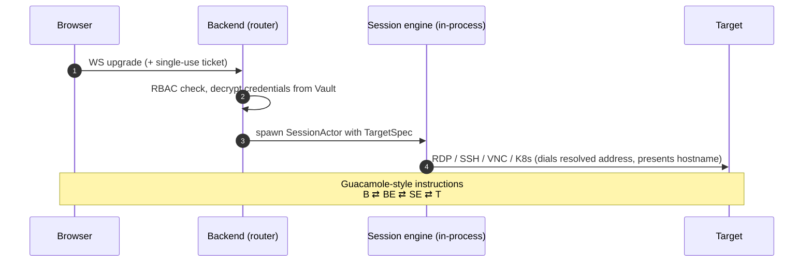

> **Changed in v2.0.0.** There was a fourth participant here: a `guacd`
> process reached over TCP 4822, to which the backend sent a `select` +
> `connect` handshake with the plaintext password injected. Both the hop and
> the handshake are gone. Note what this removes from the diagram besides a
> box — credentials no longer cross a process boundary in the clear, and there
> is no socket between the router and the engine on which to interpose.

#### Session loop: bounded queues, one task per session

The loop lives in
[`backend/src/session_engine.rs`](../backend/src/session_engine.rs) and the
`SessionActor` in
[`crates/strata-session/src/actor/session.rs`](../crates/strata-session/src/actor/session.rs).
The concern that shaped the old proxy loop still applies and is still
addressed, just at a different seam.

The problem: if the output path and the input path share a single point of
backpressure, a burst of draw instructions (the Windows Win+Arrow window-snap
animation emits one in ~200 ms) fills the browser's receive buffer, the send
blocks, and *while it is blocked* the loop cannot service client input. Mouse
and keyboard events queue in the kernel buffer and arrive in bursts. Users
perceive this as rendering freezes, mouse "acceleration" and keyboard lag — a
performance complaint that sounds like a network problem and is not.

The structure that prevents it:

- **`ws.split()`** separates the socket into `sink` and `stream`, polled by
  different arms of one `tokio::select!`.
- **The engine never touches the socket.** `SessionActor::spawn` returns an
  `mpsc::Receiver<ClientFrame>`; the actor produces frames into a **bounded**
  channel (`CLIENT_QUEUE_DEPTH`) and the loop drains it. A browser too slow to
  keep up applies backpressure to the actor, not to the client-input arm.
- **One task per session.** Each session is an independent `tokio::spawn`,
  which is what replaces `guacd`'s process-per-connection isolation. A panic
  is caught at the task boundary and closes that session alone.
- **Observers and the NVR ring buffer** are fed from the same frame the
  operator receives, so a watcher cannot see something the operator did not.

Additional session details:

- Instructions are delimited by `;` and can split across reads. `GuacDecoder`
  ([`crates/strata-session/src/transport/decoder.rs`](../crates/strata-session/src/transport/decoder.rs))
  buffers the remainder.
- The decode buffer is hard-capped at **16 MiB** (`DEFAULT_DECODE_LIMIT`).
  Exceeding it closes the session rather than clearing the buffer — resuming
  mid-token is not safe.
- **Gateway shutdown drops the socket** rather than sending a clean
  disconnect. This is deliberate and easy to get wrong: a disconnect
  instruction tells the browser the *target* hung up, which suppresses its
  automatic reconnect. An abrupt close is both the truth and the behaviour
  that lets the client recover on its own once the backend is back.
- Keepalives: `Ping` every 15 s, disconnect if no `Pong` within 30 s.
- Per-session bandwidth counters (`bytes_down`, `bytes_up`) are updated
  atomically on every frame and flushed to `recordings` at session end.
  These were named `bytes_from_guacd` / `bytes_to_guacd` until v2.0.0;
  migration `089` renames the columns and carries the values across.

- **Web-protocol kiosk eviction (v1.3.0+).** When `protocol == "web"`,
  the tunnel route in [`backend/src/routes/tunnel.rs`](../backend/src/routes/tunnel.rs)
  captures an `Arc<WebRuntimeRegistry>` and the requesting `user_id`
  before the WebSocket upgrade. After `tunnel::proxy` returns
  (success or error), the route calls
  `web_runtime.evict(connection_id, user_id)` to drop the registry's
  reference to the kiosk's `Arc<WebSessionHandle>`. If no other tab is
  holding the same handle, refcount-zero `Drop` SIGKILLs the Chromium
  and Xvnc children (`kill_on_drop(true)`), releases the X-display
  slot (`100..=199`) and CDP port (`9222..=9321`), and removes the
  per-session profile tempdir (with its NSS DB inside). A
  `web.session.end` audit row with `reason: "tunnel_disconnect"` is
  written so the lifecycle event is visible. Before v1.3.0 only the
  idle reaper and process-death paths ran in production, so closing a
  browser tab without first hitting _Disconnect_ leaked the kiosk
  until the reaper caught up.

- Guacamole instructions are delimited by `;` and can be split across
  reads. `GuacDecoder` buffers the remainder rather than re-allocating,
  which matters under a bitmap flood.
- The tunnel ingests non-ASCII WS frames via `str::from_utf8` before
  forwarding; invalid bytes end the session rather than being dropped
  silently.
- Keepalives: `Ping` every 15 s, disconnect if no `Pong` within 30 s.
- Per-session bandwidth counters (`bytes_down`, `bytes_up`)
  are updated atomically on every read/write for the session-metrics
  endpoint.
- **Auth watchdog (v1.3.2; revised v1.4.1).** A 30-second ticker runs
  alongside the proxy loop and forces tunnel teardown on either of
  two conditions: (a) the upgrade-time access token appears in the
  in-memory revocation set
  (`services::token_revocation::is_revoked(token)` — populated by
  `/api/auth/logout`), audit `reason = "revoked"`; or (b) the
  elapsed wall-clock time since the upgrade exceeds
  `MAX_TUNNEL_DURATION = 8h`, audit `reason = "max_duration"`. The
  v1.3.2 implementation also reaped on the access token's `exp`
  claim, but that broke under proactive token rotation — the
  WebSocket cannot learn that the cookie was rotated, so the cached
  `exp` reaped active sessions every 20 minutes; v1.4.1 removes
  that path. Full prose at
  [`docs/security.md` § WebSocket-tunnel auth watchdog](security.md#websocket-tunnel-auth-watchdog-v132-revised-v141).

#### How a session ends (v2.1.1)

Every way a native session can end reaches the browser as **one** Guacamole
`error` instruction — `error,<text>,<status>;` — whose status code says what
*kind* of end it was and whose text says what happened. The browser picks
its overlay title from the code and shows the text as-is. It never has to
infer the kind of end from the wording, which is what it did before v2.1.1
and why a Windows sign-out was titled *Connection Error*.

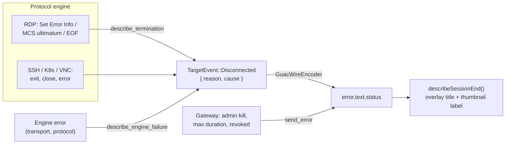

**The cause.** `TargetEvent::Disconnected` carries a human-readable `reason`
and a `cause: DisconnectCause`
([`engine/mod.rs`](../crates/strata-session/src/engine/mod.rs)). Only the
wire encoder
([`transport/guac_wire.rs`](../crates/strata-session/src/transport/guac_wire.rs),
`disconnect_status()`) knows how a cause is spelled on the Guacamole wire, so
engines stay protocol-agnostic:

| `DisconnectCause` | Status | Browser title | Typical source |
| ----------------- | ------ | ------------- | -------------- |
| `Ended` | `0x020B` `SESSION_CLOSED` | Session Ended | Sign-out, Start → Disconnect, shell exit, host time limit |
| `IdleTimeout` | `0x020A` `SESSION_TIMEOUT` | Session Timed Out | Host idle-session limit |
| `Conflict` | `0x0209` `SESSION_CONFLICT` | Session Disconnected | Session opened elsewhere; host administrator disconnect/logoff |
| `Refused` | `0x0208` `UPSTREAM_UNAVAILABLE` | Connection Refused | Host refused, out of memory, licensing, connection broker |
| `Unauthorized` | `0x0301` `CLIENT_UNAUTHORIZED` | Access Denied | No Remote Desktop right; credentials rejected |
| `ConnectionLost` | `0x0203` `UPSTREAM_ERROR` | Connection Lost | TCP reset or timeout; host closed without a reason |
| `Failed` | `0x0200` `SERVER_ERROR` | Connection Error | Protocol violation; a Windows component crashed |

**RDP.** Windows ends a session with a *Set Error Info* PDU carrying a code,
and/or an MCS *Disconnect Provider Ultimatum*. `ironrdp-session` 0.11 does
not expose the code — it renders it through `ErrorInfo::description()`, the
MS-RDPBCGR wording, and returns only the string as
`GracefulDisconnectReason::Other`. `describe_termination()` in
[`engine/rdp/mod.rs`](../crates/strata-session/src/engine/rdp/mod.rs)
recovers the code by rendering each entry of `PROTOCOL_INDEPENDENT_ENDS`
through that same function and comparing. Because both sides of the
comparison come from one function, a rewording upstream cannot break the
match. Codes outside the table are classified by their category tag
(licensing, connection broker, RDP-specific protocol error) with the spec
text kept as detail. The raw reason is logged at `INFO` as
`rdp target ended the session` before translation.

The distinction that matters most to users is between the two
"disconnect" codes. `ERRINFO_RPC_INITIATED_DISCONNECT_BYUSER` (`0x0B`) is the
Start-menu **Disconnect**: the Windows session keeps running and reconnecting
resumes it. The specification describes it as *"initiated by an
administrative tool on the server running in the user's session"*, which is
what users saw before v2.1.1. `ERRINFO_LOGOFF_BY_USER` (`0x0C`) is a real
sign-out, after which reconnecting starts a fresh Windows session.

**Engine failures.** An engine that returns an error rather than a
`Disconnected` event is reported by `describe_engine_failure()` in
[`actor/session.rs`](../crates/strata-session/src/actor/session.rs):
I/O timeouts and resets become `ConnectionLost`, credential rejection
`Unauthorized`, protocol violations `Failed`, and an event stream that ends
with nothing to say `Ended` with *"The remote session has ended."* The
error chain itself is logged, never sent. When the failure surfaces on the
**input** path — a keystroke written to a socket that has just closed —
`end_after_input_failure()` gives the engine up to one second
(`CLOSE_REASON_GRACE`) to yield its own `Disconnected` event first, because
a closed RDP engine has usually queued the real reason and the failed write
would otherwise mask it. Either way, teardown then runs: engine shutdown,
audit-sink finalisation and credential revocation. Before v2.1.1 the input
path returned from the actor with `?` and skipped all three.

**Gateway-initiated ends** bypass the engine and are written by
`send_error()` in
[`backend/src/session_engine.rs`](../backend/src/session_engine.rs):

| Trigger | Text | Status |
| ------- | ---- | ------ |
| Administrator kill | Session terminated by administrator | `SESSION_CONFLICT` |
| `MAX_TUNNEL_DURATION` (8 h) | This session reached the maximum allowed duration and was closed. | `SESSION_CLOSED` |
| Access token revoked | This session was closed because your sign-in was revoked. | `SESSION_CLOSED` |
| Gateway shutdown | *(no instruction — socket dropped so the browser auto-reconnects; see above)* | — |

**Browser.** `describeSessionEnd(message, code)` in
[`frontend/src/utils/sessionEnd.ts`](../frontend/src/utils/sessionEnd.ts)
returns the overlay title, the session-bar thumbnail label, and whether the
end was an administrator termination (recognised by its text, which
suppresses **Reconnect**). `GuacSession.errorCode` is set from
`Guacamole.Status.code` in both `tunnel.onerror` and `client.onerror`
([`SessionManager.tsx`](../frontend/src/components/SessionManager.tsx),
[`SessionClient.tsx`](../frontend/src/pages/SessionClient.tsx)).
`SessionClient` stores the code keyed by the message it arrived with, so a
later client-side error cannot inherit it. With no code — a clean close with
nothing said, or a client-side failure such as exhausted reconnect attempts —
the title falls back to text heuristics.

**Reconnect behaviour is unchanged.** Any `error` instruction marks the end
as server-initiated, so the browser shows the overlay with a **Reconnect**
button rather than retrying on its own. Automatic reconnection remains
reserved for the browser-side tunnel failing (receive timeout, WebSocket
error) with no instruction received, which is the only case where retrying
without asking is always safe.

#### H.264 GFX passthrough (v0.28.0 – v1.14.6; removed in v2.0.0)

> **Restored in v2.1.0** as opt-in native passthrough on `ironrdp-egfx`. The
> current design is documented in [h264-passthrough.md](h264-passthrough.md);
> this section is kept as the record of the `guacd`-era pipeline and of why
> v2.0.0 shipped without it.
>
> **This capability is not in v2.0.0.** It is documented as removed rather
> than deleted, because it is the one user-visible thing the migration cost,
> and an operator who upgrades and finds the `enable-h264` toggle missing
> deserves to find out why here rather than by reading a migration file.
>
> **What replaced it.** The RDP engine
> ([`crates/strata-session/src/engine/rdp`](../crates/strata-session/src/engine/rdp/))
> maintains a full-desktop framebuffer, reports changed rectangles, and
> PNG-encodes them — the same shape `guacd` used for the bitmap path.
> Migration `087` strips `enable-h264` from every connection's `extra` map.
> Nothing was withdrawn in practice: the parameter defaulted to `false` and no
> connection in this deployment had it set.
>
> **Why it was dropped rather than ported.** Not for lack of a route.
> `ironrdp-pdu` 0.6 — the version this tree pins — already carries the
> MS-RDPEGFX PDUs including `Avc420BitmapStream`, `Avc444BitmapStream` and the
> AVC codec ids, and the browser client still understands the custom `h264`
> instruction. What is missing is channel orchestration: `ironrdp-egfx` wants
> `pdu` 0.9 / `dvc` 0.8 / `core` 0.2, beyond the pin held by the `picky`/`russh`
> conflict, so it would have to be written over `ironrdp-dvc` 0.4.
>
> The decisive argument was testability. H.264 requires the **server** to
> encode — xrdp built with x264, or Windows with an AVC hardware encoder — and
> no target available here does. Shipping an untestable video path in a
> privileged-access gateway is a poor trade, and the measured gain is smaller
> than the old release notes implied: the native encoder runs at **0.077 bytes
> per pixel**, roughly 39:1, about **230 kbps** for an active desktop.
>
> **If you need it**, stay on v1.14.6 and open an issue describing the target
> that encodes AVC444, which is the missing piece for building it properly.

<details>
<summary>Historical — the passthrough pipeline (v0.28.0 – v1.14.6)</summary>

RDP H.264 frames travelled **end-to-end without a server-side transcode
step**. The path was:

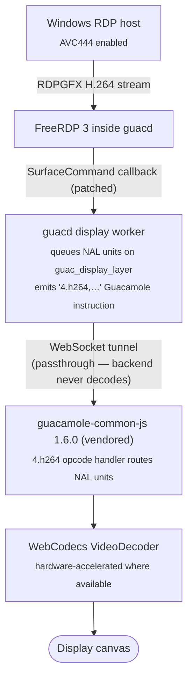

The four cooperating components:

1. **`guacd/patches/004-h264-display-worker.patch`** — a byte-identical
   port of upstream `sol1/rustguac`'s H.264 display-worker patch
   (SHA `7a13504c2b051ec651d39e1068dc7174dc796f97`). Hooks FreeRDP's
   RDPGFX `SurfaceCommand` callback, queues AVC NAL units on each
   `guac_display_layer`, and emits them as a custom `4.h264` Guacamole
   instruction during the per-frame flush. **Superseded** the v0.27.0
   `004-refresh-on-noop-size.patch` at the same path.
2. **Vendored `guacamole-common-js` 1.6.0**
   ([`frontend/src/lib/guacamole-vendor.js`](../frontend/src/lib/guacamole-vendor.js)) —
   bundles `H264Decoder`, the `4.h264` opcode handler, and a sync-point
   gate `waitForPending` that prevented the decoder being asked to flush
   before its pending-frame queue had drained. **Stock
   `guacamole-common-js` does not handle the `h264` opcode**; the vendored
   bundle is still shipped, because the rest of it is what the client uses.
3. **Backend RDP defaults** — `full_param_map()` seeded `color-depth=32`,
   `disable-gfx=true`, `enable-h264=false`, `force-lossless=false`,
   `cursor=local`, plus the explicit `enable-*` / `disable-*` toggles that
   FreeRDP's `settings.c` required (empty ≠ `"false"` in many guacd code
   paths). The handshake driver gated `video/h264` mimetype advertisement
   on the resolved `enable-h264` value, so leaving GFX or H.264 disabled
   fell back to the bitmap path silently even on AVC444-capable hosts.
4. **Connection-form GFX/H.264 interlock (v1.1.0+)** — the RDP Codecs panel
   rendered _Enable graphics pipeline (GFX)_ as ticked only when
   `disable-gfx === "false"`, and disabled _Enable H.264 (AVC444)_ whenever
   GFX was off, so the form could not be saved into an unreachable state.
5. **Windows host AVC444 configuration** — the helper script
   [`docs/Configure-RdpAvc444.ps1`](Configure-RdpAvc444.ps1) audits the host
   registry, detects whether a hardware GPU is usable, and prompts before
   applying the recommended values. Operator runbook:
   [`docs/h264-passthrough.md`](h264-passthrough.md).

Verification flowed in priority order:

1. **Authoritative** — Windows Event Viewer →
   `Applications and Services Logs > Microsoft > Windows > RemoteDesktopServices-RdpCoreTS > Operational`:
   - Event ID **162** = AVC444 mode active
   - Event ID **170** = hardware encoding active
2. guacd logs included `H.264 passthrough enabled for RDPGFX channel`
3. WebSocket trace showed `4.h264,…` instructions in DevTools Network
4. `client._h264Decoder?.stats()` showed `framesDecoded > 0`

If the host was not configured for AVC444, `enable-h264=true` was a no-op:
guacd loaded the H.264 hook (visible in logs) but no `SurfaceCommand`
callbacks fired and the session fell back silently to the bitmap path.

</details>

**Known limitation — DevTools-induced ghosting**: Chromium-based
browsers throttle GPU-canvas compositing and `requestAnimationFrame`
cadence on tabs whose DevTools panel is open. Cached tile blits fall
behind the live frame stream and the user perceives ghosting that
resembles a codec problem but is not. Closing DevTools (or detaching
to a separate window) restores normal compositor behaviour. This is
not fixable in the Strata client.

### Backend SSH defaults (v1.3.1+)

The SSH engine seeds a set of defaults so a brand-new SSH connection
behaves sensibly without admin configuration:

| Parameter               | Default          | Why                                                                                                                                                                        |
| ----------------------- | ---------------- | -------------------------------------------------------------------------------------------------------------------------------------------------------------------------- |
| `terminal-type`         | `xterm-256color` | Exported as `TERM` on the remote PTY. Without it OpenSSH defaults to `TERM=linux`, which does not advertise `smcup`/`rmcup` and breaks `nano` / `less` alt-screen restore. |
| `color-scheme`          | `gray-black`     | Without it the palette falls back to `black-white` and inverts most users' expectations.                                                                                   |
| `scrollback`            | `1000`           | Lifts the in-buffer line count above the historical ~256 default.                                                                                                          |
| `font-name`             | `monospace`      | Resolved through `fontdue` against `fonts-dejavu-core`, which the backend image installs explicitly rather than inheriting from Chromium's dependency closure.             |
| `font-size`             | `12`             | Drives the terminal rasteriser's glyph cache.                                                                                                                              |
| `backspace`             | `127`            | DEL — what every modern Linux distro ships as the SSH default; stops `^?` characters appearing on Backspace, and matches xterm. Sending BS instead breaks `readline` editing on essentially every modern target. |
| `locale`                | `en_US.UTF-8`    | Required for UTF-8 box-drawing characters in `htop`, `mc`, `tmux` status bars.                                                                                             |
| `server-alive-interval` | `0`              | Disables engine-side keepalives — the tunnel's own ping/pong already provides liveness.                                                                                    |

> **Note.** `terminal_font` on `GET /api/admin/health` reports whether a
> usable monospace face was found. `false` breaks SSH and Kubernetes
> rendering outright, which is why it is surfaced on the Health page rather
> than left to a log line.

#### H.264 GFX reference-frame corruption (recovery path in v0.27.0)

> **Status — historical.** Superseded by the v0.28.0 passthrough decoder,
> and moot since v2.0.0: with no H.264 pipeline at all, there is no
> delta-compressed reference chain to desynchronise. Both the forked-guacd
> patch and the Refresh Display button are gone. Retained for context,
> because the failure mode is a good illustration of why an untestable
> video path was not worth carrying into the rewrite.

<details>
<summary>Historical — Refresh Rect ghost recovery (v0.27.0)</summary>

With `enable-gfx-h264=true` (the default for RDP connections), FreeRDP
hands decoded H.264 NAL units to guacamole-common-js's `VideoPlayer`
which renders them to the display canvas. H.264 is a delta-compressed
codec: every P-frame references one or more prior frames. If the
reference chain desynchronises between the server-side encoder and the
in-browser decoder — for example, a packet reordering window during a
rapid series of window minimise/maximise animations that briefly
exceeds the GFX cache ceiling — the browser continues to decode
subsequent deltas against a now-wrong reference. Visually, this appears
as multiple overlapping window states composited on one canvas.

v0.27.0 ships an in-session recovery path: the forked guacd
([`guacd/patches/004-refresh-on-noop-size.patch`](../guacd/patches/004-refresh-on-noop-size.patch))
intercepts a Guacamole `size W H` instruction whose dimensions match
the current remote desktop size (a no-op resize) and sends an RDP
`Refresh Rect` PDU to the RDP server via
`context->update->RefreshRect()`. Refresh Rect asks the server to
retransmit the specified region; on Windows servers this is expected
to be emitted as an H.264 IDR keyframe that resets the decoder's
reference-frame chain. A 1-second per-session cooldown guards against
accidental flooding. The Refresh Display button in `SessionBar` wires
a compositor nudge AND a no-op `client.sendSize(cw, ch)` through
`manualRefresh()` in `SessionClient.tsx` to drive this path.

Server-dependent behaviour: MS-RDPEGFX specifies Refresh Rect as valid
in GFX mode but does not mandate that servers emit an IDR keyframe in
response. On Windows 10/11 and Windows Server 2019/2022 the ghost is
expected to clear within one frame; on non-Microsoft or legacy RDP
targets this may be a no-op. Two fallback workarounds remain:

- **User-driven**: the Reconnect button in `SessionBar` performs a full
  `client.disconnect()` + re-establish, which cleanly re-initialises the
  codec state on both ends.
- **Operator-driven**: the Admin → Connection form's **Disable H.264
  codec** toggle (which writes `enable-gfx-h264=false` into the extras
  map) falls back to the RemoteFX codec, which has no cross-frame
  reference chain and cannot exhibit this class of ghost at the cost of
  2–4× higher bandwidth.

Approach note: the no-op-size-hijack was chosen over defining a new
Guacamole protocol opcode (e.g. a `refresh` instruction) so that stock
`guacamole-common-js` — which Strata does not fork — continues to work
unchanged. Stock guacd silently ignores a no-op resize, so the
frontend change is also safe to run against an un-patched guacd (the
compositor nudge still fires, the sendSize is a harmless no-op). The
extension is invisible at the wire-protocol layer.

</details>

### Envelope Encryption (Credential Save)

```
1. Rust generates random 32-byte DEK
2. Rust encrypts password with DEK (AES-256-GCM) → ciphertext + nonce
3. Rust sends plaintext DEK to Vault POST /transit/encrypt/guac-master-key
4. Vault returns wrapped DEK (vault:v1:base64...)
5. Rust stores (ciphertext, wrapped_dek, nonce) in PostgreSQL
6. Rust zeroizes plaintext DEK from memory
```

### Envelope Decryption (Tunnel Handshake)

```
1. Rust fetches (ciphertext, wrapped_dek, nonce) from PostgreSQL
2. Rust sends wrapped DEK to Vault POST /transit/decrypt/guac-master-key
3. Vault returns plaintext DEK
4. Rust decrypts password with DEK (AES-256-GCM)
5. Rust hands the plaintext password to the in-process session engine
   (`secrecy::SecretString`; never crosses a process boundary, redacted in `Debug`)
6. Rust zeroizes DEK and password from memory
```

### Transactional-Email Pipeline

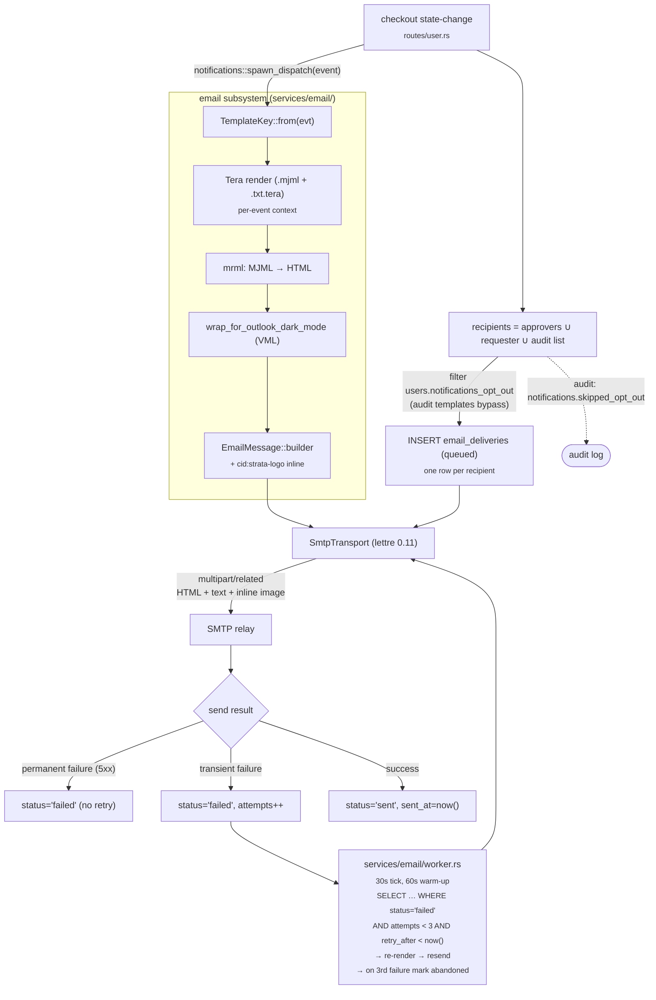

**Why MJML?** MJML compiles to table-based HTML that survives every major
client (Gmail, Outlook desktop/web/mobile, Apple Mail, Thunderbird, K-9).
Hand-rolling that markup is fragile; generating it from MJML lets the
templates focus on layout intent rather than client quirks. The renderer
runs server-side via the [`mrml`](https://github.com/jdrouet/mrml) Rust
port — no Node.js round-trip is required at boot or at send time.

**Outlook dark-mode wrapper.** `wrap_for_outlook_dark_mode` adds a VML
namespace on `<html>`, a full-bleed `<v:background fill="t">` rectangle
inside an `<!--[if gte mso 9]>` conditional, and an Outlook-only
stylesheet. VML backgrounds are immune to Outlook desktop's dark-mode
inversion engine, so the result is a clean dark-themed email even on
Outlook for Windows in dark mode. Future templates inherit the fix
automatically.

**Standalone templates only.** mrml's XML parser does not tolerate
Tera's `` mechanism (whitespace from the include directive
breaks parsing at the section/column boundary). Each of the four
templates is therefore self-contained: no `_header.mjml` /
`_footer.mjml` partials, no `<mj-attributes>` block, font-family set
per-element. Context values are escaped through a custom `xml_escape`
helper (only the five XML-significant characters: `& < > " '`) — using
`ammonia::clean_text` over-escapes (it encodes spaces as `&#32;`) and
breaks rendering.

**Vault-sealed SMTP password.** The SMTP password is never stored in
`system_settings`. It is sealed via the existing
`crate::services::vault::seal_setting` helper and unsealed at send time.
The `PUT /api/admin/notifications/smtp` endpoint refuses to save
credentials when Vault is sealed or running in stub mode — a
half-configured install should fail loudly rather than silently leak the
password to disk in plaintext.

**Dispatcher hooks.** Five call sites invoke
`notifications::spawn_dispatch`:

| Call site                                                                 | Event                                                                                                                         |
| ------------------------------------------------------------------------- | ----------------------------------------------------------------------------------------------------------------------------- |
| `routes/user.rs::request_checkout` (Pending branch)                       | `CheckoutEvent::Pending` → all approvers for the target account                                                               |
| `routes/user.rs::request_checkout` (SelfApproved branch)                  | `CheckoutEvent::SelfApproved` → audit recipients (bypasses opt-out)                                                           |
| `routes/user.rs::decide_checkout` (Approved branch)                       | `CheckoutEvent::Approved` → original requester                                                                                |
| `routes/user.rs::decide_checkout` (Rejected branch)                       | `CheckoutEvent::Rejected` → original requester                                                                                |
| `routes/outbound_shares.rs::submit` (non-bypass, queued branch, v1.12.2+) | `OutboundShareEvent::Pending` → approvers (`roles.can_manage_system = true` ∪ `outbound_share_approvers`) minus the requester |

`spawn_dispatch` is fire-and-forget — it returns immediately so the
user-facing checkout request is never blocked by mail delivery. All
errors are logged via `tracing` and visible in `email_deliveries`.

**Tenant base URL resolution (v1.12.2+).** Every template that renders
a link back into the SPA (`approval_url` / `share_url` / etc.) reads
the tenant URL through `services::settings::tenant_base_url(pool)`,
which resolves in three deterministic tiers:

| Tier | Source                            | Picked when                                       |
| ---- | --------------------------------- | ------------------------------------------------- |
| 1    | `system_settings.tenant_base_url` | Admin entered a value (non-empty after trim)      |
| 2    | `BASE_URL` env var                | Tier 1 is empty and `BASE_URL` is set + non-empty |
| 3    | `https://strata.local`            | Tiers 1 and 2 both empty (last-resort)            |

All four email-render entry points
(`notifications::build_context`,
`notifications::build_outbound_share_context`, `email::worker`
rebuild path, `routes/notifications::sample_context` preview) share
the helper, so the resolution order is identical regardless of
whether the email was rendered on the originating dispatch, on a
retry from the worker, or in the admin preview panel. The previous
behaviour (hardcoded `https://strata.local` fallback) is preserved
only as Tier 3 — deployments that export `BASE_URL` in `.env`
automatically get a working email-link target without touching the
admin UI.

## Command Palette (v0.31.0)

The in-session Command Palette (default `Ctrl+K`, user-rebindable per
v0.30.1) exposes both **connection search** (typed text without a
leading colon) and a **scriptable command surface** (typed text with a
leading colon). The command surface is composed of two registries:

1. **Built-in commands** — hard-coded in
   [`frontend/src/components/CommandPalette.tsx`](../frontend/src/components/CommandPalette.tsx).
   Names: `reload`, `disconnect`, `close`, `fullscreen`, `commands`,
   `explorer`. Built-in
   handlers reuse the same primitives as the SessionBar (e.g.
   `requestFullscreenWithLock`) so behaviour is identical regardless of
   how the action is invoked. Built-in names are reserved — user
   mappings cannot collide with them.
2. **User mappings** — sourced from `user_preferences.preferences ->
commandMappings` (JSONB array, max 50 entries per user). Each
   mapping is a discriminated union with `trigger`, `action`, and
   `args`. The six allowed actions are `open-connection`, `open-folder`,
   `open-tag`, `open-page`, `paste-text`, and `open-path`; the
   `open-page` `args.path` is locked to the seven-value enum
   `/dashboard | /profile | /credentials | /settings | /admin | /audit | /recordings`,
   `paste-text` `args.text` is capped at 4096 characters, and
   `open-path` `args.path` is capped at 1024 characters and rejected
   if it contains any control characters. The `paste-text` action
   writes `args.text` to the active session's remote clipboard via
   `sendClipboardToRemote(session, text, source, { force: true })` in
   [`clipboardSync.ts`](../frontend/src/components/clipboardSync.ts) —
   which serialises behind any in-flight clipboard transfer and
   `force`-bypasses duplicate suppression, because the Ctrl+V that
   follows is worthless if the cached belief about the remote
   clipboard turns out to be stale — then fires a Ctrl+V
   keystroke (keysyms `0xffe3` + `0x76`) so the focused remote
   application actually receives the paste. The `open-path` action
   drives the Windows Run dialog on the remote target: it sends Win+R
   (keysyms `0xffeb` + `0x72`), pastes the path the same way, then
   sends Enter (`0xff0d`) — which makes Explorer (or whichever app is
   registered for that URI scheme) open the path. The audit stream
   logs only `{ text_length }` / `{ path_length }` for these two
   actions so potentially sensitive payloads never leave the
   originating user's preferences blob.

Validation is enforced server-side inside
[`backend/src/services/user_preferences.rs`](../backend/src/services/user_preferences.rs)
(`validate_command_mappings`), so a frontend that bypasses client-side
checks still cannot poison the database.

### Resolver and ghost-text autocomplete

When the input starts with `:`, the palette merges the built-in registry
with the user's mappings into a single sorted candidate list. Two
quantities are derived from that list and the current query:

- `matchingCommands` — every candidate whose name starts with the
  query slug. Drives the inline `:commands` listing and the empty
  state.
- `ghostSuffix` — the longest common prefix shared by every member of
  `matchingCommands` minus the already-typed slug. Rendered in a
  zero-position-offset, `pointer-events-none`, `opacity: 0.35`
  overlay. **Tab** or **Right Arrow** (when the caret is at end-of-
  input) commits the suggestion.

### Audit flow

Every successful command execution writes one immutable, hash-chained
`command.executed` row to the `audit_logs` table via the new
fire-and-forget endpoint:

```
frontend executeCommand()
  ├── await postCommandAudit({ trigger, action, args, target_id })   // best-effort, .catch swallowed
  └── run the action (navigate / disconnect / reload / fullscreen)
```

The audit POST is intentionally invoked _before_ the action runs so
the audit row captures intent even if the action throws. The endpoint
([`POST /api/user/command-audit`](api-reference.md#post-apiusercommand-audit))
hard-codes `action_type = "command.executed"` server-side; client-side
poisoning of the audit-event taxonomy is impossible. The chain-hash
integrity guarantees described in
[security.md → Audit Trail](security.md#audit-trail) apply uniformly to
this stream.

### Open-session prioritisation (v1.12.4)

The connection-search path (typed text **without** a leading colon)
sorts the filtered list into three stable rank buckets after the
existing query filter runs, so the most useful target is always
the default selection:

| Rank | Bucket                                            |
| :--: | :------------------------------------------------ |
|  0   | Open session you are **not** currently looking at |
|  1   | Open session you **are** currently looking at     |
|  2   | Connection that is not open                       |

The ranks are derived from two render-time helpers:

- `activeConnectionIds: Set<string>` — already-present pre-render
  set, computed once per render via
  `new Set(sessions.map((s) => s.connectionId))`. Also drives the
  green **Active** pill on each row.
- `activeConnectionId: string | null` — the connection id of the
  session the user is currently focused on, resolved by
  intersecting `sessions` with the existing `activeSessionId`
  from `useSessionManager()` (`sessions.find((s) => s.id ===
activeSessionId)?.connectionId ?? null`).

ECMAScript 2019+ specifies `Array.prototype.sort` as **stable**,
so the relative order **within** each rank bucket is preserved:
open sessions don't reshuffle when another session opens or
closes (only the bucket boundaries shift), and inactive
connections continue to appear in exactly the same API order they
always did beneath the open sessions. The existing green
**Active** pill on rows visually reinforces the new ordering
without needing a section header.

The result: with two open sessions and the user focused on one of
them, pressing `Ctrl+K → Enter` jumps straight to the **other**
open session (the fastest possible session-switch). The
currently-displayed session sits at rank 1 (one keystroke away),
which keeps it cheap to re-focus or reconnect when the operator
actually wants that. Inactive connections at rank 2 preserve
muscle memory for users who have internalised the existing
presentation order over the past six minor versions.

The colon-prefixed `:command` surface is unaffected — built-in
and user-mapped commands render in their existing fixed-order
registry regardless of session state, and the ghost-text
autocomplete and audit-row emission paths are unchanged. The
pop-out vanilla-DOM palette
([`utils/popoutPalette.ts`](../frontend/src/utils/popoutPalette.ts))
is also unchanged — it serves a single pop-out window's own
session-switcher, where the three-bucket rank is not meaningful.

### Pop-out Command Palette (v1.5.1)

When a session is detached into its own pop-out window the main
React-rooted Command Palette cannot render — the popup has its own
`Window`, no React root, and no router context. Pressing `Ctrl+K`
inside a pop-out instead opens a deliberately small **vanilla-DOM
palette** rendered directly in the popup's `document`
([`frontend/src/utils/popoutPalette.ts`](../frontend/src/utils/popoutPalette.ts)):
dimmed backdrop, search input, filterable connection list. It fetches
the user's connections lazily through the existing
`getMyConnections()` (the popup is `about:blank`, opened by
`window.open()` from the same origin, so it shares the opener's JS
realm and cookies — no second auth round-trip) and posts the chosen
connection back to the opener as a same-origin `postMessage`:

```js
opener.postMessage(
  { type: "strata:open-connection", id },
  opener.location.origin,
);
```

The opener's [`CommandPaletteProvider`](../frontend/src/components/CommandPaletteProvider.tsx)
validates the id (`typeof === "string"`, length 1–255) and navigates
to `/session/${encodeURIComponent(id)}`, reusing the existing
routed-launch flow. The palette intentionally does **not** register
its own document keydown listener — doing so would race against the
`Guacamole.Keyboard` capture-phase listener that the pop-out already
installs on `popup.document`. Instead the popup's existing
`trapKeyDown` (registered _before_ `new Guacamole.Keyboard(popup.document)`)
delegates to `popoutPalette.handleKeyDown(e)`. While the palette is
open the trap returns `true` from `Guacamole.Keyboard.onkeydown` —
the contract is inverted: returning `true` means "do not
`preventDefault`", so the `<input>` element receives typed characters
normally — and `onkeyup` early-returns. Filter matches against
`name`, `hostname`, and `protocol` (case-insensitive substring);
arrow keys cycle with wrap-around; Enter activates; Escape closes;
mousedown on a row activates; mousedown on the dimmed backdrop
closes.

The same registration-order fix (trap before `Guacamole.Keyboard`)
makes `F11` toggle the pop-out's local fullscreen and `F12`
preventDefault locally instead of forwarding to the remote desktop.
A `pagehide` handler on the opener calls `popup.close()` for every
tracked pop-out so an opener crash / hard navigation no longer leaves
orphaned pop-out windows.

## Database Schema

```
system_settings ──── key/value config store (now excluding OIDC settings)
sso_providers ────── multi-tenant OIDC configurations (provider_id, name, issuer, client_id, vault-sealed client_secret)
users ──────────────── OIDC subject, username, role FK
roles ────────────── name, description (v2.2.0, migration 090) and eleven permission flags
                       (can_manage_system, can_manage_users, can_manage_connections,
                       can_view_audit_logs, can_view_sessions, can_create_users, can_create_user_groups,
                       can_create_connections, can_create_sharing_profiles,
                       can_use_quick_share — user-facing, excluded from admin-surface checks,
                       can_use_quick_share_outbound — v1.11.0+, user-facing; can_manage_system also passes
                       its checks except the HTTPS-snippet consume re-check). What each flag enforces:
                       security.md § Granular Admin Permissions
connections ──────── target host, protocol, port, domain, description, folder_id FK (ON DELETE SET NULL),
                       extra (JSONB parameters), health_status, health_checked_at, soft_deleted_at
connection_folders ─ folder hierarchy with parent_id self-reference (ON DELETE CASCADE); named
                       connection_groups until migration 023
role_connections ──── many-to-many role ↔ connection (direct grants)
role_folders ──────── many-to-many role ↔ folder (migration 024). Grants the connections whose
                       folder_id equals the folder — NOT connections in its subfolders
user_credentials ──── encrypted password + DEK + nonce per user/connection
credential_profiles ─ saved credential profiles with optional TTL expiry, optional per-profile extended_expiry flag (raises the cap from 12 h to 2160 h / 90 d, enforced by the `chk_ttl_hours` two-arm CHECK constraint), and optional checkout_id link to password management
user_favorites ────── user ↔ connection favorites (composite PK)
connection_shares ── temporary share links with mode (view/control); viewers observe via NVR broadcast. v1.9.6+ adds `multiplayer BOOLEAN`, `max_participants SMALLINT CHECK (1..6)`, `allow_chat BOOLEAN`, `allow_audio BOOLEAN` for the co-pilot extension
share_participant_audit ─ v1.9.6+ per-participant join/leave audit rows for multiplayer shares: share_id FK, pid (server-issued UUID), display_name, is_owner, joined_at, left_at, client_ip, user_agent
kerberos_realms ──── multi-realm Kerberos config (realm, KDCs, admin server, lifetimes)
ad_sync_configs ──── AD LDAP source configs (URL, auth, search bases, PM search bases, filter, schedule, CA cert, connection_defaults)
ad_sync_runs ─────── per-config sync run history with stats
recordings ─────── session recording metadata with bandwidth metrics
active_sessions ── per-user login session tracking (JTI, IP, user agent, expiry)
approval_roles ──── named approval roles for password management
approval_role_assignments ── many-to-many user ↔ approval role
approval_role_accounts ──── explicit scope: approval role ↔ managed AD account DN
user_account_mappings ───── user ↔ managed AD account (with self-approve flag)
password_checkout_requests ─ checkout lifecycle tracking (Pending/Approved/Active/Expired/Denied/CheckedIn, timestamps, Vault-sealed password)
email_deliveries ──── transactional-email audit trail (template_key, recipient, subject, status, attempts, last_error, related_entity_type/id) — status ∈ {queued,sent,failed,bounced,suppressed}
users.notifications_opt_out ─ boolean column; honoured by every transactional message except the self-approved audit notice
user_preferences ──── per-user UI preferences blob (JSONB, schema owned by the frontend, validated server-side); keys: `commandPaletteBinding` (default `"Ctrl+K"`, added v0.30.1), `commandMappings` (default `[]`, added v0.31.0 — array of typed `:command` palette mappings, max 50 entries, validated by `services::user_preferences::validate_command_mappings`)
users.outbound_share_requires_approval ─ v1.11.0+ boolean, default true; when false and the submission's DLP score is below AUTO_APPROVE_THRESHOLD, an outbound share is released directly without queueing for approver review
outbound_shares ──── v1.11.0+ Outbound Quick-Share submissions: id (uuid), user_id FK, session_id, connection_id, filename, byte_len, mime_type, justification, sealed_dek (Vault-Transit ciphertext), ciphertext_path, dlp_score, dlp_flags (text[]), status (pending|approved|denied|downloaded|purged), decision_user_id FK, decision_reason, decision_at, download_token, download_token_used_at, expires_at, created_at, updated_at. **v1.12.0+:** four nullable AV columns persist the per-row scanner verdict: `av_scan_status` (clean|infected|skipped|error), `av_signature` (engine-reported signature on infected rows), `av_scanned_at` (TIMESTAMPTZ), `av_scanner_backend` (off|clamav|command). A partial index `idx_outbound_shares_av_attention (av_scan_status) WHERE status IN ('infected','error')` keeps the operator dashboard query cheap. **v1.12.1+:** these same columns back the new `GET /api/admin/files/av-blocked` endpoint, which joins them with the inbound `file.av_blocked` audit stream so the Admin → AV-Blocked Files tab can render both pipelines in a single chronological grid without two round-trips.
outbound_share_approvers ─ v1.11.0+ approver-delegation list: user_id FK (PK), added_by FK, added_at. Super-admins (can_manage_system) are implicit approvers; this table grants approval authority to non-admin users (e.g. compliance officers). The /me response sets `is_outbound_approver = true` when the calling user appears in this table.
outbound_share_ingest_tokens ─ v1.11.0+ single-use HTTPS upload tokens backing the snippet path: token (PK, 32-byte URL-safe base64), user_id FK, session_id, connection_id, justification, expires_at (mint + 10 min), used_at (nullable; atomic SET on first consume), created_at. Atomically consumed by `UPDATE … SET used_at = now() WHERE token = $1 AND used_at IS NULL AND expires_at > now()`. Reaped daily by user_cleanup.
```

See `backend/migrations/001_initial_schema.sql` through `092_prune_shipped_roadmap_statuses.sql` for the full DDL.

## Multiplayer / Co-Pilot Mode (v1.9.6+)

Strata's share links graduate from a strict 1:1 (owner ↔ single viewer) model to a multi-participant **co-pilot** room when the share is flagged `multiplayer = true`. The feature is opt-in per share, gated on `mode = "control"`, clamped to `1..=6` participants, and globally killable via the `multiplayer_share_enabled` system setting.

### Two-WebSocket architecture

A multiplayer share is served by **two** sibling WebSockets on the existing public surface:

| Path                                            | Wire                | Purpose                                                                                                                                                                         |
| ----------------------------------------------- | ------------------- | ------------------------------------------------------------------------------------------------------------------------------------------------------------------------------- |
| `/api/shared/tunnel/{share_token}?pid=<uuid>`   | Guacamole protocol  | Screen frames out, optional input back. Input is forwarded to the owner only when `room.note_input_activity(pid)` confirms the participant currently holds the **input token**. |
| `/api/shared/copilot/{share_token}?name=<name>` | JSON envelopes only | Bidirectional control plane: roster, cursors, chat, input arbitration, audio (reserved). Frame demux by leading byte: `{` → envelope, otherwise rejected.                       |

The split exists because `Guacamole.WebSocketTunnel` on the client cannot parse JSON frames interleaved with Guacamole instructions. Single-viewer shares are unaffected — they ignore the copilot endpoint entirely and the tunnel endpoint accepts an absent `pid` query parameter without any gating.

### Envelope protocol

Envelopes are tagged unions with `#[serde(tag = "type", rename_all = "snake_case")]`. The authoritative definition lives in `backend/src/services/co_pilot.rs`; a hand-mirrored TypeScript copy lives in `frontend/src/co-pilot/protocol.ts`. The variants:

| Variant                                | Direction       | Notes                                                                                                                      |
| -------------------------------------- | --------------- | -------------------------------------------------------------------------------------------------------------------------- |
| `hello`                                | client → server | Optional opening envelope. Carries `display_name` and `want_audio`. The server also accepts the equivalent `?name=` query. |
| `welcome`                              | server → client | First server reply on a successful join. Carries `pid`, `allow_chat`, `allow_audio`, `max_participants`.                   |
| `roster`                               | server → all    | Snapshot of the room (pid, display_name, color, has_input, is_owner). Re-broadcast on every membership / token change.     |
| `cursor`                               | client ↔ server | Display-space pointer coordinates. Pid is re-stamped server-side; throttled to ~30 Hz on the client.                       |
| `chat`                                 | client ↔ server | Plain-text message ≤ 500 bytes; dropped when `allow_chat = false`. Pid is re-stamped server-side.                          |
| `input_claim`                          | client → server | Request the input token. Runs `try_claim_input` FSM: owner force-grant; otherwise grant if idle ≥ 2 s; otherwise denied.   |
| `input_release`                        | client → server | Voluntary release. Token transfers to the owner if currently held by a peer, else cleared.                                 |
| `input_grant`                          | server → all    | Token-holder change broadcast. Companion to the new `roster`.                                                              |
| `input_revoke`                         | server → all    | Owner-initiated revoke with a short reason string.                                                                         |
| `audio_offer` / `audio_answer` / `ice` | client ↔ server | WebRTC SDP/ICE relay for the future audio mesh. Pid is re-stamped server-side; dropped when `allow_audio = false`.         |
| `leave`                                | server → all    | Participant cleanly disconnected.                                                                                          |
| `join_error`                           | server → client | Sent immediately before close on a failed join. `reason ∈ {"room_full", "empty_name"}`.                                    |

Bound-checks (`MAX_DISPLAY_NAME_LEN = 40`, `MAX_CHAT_LEN = 500`, `MAX_SDP_LEN = 8192`, `MAX_ICE_CANDIDATE_LEN = 1024`, `MAX_REVOKE_REASON_LEN = 120`) run in `CoPilotMsg::validate()` and are enforced before any fanout.

### `CoPilotRoom` — per-session arbitration

One `Arc<CoPilotRoom>` lives on every `ActiveSession` (always instantiated, zero-cost when no multiplayer share is open). Internally it holds a `std::sync::RwLock<RoomState>` (no `.await` is ever held across the lock) plus a `tokio::sync::broadcast::Sender<Arc<String>>` fanout channel sized for 1024 envelopes. The state machine guarantees:

- **Single-holder input token.** Exactly zero or one participant holds the token at any time; the owner implicitly starts holding it on first peer join.
- **Owner force-grant.** Any `input_claim` from the owner is granted unconditionally and transfers the token from whichever peer held it.
- **Idle-grant.** A peer claim is granted automatically when the current holder has been input-idle for ≥ 2 seconds (`INPUT_IDLE_GRANT_AFTER`). This is what `note_input_activity()` on the tunnel WS feeds.
- **Voluntary release.** `input_release` transfers the token to the owner if the owner is in the room, else clears it.
- **Revoke.** The owner can revoke at any time; a `revoke` envelope is broadcast with a reason string.
- **Colour allocation.** An 8-entry deterministic palette (blue, emerald, amber, red, violet, pink, teal, orange) is allocated round-robin in `join_order`.
- **Name disambiguation.** Whitespace-collapsed; empty rejected with `join_error: "empty_name"`; collisions get a `" (n)"` suffix up to 99.

The full table of variants, their validation arms, and the 17-test FSM coverage lives in `backend/src/services/co_pilot/room.rs`.

### Audit and forensics

Every join, leave, and token transition is captured in two places:

1. **`share_participant_audit`** rows — one row per participant per session, with `joined_at` stamped on join and `left_at` filled in on disconnect. Includes `client_ip` and `user_agent` for attribution.
2. **`audit_log`** events — `share.multiplayer.joined` and `share.multiplayer.left` events flow into the same forensic stream as every other security-relevant event.

The dedicated table exists so multiplayer queries don't have to scan the full audit log; the audit-log events exist so the multiplayer activity shows up in the same view as logins, role changes, and password checkouts.

### Operator kill switch

The system setting `multiplayer_share_enabled` (default `"true"` — never seeded, absence means enabled) is consulted by `routes::share::create_share` on every multiplayer-share creation. When the value is exactly `"false"` the route silently downgrades the request to a standard single-viewer control share. Toggle off without redeploying:

```sql
INSERT INTO system_settings (key, value) VALUES ('multiplayer_share_enabled', 'false')
ON CONFLICT (key) DO UPDATE SET value = EXCLUDED.value;
```

### Deferred for a follow-up release

- **Audio mesh client.** `allow_audio`, the envelope variants (`audio_offer` / `audio_answer` / `ice`), and the server-side validation are all wired through, but the 1.9.6 frontend does not implement a WebRTC peer mesh.
- **Owner-side participant view.** The 1.9.6 owner sees the screen and can revoke; they don't see peer cursors or the chat panel in their own session view. A future commit will add a `/api/user/sessions/:id/co-pilot` endpoint and reuse `CoPilotOverlay` from the owner's `SessionManager`.

### v1.10.3 — owner participation, force-grant, and audio

The two carve-outs above are now closed:

- **Owner-side participant view.** A new authenticated WebSocket
  `GET /api/user/shared/copilot/{share_token}` lets the connection
  owner join their own multiplayer room with `is_owner = true`. The
  handler verifies share ownership, picks `display_name` from the
  authenticated user (`full_name` or `username`), and reuses
  `copilot_room_loop` with the owner flag threaded through. The
  frontend `useCoPilotRoom` hook gained an `asOwner` flag and
  `SessionClient` mounts `CoPilotOverlay` whenever the active
  session has an `mpShareToken`. The public
  `/api/shared/copilot/{share_token}` endpoint is unchanged for
  invited viewers.
- **Owner force-grant route.** `POST
/api/user/shared/copilot/{share_token}/grant/{target_pid}` exposes
  the room's existing `force_grant` FSM transition over HTTP. The
  handler verifies share ownership, looks up an owner pid in the
  room for the `InputGrant.by` attribution, broadcasts
  `input_grant` + `roster`, and writes a
  `connection.copilot_force_grant` audit row. The overlay renders a
  "Give" button next to every roster row that doesn't currently
  hold the token (owner only).
- **WebRTC full-mesh audio.** The `audio_offer` / `audio_answer` /
  `ice` envelopes are now backed by `useCoPilotAudio`, a frontend
  hook that owns a full-mesh `RTCPeerConnection` map (implicitly
  capped at 6 peers by the room limit). STUN-only via
  `stun:stun.l.google.com:19302`. Lower-lexicographic pid is the
  offerer to avoid glare. ICE candidates received before
  `setRemoteDescription` are buffered per peer and flushed after
  the SDP exchange. Mic acquisition is strictly opt-in via the
  overlay's **Join audio** / **Leave audio** toggle; toggling off
  tears down every PC + stops the local stream.

## Safeguard JIT credential checkout (v1.10.0+)

v1.10.0 ships a first-class integration with **OneIdentity Safeguard for
Privileged Passwords** that lets a credential profile carry a Safeguard
`AccountID` + asset reference instead of a locally-stored password.
Each tunnel resolves its credentials through a just-in-time (JIT) REST
dance against the appliance at the moment of connection, with an
optional Vault-sealed cache for the duration of a user's shift and a
dedicated bulk-checkout UI for operators who need to pre-fetch every
password for a planned change window.

### Module layout

```text
backend/src/services/safeguard/
├── mod.rs             # jit_checkout / jit_checkin orchestration,
│                      # preflight, checkout_password_with_retry
├── config.rs          # SafeguardConfig load / save / unseal (Vault)
├── client.rs          # REST client: AccessRequests, CheckoutPassword,
│                      # Me/ActionableRequests deserializer
├── enrolment.rs       # v1.10.2 one-shot sign-in code mint/consume/purge
├── user_token.rs      # safeguard_user_tokens seal / store / read
└── password_cache.rs  # safeguard_cached_passwords seal / store /
                       # load (eager-purge on expiry)
```

| Layer               | Responsibility                                                                                                                                                                                                                                                      |
| ------------------- | ------------------------------------------------------------------------------------------------------------------------------------------------------------------------------------------------------------------------------------------------------------------- |
| `config.rs`         | Loads the singleton `safeguard_config` row, unseals A2A secrets via Vault, applies `"********"` mask semantics on PUT.                                                                                                                                              |
| `enrolment.rs`      | v1.10.2 one-shot code bridge for browser sign-in auto-post: mint (5-minute TTL, 5/min/user cap), atomic consume (single-use), and expiry purge hook.                                                                                                                |
| `user_token.rs`     | Per-user RSTS bearer storage in `safeguard_user_tokens`; Vault-sealed (ciphertext + per-row DEK + nonce). Expiry-aware accessor returns `None` after RSTS TTL.                                                                                                      |
| `client.rs`         | Bearer-aware `reqwest::Client` builder (system trust + optional CA + per-config TLS verify + optional A2A client identity), AccessRequests CRUD, and `list_password_entitlements` (v1.10.2 proxy for `Me/RequestEntitlements?wellKnownType=PasswordAccessRequest`). |
| `password_cache.rs` | Per-(user, profile) sealed plaintext cache with eager-purge on stale read. Store-time `expires_at` is clamped to `min(now() + profile TTL, appliance ExpiresOn)` (v1.13.1) so a cache row can never outlive the appliance's own checkout window.                    |
| `mod.rs`            | Public surface: `jit_checkout(profile, user, ctx)`, `jit_checkin(profile, user, ctx)`, retry/preflight glue.                                                                                                                                                        |

### Authentication modes

`safeguard_config.auth_mode` selects between three modes:

- **`per_user_browser`** — Each user runs `Connect-Safeguard -Browser
-IdentityProvider <alias>` from the Safeguard PowerShell module.
  Since v1.10.2, Strata mints a one-shot enrolment code and embeds it
  in a copy-paste snippet that auto-POSTs `{ code, token }` to
  `/api/safeguard/enrol`; manual token paste remains as fallback. The
  resulting bearer is sealed in `safeguard_user_tokens` and reused for every
  subsequent checkout until its ~15 minute RSTS TTL expires. Every
  checkout is attributed to the user's IdP identity in the Safeguard
  audit log.
- **`a2a`** — Strata authenticates to the appliance as a single
  application identity using a Vault-sealed client certificate + key
  - API key triple. Every checkout shows the "Strata" application
    identity in the Safeguard audit log; Strata's own
    `safeguard_checkout_audit` still attributes the row to the human
    `user_id`.
- **`hybrid`** (recommended default) — Prefers the per-user token
  when present, falls back to A2A when it isn't. Users who haven't
  signed in yet still get a working checkout against
  shared-automation accounts.

### v1.10.2 sign-in auto-post bridge

The browser flow and backend user-bound token store are bridged via a
short-lived one-shot code:

1. `POST /api/user/safeguard/signin/start` (authed) mints code bound to caller `user_id`.
2. UI renders PowerShell snippet containing code + enrol endpoint.
3. PowerShell obtains `$SGToken` from `Connect-Safeguard` and posts it to `POST /api/safeguard/enrol`.
4. Backend atomically consumes code (`used_at IS NULL AND expires_at > now()`), resolves bound `user_id`, seals token, stores in `safeguard_user_tokens`.

Atomic consume ensures single-winner semantics under concurrency; a
code cannot be successfully used twice.

### v1.10.2 entitlement picker — `GET /api/user/safeguard/accounts`

The credential profile editor (Credentials → New / Edit) renders an
inline **Safeguard account picker** whenever the **Kind** selector is
set to `safeguard`. The picker is backed by a new authed route in
`backend/src/routes/user.rs::list_safeguard_accounts` that calls
`client::list_password_entitlements(...)`, which in turn proxies the
appliance's
`GET /service/core/v4/Me/RequestEntitlements?wellKnownType=PasswordAccessRequest`
endpoint using the caller's own Safeguard identity (per-user RSTS
bearer when `auth_mode = per_user_browser`/`hybrid`, A2A identity when
`auth_mode = a2a`). The deserializer tolerates both the nested
8.x DTO (entitlements grouped by `Account`/`Asset` blocks) and the
flat row shape some appliance versions return, then projects every
row into a uniform `SafeguardEntitledAccount { account_id,
account_name?, account_domain_name?, asset_id, asset_name?,
asset_network_address? }` struct.

Strata never enumerates other users' entitlements: the appliance
itself filters the catalogue server-side based on the bearer Strata
forwards, and the backend route never persists or cross-correlates
the response. The frontend additionally hides any row that already
backs an existing Safeguard profile owned by the same user
(`isRowClaimed` predicate matches on `asset_id` or `asset_name`); when
editing an existing profile, that profile's own row stays visible so
it can be re-selected without abandoning the edit.

### v1.10.2 in-place credential-profile kind switching

`PUT /api/user/credential-profiles/:id` now accepts an optional
`kind` field (`"local"` | `"safeguard"`). When the new kind differs
from the row's current kind, the backend dispatches to
`cp_svc::set_kind_safeguard(...)` or `cp_svc::set_kind_local(...)`
inside a single transaction so a partially-converted row can never
be observed by a concurrent reader. Switching to `safeguard` nulls
the stored password ciphertext + DEK + nonce and populates the
`safeguard_account_id` / `safeguard_asset` pointers; switching to
`local` clears the Safeguard pointers and seals a fresh plaintext
password via Vault envelope encryption. `expires_at` is recomputed
via `resolve_profile_ttl` against the new kind's resolution path, so
the Profiles list reflects the correct expiry semantics immediately.
The profile's UUID and any connection mappings are preserved across
the switch, so a misconfigured profile no longer has to be deleted
and recreated (which would have evicted any per-user connection
mapping referring to the old UUID).

### Data flow — `jit_checkout`

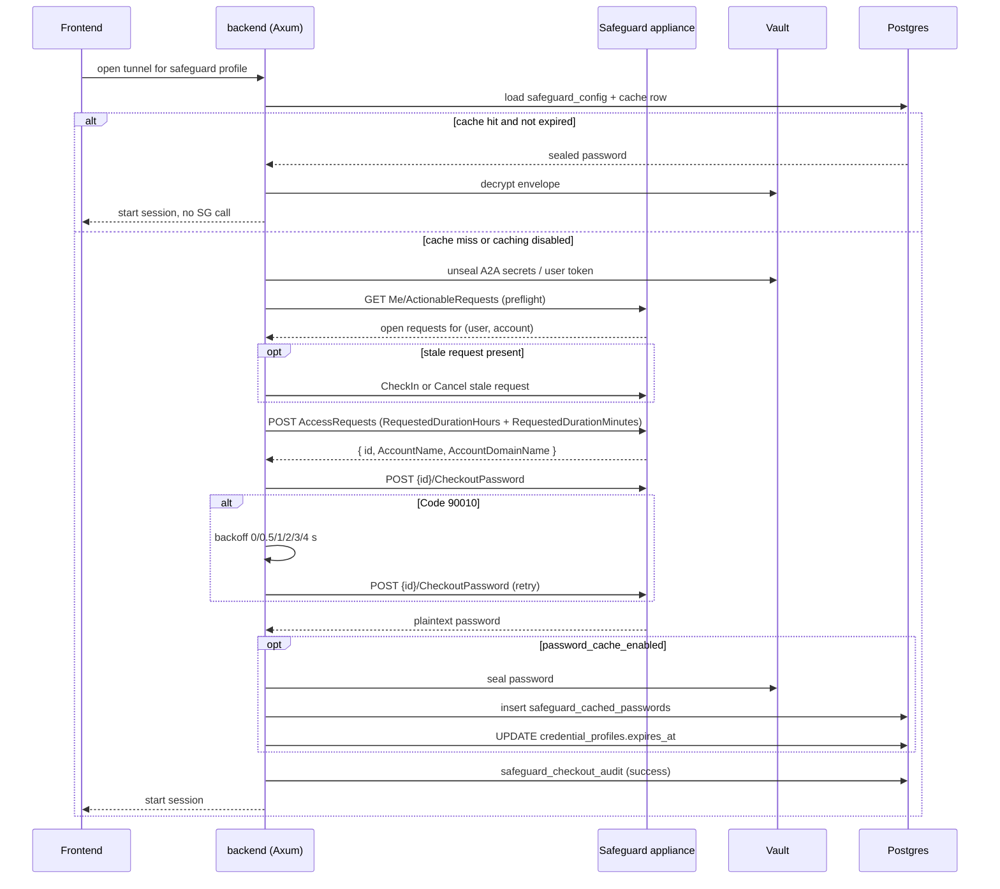

### Preflight & stale-request release

Safeguard rejects a second simultaneous request for the same account
by the same user with **Code 90001**, returning the existing request id
and password — which then fails RDP auth because the appliance
rotates the password every time it accepts a fresh request. The
`list_my_active_requests_for(account_id, asset)` helper in
[`backend/src/services/safeguard/client.rs`](../backend/src/services/safeguard/client.rs)
enumerates the caller's open requests under both the Safeguard 8.x
**singular** bucket keys (`Requester`, `Approver`, `Reviewer`, `Admin`)
and the legacy **plural** keys (`PersonalRequests`,
`RequestorRequests`, `ApproverRequests`, `ReviewerRequests`), with a
final raw-`Vec<Row>` fallback for the wire shape some 7.x appliances
emit.

The release verb is dispatched based on the workflow state in each
candidate row:

| Reported state                            | Verb used                                 | Fallback on 90114 |
| ----------------------------------------- | ----------------------------------------- | ----------------- |
| `RequestAvailable`, `PendingApproval`     | `Cancel`                                  | try `CheckIn`     |
| `PasswordCheckedOut`, `RequestCheckedOut` | `CheckIn`                                 | try `Cancel`      |
| Anything else / unknown                   | `Cancel` then `CheckIn` until one accepts |

The request body is the JSON-encoded string literal `"strata
preflight"` with `Content-Type: application/json` and a non-zero
`Content-Length` — Safeguard rejects `Content-Length: 0` with `411`,
rejects `{}` with `415`, and rejects a raw string with `70000`, all of
which are now caught at the integration boundary rather than
surfacing to the user.

### Code 90010 retry on `CheckoutPassword`

Cancelling a stale `RequestAvailable` triggers an immediate password
rotation on the Safeguard side. The very next `CheckoutPassword`
against the freshly-created replacement request returns **Code 90010**
("You cannot access this account while another request is pending
password reset") for a few seconds until the rotation finishes.
`checkout_password_with_retry` in
[`backend/src/services/safeguard/mod.rs`](../backend/src/services/safeguard/mod.rs)
wraps the bare client call with an exponential-ish backoff loop
(`[0, 500, 1000, 2000, 3000, 4000]` ms — ~10 s total worst case),
retries **only** when the error body contains the `"Code":90010`
marker, and surfaces any other error (auth, validation, not-found)
immediately so a permanently-broken state never blocks behind
transient retries.

### Approval-required release & error-path reconciliation

Tier-0 / break-glass accounts are bound to Safeguard policies that
require an **Approver** to act before the password is released. For
these, `CheckoutPassword` returns **Code 90117** ("awaiting
approval") and the orchestrator surfaces
`JitOutcome::PendingApproval { request_id, … }`. The bulk-checkout
route persists a `safeguard_pending_requests` row and returns a
`pending` result carrying the `request_id`; the SPA renders the
yellow **Awaiting approval** badge and polls
`POST /api/user/safeguard/release` (manual **Refresh** button + a
15-second background loop, capped at 30 minutes) until an approver
acts. `release_pending` retries `CheckoutPassword` against the same
request id — no new `AccessRequest` is created, so repeated polls are
idempotent and audit-clean.

The subtlety is the **error path**: a non-2xx that is not Code
`90117` must not strand the pending row on an opaque `HTTP 500`. Two
fixes make it self-correcting:

- **v1.12.12 — reconcile against live state.** On a `CheckoutPassword`
  error, `release_pending` calls
  `client::get_access_request_status(request_id)`. A **terminal**
  appliance state (`Expired` / `Cancelled` / `Denied` / `Revoked` /
  `Complete` / `PasswordCheckedIn`, matched by
  `is_terminal_release_state`) or a **404** best-effort **DELETEs**
  the `safeguard_pending_requests` row and returns
  `AppError::Validation` (`HTTP 400`, "please submit a new checkout
  request") so the badge clears instead of re-hydrating. A refetch
  still reporting `PendingApproval` is treated as a transient
  CheckoutPassword hiccup and keeps polling.
- **v1.14.2 — a dead bearer becomes a re-auth prompt, not a 500.**
  The v1.12.12 refetch reuses the same bearer that just failed, so a
  lapsed appliance session (Strata's `safeguard_user_tokens` TTL can
  outlive it in `per_user_browser` / `hybrid` modes) makes **both**
  calls answer `HTTP 401`/`403`. `is_appliance_auth_failure` now
  catches these at both points and, for non-A2A modes, returns
  `AppError::Validation("safeguard.signin_required")` (`HTTP 400`)
  while **keeping** the pending row — the access request is still
  valid, so re-running `Connect-Safeguard` and pressing **Refresh**
  resolves it. The SPA keeps the row `pending`/refreshable and shows
  a re-sign-in prompt.

### Password cache lifecycle

`safeguard_cached_passwords (user_id, profile_id)` is a composite-PK
table written every time JIT checkout succeeds **and** the
administrator has flipped `safeguard_config.password_cache_enabled =
true`. The lifetime of each row is governed by the per-profile
`ttl_hours` slider — not a global setting — so a user with a long
shift can hold a credential for the duration their profile allows
without re-triggering the 15-minute RSTS sign-in carousel.

The `password_cache::load(...)` accessor performs an eager DELETE on
any row whose `expires_at` has passed before returning a hit, so a
stale entry can never silently succeed. Auto-checkin is suppressed
while caching is active: the `AccessRequest` stays open on the
Safeguard side until the user explicitly checks back in (or until
Safeguard's own policy expires it), giving the cache an actual
lifetime to honour.

`credential_profiles.expires_at` is kept in lock-step with the cache
row's TTL via the new `credential_profiles::set_expires_at` helper —
slammed forward to the TTL on checkout, slammed back to `now()` on
checkin — so the Profiles list never lies about whether a Safeguard
credential is usable.

### Append-only audit trail

Every state transition is written to `safeguard_checkout_audit`:

```text
pending ──▶ success ──▶ checked_in
   │            │
   └─▶ failed   └─▶ expired
```

Columns: `id`, `user_id`, `profile_id`, `sg_account_id`, `sg_asset`,
`sg_request_id`, `session_id`, `opened_at`, `closed_at`, `outcome`,
`error_message`. The table shape mirrors `share_participant_audit` so
existing forensic tooling can be reused without modification.

### Kill switch

`safeguard_config.enabled = FALSE` (the upgrade default) hides the
**Kind** selector's Safeguard option across the UI, hides the
Credentials page's sign-in and bulk-checkout cards, and routes
existing safeguard-backed profiles through the same "expired managed
credential" rejection used elsewhere — so a half-disabled state never
forces a session to recover at an awkward moment. Flipping the
switch back on lights the entire surface up in a single step.

## Directory Structure

```
strata-client/
├── .github/workflows/     CI/CD pipelines
├── backend/               Rust backend
│   ├── Cargo.toml
│   ├── Dockerfile
│   ├── migrations/        SQL migration scripts
│   └── src/
│       ├── main.rs        Entry point, bootstrap
│       ├── config.rs      config.toml model
│       ├── error.rs       Unified error type
│       ├── session_engine.rs  WebSocket ↔ SessionActor bridge, preflight, watchdog, gateway-initiated session ends
│       ├── tunnel.rs      Guacamole protocol + WS↔TCP proxy
│       ├── db/            Database pool, migrations
│       ├── routes/        HTTP & WebSocket handlers
│       │   ├── admin.rs   Admin CRUD endpoints
│       │   ├── health.rs  Health & status
│       │   ├── setup.rs   First-boot initialisation
│       │   ├── tunnel.rs  WebSocket tunnel upgrade
│       │   ├── share.rs    Connection sharing (view/control modes)
│       │   ├── files.rs   Quick Share temp file CDN (upload/download/list/delete)
│       │   ├── tunnel.rs  WebSocket tunnel upgrade
│       │   └── user.rs    User-facing endpoints
│       └── services/      Business logic
│           ├── app_state.rs   Shared state + boot phase
│           ├── ad_sync.rs     AD LDAP sync engine (multi-base, multi-auth)
│           ├── admission.rs   Session admission: memory budget + per-user session limit (v2.3.0)
│           ├── audit.rs       Audit writes through `audit_append` (v2 hash chain)
│           ├── audit_verify.rs  Chain verifier, keyed checkpoints, Vault-signed anchor file (v2.3.0)
│           ├── auth.rs        OIDC token validation
│           ├── auth_limits.rs Sign-in and password-change limits in PostgreSQL (v2.3.0)
│           ├── checkouts.rs   Password checkout lifecycle + rotation workers
│           ├── client_ip.rs   One client-IP resolution for every request, honouring `STRATA_TRUSTED_PROXIES` (v2.3.0)
│           ├── dns.rs         Target-hostname resolution against admin-set nameservers
│           ├── file_crypto.rs Chunked AES-256-GCM (STREAM) for staged files (v2.3.0)
│           ├── health_check.rs  Background TCP health probes for connections (one replica per pass via a worker lease)
│           ├── kerberos.rs    Multi-realm krb5.conf generation
│           ├── keyed_lock.rs  Per-key single-flight locks for cache misses (v2.3.0)
│           ├── middleware.rs   JWT auth + admin middleware
│           ├── password.rs    Argon2id parameters + bounded hashing pool
│           ├── recording_index.rs  Recording seek index (checkpoint every 8 MiB) (v2.3.0)
│           ├── recordings.rs  Recording config + scheduled retention purge (DB rows, Azure blobs, local files)
│           ├── refresh_tokens.rs  Refresh-token families, rotation and reuse detection (v2.3.0)
│           ├── session_cleanup.rs  Periodic active_sessions expiry sweep
│           ├── session_registry.rs  NVR ring buffer + persistent-state log (v1.9.4) + live session tracking; replay history under one memory budget (v2.3.0)
│           ├── settings.rs    system_settings CRUD
│           ├── trusted_ca.rs  Trusted CA bundle CRUD + per-session NSS DB import via `certutil` (v1.2.0)
│           ├── user_cleanup.rs  Daily worker: (1) stale-account sweep — soft-deletes users idle past `user_stale_days` (v1.9.5; `NULL last_login_at` excluded; `0` disables; audited as `user.stale_auto_deleted`), (2) hard-deletes soft-deleted users older than `user_hard_delete_days` (default 90 days), and (3) purges stale `safeguard_enrolment_codes` rows (v1.10.2)
│           ├── file_store.rs  Session-scoped temporary file storage (20 files/session, 10 GiB store, 24 h expiry)
│           ├── transfer_gate.rs  AV scan + outbound approval for SFTP file-browser transfers (v2.3.0)
│           ├── vault.rs       Envelope encryption
│           ├── vault_tls.rs   Private CA + server certificate for the bundled Vault (`vault-tls-init`, v2.3.0)
│           ├── worker_lease.rs  One replica at a time for a periodic job (`worker_leases`, v2.3.0)
│           ├── notifications.rs  Dispatcher: maps CheckoutEvent → recipients → EmailMessage; honours opt-outs; writes email_deliveries rows
│           ├── email/         Transactional email subsystem
│           │   ├── mod.rs         Re-exports + EmailTransport trait
│           │   ├── message.rs     EmailMessage + builder + InlineAttachment
│           │   ├── transport.rs   EmailTransport trait + StubTransport (for tests)
│           │   ├── smtp.rs        SmtpTransport (lettre 0.11, rustls, STARTTLS/implicit/none) + permanent vs transient classifier
│           │   ├── outlook.rs     wrap_for_outlook_dark_mode (VML namespace + <v:background> + Outlook-only stylesheet)
│           │   ├── templates.rs   Tera + mrml renderer; standalone MJML templates; custom xml_escape
│           │   ├── templates/     4 MJML + 4 plaintext templates per checkout event
│           │   └── worker.rs      Background retry worker (30s tick, exp backoff, 3 attempts max)
│           └── vault_provisioning.rs  Bundled Vault lifecycle
├── frontend/              React SPA + nginx gateway
│   ├── Dockerfile
│   ├── common.fragment    Shared nginx config (proxy rules, security headers, compression)
│   ├── http_only.conf     HTTP-only server block
│   ├── https_enabled.conf HTTPS server block (SSL termination + HSTS)
│   ├── connection-upgrade.conf  WebSocket upgrade header mapping
│   ├── ssl-init.sh        Entrypoint: selects HTTP or HTTPS config based on cert presence
│   ├── package.json
│   └── src/
│       ├── api.ts         Typed API client
│       ├── App.tsx        Router + boot detection
│       ├── components/    Shared components (Layout, GlobalHeader, AdminMegaMenu, Select, EnterpriseCheckbox, SessionBar, SessionManager, clipboardSync, QuickShare, SessionTimeoutWarning, ThemeProvider, ToastProvider, PendingApprovalWatcher, CredentialProfileExpiryWatcher, leaseStore, LeaseIndicator, LeaseDrawer, WhatsNewModal)
│       ├── hooks/         Shared hooks (useConnectionFilter)
│       ├── styles/        Design tokens (dashboard-theme.css)
│       ├── utils/         Pure helpers (keybindings, sessionEnd, popoutPalette, browserCapabilities, keyboardLock, winKeyProxy, pasteShortcutGate, …)
│       └── pages/         Page components (Dashboard, Documentation, SessionClient, AdminSettings, AuditLogs, Approvals, Login, SetupWizard, SharedViewer)
│           ├── admin/     One module per Admin Settings tab (Security, Network, Display, SSO, Kerberos, Recordings, Vault, Tags, Health, Sessions, Passwords, AdSync, Access) plus the shared connection-form helpers and ConnectionFoldersView
│           │   ├── fleet/ Connections fleet manager (FleetManager, FleetToolbar, FleetTable, FleetBulkDock, FleetTelemetryStrip, fleetModel)
│           │   └── roles/ Role editor (EditRoleModal, RolePermissionsTab, RoleAssignmentsTab, RoleMembersTab, roleModel, useRoleEditor)
│           └── credentials/  Credentials page child components (RequestCheckoutForm, ProfileEditor)
├── crates/                Workspace crates
│   ├── strata-session/    In-process session engine (RDP / VNC / SSH / SFTP / K8s)
│   ├── strata-protocol/   Guacamole instruction + media envelope codecs
│   ├── strata-dmz/        DMZ edge proxy
│   └── vendor/            Patched forks (ironrdp-connector, ironrdp-egfx, sspi) — see scripts/check-vendored-forks.sh
├── certs/                 TLS certificates (mount for HTTPS)
├── docker-compose.yml     Full stack orchestration
├── CHANGELOG.md
├── CONTRIBUTING.md
├── LICENSE                Apache 2.0
├── NOTICE                 Third-party attributions
└── README.md
```

## DMZ split topology (optional)

Strata Client supports an optional split-host deployment where a
public-facing **DMZ node** terminates TLS and serves the SPA, while
all business logic, secrets, and database access remain on a private
**internal node** that the public network cannot reach. This is
intended for deployments where the internal Strata host must not
have any inbound listener exposed to the Internet (regulatory zoning,
defence-in-depth, or hosting-provider policy).

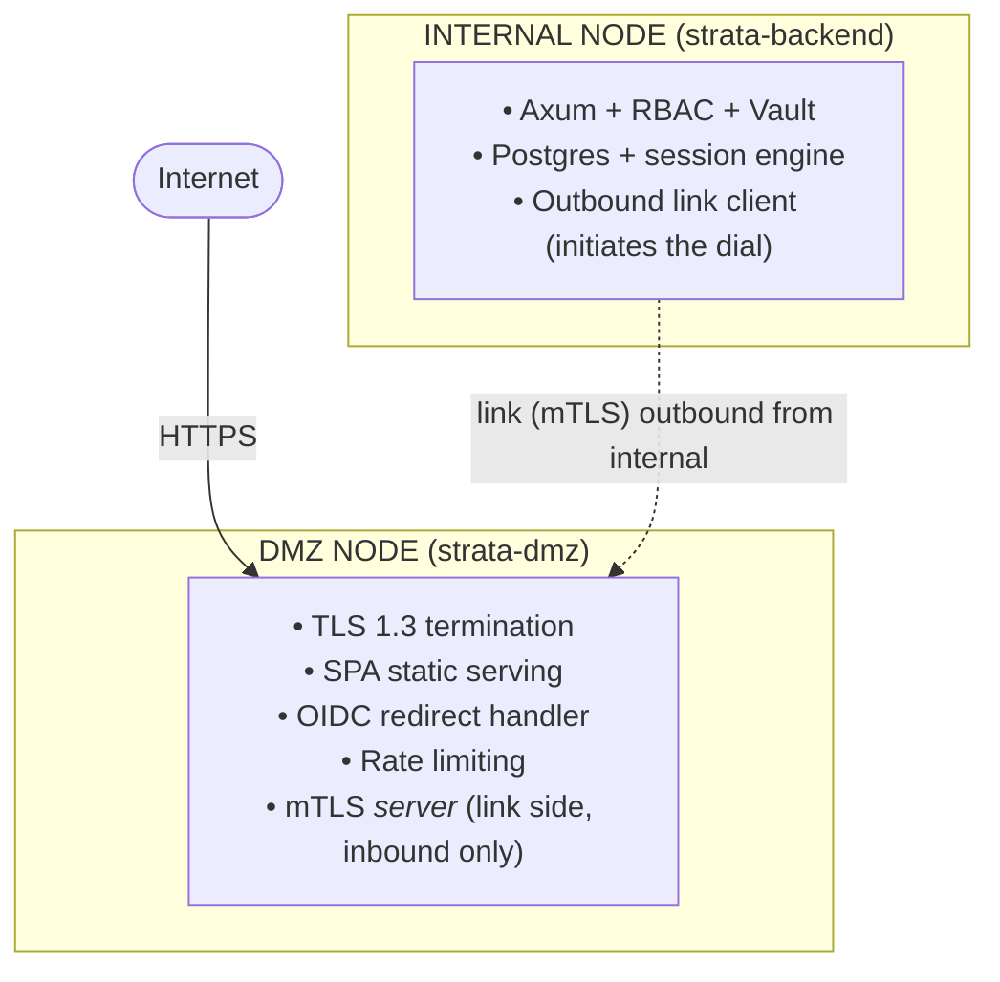

The link is the only channel between the two halves and reverses the
usual client-server polarity: the **internal node dials out** to the
DMZ node and holds a long-lived authenticated tunnel open. The DMZ
node multiplexes inbound HTTP/WebSocket requests onto that tunnel.
This means the firewall between the DMZ network and the internal
network can deny **all** inbound traffic to the internal host — the
internal half only ever makes outbound TCP connections to the DMZ
host's link port.

### Trust posture

- **No business secrets on the DMZ host.** It holds two key
  materials: a public TLS cert (browser-facing) and a per-link PSK
  used to authenticate the internal node when it dials in. It holds
  **no** Vault tokens, no DB credentials, no AD bind passwords, no
  user JWT signing keys. Compromise of the DMZ host yields only the
  ability to drop traffic, not to read or forge it (sessions remain
  bound to the internal node's JWT signing key).
- **Wire protocol** (`strata-link/1.0`): length-prefixed JSON
  handshake (see `crates/strata-protocol/src/handshake.rs`) followed
  by HTTP/2 (h2 0.4) inside the same mTLS connection, ALPN
  `h2,http/1.1`. Custom framing is intentionally minimal — every
  user request is one HTTP/2 stream, WebSockets ride RFC 8441
  Extended CONNECT, and per-stream flow control comes for free.

  **Minimum `h2` version (v1.14.5+)** — `Cargo.lock` pins `h2 >= 0.4.16`.
  Versions below that accepted and queued empty `DATA` frames without
  limit (RUSTSEC-2026-0258), which is exploitable for memory exhaustion
  by any peer that can complete an HTTP/2 handshake. That includes
  **anonymous internet clients** on the DMZ's public listener, whose
  `alpn_protocols` list (`crates/strata-dmz/src/public_tls.rs`)
  advertises `h2` before any credential is presented — so the edge
  binary must be redeployed alongside the internal node when applying
  this patch. See
  [security.md § Dependency & supply-chain security](security.md#dependency--supply-chain-security).

  **WebSocket-over-HTTP/2 (v1.5.2+)** — both ends negotiate the
  `SETTINGS_ENABLE_CONNECT_PROTOCOL` extension (h2 server side calls
  `enable_connect_protocol()`; the DMZ client side sends per-request
  `h2::ext::Protocol::from_static("websocket")`). The DMZ proxy
  detects RFC 6455 WebSocket upgrades on the public listener,
  captures `hyper::upgrade::on(&mut req)` before the request is
  consumed, opens an Extended CONNECT stream
  (`:method=CONNECT, :protocol=websocket, :path=<original>`) on a
  registered link sender, awaits `:status=200`, then returns
  `101 Switching Protocols` to the public client with a correctly-
  computed `Sec-WebSocket-Accept` (RFC 6455 §1.3 SHA-1 + base64).
  A bidirectional byte-pump copies WebSocket frames between the
  public TCP socket and the h2 stream; masking, ping/pong,
  fragmentation and close frames flow through unmodified. The
  internal-side `LoopbackUpgradeHandler`
  (`backend/src/services/dmz_link/upgrade_handler.rs`) accepts the
  inbound Extended CONNECT and bridges it to a regular HTTP/1.1
  WebSocket upgrade against `127.0.0.1:8080` (overridable via
  `STRATA_DMZ_LOOPBACK_ADDR`), so the existing
  `/api/tunnel/{connection_id}` axum handler runs unchanged. The
  connection to the target therefore originates from the **internal node's**
  IP, not the DMZ node's IP — exactly as a single-node deployment
  behaves. WebSocket streams are not subject to the REST path's
  request-body ceiling because they are long-lived; instead we cap
  individual h2 frame sizes at 8 MiB on the DMZ→public direction
  so a misbehaving internal node cannot make the DMZ buffer
  arbitrary memory before the public socket drains.

- **Edge attribution**: the DMZ node stamps a signed bundle of
  request metadata (`x-strata-edge-*` headers — client IP, TLS
  version/cipher/JA3, user-agent, request ID, link ID, timestamp)
  with an HMAC-SHA-256 over the canonical concatenation, keyed by a
  shared `STRATA_DMZ_EDGE_HMAC_KEY`. The internal node verifies the
  HMAC, rejects skew > 60 s, and **strips any `x-strata-edge-*`
  headers that arrive without a valid MAC** so a compromised DMZ
  cannot forge a different client IP into the audit log.
- **Egress posture**: the DMZ pod has no egress permission to the
  internal network in either the compose overlay or the Helm
  NetworkPolicy. The only outbound it makes is DNS to kube-dns. Even
  a fully RCE'd DMZ node cannot reach the database, Vault, or AD.

### Authoritative references

| Topic                               | Location                                                                   |
| ----------------------------------- | -------------------------------------------------------------------------- |
| Decision + alternatives             | [adr/ADR-0009-dmz-deployment-mode.md](adr/ADR-0009-dmz-deployment-mode.md) |
| Implementation plan (canonical)     | [dmz-implementation-plan.md](dmz-implementation-plan.md)                   |
| Threat model (STRIDE per component) | [threat-model.md](threat-model.md) §6                                      |
| Operator deployment guide           | [deployment.md](deployment.md#dmz-deployment-mode)                         |
| On-call runbook                     | [runbooks/dmz-incident.md](runbooks/dmz-incident.md)                       |
| Grafana dashboard                   | [grafana/strata-dmz-dashboard.json](grafana/strata-dmz-dashboard.json)     |
| Compose overlay                     | [`docker-compose.dmz.yml`](../docker-compose.dmz.yml)                      |
| Helm chart                          | [`deploy/helm/strata-dmz/`](../deploy/helm/strata-dmz/)                    |
| Wire protocol crate                 | [`crates/strata-protocol/`](../crates/strata-protocol/)                    |
| DMZ binary crate                    | [`crates/strata-dmz/`](../crates/strata-dmz/)                              |

### Naming

Throughout this codebase the public-facing node is consistently
referred to as the **DMZ node** (`strata-dmz` crate, binary, image,
and Helm chart). The token "edge" is reserved for the
`x-strata-edge-*` request-attribution header bundle stamped by the
DMZ on every forwarded request — it is not a synonym for the node
itself.

### Internal-node supervisor and operator UI (v1.5.0)

The internal node owns the dialler. One **link supervisor** task is
spawned per endpoint listed in `STRATA_DMZ_ENDPOINTS`
([`backend/src/services/dmz_link/supervisor.rs`](../backend/src/services/dmz_link/supervisor.rs)).
Each supervisor runs an exponential-back-off reconnect loop with
jitter and a per-link state machine:

- `connecting` — TCP + TLS handshake in progress.
- `authenticating` — `AuthHello` + PSK challenge–response in flight.
- `initializing` — mTLS handshake succeeded, HTTP/2 preface still
  pending.
- `up` — h2 connection healthy, ready to serve forwarded requests.
- `backoff` — last attempt failed; sleeping before the next try.
- `stopped` — supervisor cancelled (shutdown or Force reconnect).

Operators see this state machine surfaced in real time in
**Admin → DMZ Links**
([`frontend/src/pages/admin/DmzLinksTab.tsx`](../frontend/src/pages/admin/DmzLinksTab.tsx)),
which hits two endpoints:

- `GET /api/admin/dmz-links` returns
  `{ configured: bool, links: [{ endpoint, state, connects, failures,
since_unix_secs, last_error }, …] }`. Auto-refreshed every 15 s.
- `POST /api/admin/dmz-links/reconnect` drops every link's TCP
  connection and lets the supervisor's back-off loop redial. Used
  during scheduled DMZ restarts and as the first step in the
  incident runbook.

Both endpoints require `can_manage_system` and the standard
`X-CSRF-Token` double-submit cookie. They are documented in
[api-reference.md](api-reference.md#dmz-link-management-v150).

## Architecture Decision Records

Design decisions whose rationale outlives any single commit live as
numbered ADRs under [adr/](adr/):

| ADR                                                    | Topic                                                                                                          |
| ------------------------------------------------------ | -------------------------------------------------------------------------------------------------------------- |
| [ADR-0001](adr/ADR-0001-rate-limit-single-instance.md) | Rate-limit state: single-instance constraint with promotion criteria                                           |
| [ADR-0002](adr/ADR-0002-csrf-samesite-strict.md)       | CSRF strategy: `SameSite=Strict` as the compensating control                                                   |
| [ADR-0003](adr/ADR-0003-feature-flags-deferred.md)     | Feature flags: boolean `settings` keys instead of a dedicated table                                            |
| [ADR-0004](adr/ADR-0004-guacd-connection-model.md)     | guacd connection model, protocol-parameter allow-list, and trust boundaries. **Superseded by ADR-0015.**       |
| [ADR-0005](adr/ADR-0005-jwt-refresh-token-sessions.md) | JWT + refresh-token TTLs, single-use rotation, forced-logout lever                                             |
| [ADR-0006](adr/ADR-0006-vault-transit-envelope.md)     | Vault Transit envelope (`vault:<base64>`), rotate + rewrap path                                                |
| [ADR-0007](adr/ADR-0007-emergency-bypass-checkouts.md) | Emergency approval bypass and scheduled-start checkouts                                                        |
| [ADR-0008](adr/ADR-0008-notification-pipeline.md)      | Transactional-email subsystem: MJML/mrml renderer, Vault-sealed SMTP password, opt-out semantics, retry worker |
| [ADR-0009](adr/ADR-0009-dmz-deployment-mode.md)        | DMZ deployment mode: public-facing dumb-proxy, reverse-tunnel link, signed edge headers                        |
| [ADR-0010](adr/ADR-0010-dmz-phase6-hardening.md)       | DMZ phase-6 hardening                                                                                          |
| [ADR-0011](adr/ADR-0011-persistent-jwt-secrets.md)     | Persistent JWT signing secrets across container restarts                                                       |
| [ADR-0011](adr/ADR-0011-av-scanning.md)                | Antivirus scanning trait: pluggable backends (`off`/`clamav`/`command`), fail-closed default, opt-in sidecar   |
| [ADR-0012](adr/ADR-0012-njs-security-hardening.md)     | NJS security hardening at the nginx layer                                                                      |
| [ADR-0013](adr/ADR-0013-vitest-environment-stabilization.md) | Vitest environment stabilisation                                                                          |
| [ADR-0014](adr/ADR-0014-co-pilot-two-websocket-split.md) | Co-pilot: two-WebSocket split for observation vs. control                                                    |
| [ADR-0015](adr/ADR-0015-native-rust-session-engine.md) | **Native Rust session engine replacing guacd (v2.0.0).** Supersedes ADR-0004.                                  |

## Operational Runbooks

Step-by-step procedures for on-call engineers live under
[runbooks/](runbooks/):

| Runbook                                                       | When to use                                                                                                   |
| ------------------------------------------------------------- | ------------------------------------------------------------------------------------------------------------- |
| [disaster-recovery.md](runbooks/disaster-recovery.md)         | Host loss or corrupted volumes (RTO ≤ 4h, RPO ≤ 24h)                                                          |
| [security-incident.md](runbooks/security-incident.md)         | Credential exposure, token replay, unauthorised config change, refresh-token reuse, audit integrity failure   |
| [certificate-rotation.md](runbooks/certificate-rotation.md)   | Scheduled rotation or expiry alert (ACME + internal CA); bundled Vault TLS certificate (v2.3.0)              |
| [vault-operations.md](runbooks/vault-operations.md)           | Vault unseal, Transit key rotate + rewrap, Shamir rekey                                                       |
| [database-operations.md](runbooks/database-operations.md)     | Replica promotion, migration rollback, panic-boot recovery, edited migration refused at startup (v2.3.0)      |
| [smtp-troubleshooting.md](runbooks/smtp-troubleshooting.md)   | Notification emails not arriving, SMTP failures, retry-worker stalls, Vault sealing during config             |
| [dmz-incident.md](runbooks/dmz-incident.md)                   | DMZ link flap, links-up:0, edge-HMAC/PSK rotation, suspected DMZ host compromise                              |
| [av-operations.md](runbooks/av-operations.md)                 | AV scanner outage, signature update failure, false-positive triage, EICAR smoke test, capacity check          |
| [clipboard-diagnostics.md](runbooks/clipboard-diagnostics.md) | RDP copy/paste reported broken — classify stalled-transfer vs wedged `rdpclip.exe`, recover, capture evidence |
| [session-disconnects.md](runbooks/session-disconnects.md)     | A user reports an unexpected or unexplained session end — map the on-screen message to its cause and log line |
| [keyboard-input.md](runbooks/keyboard-input.md)               | Wrong characters, nothing typed at a console prompt, dead keypad, stuck keys in an RDP or SSH session (v2.3.1) |
| [dmz-production-certs.md](runbooks/dmz-production-certs.md)   | Issue and install production certificates for the DMZ link (replace the development certificates)            |
| [login-rate-limiting.md](runbooks/login-rate-limiting.md)     | Users get `429` on sign-in or password change; session admission summary (v2.3.0)                             |
| [session-capacity.md](runbooks/session-capacity.md)           | New sessions refused with **Session Limit Reached** (before v2.3.5: endless **Reconnecting…**); find and raise the limit (v2.3.5) |

## Session-activity bus and proactive token refresh (v1.6.1)

The frontend keeps a 20-minute access token alive across user
activity through a small in-process event bus rather than relying
solely on bubbling DOM events. The need for the bus is a direct
consequence of how the vendored `guacamole-common-js` library
captures input.

**Why the DOM event-bubbling path is not enough.** The proactive
refresh logic in
[`SessionTimeoutWarning.tsx`](../frontend/src/components/SessionTimeoutWarning.tsx)
listens for `mousedown` / `keydown` / `touchstart` / `scroll` on
`window`. When the access token has under 10 minutes remaining
(`PROACTIVE_REFRESH_THRESHOLD_SECS = 600`) and the user produces
any of those events, it triggers a silent `POST /api/auth/refresh`
(rate-limited to one attempt per 30 s through `PROACTIVE_COOLDOWN_MS`).
This works perfectly for the SPA chrome — clicking the dashboard,
typing in a search box, scrolling the audit page — but it is
defeated inside an active remote session. `Guacamole.Keyboard` is
constructed against `document` and `Guacamole.Mouse` against the
`<canvas>` display element; both call `event.preventDefault()` and
`event.stopPropagation()` on every input event before it can bubble
to `window`. The result before v1.6.1 was a logged-in user being
silently signed out at the 20-minute mark while actively working
inside an RDP or SSH tab — the warning toast fired, but no input
ever reached it to extend the session, and the next API call
returned 401.

**The bus.** [`sessionActivity.ts`](../frontend/src/components/sessionActivity.ts)
exports a single `notifySessionActivity()` function that, throttled
to one call per second, dispatches a custom
`strata-session-activity` event on the opener `window`.
`SessionTimeoutWarning` subscribes to that event in addition to its
existing DOM listeners, and treats it as the same "user activity"
signal. The throttle is intentional — the Guacamole keyboard
callback fires on every keydown, and a 100-WPM typist would
otherwise dispatch ~10 events per second for the entire session
duration with no observable benefit.

**Notify-call call-sites.** The notify call is wired into every
Guacamole input callback in every window context the product
exposes:

| File                                                                  | Context                             | Hooks                                |
| --------------------------------------------------------------------- | ----------------------------------- | ------------------------------------ |
| [`SessionManager.tsx`](../frontend/src/components/SessionManager.tsx) | Main-window session container       | `mouse.onEach`                       |
| [`SessionClient.tsx`](../frontend/src/pages/SessionClient.tsx)        | Main-window keyboard handler        | `kb.onkeydown`                       |
| [`usePopOut.ts`](../frontend/src/components/usePopOut.ts)             | Pop-out window (single secondary)   | mouse, touch, and keyboard callbacks |
| [`useMultiMonitor.ts`](../frontend/src/components/useMultiMonitor.ts) | Multi-monitor pop-out (per monitor) | mouse and keyboard callbacks         |

Both pop-out hooks execute in the _opener's_ JS context (only the
Guacamole `displayEl` is reparented into the popup's DOM), so
`window.dispatchEvent` reaches the same `window` where
`SessionTimeoutWarning` is mounted. No cross-window plumbing is
required, and any future window-flavour additions (e.g. picture-
in-picture) only need to call `notifySessionActivity()` from their
own input callbacks to inherit the same behaviour.

**Resulting timeout model.**

| Scenario                                  | Token behaviour                                                                                                                                        |
| ----------------------------------------- | ------------------------------------------------------------------------------------------------------------------------------------------------------ |
| Actively using a session (any window)     | Access token silently refreshes whenever it has < 10 min remaining and an input event arrives, for up to **8 hours** (the refresh-token hard ceiling). |
| Idle (no DOM events, no Guacamole input)  | Access token expires **20 min** after the most recent refresh; warning toast appears at the 2-min mark with an explicit extend button.                 |
| Returning from idle before the 20-min cap | A click or keypress with < 10 min left triggers a silent background refresh; with > 10 min left it is a no-op.                                         |

## SSH/Telnet paste payload normalisation (v1.6.1)

[`pastePayload.ts`](../frontend/src/components/pastePayload.ts)
exports a single
`preparePastePayload(text: string, protocol: string): string`
helper that the main-window paste path in `SessionManager.tsx` and
the pop-out paste path in `usePopOut.ts` both call before the
clipboard payload is shipped over the Guacamole tunnel. For `ssh`
and `telnet` protocols the payload is wrapped with the
bracketed-paste start/end sequences (`ESC [ 200 ~` /
`ESC [ 201 ~`) and every `\r\n` and bare `\n` is rewritten to a
single `\r`. For all other protocols (RDP, VNC, Kubernetes-exec,
Quick-Share clipboard) the payload is returned unchanged. The
transformation matches what an `xterm`-class terminal emits when a
real human pastes into it, which is the contract editors and REPLs
on the remote end (`vim`, `nano`, `psql`, `python`) interpret.
Seven unit tests in
[`__tests__/pastePayload.test.ts`](../frontend/src/__tests__/pastePayload.test.ts)
pin the boundary conditions.

## Remote → local clipboard stall watchdog (v1.14.1)

The remote → local clipboard path is a Guacamole **stream**, not a
single instruction. When text is copied inside the remote desktop, the
session engine emits `clipboard,<idx>,text/plain;`, then one or more
`blob,<idx>,<base64>;` instructions carrying the UTF-8 payload in
chunks, and finally `end,<idx>;` to close the stream. The frontend
handler `client.onclipboard` in
[`SessionManager.tsx`](../frontend/src/components/SessionManager.tsx)
attaches a `Guacamole.StringReader` to the stream, accumulates the
decoded text across every `blob`, and — historically — only wrote the
result to the browser via `navigator.clipboard.writeText()` inside the
reader's `onend` callback.

That single-point-of-flush design has a failure mode on RDP. The
Windows clipboard is exposed through the **CLIPRDR** virtual channel,
which is a _delayed-rendering_ protocol: when an application copies,
Windows advertises the available formats but does not produce the
actual bytes until a consumer requests a specific format. If the
clipboard owner is an app that renders lazily (Chrome, Edge, VS Code,
most terminals) and a _subsequent_ copy interrupts the in-flight
format-data request, or if the CLIPRDR state machine becomes
wedged after many transfers, the engine can open the stream and deliver
zero or a partial set of `blob`s and then **never emit `end`**. The
reader's `onend` never fires, `writeText()` is never called, and the
local clipboard silently retains its previous contents. Nothing is
logged, no `onerror` fires, and the only recovery is a full reconnect
(which establishes a clean CLIPRDR channel).
Large multi-blob transfers are statistically more exposed to this —
they keep the channel busy longer and are more likely to be
interrupted — but the stall itself is size-independent.

v1.14.1 wraps the receive path in a **per-stream stall watchdog**:

- A timer is armed when the stream opens and re-armed on every
  received `blob`. Continuous delivery therefore never trips it.
- The window is **asymmetric**, because "nothing ever arrived" and
  "delivery paused" are different failures.
  `CLIPBOARD_OPEN_STALL_MS` (2 s) applies while zero blobs have been
  received — that is the wedged-CLIPRDR signature and 2 s is ample to
  recognise it. `CLIPBOARD_BLOB_STALL_MS` (10 s) applies once data is
  flowing: the engine emits the whole clipboard as one back-to-back burst
  of 4 KiB blobs out of a single in-memory buffer, so a gap between
  blobs is transport backpressure rather than a wedge.
- If `end` arrives first, the flush is normal and unchanged.
- If the timer fires **after real progress**, the handler publishes
  what it has (so the user is never left holding stale text) and
  **keeps listening**. Late blobs continue to accumulate and are
  re-published in full, so a transfer that merely paused still ends up
  complete on the clipboard.
- The stream is only **abandoned** — ack-closed via
  `stream.sendAck(...)` so the engine can release the orphaned index — on
  a stall window that saw no new data at all. A `console.warn`
  (`clipboard stream N stalled after M blob(s), K chars — abandoning
transfer`) is logged for correlation with the backend log;
  the intermediate partial flush logs `… paused …, still listening`.
- A **no-clobber guard** ensures a stall that received _zero_ blobs
  never overwrites the local clipboard — an empty flush would wipe
  whatever the user had copied previously and make the defect worse.

> **Why the asymmetry matters.** The original flat 2-second window
> latched on its first fire and ack-killed the stream, so every blob
> after the pause was discarded. Because the chance of hitting one
> ≥ 2 s gap grows with the number of blobs, this truncated exactly the
> copies that matter — a multi-thousand-line script came back as a few
> hundred lines — while small copies were unaffected. That is the
> "large clipboard doesn't capture everything" report.

The watchdog is a resilience layer over the receive path only; the
local → remote (paste) path, the pop-out clipboard path, and the
CLIPRDR channel on the server side are unchanged. It cannot un-wedge
the remote's clipboard state — that remains a target-side concern — but
it guarantees the user receives whatever text did arrive instead of
silently stale content, and it makes every future occurrence visible.
Three regression tests in
[`__tests__/SessionManager.test.tsx`](../frontend/src/__tests__/SessionManager.test.tsx)
pin the flush-on-stall, zero-blob-no-clobber, and
complete-payload-after-a-pause behaviours.

## Clipboard size ceiling — `clipboard-buffer-size`

The ceiling is **8 MiB per direction**, applied symmetrically:
`MAX_CLIPBOARD_BYTES` in
[`crates/strata-session/src/actor/session.rs`](../crates/strata-session/src/actor/session.rs)
and mirrored in
[`engine/rdp/clipboard.rs`](../crates/strata-session/src/engine/rdp/clipboard.rs).
Overrunning it **truncates and logs**, in both directions. It is a
compile-time constant, not a negotiated parameter, so there is nothing to
configure and nothing that can silently fail to be applied.

| Bound                | Value             | Where                                                             |
| -------------------- | ----------------- | ------------------------------------------------------------------- |
| Per-direction ceiling | 8 MiB (`8388608`) | `MAX_CLIPBOARD_BYTES`                                              |
| Wire chunk size       | 4 KiB             | blob size on the instruction stream                                |
| Protocol element cap  | 8192 bytes        | `Guacamole.StringWriter` re-splits to stay inside it               |

Chunking on the wire is separate from and much smaller than the ceiling:
the engine emits 4 KiB blobs, and the browser sends 4096-char chunks from
`clipboardSync.ts`, each re-split by `Guacamole.StringWriter` to stay
inside the Guacamole protocol's 8192-byte per-element limit.

<details>
<summary>Historical — how this failed under guacd (up to v1.14.6)</summary>

This is worth keeping on the record, because it was genuinely difficult to
attribute from a user report.

`guacd` allocated **one fixed-size clipboard buffer per connection**,
and that buffer was the hard ceiling in either direction. Overrunning it
produced no error instruction, no client-side `onerror`, and nothing in
`guacd`'s log at default verbosity — and the two directions failed
**differently**:

- **Remote → local (copy out) — dropped wholesale.**
  `guac_rdp_cliprdr_format_data_response()` converted the incoming
  UTF-16 into a buffer of exactly `clipboard-buffer-size` bytes.
  `guac_iconv()` returns 0 when the output fills before it reaches the
  null terminator, and the reset/append/send calls sat **inside** that
  `if`. A copy that overran therefore emitted **no `clipboard` stream
  at all** — the browser saw nothing whatsoever, not a short payload.
- **Local → remote (paste in) — truncated.**
  `guac_rdp_clipboard_blob_handler()` called
  `guac_common_clipboard_append()`, which clamped to the remaining
  space. Note the outbound conversion is UTF-8 → UTF-16, so the
  *effective* ceiling on this direction was roughly **half** the buffer.

In a `strataClipboard` dump the difference was unmistakable: an
overrun copy left **zero `dir: "in"` entries**, whereas a stalled
transfer left `stream-paused` / `stream-stalled` with a short `chars`.

| Bound                                   | Value                | Where                                                     |
| --------------------------------------- | -------------------- | --------------------------------------------------------- |
| `guacd` default (parameter unset)       | 256 KiB (`262144`)   | `GUAC_COMMON_CLIPBOARD_MIN_LENGTH`                        |
| `guacd` maximum (larger values clamped) | 50 MB (`52428800`)   | `GUAC_COMMON_CLIPBOARD_MAX_LENGTH`                        |
| Strata default                          | 8 MiB (`8388608`)    | `DEFAULT_CLIPBOARD_BUFFER_BYTES`                          |
| Deployment override                     | env                  | `STRATA_CLIPBOARD_BUFFER_BYTES`                           |
| Per-connection override                 | admin-set            | `extra["clipboard-buffer-size"]`                          |

The sting was that the parameter had to be **advertised** by `guacd` to
have any effect. The Guacamole handshake only carries values for
parameters the server lists in its `args` response, so one the running
build did not support was silently discarded — which is how RDP sat at
the 256 KiB default for several releases while Strata believed it was
sending 8 MiB.

</details>


## Local → remote clipboard serialisation (v1.14.4)

Pushing the local clipboard to the remote is driven by six independent
triggers: `mouseenter`, `mousedown` and `focus` on the session display,
a window-level `paste` listener, the pop-out window's own pair of
handlers (bound to the _same_ `displayEl`), and the explicit
`paste-text` / `open-path` command-palette actions. Each one used to
carry its own inline copy of the "open a clipboard stream, chunk the
text into 4 KiB `blob`s, `sendEnd`" sequence.

A single click on a popped-out session fires up to four of those
triggers. They all read `session.remoteClipboard` to decide whether the
payload had already been sent, but none of them wrote it back until
_after_ their transfer finished — so every one of them passed the guard
and opened its own clipboard stream. Because the large-payload path
awaits between chunks, the `blob` instructions of the concurrent
streams interleave on the wire.

Windows' RDP clipboard is a **single shared buffer**: the `clipboard`
instruction resets it and every `blob` appends to it, regardless of
stream index. Interleaved streams therefore splice two payloads
together and announce the result over CLIPRDR twice. Windows'
clipboard owner (`rdpclip.exe`) can be left waiting on a format-data
response that never matches, at which point **both copy and paste stay
dead for the remainder of the Windows session**. Reconnecting the
tunnel does not help — the wedged state lives in the Windows session,
not in the gateway — which is why the only reliable recovery was to log
off the Windows session and log back in, restarting `rdpclip.exe`.

[`clipboardSync.ts`](../frontend/src/components/clipboardSync.ts) is
now the single transmission path. Every caller routes through
`sendClipboardToRemote(session, text, source)`, which:

- **Serialises** sends per session on a promise chain, so only one
  clipboard stream is ever open at a time.
- **Suppresses duplicates** against both the last confirmed
  `remoteClipboard` value and the text of any send still queued, which
  is what collapses a single click's burst of triggers into one
  transfer. Explicit user commands pass `{ force: true }` to bypass it.
- **Refuses to write to a closed tunnel**, and only updates
  `remoteClipboard` once the payload has actually been written.
  Previously a send into a dead tunnel still recorded the text as
  "delivered", which permanently suppressed every later paste of that
  same text.

`resetRemoteClipboardEcho` is called whenever a client reaches the
`CONNECTED` state. A freshly-started session has an empty clipboard,
and when RDP reattaches to an already-logged-on Windows session the
CLIPRDR channel is renegotiated from scratch, so the frontend must
forget what it believed the remote held or the first push after a
reconnect is discarded as a duplicate.

Related fix: the tunnel-`CLOSED` handler in `SessionManager` now calls
`session._cleanupPaste()`. Only the explicit `closeSession()` path did
so before, which meant every network drop, server-side disconnect and
auto-reconnect attempt left a window-level `paste` listener bound to a
dead client for the lifetime of the page.

## Paste shortcuts wait for the clipboard (v2.3.1)

The local clipboard reaches the target only when the browser pushes it.
The automatic pushes are pointer- and focus-driven (`mouseenter`,
`mousedown`, `focus` on the display; the pop-out's own pair), and the
window `paste` listener never fires for a paste typed **inside** a session,
because the session's capture-phase key trap prevents the default action of
every keydown. Returning to the browser with Alt+Tab, pointer already over
the session, and pressing Ctrl+V therefore fired no push at all, and the
target pasted what it held before.

[`utils/pasteShortcutGate.ts`](../frontend/src/utils/pasteShortcutGate.ts)
sits in the key path of every session view:

```
Guacamole.Keyboard ──► createWinKeyProxy ──► createPasteShortcutGate ──► client.sendKeyEvent
                                                  │
                                    Ctrl+V / Shift+Insert
                                                  ▼
                                        prepareRemotePaste()
                                  read local clipboard → sendClipboardToRemote
                                  (+150 ms settle if the text changed)
```

| Behaviour | Detail |
| --------- | ------ |
| Trigger | Key-down of `v`/`V` with either Ctrl held, or `Insert` with either Shift held, as tracked from the keys that passed through the gate |
| Hold | That key and **every** later key event, releases included, are buffered and replayed in order, so a modifier release cannot overtake the paste |
| Release | When `prepareRemotePaste()` settles, fails, or after `PASTE_GATE_TIMEOUT_MS` (1 s) — whichever is first |
| Settle | `PASTE_SETTLE_MS` (150 ms) after a push that sent new text, because `rdpclip.exe` applies a new format list asynchronously; none for a duplicate |
| Clipboard read | `pushLocalClipboard()`; pop-out and multi-monitor windows pass their own `navigator.clipboard`, since only the focused document may read |
| Wired into | `SessionClient.tsx`, `usePopOut.ts`, `useMultiMonitor.ts`, `TiledView.tsx` (not the shared viewer) |

The gate is below the Right-Ctrl Windows-key proxy, so Right-Ctrl+V reaches
the target as Win+V (clipboard history) without being held.

**CLIPRDR ordering.** `ironrdp-cliprdr` sends Capabilities, Temporary
Directory and Format List together the first time it is asked to advertise
a copy, so a browser push that arrived before the target's **Monitor Ready**
sent them ahead of the target's own capability exchange. The engine records
Monitor Ready in `RdpSession::clipboard_ready`; until then a push only
stores the text, and the Monitor Ready answer advertises it.

**Duplicate guard, deliberately unchanged.** When the target copies
something the bridge does not carry (a file, an image, anything under
`disable-copy`), the browser still believes the target holds the last text
it sent. Resetting that belief was tried and rejected: the next click would
push local text and overwrite what the user had just copied on the target.

## Clipboard diagnostics (v1.14.4)

Both ends carry opt-in instrumentation for diagnosing clipboard
failures in the field. Neither records clipboard **contents** — only
opcodes, stream indices, payload sizes, timings and a non-reversible
FNV-1a digest — so a capture can be attached to a support bundle
safely.

**Browser.** `clipboardSync.ts` writes every clipboard lifecycle event
into a 500-entry ring buffer that is always recording, so a user can be
asked for a dump _after_ they hit the bug. The console helper is
published on `window.strataClipboard`:

| Call                        | Effect                                                                                 |
| --------------------------- | -------------------------------------------------------------------------------------- |
| `strataClipboard.enable()`  | Echo events to the console; persisted in `localStorage` under `strata.debug.clipboard` |
| `strataClipboard.disable()` | Stop echoing                                                                           |
| `strataClipboard.print()`   | `console.table` of the ring buffer                                                     |
| `strataClipboard.dump()`    | Structured entries, oldest first                                                       |
| `strataClipboard.clear()`   | Reset the buffer                                                                       |

Outbound events are `queued`, `skip-duplicate`, `skip-disconnected`,
`stream-open`, `ack`, `ack-error`, `abort-mid-stream`, `stream-failed`,
`stream-end`, `echo-reset` and `tunnel-closed`. Inbound events are
`stream-open`, `stream-end`, `stream-stalled`, `ignored-mimetype` and
`local-write-failed`.

**Backend.** Removed in v2.0.0. `STRATA_CLIPBOARD_TRACE` and its
`ClipboardTracer` walked every instruction batch crossing the socket to
`guacd`; there is no such socket now, and the tracer went with the daemon.
The browser-side buffer above is the primary diagnostic.

Two of the four failure modes the tracer existed to catch are now
structurally impossible — interleaved transfers splicing payloads, and an
oversize copy being discarded rather than truncated — because the engine
gives each direction its own ceiling and logs a truncation. The remaining
two are properties of the *target*, not the gateway, and stay visible in
the browser buffer:

- A `stream-open` with no matching `stream-end` — the remote never
  finished the transfer (the delayed-render CLIPRDR hang).
- `blobs=0` on a completed inbound stream — the remote announced a
  format and then produced nothing.

## OIDC discovery and JWKS cache consolidation (v1.6.1)

The OIDC SSO callback handler used to perform up to four upstream
HTTP round-trips on a cold cache: discovery (cached only inside
`backend/src/routes/auth.rs`), the token endpoint POST, discovery
**again** inside `backend/src/services/auth.rs::validate_token`
(a separate uncached cache miss because the cache lived in the
wrong module), and the JWKS fetch (never cached). Each upstream
call has a 5-second connect / 10-second overall timeout, which on
a sluggish corporate IdP cumulates to 15–30 seconds of callback
latency. v1.6.1 consolidates the discovery cache into
`services::auth::fetch_oidc_discovery_cached` so both call sites
share a single `tokio::sync::Mutex<Option<(Instant, OidcDiscovery)>>`,
and adds an equivalent `fetch_jwks_cached` for the JWKS document.
Both caches share the constant `OIDC_CACHE_TTL = Duration::from_secs(600)`
(10 minutes). The callback now performs at most one upstream call
on a warm cache (the token POST) and at most two on the very
first sign-in after process start (discovery + token POST).

A diagnostic info-level tracing line on the
`strata::auth::sso` target is emitted at the end of every
successful callback and carries the per-step latency breakdown:
`discovery_ms`, `token_exchange_ms`, `token_validate_ms`,
`total_so_far_ms`. This is the canonical signal for triaging
future "SSO is slow" reports — the values either add up to the
user-perceived latency (in which case the time was spent inside
Strata and the cache hit/miss can be reasoned about) or they are
small while the user still waited minutes (in which case the time
was spent inside Keycloak's broker path or a federated upstream
IdP, and the trail continues outside the Strata logs).

## Native RDP input, display and audio (v2.1.1)

Four behaviours of the RDP engine that a user notices directly, each of
which was wrong until v2.1.1 for a reason that is easy to reintroduce. The
keyboard model was revised again in v2.3.1.

### Keyboard: characters typed on the target's layout (v2.3.1)

RDP can carry a keystroke two ways: as a **scancode** (a physical key
position, which the target maps through *its* keyboard layout) or as a
**Unicode** key event (a character, which Windows injects as `VK_PACKET`).
The browser reports X11 keysyms, and a keysym is the character the user's
**local** layout already produced.

Sending that character as a *US* scancode applies a layout twice: on a UK
target `\` arrives as `#` (#420). v2.1.1 fixed that by sending every
printable character as Unicode, which broke console line editors: the
PSReadLine that ships with Windows Server 2019/2022 drops `VK_PACKET` input
(fixed upstream in PSReadLine #2632), so nothing could be typed at a
PowerShell prompt on Server Core while Notepad and `Read-Host` worked.

The engine now types each character on the **target's** layout, as guacd
did. `layouts.rs` embeds guacd's RDP keymaps (Apache-2.0, unmodified) and
`keymap_for_layout(id)` gives the key plus Shift/AltGr for every character
the layout can type. `resolve_key(keysym, shortcut_held, keymap)` in
[`engine/rdp/keycodes.rs`](../crates/strata-session/src/engine/rdp/keycodes.rs)
decides per keystroke:

| Keystroke | Sent as | Why |
| --------- | ------- | --- |
| Printable character the layout can type | `KeyEvent::Character` | Scancode, with Shift/AltGr pressed or lifted around the key-down to match the layout |
| Any key while Ctrl, Alt (left) or Super is held | Scancode, no modifier adjustment | `Ctrl+C` must be the C *position*; on AZERTY that is the layout's own C key |
| Space, Enter, Tab, arrows, function keys, keypad, modifiers | Scancode | Positions, not text |
| Character the layout cannot type, or `failsafe` layout | `KeyEvent::Unicode` | There is no key to send |

**The tables.** The 18 `.keymap` files in
[`engine/rdp/keymaps/`](../crates/strata-session/src/engine/rdp/keymaps)
are compiled in with `include_str!` and parsed once (`Keymap::parse`, cached
in a `OnceLock`). Only `map` lines with a quoted character string are read;
hex-keysym lines (dead keys, IME toggles) are skipped because browsers do not
deliver those keysyms, and `+caps` lines are skipped because the target's
Caps Lock is held off. Where a character appears twice, the stroke with
fewer modifiers wins, then the first definition. Finnish (`0x040B`) uses
the Swedish table, which is what Windows' Finnish layout is.

**Modifier fix-ups.** The browser has folded the user's modifiers into the
character, so they no longer say what the target needs — Caps Lock plus
Shift yields a lower-case keysym with Shift still down. `character_events()`
in [`engine/rdp/mod.rs`](../crates/strata-session/src/engine/rdp/mod.rs)
presses a missing Shift (`0x2A`) or lifts held ones (`0x2A`, `0x36`), and
presses or lifts AltGr as extended right Alt (`E0 38`), around the
key-down only, then restores them. Windows resolves the character on
key-down, so the release needs no wrapping.

**Releases match presses.** `RdpSession::keys_down` maps each held keysym
to what it was sent as (`SentKey::Scancode` or `SentKey::Unicode`), and a
release sends exactly that. Re-resolving on release — the v2.1.1 behaviour
— sent a Unicode release for a key pressed as a scancode whenever Ctrl was
let go first, leaving the key down on the target.

**Numeric keypad.** With Num Lock on, `Guacamole.Keyboard` reports keypad
digits as `KP_0`–`KP_9` (`0xFFB0`–`0xFFB9`) and the decimal point as
`KP_Decimal` (`0xFFAE`); with it off, as the ordinary navigation keysyms,
which map to the grey navigation cluster. Until v2.3.1 the digit keysyms
had no mapping and were dropped. They are now keypad positions (`KP_0` →
`0x52`, `KP_1` → `0x4F` … `KP_9` → `0x49`, `KP_Decimal` / `KP_Separator` →
`0x53`), and keypad `/` is `E0 35` rather than the main-block `/` key.
SSH and Kubernetes map the same keysyms to characters in
`keymap::keypad_char()`.

**Lock keys are the browser's.** Caps Lock and Num Lock are not forwarded
(`is_local_lock_key()`): the browser has already applied them to the
keysym. The engine sends a fast-path synchronize event — Num Lock on, Caps
Lock off, Scroll Lock as last toggled — at connect, before every keypad
digit, and before the first layout character after a
Deactivation-Reactivation Sequence (logon applies the user's
`InitialKeyboardIndicators`), each only while no key is held, because a
synchronize event can reset the target's held-key state.

**AltGr is not a shortcut modifier.** `shortcut_modifier_bit()` deliberately
omits `Alt_R`: on most non-US layouts it is AltGr, which composes
characters, and counting it would send `AltGr+Q` on a German keyboard as a
bare key position instead of `@`.

**`server-layout` must match the target user's layout.** Windows uses the
user profile's layout, which the client cannot detect. `rdp_keyboard()` in
[`backend/src/session_engine.rs`](../backend/src/session_engine.rs) treats a
blank value as UK English (`en-gb-qwerty`, advertised as `0x0809`);
`failsafe` and names without a bundled keymap send Unicode, and so do not
work in console line editors. Diagnosis:
[runbooks/keyboard-input.md](runbooks/keyboard-input.md).

### Display: device pixels, and DPI only on request

A browser on a display scaled to 125% reports **CSS pixels**: a 1920-wide
monitor is 1536 CSS pixels wide. Two things used to go wrong:

1. The desktop was requested in CSS pixels (1536 wide), so less fitted, and
   the canvas was then stretched back over 1920 real pixels, softening it.
2. The DPI was reported as `96 × devicePixelRatio` (120). The engine maps
   that onto an MS-RDPEDISP desktop scale factor via
   `desktop_scale_from_dpi()`, so Windows drew its UI at 125% **on top of**
   the already-undersized desktop.

`remoteDisplayMetrics(cssWidth, cssHeight)` in
[`SessionManager.tsx`](../frontend/src/components/SessionManager.tsx) is now
the single source of both numbers, used by the connect-time ticket, every
later `size` instruction, the shared viewer and multi-monitor layout:

| Output | Value |
| ------ | ----- |
| `width`, `height` | CSS size × `devicePixelRatio`, rounded — real device pixels |
| `dpi` | `96`, unless the user has ticked **Match my display scale**, in which case `96 × devicePixelRatio` |

The canvas-fit scaling divides device pixels back down, so a 1920×1080
desktop maps 1:1 onto a 1920×1080 panel whatever the local zoom. The opt-in
is stored per browser in `localStorage` (`strata-display-scale-passthrough`)
and re-applied immediately through `applyDisplayConfig`, without a
reconnect.

**Multi-monitor.** `useMultiMonitor` sums each screen's **device** width
into the aggregate desktop and sends the primary screen's DPI with the
resize; each pop-up canvas is backed in device pixels so its slice draws 1:1.
Window *placement* stays in CSS pixels, because that is the unit
`window.moveTo` speaks.

### Resizing a live session (v2.3.4)

A new size reaches the target as an MS-RDPEDISP monitor layout. Windows
applies it either through a **Deactivation-Reactivation Sequence** (a fresh
capability exchange and finalization) or, with the graphics pipeline on, by
resetting its graphics output. Three rules in
[`engine/rdp/mod.rs`](../crates/strata-session/src/engine/rdp/mod.rs) keep
that from ending the session:

- **Only reads race input.** The session loop's `tokio::select!` waits on
  the input channel, the cancel-safe `Framed::read_pdu` and the resize
  timer; the frame is then processed in the branch body. Processing a frame
  can take several round trips (a reactivation) and writes responses, so
  running it as a select branch let any input arriving meanwhile cancel it
  halfway — the cause of sessions that sometimes dropped mid-resize.
- **Reactivation takes only its own PDUs.** The activation sequence can
  parse nothing else, but audio, clipboard and graphics-pipeline traffic
  keeps arriving while it runs. `classify_reactivation_frame` hands it share
  control PDUs on the I/O channel (and, once finalizing, Synchronize /
  Control / Font Map / Set Error Info), queues everything else in
  `RdpSession::deferred` for processing after the sequence, and drops
  fast-path output for the desktop being replaced — a full repaint follows.
- **Resizes are paced.** `ResizeThrottle` sends at most one layout per
  500 ms, always the newest size, and treats a size as pending until the
  target applies it, so dragging back to the current size still goes out.

### Audio: RDPSND needs RDPDR beside it

Two independent faults each silenced RDP audio on their own:

- **The Client Info PDU declared `INFO_NOAUDIOPLAYBACK`.** The connector
  field behind that flag, `enable_audio_playback`, is a negative and
  defaulted to `false`. `RdpConfig::enable_audio` now defaults to `true`, and
  the backend sets it to `!disable-audio`.
- **Windows will not use RDPSND without RDPDR.** With the flag cleared the
  host still joined the audio channel and sent nothing — no Server Audio
  Formats, no training, no wave data, no error. MS-RDPEFS Appendix A<1>
  documents the dependency in the other direction only; on Server 2019 and
  2022 it holds both ways, and `mstsc` always advertises both.
  `with_audio_channels()` in
  [`engine/rdp/mod.rs`](../crates/strata-session/src/engine/rdp/mod.rs)
  therefore registers `Rdpsnd` **and** `Rdpdr` together, the latter with an
  empty device list and `NoopRdpdrBackend`. A unit test asserts both are
  present, because the RDPDR registration looks like dead weight and would
  not otherwise survive a tidy-up.

Audio leaves the engine as `audio/L16;rate=44100,channels=2` on a single
Guacamole audio stream; the backend logs `opening audio stream` when it
allocates it. In the browser the vendored
`Guacamole.AudioContextFactory.resumeOnGesture()` resumes the
`AudioContext` on the first capture-phase `mousedown` / `keydown` /
`touchstart` / `pointerdown`, since browsers create it suspended and a
suspended context plays nothing without raising an error.

### Network auto-detection is not advertised

The vendored
[`ironrdp-connector`](../crates/vendor/ironrdp-connector/src/connection.rs)
no longer sets `SUPPORT_NET_CHAR_AUTODETECT` in the client early-capability
flags. `ironrdp-session` answers the RTT part of the MS-RDPBCGR 2.2.14
sequence but drops Bandwidth Measure Start / Payload / Stop, so the
Bandwidth Measure Results PDU that 3.2.5.10 requires never goes back and
Windows re-runs the measurement dozens of times a second for the life of the
session. Without the flag the host sizes the session from the declared
`connectionType`. Re-add the flag only once the bandwidth measurement is
answered; `scripts/check-vendored-forks.sh` tracks the fork.

## Admin console: fleet, folders and roles (v2.2.0)

v2.2.0 rebuilt three admin surfaces. None of them adds an authorisation
decision: each calls endpoints that already enforce their own permission,
and the UI's own gating only decides what to show.

### Connections fleet manager

`pages/admin/fleet/` renders **Admin → Connections**. `FleetManager` owns
state and data loading; the other modules are presentational.

```
getConnections() ───────┐
getConnectionFolders() ─┼─► buildFleet() ─► filters ─► 20-row pages ─► FleetTable
getActiveSessions() ────┘   (health, policy     │
  (every 30 s, only with     badges, folder)    └─► computeTelemetry() ─► FleetTelemetryStrip
   can_manage_system or
   can_view_sessions)
```

| Piece | Behaviour |
| ----- | --------- |
| `fleetModel.policiesFor()` | Badges derived only from `extra` keys the engine honours: `security`, `auth-pkg`, `host-key`, `ignore-cert`, `read-only`, `disable-copy`, `disable-paste`. Alert tone for legacy RDP security, an unpinned SSH host key and an ignored certificate |
| `computeTelemetry()` | Total and protocol mix; reachability over **probed** connections only (`unknown` is excluded, not counted as down); alert count; sessions and distinct live users; latest `health_checked_at` |
| Probe | `POST /api/admin/connections/{id}/probe`, at most **4** in flight from a client-side worker pool; the returned latency is shown in the health cell until the page reloads |
| Bulk move | `PUT /api/admin/connections/{id}` per connection with `connectionPayload()`, which re-sends every field because the PUT replaces the row |
| Pin host keys | Opens the existing host-key survey panel scoped to the selected SSH connections; nothing is stored without an explicit approval |
| Delete | Confirmation, with a warning listing connections that have live sessions |

### Connection folder tree

`ConnectionFoldersView` builds the hierarchy with `utils/folderTree.buildFolderTree()`,
which nests the flat `{ id, name, parent_id }` list, sorts siblings, treats an
unknown parent as a root, and attaches `directCount` / `totalCount`. The tree is
flattened to rows for rendering, so the WAI-ARIA `tree` pattern (roving focus,
`aria-level`, `aria-posinset`, `aria-setsize`) and the guide lines are computed
per row. Renames send the folder's current `parent_id`, because
`PUT /api/admin/connection-folders/{id}` writes both fields.

### Role editor

`pages/admin/roles/` replaces the role dialog on **Admin → Access**.

```
EditRoleModal ── loads GET /roles/{id}/mappings ──► refuses to open on failure
     │
     └─ RoleEditor ── useRoleEditor(initial, connections)
            ├─ RolePermissionsTab   PERMISSION_CATEGORIES (roleModel.ts)
            ├─ RoleAssignmentsTab   buildFolderTree + inheritedConnectionIds()
            └─ RoleMembersTab       users filtered by role_name
Save ─► PUT /roles/{id}  (or POST /roles)
     └► PUT /roles/{id}/mappings   only when folder or connection grants changed
```

- **`roleModel.ts`** is the single description of every role flag — category,
  label, enforced effect and risk tier. It must describe what the server
  enforces; see [security.md § Granular Admin Permissions](security.md#granular-admin-permissions).
- **`inheritedConnectionIds()`** mirrors the backend's non-recursive folder
  check (`connections.folder_id` ∈ granted folders). Changing it without
  changing the SQL would make the editor display access that does not exist.
- **`useRoleEditor`** keeps the draft, the two grant sets and a per-item change
  count (each field, flag, folder and connection that differs from what was
  loaded).
- The dialog renders into `document.body` through a portal, so page-level
  stacking contexts cannot draw the sidebar over it.

## Notifications and credential leases (v2.2.0)

```
PendingApprovalWatcher (45 s) ─────────┐
                                       ├──► ToastProvider (one stack, top-right)
CredentialProfileExpiryWatcher (60 s) ─┤
          │                            │
          └──► leaseStore ──► LeaseIndicator (header pill) ──► LeaseDrawer
```

- **`ToastProvider`** is the only notification surface. Toasts are keyed
  (replaced in place), carry optional `details` and interactive `content`,
  pause on hover or focus, and can hold themselves open with `useToastHold()`.
  The dismiss timer arms in `useLayoutEffect`.
- **`CredentialProfileExpiryWatcher`** polls `GET /api/user/credential-profiles`,
  computes warning thresholds per profile, batches expiries that land within
  20 s into one toast (`LeaseBatchBody`), and publishes every lease to
  `leaseStore`.
- **`leaseStore`** is a small subscribe/snapshot store. The header pill and the
  drawer only read it, so the lease UI adds **no** requests of its own.
- **One lease per account.** A `[managed]` profile whose account is already
  reached through a profile linked to its checkout carries the same lease, so
  `withoutLinkedManagedProfiles()` drops it before anything is published. Since
  v2.3.1 the link is read from `managed_ad_dn` on each credential profile,
  which the server fills from the linked checkout even after it has expired;
  matching through `/api/user/checkouts` missed checkouts that had aged out of
  that list (#468, #469). The Dashboard and Credentials pages apply the same
  function.
- **Extend** calls `POST /api/user/safeguard/bulk-checkout` for Safeguard JIT
  leases only; **check-in** calls the Safeguard or password-checkout check-in
  endpoint for each lease after a confirmation.

## Capacity, integrity and scale-out (v2.3.0)

v2.3.0 closes an external security and performance review of v2.0.0. The
security controls are listed finding by finding in
[security.md § External security review](security.md#external-security-review-v230);
this section describes the moving parts they and the performance fixes
added to the architecture.

### Session admission (PERF-04)

[`services/admission.rs`](../backend/src/services/admission.rs) runs before
a session touches its target. It reserves an estimate of the session's
memory — 4 MiB for a terminal protocol, 8 MiB plus two framebuffers at four
bytes a pixel for a graphical one (capped at 8K), and 384 MiB plus
framebuffers for a web session's Chromium — against one process-wide
budget, and counts the session against its user's limit. The reservation
is released when the session ends.

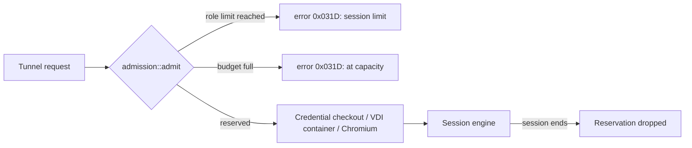

- Budget: `STRATA_SESSION_MEMORY_BUDGET_MB`, else three quarters of the
  cgroup memory limit (or host memory) less the replay budget, never
  below 256 MiB. Re-read on every admission, so it follows a resized host
  or `docker update --memory` without a restart. The Compose file sets no
  backend limit by default (`STRATA_BACKEND_MEMORY` / `STRATA_BACKEND_CPUS`).
- Per user: `roles.max_concurrent_sessions` (migration 101), else
  `STRATA_MAX_SESSIONS_PER_USER`; `max_web_sessions` caps kiosks.
- Observer replay history shares one budget (`STRATA_NVR_MEMORY_BUDGET_MB`,
  1 GiB) instead of a fixed buffer per session.
- Within a session, each client's clipboard and upload streams have
  count, size, idle and rate limits, and incoming clipboard data is capped
  at 256 MiB across all sessions (SEC-15).
- Reserved, limit, refused, replay and clipboard figures are reported
  under `memory` in `GET /api/admin/metrics`.

#### How a refusal reaches the browser (v2.3.5)

A browser does not expose the HTTP status of a failed WebSocket upgrade to
the page, so a refusal sent as `429` looked to the client exactly like a
dropped network and it retried — the user saw **Reconnecting…** for minutes.
`ws_tunnel` in [`routes/tunnel.rs`](../backend/src/routes/tunnel.rs) now
holds the `WebSocketUpgrade` until the session is ready (`open_tunnel`), and
any error before that point is delivered by `refuse_over_socket`: it accepts
the upgrade, sends one Guacamole `error` instruction carrying the
client-safe message from `error_status_and_message` and a status from
`guac_status`, and closes. The browser treats an `error` instruction as a
server-side end, shows the overlay and does not retry.

| Refusal | `AppError` | Guacamole status | Overlay heading |
| ------- | ---------- | ---------------- | --------------- |
| Budget full, per-user limit, tunnel rate limit | `RateLimited` / `TooManyAttempts` | `0x031D` `CLIENT_TOO_MANY` | Session Limit Reached |
| Setup not complete | `SetupRequired` | `0x0201` `SERVER_BUSY` | Server Unavailable |
| Bad request | `Validation` | `0x0300` `CLIENT_BAD_REQUEST` | Connection Error |
| Ticket for another user or connection | `Auth` | `0x0301` `CLIENT_UNAUTHORIZED` | Access Denied |
| No role access to the connection | `Forbidden` | `0x0303` `CLIENT_FORBIDDEN` | Access Denied |
| Connection not found | `NotFound` | `0x0204` `RESOURCE_NOT_FOUND` | Connection Error |
| Anything else | other | `0x0200` `SERVER_ERROR` (generic text) | Connection Error |

Failures of the authentication middleware (no or expired token) happen
before the handler and are still plain HTTP responses.

#### Capacity reporting

The admin **Native Engine Capacity** card (`GET /api/admin/metrics`) sizes
itself from what the backend can actually use — `admission::memory_capacity`
(the cgroup limit capped at host RAM) and `admission::cpu_capacity`
(`std::thread::available_parallelism`, which honours cgroup CPU quotas) —
not the host's totals. **Max Recommended** is the lower of the admission
budget ÷ the average live reservation and 70% of the CPUs ÷ 0.15 CPU per
session. **Backend Memory** is the backend process's resident memory (web
sessions' Chromium and Xvnc are separate processes and not included).

### Shared state across replicas

Everything a second backend replica must agree on is now in PostgreSQL:

| Concern | Before v2.3.0 | Now |
| ------- | ------------- | --- |
| Sign-in / password-change limits | In-memory per replica | `auth_attempts` + `auth_attempt_reserve()` (migration 102), serialised per bucket by an advisory lock |
| Refresh tokens | Not rotated | `refresh_tokens` families: rotation in one transaction, reuse revokes the family ([`refresh_tokens.rs`](../backend/src/services/refresh_tokens.rs)) |
| Token revocation | Loaded at start | Synchronised every 15 s; a replica that cannot synchronise for 5 minutes refuses tokens |
| Managed-account password operations | Not serialised per account across replicas | One per account (`managed_account_locks`, migration 097, which replaces the per-checkout activation lease added in 095); the password being set is kept sealed on the checkout row from just before the AD reset until the checkout commits |
| Connection health sweep | Every replica probed every connection | One replica per pass via `worker_leases` ([`worker_lease.rs`](../backend/src/services/worker_lease.rs)); the claim lapses if its holder dies |
| Audit chain head | Read and written by the application | `audit_append()` under a chain lock in the database (migration 098) |

Cache misses for the same key (OIDC discovery and JWKS, for example)
queue behind one fetch through
[`keyed_lock.rs`](../backend/src/services/keyed_lock.rs) instead of all
going upstream (PERF-14).

### Audit integrity (SEC-17)

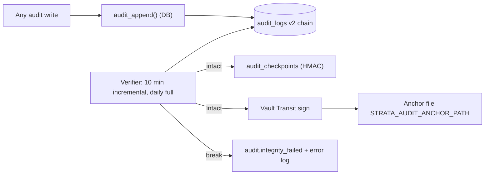

The application no longer computes chain digests; the database function
does, so two replicas cannot fork the chain. The runtime database role
cannot disable the triggers that make the table append-only. The anchor
file lives outside the database (the `audit-anchor` volume in Compose), so
rewriting the chain and its checkpoints together is still detected.
`GET /api/admin/audit-status` reports write latency and the verifier's
last result.

### Files: chunked encryption and one transfer policy

- **Chunked encryption (PERF-03).** Staged outbound files are sealed by
  [`file_crypto.rs`](../backend/src/services/file_crypto.rs) as a sequence of
  AES-256-GCM chunks under the STREAM construction, so encryption and
  decryption run in bounded memory and reordered, duplicated or truncated
  chunks fail authentication. At most `STRATA_FILE_CRYPTO_CONCURRENCY`
  files (one per CPU, up to 4) are processed at once.
- **SFTP file browser (SEC-10).** Transfers made in the SFTP browser used
  to bypass both Quick Share controls. They now pass
  [`transfer_gate.rs`](../backend/src/services/transfer_gate.rs): uploads are
  scanned like inbound Quick Share; downloads are scanned and then
  submitted to the outbound approval queue.

### Recordings (SEC-16, PERF-13)

Recordings carry a status (`recording`, `complete`, `incomplete`,
`failed`; migration 099) and are synced to disk every 5 seconds. Every
session end finalises its recording. While recording,
[`recording_index.rs`](../backend/src/services/recording_index.rs) writes a
seek checkpoint every 8 MiB — the byte offset of an instruction boundary
plus a prelude that rebuilds the display at that point — so seeking starts
from the nearest checkpoint instead of replaying from the first byte.

### Trust boundaries tightened

- **Vault** is reached over verified TLS with a Transit-only token
  ([HashiCorp Vault](#5-hashicorp-vault)).
- **PostgreSQL** requests run as the least-privilege runtime role
  ([PostgreSQL](#4-postgresql)).
- **Client IP** is resolved once per request by
  [`client_ip.rs`](../backend/src/services/client_ip.rs): verified DMZ edge
  header, then `X-Forwarded-For` only from `STRATA_TRUSTED_PROXIES` when
  `STRATA_TRUST_XFF=1`, then the socket peer (SEC-20).
- **Web kiosks** run Chromium with its sandbox under a seccomp profile,
  Xvnc on loopback only, and the initial URL checked against
  `web_allowed_networks` (SEC-02/03/04).

### DMZ link streaming (PERF-02)

The internal node streams request and response bodies through the DMZ
link instead of collecting up to 8 MiB of each, so large uploads and
downloads work through the DMZ. Unread body is bounded by h2 flow control
(1 MiB per stream, 16 MiB per link); bodies over 512 MiB are refused; a
body idle for 60 seconds fails and a stream open for 30 minutes is reset.
Detail: [dmz.md § Streaming through the internal node](dmz.md#streaming-through-the-internal-node-perf-02).
**Both nodes must run v2.3.0.**

### Frontend

- **Cross-tab sharing (PERF-15).** Data every tab polls (pending
  approvals, leases and similar) goes through
  [`sharedFetch`](../frontend/src/utils/sharedFetch.ts): a Web Lock per key
  and a `BroadcastChannel` mean it is fetched about once per interval
  however many tabs are open. Token refresh takes the
  `strata-auth-refresh` Web Lock so tabs present the newest refresh
  cookie in turn rather than a spent one.
- **Lazy routes.** Pages other than sign-in, the dashboard and the session
  client are
  loaded on demand (`React.lazy`), each behind a `PageLoadBoundary` that
  catches a chunk that fails to load after a new release and asks the user
  to reload (it does not reload by itself, which would end live sessions).
- **Paged lists.** The admin connections and users lists and the user's
  dashboard read server-side pages (`/page`, `/refs`, `/summary`,
  `/facets` endpoints) instead of loading every row.

## Extended protocols

In addition to the classic RDP / SSH / VNC connections, Strata
supports three driver-backed connection types where the backend
supervises a workload on the user's behalf:

- **Web Sessions** (`web` protocol) — ephemeral kiosk Chromium inside
  Xvnc, tunnelled as VNC. See [`web-sessions.md`](web-sessions.md).
- **VDI Desktop Containers** (`vdi` protocol) — Strata-managed
  Docker container running xrdp, tunnelled as RDP. See
  [`vdi.md`](vdi.md).
- **Kubernetes Pod Console** (`kubernetes` protocol, v1.4.0) —
  `kubectl attach` / `kubectl exec` into a named pod, rendered as a
  terminal via the engine's `kubernetes` client
  ([`crates/strata-session/src/engine/kube`](../crates/strata-session/src/engine/kube/)).
  Connection extras carry `pod`, `namespace`,
  `container`, `exec-command`, `use-ssl`, `ca-cert` and `client-cert`;
  the matching `client-key` private bytes live exclusively in a
  Vault-encrypted credential profile and are remapped from the
  profile's password slot into the `client-key` parameter at
  handshake time (see `routes/tunnel.rs`). Operators import their
  `~/.kube/config` via `POST /api/admin/kubernetes/parse-kubeconfig`,
  which extracts the cluster server URL, namespace, CA cert and
  client cert into the form and shows the private key once for the
  operator to paste into a credential profile.

All three extensions land their per-connection configuration in
`connections.extra` (JSONB) and inherit the existing recording, audit,
and credential-mapping pipelines unchanged.

### Web Sessions runtime (shipped v0.30.0)

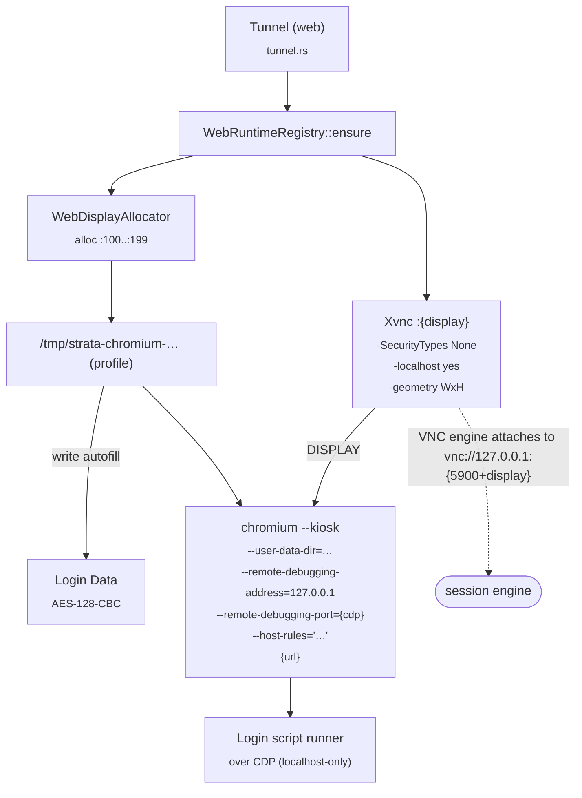

Allocator state machine: `WebDisplayAllocator` keeps a `BTreeSet<u8>`
of free displays; `acquire()` removes the first; `release(display)`
re-inserts. The cap of 100 simultaneous sessions is the size of the
range `:100..:199`. `CdpPortAllocator` mirrors the structure for
`9222..9421`. Both are `Arc<…>` so the runtime can share them across
spawn workers.

Reuse semantics: `WebRuntimeRegistry::ensure(connection_id, user_id,
session_id, spec)` returns the existing handle for a `(connection_id,
user_id)` pair if one is registered and still alive, so a tab refresh
doesn't pay the spawn cost twice. When the tunnel closes the registry
keeps the handle for a short grace window; an idle reaper destroys it
afterwards.

#### Trusted CA bundles for Web Sessions (v1.2.0)

A new admin-managed table `trusted_ca_bundles` stores PEMs once with
a friendly name; any `web` connection can attach a bundle via
`extra.trusted_ca_id`. RDP connections use the same key for certificate
trust (v2.0.0), and since v2.3.1 an AD sync source can set it in
`connection_defaults`, so every connection the source creates or updates
carries it. For RDP the tunnel resolves the id to its PEM and **fails closed**
if the bundle no longer exists, which is why a bundle referenced by a
connection or used as an AD sync default cannot be deleted. The web-session
runtime path is:

1. `routes/tunnel.rs` resolves `cfg.trusted_ca_id` to the PEM bytes
   via `services::trusted_ca::get(&pool, id)` _before_ constructing
   the `WebSpawnSpec`.
2. `WebSpawnSpec.trusted_ca_pem` and `trusted_ca_label` flow into the
   spawn worker.
3. The worker calls `services::trusted_ca::import_pem_into_nss_db(
&pem, profile_dir, label)` which executes
   `certutil -N --empty-password -d sql:<profile>/.pki/nssdb` followed
   by `certutil -A -d sql:<profile>/.pki/nssdb -n <label> -t "C,," -i <tmp.pem>`.
4. Chromium reads the NSS DB at startup and trusts the supplied roots
   without any `--ignore-certificate-errors` flag.
5. The NSS DB lives inside the per-session profile directory and is
   destroyed with it on session end.

`certutil` is provided by the `libnss3-tools` apt package, baked into
the backend image since v1.2.0. PEMs are validated at upload time
with `rustls_pki_types::CertificateDer::pem_slice_iter` + `x509_parser::parse_x509_certificate`
and the parsed `subject` / `not_after` / `fingerprint` (SHA-256 hex,
colon-separated) are cached on the row so list views never re-parse.
The PEM column is treated as **public material** (signatures over
public keys) and is _not_ envelope-encrypted via Vault — see the
[Security](security.md) document for the rationale.

### VDI runtime (shipped v0.30.0)

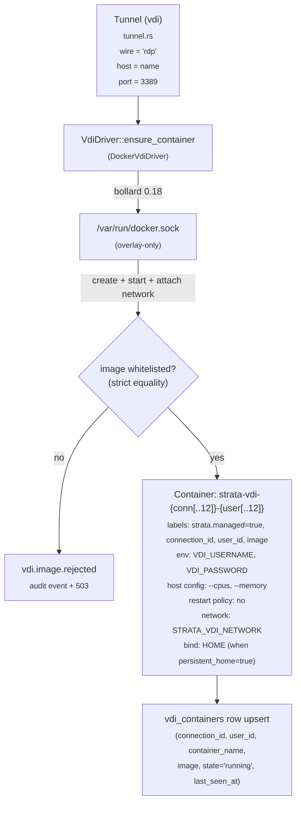

Deterministic naming: `container_name_for(connection_id, user_id)`
takes the first 12 hex chars of each UUID, separated by `-`, with the
prefix `strata-vdi-`. The same `(connection, user)` pair always
resolves to the same name, so `ensure_container` short-circuits to a
reuse path when the container already exists.

Ephemeral credentials: when the credential cascade resolves to no
password, `ephemeral_credentials(strata_username)` returns a
`(sanitised_posix_username, fresh_24char_password)` pair. The
sanitised username is a pure function of the Strata username so the
bind-mounted `$HOME` is consistent across reconnects; the password is
fresh per call so the live xrdp instance always sees a new value.

Wire-protocol translation: `tunnel.rs` rewrites
`wire_protocol = "rdp"` and replaces hostname/port with the
network-attached endpoint. The original `vdi` label is preserved on
`nvr_protocol` so recordings keep the operator-facing icon.

Network resolution: `STRATA_VDI_NETWORK` (env var, threaded through
`main.rs`) defaults to
`${COMPOSE_PROJECT_NAME:-strata-client}_guac-internal` in the overlay
file so containers join the same Compose-prefixed network as the rest
of the stack.

Socket permission handling: `entrypoint.sh` either creates a
`docker-host` group at the socket's GID (Linux distros) or `chgrp` +
`chmod g+rw` the bind-mount in place (Docker Desktop GID 0). See
[`vdi.md`](vdi.md) § _Docker socket permissions_ for the exact
script.

VDI-specific tunnel parameter overrides:

| Param           | Forced for VDI | Reason                                                       |
| --------------- | -------------- | ------------------------------------------------------------ |
| `ignore-cert`   | `true`         | Per-container self-signed cert; both ends Strata-controlled. |
| `security`      | `any`          | xrdp negotiates whatever it can.                             |
| `resize-method` | `""`           | xrdp's display-update channel drops on resize storms.        |
