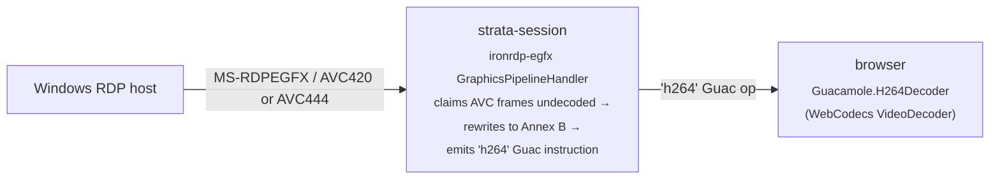

# H.264 GFX passthrough

> **Reinstated on the native RDP engine.**
>
> Passthrough was originally a property of the patched `guacd` image and was
> removed in v2.0.0 along with it. It now runs natively on `ironrdp-egfx`,
> with no `guacd` and no FreeRDP anywhere in the path.
>
> It is **off by default**. Enable it per connection with **Enable graphics
> pipeline (GFX)**, which sets `disable-gfx=false`.
>
> Turning GFX on stops the host sending legacy bitmap updates, so it is a
> genuine trade rather than a free win: H.264 is lossy, and the lossless
> bitmap path measured **0.0296 bytes per pixel** on the pilot estate --
> already inside the bandwidth budget. Prefer GFX for motion-heavy work
> (video, scrolling, window drags) and the bitmap path for static text.

Strata's RDP pipeline streams **raw H.264 NAL units** from the Windows host all
the way to the browser's `VideoDecoder` (WebCodecs API). There is no
server-side decode/re-encode step. This document covers the moving parts, the
Windows host prerequisites, and how to verify the codec is actually flowing.

## Pipeline overview



### Components

| Layer | File / artefact | Role |
|---|---|---|
| EGFX handler | [`crates/strata-session/src/engine/rdp/gfx.rs`](../crates/strata-session/src/engine/rdp/gfx.rs) | Implements `GraphicsPipelineHandler`. Advertises V10.7/V8.1/V8, claims AVC frames before the decode path, converts the bitstream to Annex B, and forwards solid fills and surface-to-surface copies. Non-AVC surface commands are rendered as PNG so the screen is never left blank. |
| `ironrdp-egfx` fork | [`crates/vendor/ironrdp-egfx`](../crates/vendor/ironrdp-egfx) | Adds the `accepts_avc_passthrough` / `on_avc_bitstream` hooks upstream lacks, so AVC frames can be claimed without an H.264 decoder present. Tracked by [`scripts/check-vendored-forks.sh`](../scripts/check-vendored-forks.sh). |
| `ironrdp-connector` fork | [`crates/vendor/ironrdp-connector`](../crates/vendor/ironrdp-connector) | Sets `SUPPORT_DYN_VC_GFX_PROTOCOL` in the early capability flags when GFX is enabled. Without it the host never opens the `Microsoft::Windows::RDS::Graphics` channel. |
| Backend wiring | [`backend/src/session_engine.rs`](../backend/src/session_engine.rs) | Maps the `disable-gfx` connection parameter onto `RdpConfig::enable_gfx`. The parameter is inverted: `"false"` is the *enabled* state. |
| Frontend decoder | [`frontend/src/lib/guacamole-vendor.js`](../frontend/src/lib/guacamole-vendor.js) | `H264Decoder` built on WebCodecs, plus the `waitForPending` sync gate that applies decode backpressure. Draws each frame **1:1**, cropping to the RDP destination rectangle rather than the padded coded size. |
| Admin UI toggle | [`frontend/src/pages/admin/connectionForm.tsx`](../frontend/src/pages/admin/connectionForm.tsx) | Per-connection **Enable graphics pipeline (GFX)** checkbox under Performance. |

## Windows host prerequisites

H.264 will only flow if the RDP host is configured to use AVC444. Without
this, ticking **Enable graphics pipeline (GFX)** is a silent no-op: the
graphics channel opens and the backend logs `rdp graphics pipeline
negotiated`, but the capability set comes back without an AVC flag and the
host never sends a `WireToSurface1` AVC command.

### Required registry values

These mirror sol1/rustguac's `contrib/setup-rdp-performance.ps1` exactly.

**`HKLM\SOFTWARE\Policies\Microsoft\Windows NT\Terminal Services`**

| Value | DWORD | Purpose |
|---|---|---|
| `AVC444ModePreferred` | `1` | Tells RDP to negotiate H.264 / AVC444 with the client at all. **Without this, H.264 will not flow regardless of GPU.** |
| `AVCHardwareEncodePreferred` | `1` *(GPU only)* | Use the GPU's hardware AVC encoder when available. **Skip on hosts without a real GPU.** |
| `bEnumerateHWBeforeSW` | `1` *(GPU only)* | Enumerate hardware encoders before falling back to software. |
| `fEnableDesktopComposition` | `1` | Enable DWM compositing in remote sessions (improves video overlays / smooth scroll). |
| `fEnableRemoteFXAdvancedRemoteApp` | `1` | Enable RemoteFX features for remote app sessions. |
| `VisualExperiencePolicy` | `1` | Visual experience preset = "Rich multimedia". |
| `SelectNetworkDetect` | `1` | Auto-detect network quality. |

> **Not set by the script.** `SelectTransport`, `fClientDisableUDP` and
> `MaxCompressionLevel` appear in older versions of this page and in
> rustguac's script. Strata connects over TCP with no sideband UDP
> transport (`multitransport_flags: None`) and no bulk compression
> (`compression_type: None`), so all three are inert for this client and
> are omitted rather than changing unrelated behaviour for other RDP
> clients on the same host.

**`HKLM\SYSTEM\CurrentControlSet\Control\Terminal Server\WinStations`**

| Value | DWORD | Purpose |
|---|---|---|
| `DWMFRAMEINTERVAL` | `15` | Unlocks 60 FPS RDP rendering (default is 30). `15` = 60 fps; `30` = 30 fps. |

> **⚠️ Common mistake:** older versions of this doc and helper script wrote
> `DWMFRAMEINTERVAL` under `HKLM\SOFTWARE\Microsoft\Windows\Dwm`. That key
> controls the *local* DWM and has **no effect** on RDP frame rate. The
> correct location is `Terminal Server\WinStations` as shown above.

The first Terminal Services value (`AVC444ModePreferred`) is what actually
**enables H.264 negotiation** between client and server.
`AVCHardwareEncodePreferred` only chooses between the hardware and software
encoder *once* H.264 is negotiated — it does **not** turn H.264 on by itself,
and a host with no GPU can still serve H.264 from the software encoder.

### Should I run the script if the host has no hardware GPU?

Short answer: **usually no for production, yes for verification**. Long
answer:

Without a GPU, Windows falls back to the **software AVC encoder** (an MFT
in `mfh264enc.dll`). It works, but the trade-off table is unforgiving:

| Aspect | Hardware AVC | Software AVC |
|---|---|---|
| CPU on host | ~near-zero | High (1–2 cores busy per active 1080p@30 session) |
| Latency | Low | Medium-to-high under load |
| Quality at given bitrate | Good | Lower (CPU encoders trade quality for speed) |
| Concurrency ceiling | Limited only by GPU encode slots | CPU bottleneck typically at 2–4 sessions |

**Decision matrix:**

| Your situation | Recommendation |
|---|---|
| Bare metal Windows, or Windows VM with GPU passthrough / vGPU | **Run the script, reboot, use H.264.** This is the intended deployment. |
| VM with no GPU, low concurrency (1–2 users), bandwidth-constrained network | Run the script (accept software AVC trade-off). Bandwidth saving may justify the CPU cost. |
| VM with no GPU, multiple concurrent users on a fast LAN | **Don't run the script.** Keep the bitmap path — JPEG/WebP tile encoding is cheaper on the CPU than software AVC at scale, and Strata still renders fine. |
| You just want to verify the H.264 pipeline works end-to-end | Run the script. Software AVC is fine for testing; the script auto-sets `AVCHardwareEncodePreferred=0` and warns. |

### Can H.264 be used **without** running the script?

In practice, **no**. The script does two conceptually different things:

1. **Enables AVC444 negotiation** (`AVC444ModePreferred`,
   `bEnumerateHWBeforeSW`, `SelectTransport`) — these are what tell Windows
   to negotiate H.264 with the client at all. Without them, H.264 will not
   flow regardless of GPU.
2. **Picks hardware vs software encoder** (`AVCHardwareEncodePreferred`) —
   only relevant once H.264 is negotiated.

So:

- **No script run + no GPU** → No H.264. Strata uses the bitmap path.
- **No script run + GPU** → Still no H.264 in most cases. Some Windows
  builds enable AVC444 by default if a Quick Sync / NVENC adapter is
  detected on first boot of the RDP service, but it's inconsistent. The
  script makes it deterministic.
- **Script run + no GPU** → H.264 via software encoder (works, but
  CPU-heavy; see the decision matrix above).
- **Script run + GPU** → H.264 via hardware encoder (the intended target).

### Applying the values: `Configure-RdpAvc444.ps1`

[`docs/Configure-RdpAvc444.ps1`](Configure-RdpAvc444.ps1) is a read-first
helper that:

1. Enumerates `Win32_VideoController` and decides whether the host has a
   usable hardware GPU (filtering out Microsoft Basic Display Adapter,
   Hyper-V synthetic video, RemoteFX virtual adapters, and adapters with
   < 256 MB VRAM).
2. Reads the current registry values for all five settings.
3. Prints a diff table (`Setting / Path / Current / Desired / Action`).
4. **Prompts `y/N` before changing anything.** When no GPU is detected, the
   prompt explicitly explains the software-AVC CPU cost so you can opt out.
5. Auto-adjusts `AVCHardwareEncodePreferred` to `0` if no real GPU was
   detected.
6. Optionally reboots at the end (also prompted).

Exits silently with no changes if every value is already correct.

#### Running it

On the **Windows RDP host** (the machine you connect *to*, not the Strata
container host), in an **elevated PowerShell** session:

```powershell
# Copy the script to the host first (SMB share, RDP clipboard, scp, etc.)
Set-ExecutionPolicy -Scope Process -ExecutionPolicy Bypass -Force
.\Configure-RdpAvc444.ps1
```

A reboot is required for the settings to take effect; the script offers to do
this for you when it finishes.

#### Server-SKU caveat

On Windows Server SKUs, RDP only uses the host GPU if the additional Group
Policy

> Computer Configuration → Administrative Templates → Windows Components →
> Remote Desktop Services → Remote Desktop Session Host → Remote Session
> Environment → **Use hardware graphics adapters for all Remote Desktop
> Services sessions**

is **Enabled**. The helper script detects Server SKUs and prints a reminder
about this policy; it does not attempt to set the policy itself because GPO
edits require `gpedit.msc` rather than registry writes on Server.

## Verifying H.264 is flowing

The **backend log is authoritative**. It reports what this client actually
negotiated and what it received, which is the only thing that matters.

> **Event IDs 162 and 170 are not useful here.** Earlier versions of this
> page treated the `RemoteDesktopServices-RdpCoreTS/Operational` log as the
> source of truth. Those events describe the host's own encoder state; they
> can be absent on a working passthrough session and present on a session
> that never reached this client. Use them only to diagnose the host in
> isolation.

### 1. Backend log (authoritative)

```powershell
docker compose logs backend | Select-String "graphics pipeline|h264 frame"
```

| Line | Meaning |
|---|---|
| `rdp graphics pipeline negotiated` + `caps` | The channel opened. Check the flags: `V10_7` or `V8_1` with AVC means H.264 was agreed. |
| `first rdp h264 frame passed through` | Frames are arriving. Reports `codec_id`, `keyframe`, `bytes` and the `wire` format. |
| `rdp graphics pipeline output resized` | The host resized the surface under GFX. |
| `rdp graphics pipeline closed` + `chroma_views_discarded` | Session end, plus how many AVC444 auxiliary views were dropped. |

If `negotiated` appears with no AVC flag, the host declined H.264 and the
backend logs an error telling you to turn the toggle off. If neither line
appears, the pipeline was never opened — check the GFX checkbox.

### 2. WebSocket trace

In Chrome DevTools → Network → WS → click the tunnel → Messages. Look for
frames starting with `4.h264,` — these are H.264 NAL units being sent to the
browser. If you only see `5.image,` and `4.blob,` frames, the session is on
the bitmap path.

### 3. Browser console

```js
window.client?._h264Decoder?.stats()
```

The `_h264Decoder` field is **created lazily** on the first `h264`
instruction, so:

- `undefined` → no H.264 instruction has ever arrived in this session.
  Combine with check #1 to decide whether it is the host (no AVC) or the
  engine (nothing forwarded).
- An object with `framesDecoded > 0` → H.264 is fully active.

## Troubleshooting matrix

| Symptom | Likely cause | Action |
|---|---|---|
| No `graphics pipeline negotiated` line at all | GFX is off for this connection | Tick **Enable graphics pipeline (GFX)**. The parameter is inverted, so the stored value is `disable-gfx=false`. |
| `negotiated` shows caps with no AVC flag | Host will not do H.264 | Run `Configure-RdpAvc444.ps1`, reboot, reconnect. |
| Caps come back as `V8_1 { SMALL_CACHE }` after advertising AVC420 | Host prefers 4:4:4 and strips the AVC flag rather than falling back | Already handled: the handler advertises V10.7 so the host has a 4:4:4 option to agree to. |
| Black screen with GFX on | Host is sending a surface command the handler cannot render | Check for `progressive codec` or `graphics cache` warnings in the backend log; both are unsupported under passthrough. |
| Text looks soft or hazy | Frames being rescaled rather than blitted 1:1 | Fixed: H.264 pads to a 16x16 macroblock boundary and Windows sets no crop metadata, so the decoder reports a taller frame than the picture. The client crops to the RDP destination rectangle. |
| Green line along the bottom edge | Macroblock padding rows (YUV 0,0,0) being drawn | Same fix as above. |
| `framesDecoded > 0` but rendering ghosts during fast animations | DevTools open and throttling GPU compositing | Close DevTools or detach it to a separate window. |
| Works, but text is crisper with GFX off | Expected. H.264 is lossy; the bitmap path is not. | Use GFX for motion-heavy sessions, the bitmap path for static text. |

## Why this replaced the v0.27.0 Refresh Rect mitigation

*History, from the guacd era. Neither guacd nor the patch exists any more.*

v0.27.0 shipped a guacd patch that translated a no-op resize instruction
into an RDP `Refresh Rect` PDU, asking the host to retransmit a full frame
to clear ghosting in the H.264 reference chain. That worked, but it was
treating the symptom: the ghost frames only existed because guacd was
decoding H.264 server-side and re-encoding tiles for the browser, and the
re-encoder's tile cache could fall out of sync with the AVC reference
chain on rapid window animations.

The v0.28.0 passthrough patch removes the server-side decoder entirely. The
browser's WebCodecs `VideoDecoder` consumes NAL units directly, so the tile
cache that produced the ghosts no longer exists, and Refresh Rect is no
longer necessary. The Refresh Display button in the session bar still works
— it now only does the compositor nudge.
