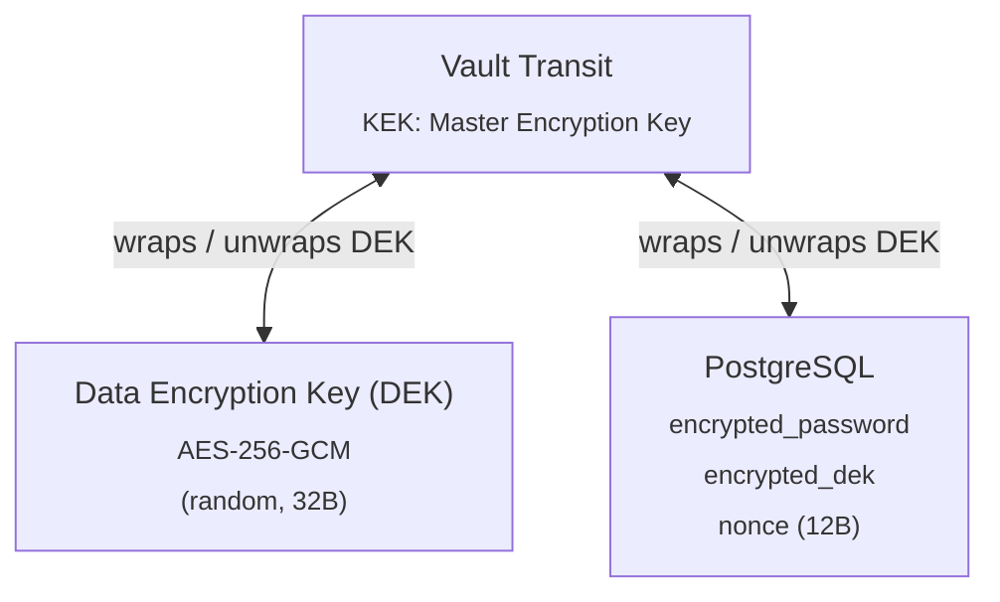

# Security

This document describes the security model, encryption architecture, and authentication flows in Strata Client.

---

## Session tier security posture (v2.0.0)

v2.0.0 removed Apache Guacamole's `guacd` daemon and moved every protocol
into native Rust engines running inside the backend process. That moves a
trust boundary, and changes several security properties. This section
states them in one place; the detail is in the sections that follow.

**The boundary that disappeared.** Sessions were previously served by a
separate C process reached over TCP 4822 on the internal Docker network.
Credentials crossed that boundary as Guacamole connection parameters,
which meant a decrypted password existed in a second process's address
space, and could surface in that process's logs or argument vector.
Session code is now in-process: the credential lives in a
`secrecy::SecretString` that zeroes on drop, redacts in `Debug`, and is
revoked on teardown even when engine shutdown fails.

**The attack surface that disappeared.** `guacd` was the largest block of
unmanaged C in the product — FreeRDP, libssh2, libvncclient, and five
local patches to keep them working, all parsing attacker-influenced
protocol data. The replacement engines are memory-safe Rust. This does
not make protocol parsing risk-free, but it removes an entire class of
it, and it removes a dependency whose CVE stream Strata had to track and
rebuild for weekly.

**Two controls that are now stricter, by design:**

| Control | Before | v2.0.0 |
| ------- | ------ | ------ |
| **RDP NLA** | The connector advertised CredSSP *and* the legacy TLS security layer, so a target could negotiate down to a layer where the RDP connection completes **before any credential is checked** — authentication moving to an in-session login screen. A live test against a non-NLA xrdp produced a healthy, apparently authenticated session from a deliberately wrong password. | CredSSP is advertised **only**. A target that will not do NLA is refused. This is also why NLA cannot be optional: RDP certificates are self-signed as a matter of course, so it is CredSSP's binding to the server's public key that authenticates the target at all. |
| **SSH host keys** | Verification depended on connection configuration. | Mandatory by default. The engine accepts a list of SHA-256 fingerprints, and a connection with none pinned is refused. Every key a host offers can be pinned, since which one is used comes out of negotiation. **Changed in v2.3.6:** an administrator can opt a single connection into trust on first use or no verification — see [SSH host-key modes](#ssh-host-key-modes-v236). |

**Certificate trust for RDP.** A connection can verify its target against
an uploaded CA bundle or a pinned SHA-256 fingerprint, with precedence
**pin > CA bundle > `ignore-cert`**. Certificate discovery reads the
target's certificate over the very channel it is meant to protect and is
deliberately **not** verified — it is the starting point for a human
decision, not proof of anything.

### SSH host-key modes (v2.3.6)

Host-key pinning stays the default and the recommendation. Version 2.3.6
adds two per-connection opt-outs, because a fleet of network devices that
cannot be pinned one by one otherwise ended up unreachable or managed
outside the gateway altogether. Both are set by someone with
`can_manage_connections`, on the connection or as an AD sync default, and
both are visible and audited:

| Mode (`host-key-policy`) | What is authenticated | Exposure | Evidence |
| ------------------------ | --------------------- | -------- | -------- |
| `pinned` (default) | Every session, against approved keys | None beyond the approval itself | `connection.host_key_approved` |
| `tofu` | Every session after the first | An attacker on the path at the **first** connection is pinned in place of the real host, and sees that session's credentials | `connection.host_key_pinned` with the key and the user whose session pinned it; **TOFU** fleet badge until then |
| `none` | Nothing | Every session can be intercepted: credentials, keystrokes and output | `connection.host_key_unverified` on every session; **Unverified** security alert on the Fleet Manager and in `host_key_unverified` |

The trust boundary is the network between the backend and the target, and
the code path is post-authentication (a Strata user opening a session).
Unrecognised mode values fail closed to `pinned`. A trust-on-first-use pin
is written only while the connection still has no key, so two first sessions
cannot replace each other's pin, and a changed key afterwards is refused
exactly as for an approved key. To re-pin after a genuine host rebuild,
clear the key (**Clear pinned host key** in the fleet menu) or approve the
new one.

**Algorithms.** RSA host keys with SHA-2 signatures are accepted by default
since v2.3.6. The per-connection `ssh-legacy-algorithms` adds `ssh-rsa`
(SHA-1 signatures), SHA-1 and NIST-curve key exchange (including the 1024-bit
`diffie-hellman-group1-sha1`), `hmac-sha1` and AES-CBC. They are offered
**after** the modern algorithms, so a host supporting both still negotiates
the modern set; enabling the flag on a modern host changes nothing on the
wire. These algorithms are weak against a well-resourced attacker on the
path; enable the flag only for devices that need it.

**Controls removed rather than reimplemented,** each because it widened
the gateway's exposure for a capability that could be met another way:

| Removed | Reasoning |
| ------- | --------- |
| RD Gateway (`gateway-*`) | A second, unaudited network hop around the gateway's own access control. |
| Microphone input | A data-exfiltration path a privileged-access gateway should not open by default. |
| Drive and printer redirection | Replaced by one SFTP path with a single permission model and a single audit trail, instead of three mechanisms with three. |
| RemoteApp | Requires an alternate shell channel whose behaviour Strata could not fully mediate. |

**Target hostname resolution** now happens in-process against the
nameservers an administrator configures, while Strata's own
infrastructure lookups stay on the container resolver. Only the socket
uses the resolved address — the hostname still reaches TLS verification
and the Kerberos SPN, so pre-resolution cannot be used to steer a session
to an attacker-controlled address while retaining a valid-looking name.

### Session-end reporting (v2.1.1)

v2.1.1 made every session end reach the browser as a Guacamole `error`
instruction with a cause-specific status code and a plain-language sentence
(design: [architecture.md](architecture.md#how-a-session-ends-v211)). Two
security properties follow from how that was done.

**Teardown now always runs after an input-path engine failure.** Before
v2.1.1, an engine error raised while forwarding client input to the target
propagated out of `SessionActor::run()` with `?`, which returned **before**
`teardown()`. On that path the engine was not shut down, the audit sink was
not finalised, and the credential guard's `revoke()` was never called — the
step this document elsewhere promises runs *"even when engine shutdown
fails"*. The input path now converts the error into an orderly end and falls
through to teardown like every other exit.

| Property | Value |
| -------- | ----- |
| Trust boundary | Backend ↔ target host |
| Reachability | **Post-authentication** — requires an established session. A target, or the network between the backend and a target, can trigger it by failing a write. |
| Effect before the fix | Recording left unfinalised; session credential guard not revoked; engine resources released only when the task was dropped |
| Other exit paths | Unchanged. `PipelineClosed` and audit-sink errors still return early, as before; they indicate the actor's own plumbing has failed, not the target |

**Client-facing text discloses no internal detail.** The browser is sent
fixed sentences chosen by the engine, never an error chain:

| Source | What reaches the browser | What stays server-side |
| ------ | ------------------------ | ---------------------- |
| Engine error (`Transport`, `Closed`, `Protocol`, `Unsupported`, `AuthRejected`) | One of five fixed sentences | The full error, logged at `WARN` (`engine failure`) |
| Failure before the session starts (v2.3.8): engine connect, required recording, session registry full | One of six fixed sentences (`ConnectError::notice`); a rejected password reads the same whether the account is wrong, disabled or locked | The full error: `Tunnel error` log line, `tunnel.failed` audit row, recording failure column |
| RDP Set Error Info, known code | A fixed sentence from `PROTOCOL_INDEPENDENT_ENDS` | The `ironrdp` reason, logged at `INFO` |
| RDP licensing / broker / protocol-error code | A fixed sentence plus the MS-RDPBCGR description — a constant compiled into `ironrdp-pdu`, not target-supplied text | — |
| SSH exit or signal | Exit status, or signal name and the server's error message | — |
| Kubernetes close / exec status, VNC error | Target- or library-supplied text, as before v2.1.1 | — |

The last row is pre-existing and deliberate — a pod's own error message is
the most useful thing an operator can be shown — and it is safe to display
because the SPA renders it as React text, never as markup. The rest of the
table exists so that a transport failure cannot reveal internal hostnames,
resolved addresses or socket errors to an end user.

The browser keys **no** security decision on the status code. The only
behaviour the overlay derives from an end is whether to offer **Reconnect**,
and an administrator termination is recognised by its text on the same
basis as before; reconnecting still goes through a fresh tunnel ticket and
the full authorisation path.

### RDP device-redirection channel (v2.1.1)

Windows Server 2019 and 2022 will not send RDPSND audio unless the client
also advertises the device-redirection virtual channel (RDPDR, MS-RDPEFS).
v2.1.1 therefore registers RDPDR — but as a pairing token only:

- The device list is **empty**, and the backend is `NoopRdpdrBackend`. No
  drive, printer, serial/parallel port or smart card is announced, so the
  host has nothing to open and no I/O request it sends can reach a local
  resource.
- Drive and printer redirection remain **removed**, exactly as recorded in
  the v2.0.0 table above; file transfer stays on the single audited SFTP
  path.
- RDPDR and RDPSND are attached together in one function,
  `with_audio_channels()`, and a unit test asserts both, so the channel
  cannot be dropped as apparent dead code (which would silently kill audio)
  or grown into real redirection without the change being visible.

Both channels are registered on every RDP connection. `disable-audio` does
not remove them; it sets `INFO_NOAUDIOPLAYBACK` in the Client Info PDU, which
tells the host not to redirect audio at all. The empty RDPDR channel carries
the same (nil) exposure either way.

---

## Authentication

### OIDC / OpenID Connect (Multi-SSO support since v1.9.0)

Strata Client supports configuring **multiple standard OpenID Connect (OIDC) identity providers (IdPs)** simultaneously. The active providers are rendered dynamically as custom-labeled, branded buttons on the login screen. Client secrets for all providers are encrypted at rest with HashiCorp Vault's Transit Secrets Engine under the dedicated transit key path `transit/encrypt/strata-sso` before being written to the PostgreSQL database.

An in-memory cache/state tracking system is introduced to hold discovery clients and handle connection tests safely.

**Flow:**

1. Frontend queries `/api/auth/sso/providers` to fetch the active list of providers and renders custom sign-in buttons.
2. When the user clicks a button, a request is sent to `/api/auth/sso/login?provider=<id>` which generates a unique authorization URL for that specific provider, with a random `state`, a PKCE `S256` challenge and an OIDC `nonce`. The response sets an `HttpOnly; Secure; SameSite=Lax` `sso_binding` cookie (path `/api/auth/sso`, 5 minutes) whose hash is stored with the state.
3. The user is redirected to the target IdP's authorization endpoint.
4. User authenticates with the IdP (e.g., Keycloak, Entra ID).
5. IdP redirects back to the backend callback (`GET /api/auth/sso/callback`) with an authorization code and the state.
6. The backend consumes the state (single use), requires the presented `sso_binding` cookie to match (so a callback URL completed in another browser is refused), decrypts the provider's `client_secret` via Vault, and exchanges the code together with the PKCE verifier.
7. Backend validates the token:
   - Fetches the IdP's `/.well-known/openid-configuration`
   - Downloads the JWKS (JSON Web Key Set)
   - Verifies the token signature (RS256) using the matching `kid`
   - Validates `iss` (issuer), `aud` (audience/client_id), `exp` (expiry) and `nonce`
   - Resolves the local account by email, then checks the identity: an account already linked must match both `sub` and the provider's issuer (`users.sso_issuer`); a first link is refused if the account has a local password or the IdP reports `email_verified: false`, and is written compare-and-set.

### Local Authentication

For environments without an OIDC provider, Strata Client supports built-in username/password authentication. Passwords are hashed using Argon2id before storage. Local authentication can be globally disabled via the Admin Settings; when disabled, the backend strictly rejects all local login attempts with a 401.

**Password Policy:**

- Minimum 12 characters enforced on user creation and password change
- Maximum 256 characters (login input and new passwords alike)
- Argon2id hashing with cryptographically random salts, run on the blocking pool with at most `STRATA_PASSWORD_HASH_CONCURRENCY` at once (default: one per CPU, up to 4); a request that waits more than 10 seconds for a slot is told the server is busy (PERF-01). An unknown username costs the same Argon2 work as a wrong password, so timing does not reveal which usernames exist.
- Attempts are limited in PostgreSQL before any hashing — see [Rate Limiting](#rate-limiting)
- Users can change their own password via `PUT /api/auth/password` (requires current password verification)
- Admins can force-reset any user's password via `POST /api/admin/users/:id/reset-password`
- A password change, admin reset or account deletion sets `users.sessions_valid_after` (migration 094): every access and refresh token issued before that instant is refused, and the account's native sessions are closed within 30 seconds. Restoring a deleted user does not restore its old sessions (SEC-08).

### Session Management

Authentication uses a **dual-token architecture** aligned with OWASP session timeout recommendations:

| Token         | TTL          | Storage                                        | Purpose                     |
| ------------- | ------------ | ---------------------------------------------- | --------------------------- |
| Access token  | 20 minutes   | `HttpOnly`, `Secure`, `SameSite=Strict` cookie | API authentication          |
| Refresh token | 8 hours      | `HttpOnly`, `Secure`, `SameSite=Strict` cookie | Silent access token renewal |
| `csrf_token`  | Access + 60s | `Secure`, `SameSite=Strict` cookie             | CSRF for refresh & logout   |
| `session_exp` | Access + 60s | `Secure`, `SameSite=Strict` cookie             | Expiry display for SPA      |

**Persistent JWT Signing (v1.8.3)**: Both the access and refresh tokens are signed using a persistent `JWT_SECRET` configured in the `.env` file. This ensures that user sessions remain valid across backend container restarts, providing a seamless experience during maintenance windows. If `JWT_SECRET` is not provided, the backend generates a random one on every startup, which invalidates all existing sessions (legacy behavior).

The 60-second buffer on `csrf_token` and `session_expires` (implemented in v1.8.2) ensures the SPA can access these values to perform a refresh even at the exact deadline of the access token, preventing "locked out" states where the CSRF token would otherwise expire before the final refresh request could be sent.

**Flow:**

1. On login, the backend issues an **access token**, a **refresh token**, a **CSRF token**, and a **session expiry** timestamp, all as cookies.
2. The access and refresh tokens use the `HttpOnly` attribute, meaning they cannot be read or modified by client-side JavaScript, significantly mitigating the risk of token theft via XSS.
3. The frontend uses the browser's native `credentials: "include"` fetch behavior to send these cookies automatically on every `/api/*` request.
4. When the access token expires (401 response), the frontend silently calls `POST /api/auth/refresh` (which sends the refresh cookie).
5. If refresh succeeds, a new access token cookie is issued and the original request is retried transparently.
6. If refresh fails (cookie expired or revoked), the user is redirected to the login page.
7. A **session timeout warning** toast appears 2 minutes before access token expiry, offering an "Extend Session" button.

**Token claims:** Both tokens include a `token_type` claim (`"access"` or `"refresh"`). The auth middleware rejects refresh tokens used as access tokens. A `default_token_type()` provides backward compatibility for pre-existing tokens during upgrade.

**Refresh token isolation:** The refresh cookie is scoped to `Path=/api` (so that both `/api/auth/refresh` and `/api/auth/logout` can read it) and uses `SameSite=Strict`, so it is never sent in a cross-site request.

**Per-user session tracking:** Each login records an entry in the `active_sessions` table with the token's JTI (UUID), user ID, IP address, user agent, and expiry time. This provides visibility into how many active sessions a user has.

#### Refresh-token semantics (clarified v1.6.1; rotation tracked since v2.2.x)

The refresh token is rotated on every `POST /api/auth/refresh`, against a `refresh_tokens` row per issued token. Rotation consumes the presented token and records its successor in one transaction, so of two requests racing with the same token exactly one succeeds. Tokens descend from one sign-in as a family: presenting a token more than 30 seconds after it was consumed is treated as theft and revokes the family (audited as `auth.refresh_token_reused`); within 30 seconds the server answers `409`, which the SPA treats as "another tab already refreshed". Tabs serialise refreshes through the Web Locks API where available. Sign-out revokes the family.

Refresh never extends a sign-in past 12 hours from the original authentication (`auth_time`). The 8-hour token lifetime still applies to each individual refresh token.

| Scenario                                                                | Behaviour                                                                                                                                                                                                     |
| ----------------------------------------------------------------------- | ------------------------------------------------------------------------------------------------------------------------------------------------------------------------------------------------------------- |
| User actively using the SPA or a session                                | Access token silently refreshes when it has < 10 min remaining and an activity event arrives, for up to **12 hours total** since sign-in. At 12 h the refresh fails and the user is redirected to the login page. |
| User idle (no DOM events, no Guacamole input)                           | Access token expires **20 min** after the most recent refresh. Warning toast appears at the 2-min mark with an explicit extend button.                                                                        |
| Refresh token revoked server-side (e.g. admin signout, password change) | Next `POST /api/auth/refresh` returns 401; the WebSocket-tunnel auth watchdog (≤ 30 s tick) tears the active session down on the backend.                                                                     |

#### Session-activity bus inside remote sessions (v1.6.1)

The proactive refresh in `SessionTimeoutWarning` listens for
`mousedown` / `keydown` / `touchstart` / `scroll` on `window`. Inside an active Guacamole session, however, the vendored `guacamole-common-js` library installs `Keyboard(document)` and `Mouse(displayEl)` handlers that call `event.preventDefault()` and `event.stopPropagation()` on every input event before it can bubble to `window`. Before v1.6.1 a user actively typing or clicking inside an RDP / SSH session produced **zero** events that the timeout warning could observe, so the access token expired at the 20-minute mark and the next API call returned 401 — even though the user had been demonstrably active.

v1.6.1 introduces a `sessionActivity` event bus
(`frontend/src/components/sessionActivity.ts`). The Guacamole input
callbacks in `SessionManager.tsx`, `SessionClient.tsx`,
`usePopOut.ts` and `useMultiMonitor.ts` call
`notifySessionActivity()`, which dispatches a 1-Hz-throttled
`strata-session-activity` window event;
`SessionTimeoutWarning` subscribes to it alongside the existing DOM
events. The result is a single in-process invariant —
**as long as the user is interacting with any window of any session, they cannot be silently signed out** — until the 12-hour absolute sign-in limit (`ABSOLUTE_SESSION_TTL`, v2.3.0), which is the only hard cap on session length. See [docs/architecture.md § Session-activity bus and proactive token refresh (v1.6.1)](architecture.md#session-activity-bus-and-proactive-token-refresh-v161) for the full call-site table and design rationale.

#### Global Cache-Control Headers (v1.8.2)

Since v1.8.2, a global middleware policy in `backend/src/routes/mod.rs` applies consistent security headers to every API response:

- **`Cache-Control: no-store, no-cache, must-revalidate, proxy-revalidate`** — Prevents sensitive JSON payloads, user metadata, or tunnel secrets from being cached by the browser's disk/memory cache or intermediary forward/reverse proxies.

#### Nginx NJS Header Masking (v1.8.3)

To prevent technology fingerprinting, the Nginx gateway is configured with **Nginx JavaScript (njs)** to intercept and modify response headers globally:

- **`Server`** header is masked to "Strata".
- **`X-Powered-By`** header is removed entirely.
- **`Content-Security-Policy: frame-ancestors 'none'`** is enforced globally to prevent clickjacking.

This NJS-based approach ensures that even error pages generated internally by Nginx (which normally bypass the backend's header logic) adhere to the project's security standards.

#### SSO callback hardening (v1.6.1; revised v1.8.2, v1.9.0)

The OIDC callback handler is hardened against replay attacks, provider mismatch vulnerabilities, and Chromium's BFCache:

- **State and Provider Tracking (v1.9.0)**: The `state` parameter is a cryptographically strong UUIDv4. To support multiple OIDC providers concurrently, the backend stores a mapping of the generated `state` UUID to the target provider's UUID in an in-memory TTL-expiring cache (`sso_state_cache`) during initiation. Upon callback, the backend validates and consumes this `state` parameter exactly once. This securely maps the authentication callback back to the correct provider configuration for token exchange and validation, eliminating mismatch vulnerability vectors.
- **Global Cache-Control**: Prior to v1.8.2, `no-store` was applied specifically to SSO redirects. It is now part of the global middleware policy, ensuring the OIDC `code` and `state` transition never enters the browser's navigation history cache.
- **Diagnostic timing trace.** Every successful SSO callback emits an info-level tracing line on the `strata::auth::sso` target with `discovery_ms`, `token_exchange_ms`, `token_validate_ms`, and `total_so_far_ms`.

#### OIDC RP-Initiated Logout (v1.12.6)

Prior to v1.12.6, `POST /api/auth/logout` cleared Strata's own session cookies and revoked the local JWT but **never contacted the IdP**. The browser kept the upstream Keycloak SSO cookie, so the next click of **Sign in** silently re-authenticated against the surviving Keycloak session without prompting for a password or MFA challenge — a pentester confirmed the workstation-walk-away threat model collapsed to two clicks.

v1.12.6 wires up [OpenID Connect RP-Initiated Logout 1.0](https://openid.net/specs/openid-connect-rpinitiated-1_0.html):

- **`GET /api/auth/sso/callback`** now persists the raw `id_token` in a `HttpOnly; Secure; SameSite=Strict; Path=/api` cookie alongside the existing access / refresh / csrf / session_expires set. Lifetime matches the refresh token so the hint survives access-token rotation. The cookie is HttpOnly so SPA JavaScript can never read it; Path=/api so it is only sent on backend calls; SameSite=Strict so a third-party site cannot exfiltrate it via a cross-site request.
- **`POST /api/auth/logout`** now reads the `id_token` cookie, decodes the unverified `iss` claim (safe because the token was cryptographically verified at SSO callback time and the cookie is locked behind HttpOnly + Secure + SameSite=Strict + Path=/api), looks up the matching `sso_providers` row by `issuer_url`, fetches the IdP's OIDC discovery document (cached in `services::auth`), and — if the IdP advertises `end_session_endpoint` — returns the fully-formed RP-initiated logout URL in a new `post_logout_url` field on the JSON response:

  ```
  {end_session_endpoint}?id_token_hint=<id_token>&post_logout_redirect_uri=<base_url>/login&client_id=<client_id>
  ```

- The SPA's `handleLogout` navigates the browser to `post_logout_url` via `window.location.assign(...)` after tearing down local state. Keycloak terminates its own session and bounces the browser back to `/login` via the registered `post_logout_redirect_uri`.
- The new `id_token` cookie is **tombstoned (`Max-Age=0`) on every logout** — including local-account logouts where no id_token was ever set — so a stale value never leaks across sessions on a shared workstation.
- `OidcDiscovery.end_session_endpoint` deserialises with `serde(default)`. Legacy IdPs that omit the field continue to parse, and the backend falls back to the pre-fix local-only logout path (logged at `warn` level the first time it can't build the URL).

**Operator requirement.** Keycloak ≥ 25.0 validates **Valid Redirect URIs** and **Valid Post Logout Redirect URIs** separately. Operators must register `https://<your-strata-fqdn>/login` under the post-logout field, otherwise Keycloak rejects the redirect with `Invalid redirect uri` and the user lands on a Keycloak error page instead of `/login`. The user IS still logged out of both Strata AND Keycloak at that point (the redirect rejection happens AFTER the session is destroyed) — they just see a confusing error page. See [`docs/deployment.md`](deployment.md) §5 OIDC / SSO for the configuration steps.

### WebSocket-tunnel auth watchdog (v1.3.2; revised v1.4.1)

A WebSocket tunnel that has already passed the upgrade-time `require_auth` check is, in HTTP terms, a single very long-lived request. Without further checks, an access token that is _revoked_ during that request stays in force for the lifetime of the tunnel — typically until the operator's tab closes. On hosts where browser tabs were terminated without a graceful close (OS task-killer, kernel OOM, network drop, force-quit), the tunnel could continue proxying frames into a recording for hours.

`backend/src/routes/tunnel.rs` `ws_tunnel` mitigates this with an in-band auth watchdog:

1. The access token used to authenticate the upgrade is captured (Bearer header → `access_token` cookie → query string, matching `require_auth`'s priority order) and stored as `watchdog_token`.
2. The upgrade-time wall-clock instant is captured as `upgraded_at`.
3. A 30-second `tokio::time::interval` tick loop runs alongside `tunnel::proxy(...)`. On every tick the watchdog:
   - calls `services::token_revocation::is_revoked(token)` (O(1) lookup against an in-memory `RwLock<HashSet>`) — if revoked, abort with `reason = "revoked"`,
   - compares `Instant::now() - upgraded_at` to `MAX_TUNNEL_DURATION = 8h` — if exceeded, abort with `reason = "max_duration"`.
4. Either condition logs at `INFO` and aborts the proxy loop, so the recording stream flushes, the `session_registry` row decrements, and the live-sessions admin page accurately reflects the live set.

The 30 s cadence detects revocation in ≤ 30 s even on an aggressive 1-minute access-token TTL while costing at most 40 ticks per session on a normal 20-minute TTL — negligible next to the WebSocket I/O. Polling is a deliberate choice over a notification channel because both checks are cheap, in-process operations; per-tunnel subscribers would add complexity for no measurable benefit.

#### v1.4.1: removal of `exp`-claim enforcement

The original v1.3.2 watchdog also decoded the access token's `exp` claim once at upgrade time and reaped the tunnel when wall-clock `Utc::now()` reached that timestamp. This **looked** correct but was wrong in practice: access tokens carry a 20-minute TTL, and the frontend's `SessionTimeoutWarning` proactively rotates them via `POST /api/auth/refresh` after roughly ten minutes of UI activity. The already-open WebSocket has no mechanism to learn about that rotation, so the watchdog held on to the _original_ token's `exp` and reaped the session at T+20m even when the user was actively driving the UI. From the operator's point of view this was _"my session keeps disconnecting every 20 minutes"_; from the audit log it surfaced as `tunnel.terminated reason: "expired"`.

The fix in v1.4.1 removes the `exp` decode and the `watchdog_exp: Option<u64>` cache entirely. The 8-hour `MAX_TUNNEL_DURATION` hard cap is the new long-tail backstop and is _deliberately measured against `upgraded_at`_ (an `Instant`, not a token claim), so token rotation cannot move the deadline. The `tunnel.terminated` audit `reason` enum gained `"max_duration"` and lost `"expired"`; consumers that filtered on `expired` should also accept `max_duration` — they refer to the same defence-in-depth backstop, just measured differently.

| Teardown trigger                   | Mechanism                                                               | Audit `reason`            | Latency        |
| ---------------------------------- | ----------------------------------------------------------------------- | ------------------------- | -------------- |
| Manual logout / 20-min idle logout | Frontend calls `/api/auth/logout` → both tokens revoked → watchdog tick | `revoked`                 | ≤ 30 s         |
| Browser closed / network died      | TCP-level WebSocket close → `tunnel::proxy(...)` returns                | (TCP close, not watchdog) | immediate      |
| Long-lived idle session            | Watchdog tick observes `Instant::now() - upgraded_at >= 8h`             | `max_duration`            | ≤ 30 s past 8h |

### Tunnel transport timeouts and the reconnect cap (v2.3.8)

- **nginx `send_timeout` on `/api/` is 60 s** (the rest of the server keeps
  10 s). On an upgraded WebSocket nginx times writes *to the browser* with
  `send_timeout`, not `proxy_send_timeout`; at 10 s any network stall that
  long dropped the session. The trade-off is that a client which stops
  reading can hold a tunnel connection for up to 60 s before nginx frees it,
  instead of 10 s. Every tunnel already requires an authenticated, one-time
  ticket and passes session admission, so this does not widen what an
  unauthenticated client can hold open; slow-header and slow-body limits
  (`client_header_timeout 10s`, `client_body_timeout 300s`) are unchanged.
- **Automatic reconnects are capped** at 5 in any rolling 10 minutes per
  tab. A connection that kept dropping used to reconnect indefinitely; in
  production one tab opened 47 sessions in 85 minutes, each a fresh sign-in
  on the target, a fresh recording and a fresh audit trail.
- **The `native session ending` log line now carries `user` (the Strata
  username) and `client_ip`** alongside `session`, `connection`,
  `duration_secs` and `reason`. Backend logs therefore contain personal
  data on every session end, as the audit log always has; apply the same
  access control and retention to the log pipeline.

### Logout closes tunnels immediately (v1.3.2)

Manual logout (and idle-timeout logout) used to flip React auth state without first closing any open Guacamole tunnels, so the backend kept proxying frames into a logged-out user's recording until the browser tab closed itself. As a defence-in-depth complement to the auth watchdog above, `App.tsx`'s `handleLogout` now calls a module-level `closeAllSessionsExternal()` helper (exported from `frontend/src/components/SessionManager.tsx`) **before** clearing user state. The helper iterates every active session and runs the same teardown the per-session disconnect button uses (`cleanupPopout`, `cleanupMultiMonitor`, `_cleanupPaste`, keyboard reset, `client.disconnect()`), each step wrapped in a best-effort `try / catch` so a single failure cannot block the rest of the logout. `handleLogout` then issues a fire-and-forget `apiLogout()` to invalidate the refresh token and clear the auth cookies. The result: backend sees clean WebSocket closes the moment the user clicks **Log out** (or hits the idle deadline), rather than after the next 30 s watchdog tick.

### Authentication Method Enforcement

Administrators can toggle `local_auth_enabled` and `sso_enabled` independently.

- **Local Auth Disabled**: The `/api/auth/login` endpoint returns `401 Unauthorized` immediately.
- **SSO Disabled**: The `/api/auth/sso/login` and `/api/auth/sso/callback` endpoints are deactivated.
- **Safety Guard**: The system prevents disabling both methods simultaneously to ensure administrative access is maintained.

### User Resolution

After token validation, the backend looks up the user in the local database by OIDC `sub` claim. The user's role is resolved via the `users.role_id → roles` foreign key. If no matching user exists, the request is rejected with a 401.

### Route Protection

| Route Group                                                                                                                         | Middleware                                                                                                                                                     |
| ----------------------------------------------------------------------------------------------------------------------------------- | -------------------------------------------------------------------------------------------------------------------------------------------------------------- |
| `/api/health`, `/api/status`, `/api/setup/*`                                                                                        | None (public)                                                                                                                                                  |
| `/api/auth/login`, `/api/auth/sso/*`                                                                                                | None (public, rate-limited)                                                                                                                                    |
| `/api/auth/refresh`                                                                                                                 | None (public, validates `HttpOnly` refresh cookie)                                                                                                             |
| `/api/shared/tunnel/:token`                                                                                                         | None (public, share-token validated; observes owner's live session via NVR broadcast; mode determines input forwarding)                                        |
| `/api/files/:token` (GET)                                                                                                           | None (public, capability-based — the random UUID token is the authorization)                                                                                   |
| `/api/auth/password`                                                                                                                | `require_auth`                                                                                                                                                 |
| `/api/admin/*`                                                                                                                      | `require_auth` + `require_admin` + granular permission checks                                                                                                  |
| `/api/admin/users/:id/reset-password`                                                                                               | `require_auth` + `require_admin` + `can_manage_users`                                                                                                          |
| `/api/user/*`, `/api/tunnel/*`, `/api/recordings/*`                                                                                 | `require_auth`                                                                                                                                                 |
| `/api/files/upload` (POST), `/api/files/session/*` (GET), `/api/files/:token` (DELETE)                                              | `require_auth` + `can_use_quick_share` (POST only; `can_manage_system` bypass); delete = owner-only                                                            |
| `/api/user/outbound-shares` (POST), `/api/user/outbound-shares/*` (GET)                                                             | `require_auth` + `can_use_quick_share_outbound` (POST only); `can_manage_system` also passes — see the note under *User-facing permissions* |
| `/api/user/outbound-shares/ingest-token` (POST)                                                                                     | `require_auth` + `can_use_quick_share_outbound`; rate-limited 10 mints/min/user; `can_manage_system` also passes the mint (not the consume) |
| `/api/outbound-shares/ingest/:token` (POST)                                                                                         | None (public, capability-based — the path-segment token IS the auth; atomic single-use; re-checks the minter's `can_use_quick_share_outbound` at consume time) |
| `/api/outbound-shares/:id/download/:token` (GET)                                                                                    | None (public, capability-based — single-use download token issued on approval / auto-release)                                                                  |
| `/api/admin/outbound-shares` (GET), `/api/admin/outbound-shares/:id/decide` (POST), `/api/admin/outbound-shares/:id/purge` (DELETE) | `require_auth` + (`can_manage_system` OR `is_outbound_approver`); purge restricted to `can_manage_system`                                                      |
| `/api/admin/outbound-share-approvers` (GET, POST, DELETE)                                                                           | `require_auth` + `can_manage_system`                                                                                                                           |
| `/api/user/sessions`                                                                                                                | `require_auth` (filtered to own sessions)                                                                                                                      |
| `/api/user/recordings`                                                                                                              | `require_auth` (filtered to own recordings)                                                                                                                    |
| `/api/user/recordings/:id/download`                                                                                                 | `require_auth` (filtered to own recordings; format=mp4\|guac; filename sanitized)                                                                              |
| `/api/admin/recordings/:id/download`                                                                                                | `require_auth` + `require_admin` + `can_view_sessions` (filename sanitized)                                                                                    |

**Permission validation:** Both `/api/tunnel/:connection_id` (WebSocket upgrade) and `/api/tunnel/ticket` (ticket issuance) strictly validate that the authenticated user matches the ticket's `user_id` and that their role grants access to the target connection, including mappings via connection folders (`role_folders`).

**Admin connection visibility:** Users with `can_manage_system` or `can_manage_connections` see — and can open — every connection (`AuthUser::can_access_all_connections()`, used by the connection list, tunnel ticket and share paths). Other users reach a connection only if their role has it in `role_connections`, **or** has the folder the connection is filed in in `role_folders`.

**Folder grants are not recursive.** Every access query compares `role_folders.folder_id = connections.folder_id` ([`services/connections.rs`](../backend/src/services/connections.rs), [`services/credential_profiles.rs`](../backend/src/services/credential_profiles.rs)). Granting *Production* does **not** grant *Production / Web tier*; each subfolder must be granted in its own right. The role editor (v2.2.0) displays exactly this: connections filed directly in a granted folder are marked *Inherited from folder*, and each ungranted subfolder of a granted folder is marked *Not covered by parent folder*. `GET /api/user/connection-folders` returns ancestor folders of reachable connections so the tree renders in place — that is display only and grants nothing.

### Granular Admin Permissions

All admin API endpoints enforce fine-grained permission checks beyond the `require_admin` middleware:

| Permission | Enforced by | What it grants | Risk (role editor) |
| ---------- | ----------- | -------------- | ------------------ |
| `can_manage_system` | `check_system_permission`, and accepted by every other `check_*` helper | System settings, Vault, SSO/OIDC, roles **and role mappings** (create, update, delete, assign connections and folders), health, metrics, certificates, Safeguard, DMZ links. Super-admin: passes every other admin check. | Critical |
| `can_manage_connections` | `check_connection_management_permission`; `can_access_all_connections()` | Connection and folder CRUD, host-key and certificate discovery, on-demand probe, admin tags, AD sync, Kerberos realms — **and opening every connection** regardless of role mappings. | Critical |
| `can_manage_users` | `check_user_management_permission`, then `authorise_user_target` / `authorise_role_grant` | User create, update, delete, restore and password reset. Without `can_manage_system` the holder may only assign roles, and act on users whose roles, grant nothing the holder lacks; may not act on their own account; and may not exempt a user from outbound Quick Share approval. The last active system administrator cannot be demoted or deleted. | Critical |
| `can_view_audit_logs` | `check_audit_permission` | Audit log listing and export. | Elevated |
| `can_view_sessions` | `check_session_permission` | Lists, observes (NVR, with rewind) and terminates **every** active session; lists, streams and downloads every recording. Not limited to the holder's own sessions — the pre-v2.2.0 dialog label *"View own sessions"* was wrong. | Elevated |
| `can_create_sharing_profiles` | inline check in [`routes/share.rs`](../backend/src/routes/share.rs) | Generating live-session share links. | Elevated |
| `can_create_users` | **none** | Reveals the user-provisioning UI and satisfies the coarse `require_admin` gate. `POST /api/admin/users` requires `can_manage_users`. | Elevated |
| `can_create_user_groups` | **none** | Reveals the roles UI and satisfies `require_admin`. Every role endpoint requires `can_manage_system`. | Elevated |
| `can_create_connections` | **none** | Reveals the connections UI and satisfies `require_admin`. Connection and folder endpoints require `can_manage_connections`. | Elevated |

**User-facing permissions** (non-administrative, explicitly excluded from `has_any_admin_permission()`):

| Permission                     | Runtime Effect                                                                                                                                                                                                                                                                                                                                                                                                                                                                                                                                                                                                                      |
| ------------------------------ | ----------------------------------------------------------------------------------------------------------------------------------------------------------------------------------------------------------------------------------------------------------------------------------------------------------------------------------------------------------------------------------------------------------------------------------------------------------------------------------------------------------------------------------------------------------------------------------------------------------------------------------- |
| `can_use_quick_share`          | Permits `POST /api/files/upload` (ephemeral in-session file CDN). Gate enforced by `services::middleware::check_quick_share_permission()`. `can_manage_system` bypasses this check.                                                                                                                                                                                                                                                                                                                                                                                                                                                 |
| `can_use_quick_share_outbound` | Permits `POST /api/user/outbound-shares` (drive-channel ingest) and `POST /api/user/outbound-shares/ingest-token` (HTTPS-snippet ingest token mint). Gate enforced by `services::middleware::check_quick_share_outbound_permission()`, which **accepts `can_manage_system` as well as the flag** (and has since v1.11.0 — earlier versions of this document said the opposite). The HTTPS-snippet **consume** path ([`routes/outbound_shares.rs`](../backend/src/routes/outbound_shares.rs)) re-reads the minter's **role flag directly**, without the super-admin allowance, so a role revoked between mint and consume cannot launder a previously-minted token — and, as a side effect, a super-admin whose role lacks the flag can mint a token that is then refused. |

Endpoints that do not match a specific permission category (e.g. role CRUD) require `can_manage_system`.

#### Role editor and the permissions it describes (v2.2.0)

v2.2.0 replaced the role dialog with an editor that states, beside every
permission, what it grants and how risky it is. Writing that text meant
checking each flag against the handlers above, and the editor now describes
the enforced behaviour rather than the intended one.

| Property | Before v2.2.0 | v2.2.0 |
| -------- | ------------- | ------ |
| `can_manage_users`, `can_manage_connections` | Stored on every role but **no control in the dialog**; an administrator could not see that a role held them | Shown, marked Critical |
| `can_view_sessions` | Labelled *"View own sessions"* | Labelled *Monitor sessions*, described as covering every session |
| Folder grants | Shown as a flat list with `└` prefixes, suggesting nesting was inherited | Tree that marks inherited connections and uncovered subfolders |
| Loading a role's mappings fails | Dialog opened with an **empty** list; **Save** then replaced the role's mappings with nothing | Dialog refuses to open; mappings are sent only when they changed |
| Connection granted directly *and* via a folder | Invisible | Shown, with a control to remove the direct grant so it cannot outlive the folder grant |

The editor changes **no** enforcement: every check listed above is exactly as
it was.

**Known limitations, recorded rather than changed in v2.2.0:**

- ~~**`can_manage_users` is equivalent to super-admin.**~~ Fixed after
  v2.2.0: delegated user managers are bounded by their own permissions (see
  the table above).
- **`can_view_sessions` is broader in the API than in the UI.** It was
  introduced as *own-session* access, and the SPA's Sessions page still shows
  a holder only their own sessions, but `check_session_permission` gates the
  admin session, NVR and recording endpoints, so the API lets a holder act on
  every session.
- **Three `can_create_*` flags are display-only.** Granting one alone
  produces an admin area whose actions return `403 Forbidden`.
- **Role changes are audited without their content.** `role.updated` records
  `{ id, name }` and `role_mappings.updated` records `{ role_id }` — not
  which permissions, folders or connections changed. Reconstructing *who
  granted what, when* needs a database snapshot comparison, not the audit
  log alone.

#### Per-handler permission checks tightened (v1.12.7)

The `/api/admin/*` router layer applies three middlewares: `require_csrf`, `require_auth`, and `require_admin`. The third is intentionally a **coarse gate** — it answers "is this user an admin-surface user at all?" by checking `AuthUser::has_any_admin_permission()` (true if **any** of the nine admin flags above is set), so a custom delegated role with a single admin flag can still reach the subset of pages that flag covers. The granular access decision is the responsibility of each handler, which calls one of `check_system_permission(&user)?`, `check_user_management_permission(&user)?`, `check_connection_management_permission(&user)?`, `check_audit_permission(&user)?`, or `check_session_permission(&user)?` from `services::middleware` before returning data.

A penetration test against v1.12.6 found that **seventeen handlers were missing that per-handler check**. The CSRF and JWT controls were intact in every case — this was strictly an authorization gap. A delegated user holding only `can_view_audit_logs=true` (a SOC-analyst-style role scoped to the audit log) could call `GET /api/admin/settings`, `GET /api/admin/recordings`, `GET /api/admin/recordings/{id}/stream`, `GET /api/admin/health`, `GET /api/admin/connections`, `GET /api/admin/connection-folders`, `GET /api/admin/tags`, `GET /api/admin/connection-tags`, `GET /api/admin/roles`, `GET /api/admin/roles/{id}/mappings`, `GET /api/admin/certs`, `POST /api/admin/dmz-links/reconnect`, `PUT /api/admin/safeguard/config`, `POST /api/admin/safeguard/test`, `GET /api/admin/metrics`, `PUT /api/admin/connection-folders/{id}`, or `DELETE /api/admin/tags/{id}` — all of which should have required a stronger permission.

v1.12.7 adds the appropriate `check_*_permission(&user)?` call as the first statement of every affected handler. The required flag per endpoint:

| Endpoint                                 | Required permission      |
| ---------------------------------------- | ------------------------ |
| `GET /api/admin/settings`                | `can_manage_system`      |
| `POST /api/admin/settings/sso/test`      | `can_manage_system`      |
| `GET /api/admin/roles`                   | `can_manage_system`      |
| `GET /api/admin/roles/{id}/mappings`     | `can_manage_system`      |
| `GET /api/admin/metrics`                 | `can_manage_system`      |
| `PUT /api/admin/safeguard/config`        | `can_manage_system`      |
| `POST /api/admin/safeguard/test`         | `can_manage_system`      |
| `GET /api/admin/health`                  | `can_manage_system`      |
| `GET /api/admin/certs`                   | `can_manage_system`      |
| `POST /api/admin/dmz-links/reconnect`    | `can_manage_system`      |
| `GET /api/admin/connections`             | `can_manage_connections` |
| `GET /api/admin/connection-folders`      | `can_manage_connections` |
| `PUT /api/admin/connection-folders/{id}` | `can_manage_connections` |
| `GET /api/admin/tags`                    | `can_manage_connections` |
| `DELETE /api/admin/tags/{id}`            | `can_manage_connections` |
| `GET /api/admin/connection-tags`         | `can_manage_connections` |
| `GET /api/admin/recordings`              | `can_view_sessions`      |
| `GET /api/admin/recordings/{id}/stream`  | `can_view_sessions`      |

`can_manage_system` is the super-admin flag and short-circuits every check above; users with the default `admin` role see no behaviour change. The `require_admin` middleware itself is **unchanged** because it correctly models the coarse "is this an admin surface?" question; tightening it would break legitimate delegated roles that should still see the subset of pages their single flag covers.

**Operator action:** if you maintain any custom delegated admin roles, audit them under **Settings → Roles**. Confirm that each role has the flag matching the endpoints its holders need to access. Roles holding only `can_view_audit_logs` continue to access the audit log surface (`GET /api/admin/audit-logs`, `GET /api/admin/audit-logs/export`, etc.) exactly as before — those handlers always had the correct per-handler check.

#### Frontend follow-up: session-tile name lookup (v1.12.8)

The v1.12.7 lockdown of `GET /api/admin/connections` revealed a long-standing frontend bug in [`frontend/src/pages/SessionClient.tsx`](../frontend/src/pages/SessionClient.tsx) — the page used the admin endpoint to translate the URL-supplied `connectionId` into a human-readable name for the session tile in the **Active Sessions** sidebar. Pre-v1.12.7 every admin-flag holder could reach the admin endpoint via the coarse `require_admin` gate, so the bug went unnoticed; post-v1.12.7 a delegated user without `can_manage_connections` got `403 Forbidden`, the defensive `.catch(() => undefined)` swallowed the error, and the tile rendered the protocol (`RDP`) instead of the actual connection name (e.g. `cicsazt1mgt-t`). The bug was purely cosmetic — sessions still connected, audit logs still recorded the correct connection ID, file transfer still worked — and was strictly a frontend display problem, not a permission bypass: the user was already authorised to launch the session via `GET /api/user/connections/{id}/info`. v1.12.8 swaps the lookup to `getMyConnections()` (the user-scoped `/api/user/connections` endpoint), which returns the same `Connection[]` shape, is filtered server-side to exactly the connections the user is allowed to launch, and requires no admin permission flag. The v1.12.7 RBAC tightening on `GET /api/admin/connections` is preserved.

---

## Encryption

### Envelope Encryption (Credentials at Rest)

User credentials (RDP/SSH passwords) are never stored in plaintext. The system uses **envelope encryption** with HashiCorp Vault's Transit Secrets Engine:



**Write path:**

1. Generate a cryptographically random 32-byte DEK (`rand::OsRng`)
2. Encrypt the password with the DEK using AES-256-GCM (produces ciphertext + 12-byte nonce)
3. Send the DEK to Vault `POST /v1/transit/encrypt/<key>` — Vault wraps it with the master key (KEK)
4. Store `(ciphertext, vault_wrapped_dek, nonce)` in PostgreSQL
5. Zeroize the plaintext DEK from Rust memory (`zeroize` crate)

**Read path:**

1. Fetch `(ciphertext, vault_wrapped_dek, nonce)` from PostgreSQL
2. Send the wrapped DEK to Vault `POST /v1/transit/decrypt/<key>` — Vault returns the plaintext DEK
3. Decrypt the password with the DEK using AES-256-GCM
4. Hand the plaintext credential to the session engine in a `secrecy::SecretString`
5. Zeroize the DEK and plaintext password from memory

> **Improved in v2.0.0.** The credential previously crossed a process
> boundary: it was written into the `guacd` handshake over TCP 4822 as a
> connection parameter, which meant it existed in a second process's
> address space and could surface in that process's logs or argument
> vector. The engine now runs in-process, so the secret stays inside a
> `SecretString` that zeroes on drop and redacts itself in `Debug`, and is
> revoked on teardown even when engine shutdown fails. **No plaintext
> credential crosses a process boundary.**

**Key properties:**

- The master key (KEK) **never leaves Vault** — it exists only inside the Transit engine
- Each credential gets a **unique, random DEK** — compromising one DEK cannot decrypt other credentials
- DEKs are only held in memory for the duration of the encrypt/decrypt operation
- Vault access is restricted by token/AppRole with minimal Transit-only permissions

### Credential Resolution Priority

When establishing a tunnel, the backend resolves credentials in the following priority order:

1. **One-off vault profile** — A `credential_profile_id` supplied on the tunnel ticket. The profile is decrypted directly from the user's `credential_profiles` table (no permanent `credential_mappings` entry required). The profile must belong to the requesting user and must not be expired.
2. **Permanently mapped vault profile** — A credential profile linked to the connection via the `credential_mappings` table.
3. **Expired profile renewal** — When a mapped profile has expired, the connection info endpoint returns its metadata. The pre-connect prompt offers an "Update & Connect" form so the user can renew the credentials (via `PUT /api/user/credential-profiles/:id`) and connect in a single step, without leaving the session flow. For **managed (password-management) profiles**, the prompt instead offers an inline checkout request (justification + duration): self-approving users get a one-click "Self-Approve & Connect" flow, while approval-required users submit a pending request and are clearly informed the connection is blocked until approved.
4. **Ticket credentials** — Username/password supplied in the one-time tunnel ticket (from the credential prompt form).
5. **Query string fallback** — Legacy credential parameters on the WebSocket URL (kept for backward compatibility).

**Expired managed credential safeguard** — The tunnel refuses to open a session when the only credential source available for a connection is an expired managed credential profile (`credential_profiles.expires_at <= now()` with a non-null `checkout_id`). This prevents stale credentials from being sent to Active Directory, which would otherwise cause repeated failed binds and could contribute to account lockout. Users are redirected to the renewal/checkout request flow instead.

**Rejected-credential retry safeguard (v2.3.8)** — The safeguard above covers credentials Strata knows are stale; this one covers credentials the target turns out to reject. The WebSocket is open before the engine connects, and up to v2.3.7 a failed connect closed it without an instruction. The browser read that as a network drop and auto-reconnected with the same credentials — up to 10 times in quick succession, each attempt a failed sign-in counted against the account's lockout threshold on the target and in Active Directory. In production one user produced a `tunnel.failed` row (*"native rdp connect: authentication rejected by target"*) and a **FAILED** recording several times a minute. `run_native` now sends a Guacamole `error` instruction before closing (`CLIENT_UNAUTHORIZED`, *"The remote computer rejected the username or password. Check the credentials before trying again: repeated attempts can lock the account."*). Any `error` instruction marks the end as server-initiated, so the client shows **Access Denied** and makes **no** further attempt; the next try is the user's decision. The message is a fixed string: whether the account exists, is disabled or is locked is not revealed to the browser, and the engine's own error stays in the log, the `tunnel.failed` audit row and the recording's failure column. Unreachable targets (`UPSTREAM_UNAVAILABLE`) and other start-up failures (`SERVER_ERROR`) are refused the same way.

**Empty-ticket cascade safeguard (v1.6.2)** — `resolve_credentials` in `routes/tunnel.rs` is the single point of truth for the cascade above. It now treats a tunnel ticket whose `password` slot is `None` as an _absent_ source and falls through to the next tier, regardless of whether the ticket carried a username. Prior to v1.6.2 the ticket arm matched purely on `Some(&ticket)` and silently emitted `(Some(<strata_user>), None)` via the fallback-username helper when no other source was available; that injected the operator's local Strata username as the SSH/RDP `username` argument in the guacd handshake, which on SSH caused the remote server to skip its in-band username prompt and only ask for a password — leaving operators no way to authenticate as a different remote account. Two unit tests in the `resolve_credentials` test module (`resolve_creds_empty_ticket_returns_none`, `resolve_creds_ticket_no_password_skipped`) lock the contract: an empty ticket never short-circuits the cascade, and a ticket with a username but no password lets the next-priority password-bearing source win.

**Extended-expiry CHECK constraint (v1.7.0)** — `credential_profiles.ttl_hours` is governed by a two-arm CHECK constraint introduced by migration `061_credential_profile_extended_expiry.sql`: when `extended_expiry = FALSE` the column must satisfy `1 <= ttl_hours <= 12`; when `extended_expiry = TRUE` the column must satisfy `1 <= ttl_hours <= 2160` (90 days). The relaxed bound is therefore unreachable for a row that has not been opted in to the extended cap, regardless of any code path that bypasses the resolver. The backend resolver `resolve_profile_ttl(user_pref, admin_max, extended_expiry)` in `routes/user.rs` selects the correct cap and `clamp(1, cap)`s the request, and `cp_svc::update_sealed` re-encrypted updates compute that cap against the **incoming** `extended_expiry` value (not the persisted one), eliminating any race window where a request could persist a TTL above the cap implied by its own flag. Existing role/ownership checks on every credential-profile mutator are unchanged — the new field is just another property of a row already authorised by `user_owns`. Operators should restrict opt-in via deployment-layer controls (the checkbox is rendered unconditionally to any user who can edit a profile) if their threat model requires it.

**Credential-profile expiry watcher (v1.8.0)** — `frontend/src/components/CredentialProfileExpiryWatcher.tsx` polls `/api/user/credential-profiles` once a minute for every authenticated, vault-configured user and surfaces a toast when each pre-expiry threshold is crossed (1 d / 1 h / 10 m for standard profiles, 7 d / 1 d / 1 h for `extended_expiry` profiles) plus a sticky error toast on `expires_at`. The watcher does **not** introduce a new endpoint, a new secret store, or a new server-side privilege check — it is a strict client-side consumer of the existing list endpoint that the credentials page already calls. Fired-threshold state lives in `localStorage` under the namespaced key `strata.credExpiryFired.v1` and contains only `{ "<profileId>:<thresholdSecs>": <expiresAtMs> }` integers; no usernames, no passwords, no server-side identifiers beyond the profile UUID. Tracker entries for profiles that have been deleted on the server are pruned on every poll so the persisted record cannot grow without bound, and a TTL re-issue (the `expires_at` shifts by more than 2 s of clock slack) drops every prior entry for that profile so the next threshold for the new window is allowed to fire fresh. The `Renew now` action on the toast deep-links to `/credentials` only — it never carries a credential payload, never auto-decrypts, and never bypasses the standard renewal flow.

**SSH / telnet single-line paste passthrough (v1.8.0)** — `frontend/src/components/pastePayload.ts` previously wrapped every SSH and telnet clipboard payload in bracketed-paste markers (`ESC[200~ … ESC[201~`) and translated `\n` to `\r`, which is the correct behaviour for multi-line pastes destined for paste-aware shells but is **wrong for password prompts** that read stdin in raw no-echo mode (`sudo`, `ssh` password auth, `passwd`, `mysql -p`, every Cisco / Juniper / Mikrotik device CLI). Those programs treated the literal escape bytes as part of the password, so authentication failed for every pasted password. v1.8.0 makes the helper byte-transparent for any payload that contains no `\r` or `\n`; multi-line pastes still get bracketed-paste wrapping and CR translation. This is a UX defect, not a security boundary — the bytes were always going through the same authenticated WebSocket on the same authenticated tunnel ticket — but the documented effect of the previous behaviour was that operators routinely typed passwords by hand instead of using their password manager, which is itself worth removing as a pressure on safe credential hygiene.

**Terminal copy (v2.3.9)** — SSH and Kubernetes sessions gained a remote → local clipboard path: a mouse selection in the terminal is sent to the browser as a Guacamole clipboard stream when the left button is released. The text is exactly what the user can already read on their screen and goes only to that user's browser over the authenticated tunnel; nothing is read from the target's own clipboard. `disable-copy` is now passed to the terminal rasteriser for both protocols: the highlight is still drawn, but the text never leaves the gateway. Before v2.3.9 these protocols had no copy path, so the flag gated nothing. Recordings treat the stream like any other clipboard event (kept, not excluded as screen output).

**Terminal scrollback (v2.3.10)** — The mouse wheel in SSH and Kubernetes sessions scrolls the gateway's own terminal history, or, when a full-screen program is on the alternate screen, is turned into three ↑ / ↓ arrow keys sent to the target ([architecture.md § Terminal scrollback](architecture.md#terminal-scrollback-and-the-mouse-wheel-v2310)). Security properties: (1) **post-authentication only** — the wheel arrives as a `mouse` instruction on an established, authorised tunnel; (2) the arrow keys are generated **only** from a wheel event, and only after the session's input moderator has accepted that event, so they are no more than the user (or a shared-control guest, who can already type) could send by pressing the arrow keys; read-only observers send no input at all; (3) the history shown is what the session already displayed to this session, held in the gateway's memory up to the connection's `scrollback` depth and freed when the session ends — nothing new is read from the target; (4) the emulator is shared by everyone attached to the session, so scrolling back changes what observers see and what the recording contains, keeping the recording a faithful copy of the screen; (5) `disable-copy` still keeps a selection made in the history on the gateway.

**Remote → local clipboard stall watchdog (v1.14.1)** — the remote → local clipboard receive path in `frontend/src/components/SessionManager.tsx` (`client.onclipboard`) is a Guacamole stream (`clipboard` → one or more `blob` → `end`) and historically wrote to `navigator.clipboard.writeText()` only when the terminating `end` instruction arrived. Under certain RDP CLIPRDR conditions (delayed-rendering clipboard owners such as Chrome/Edge/VS Code/terminals whose in-flight format-data request is interrupted by a subsequent copy, or a FreeRDP CLIPRDR state machine wedged after many transfers) `guacd` opens the stream, delivers zero or a partial set of blobs, and never emits `end` — so the local clipboard silently retained stale content until a full reconnect. v1.14.1 adds a per-stream 2-second stall watchdog that force-flushes accumulated text if `end` never arrives, acks the stalled stream so `guacd` can free the orphaned stream index, and logs a diagnostic warning. **This is an availability/resilience fix, not a security-boundary change.** No new endpoint, secret store, or server-side privilege is introduced; the same bytes already flowed over the same authenticated WebSocket and tunnel ticket. The watchdog is a strict client-side consumer of stream data the browser was already authorised to receive. A deliberate **no-clobber guard** prevents a zero-blob stall from overwriting the user's existing local clipboard with an empty string, so the failure mode can never _destroy_ clipboard contents — at worst it delivers a partial copy, which the diagnostic log makes observable. The `stream.sendAck` on stall carries only a non-fatal status code and a fixed human-readable message; no payload data is echoed back to the server.

**Clipboard size ceiling (v1.14.6, superseded by v2.0.0)** — `guacd` allocates a single fixed-size clipboard buffer per connection, and overrunning it fails **silently, and differently in each direction**. On the remote → local path the publishing calls in `guac_rdp_cliprdr_format_data_response()` sit inside the conversion's success branch, so an oversize copy emits **no `clipboard` instruction at all** — the transfer is discarded wholesale rather than truncated. On the local → remote path the same overrun truncates, at roughly half the buffer, because that direction converts UTF-8 → UTF-16.

The security-relevant properties:

- **Availability, not confidentiality.** No clipboard data crosses a trust boundary it would not otherwise cross, and no authorisation decision is affected. The failure mode is loss of user data in transit between two endpoints the user is already authorised for. It is documented here because a silent, unlogged, size-dependent data loss is indistinguishable from tampering to the user who experiences it, and because the diagnosis path below is the one an on-call engineer will need.
- **Integrity of what does arrive.** Because the remote → local overrun is all-or-nothing, a user never receives a partial payload that *looks* complete from this particular failure. That is a deliberate property of the upstream code and is preserved: the fix raises the ceiling rather than introducing partial delivery. The separate stall path can still deliver a partial, and it now says so explicitly in the console and the diagnostic ring buffer.
- **The setting is only honoured if `guacd` advertises it.** The Guacamole handshake carries values only for parameters `guacd` lists in its `args` response. A `clipboard-buffer-size` the running `guacd` does not support is dropped without comment — which is how RDP connections ran at the 262,144-byte default for several releases while the backend believed it was requesting 8 MiB. This is a general property of the handshake and applies to every parameter Strata sends: **an unadvertised parameter is silently ignored, not rejected.** The backend now logs the negotiated value at `INFO` and `WARN`s when the parameter was absent, so the condition is observable rather than inferred.
- **Bounds are enforced on both sides.** `STRATA_CLIPBOARD_BUFFER_BYTES` is clamped in `backend/src/tunnel.rs` to `guacd`'s accepted 256 KiB – 50 MB range before transmission, so an operator cannot request an allocation outside what `guacd` will honour, and the logged value always matches the effective one. `clipboard-buffer-size` remains in the `is_allowed_guacd_param` whitelist for per-connection override.
- **No change to clipboard policy.** `disable-copy` / `disable-paste` continue to gate the feature per connection, unchanged. Raising a buffer ceiling does not widen what any user may transfer, only how much of what they are already permitted to transfer survives the trip.

> **Superseded in v2.0.0.** The whole class of defect above was a property
> of `guacd`'s single fixed-size per-connection buffer, and that buffer no
> longer exists. The native engine enforces a **fixed 8 MiB ceiling per
> direction** (`MAX_CLIPBOARD_BYTES`), applied symmetrically, and a
> transfer that exceeds it is **truncated with a log line** rather than
> discarded in silence. `STRATA_CLIPBOARD_BUFFER_BYTES`,
> `STRATA_CLIPBOARD_TRACE` and the parameter-advertisement problem are all
> gone with the daemon. `disable-copy` / `disable-paste` are unchanged and
> still gate the feature per connection. The paragraphs above are retained
> because they explain the reasoning behind the current ceiling and remain
> the reference for anyone reading a pre-v2.0.0 incident.

**Local → remote clipboard serialisation (v1.14.4)** — the local → remote push path was previously six independent inline implementations (three display listeners plus a window `paste` handler in `SessionManager.tsx`, a second pair registered on the _same_ `displayEl` by `usePopOut.ts`, the `SessionMenu.tsx` textarea, and three `CommandPalette.tsx` actions). Because each read `session.remoteClipboard` before any of them wrote it back, a single click could open several clipboard streams whose `blob` instructions then interleaved into `guacd`'s single shared RDP clipboard buffer, splicing two payloads together and potentially wedging the Windows CLIPRDR channel for the remainder of the logged-on session. v1.14.4 routes every caller through `frontend/src/components/clipboardSync.ts`, which serialises transmission per session.

The security-relevant properties of that consolidation:

- **Integrity of clipboard contents.** The pre-fix behaviour could deliver a _spliced_ payload — bytes from two different copy operations concatenated into one clipboard entry — to the remote host. Where a user pastes into a shell, a config editor, or a credential prompt, silently merging two payloads is a correctness hazard with real operational consequences. Serialisation removes the interleaving entirely rather than mitigating it after the fact.
- **No change to authorisation or data scope.** The same bytes travel over the same authenticated WebSocket on the same tunnel ticket, subject to the same `disable-copy` / `disable-paste` guacd parameters (which remain admin-controllable per connection via the `is_allowed_guacd_param` whitelist in `tunnel.rs`). Consolidating five call sites into one does not widen what any caller may send; it narrows the surface that has to be reviewed when the clipboard policy changes.
- **Listener lifecycle.** Only the explicit `closeSession()` path used to invoke `session._cleanupPaste()`. The `tunnel.onstatechange` `CLOSED` handler — which fires on network drops, server-side disconnects, and every auto-reconnect attempt — did not, leaving a window-level `paste` listener bound to a dead `Guacamole.Client` for the lifetime of the page, one per drop. Each stale listener still allocated Guacamole output-stream indices on the dead client. This was an unbounded resource leak driven entirely by remote/network conditions; the fix removes both the window listener and the three `displayEl` listeners on both close paths.
- **Fail-closed writes.** `remoteClipboard` is now assigned only after a confirmed write. Previously a push into a closed tunnel — where `Guacamole.Client.endStream()` silently returns without transmitting — still recorded the text as delivered, permanently suppressing every later paste of that same text as a duplicate. Failing closed here means a lost transfer is retried rather than silently swallowed.
- **Latent client crash removed.** `frontend/src/guacamole-common-js.d.ts` declares `Guacamole.Client.isConnected()`, but the vendored 1.6.0 bundle only defines it as a private closure-scoped function; any call would have thrown a `TypeError`. Liveness is now derived from `tunnel.state`.

**Clipboard diagnostics — content-free by construction (v1.14.4)** — both the browser ring buffer (`window.strataClipboard`) and the backend `ClipboardTracer` (`STRATA_CLIPBOARD_TRACE=1`) were designed so that enabling them cannot turn an operator's clipboard into log data:

- **Contents are never captured.** Recorded fields are limited to opcode / event name, Guacamole stream index, blob counts, payload **lengths**, elapsed timings, ack status codes, and tunnel state. The only content-derived value retained is a **non-reversible 32-bit FNV-1a digest**, present solely so two entries can be compared for "same text" during triage. A 32-bit digest is not a secure hash and must not be treated as one — it is a correlation aid, not an integrity control — but it is a lossy one-way projection of the input and cannot be inverted to recover a clipboard payload.
- **Browser buffer is memory-only and bounded.** The 500-entry ring lives in page memory and is discarded on reload; it is never persisted, never transmitted, and never attached to any request. The only `localStorage` write is the boolean verbosity preference under `strata.debug.clipboard`, which contains no session or clipboard data. The dump is retrieved manually by the user from their own devtools console.
- **Backend tracer removed in v2.0.0.** `STRATA_CLIPBOARD_TRACE` and `ClipboardTracer` traced the instruction batches crossing the socket to `guacd`; there is no socket and no tracer. The browser buffer above is unaffected and remains the primary diagnostic.
- **The parser is length-driven, not delimiter-driven.** `GuacDecoder` consumes each element using the Guacamole protocol's own character-count prefix, so a clipboard payload containing `;` or `,` cannot desynchronise the scan. It distinguishes a malformed instruction from an incomplete prefix — a split read waits rather than killing the session — and a hostile payload cannot steer it into reading beyond the batch. The parser has a fuzz harness.stile guacd or client cannot drive it out of bounds or into an unbounded loop. It never allocates a copy of the payload.
- **Traces are safe to share.** A trace captured for support contains no credentials, no clipboard text, and no user-identifying data beyond the session identifier already present in existing tunnel logs.

**Toast notification surface (v1.8.0)** — `frontend/src/components/ToastProvider.tsx` is the new generic notification surface mounted under `SettingsProvider` in `App.tsx`. Toast `title` and `description` strings are rendered as plain React children, so they pass through React's standard text-escaping path; the provider has no `dangerouslySetInnerHTML`, no `innerHTML` write, and no HTML-string consumer in any code path. A future caller passing a server-controlled string into a toast cannot accidentally introduce a stored XSS through this surface. Action button click handlers are typed as `() => boolean | void | Promise<boolean | void>` so a long-running click cannot freeze the UI thread, and the provider clears every outstanding `setTimeout` on unmount so a logout or hot-reload does not leak handles.

**Kubernetes client-key handling (v1.4.0)** — The `kubernetes` protocol authenticates to the API server with mTLS. The cluster CA cert and the user's client cert are public PEM material and are stored as plain values in `connections.extra` (`ca-cert`, `client-cert`). The matching **client private key** is sensitive and is stored exclusively in a Vault-encrypted credential profile, in the same slot as a password (`p` in the profile JSON). At handshake time the tunnel layer in `routes/tunnel.rs` remaps the decrypted profile password into the guacd `client-key` parameter and clears the username/password slots, so the private key never travels through the connection-extras path and never appears in the connections table. The `is_allowed_guacd_param()` whitelist in `tunnel.rs` deliberately excludes `client-key` so a malicious admin cannot smuggle a key in via connection extras either. The `POST /api/admin/kubernetes/parse-kubeconfig` importer returns the extracted private key to the caller exactly once and does not persist it; the operator is expected to immediately paste it into a credential profile.

This design allows users to use vault-stored credentials for ad-hoc connections without creating permanent mappings, while maintaining the security guarantee that only the profile owner can decrypt their credentials.

### Memory Zeroization

All sensitive material (DEKs, plaintext passwords, tunnel ticket credentials) uses the `zeroize` crate to overwrite memory before deallocation, preventing data leaks through memory reuse. The `TunnelTicket` struct implements `Drop` with `zeroize` to automatically scrub username and password fields when the ticket goes out of scope.

---

## Audit Trail

The `audit_logs` table is an append-only, tamper-evident log:

- **Append-only:** triggers refuse `UPDATE`, `DELETE` and `TRUNCATE`. They
  stop the application, and anything reaching the database through it, from
  changing history; the table owner can still drop them.
- **Hash chain (v2, migration 098):** `audit_append` hashes each entry with
  SHA-256 over a length-prefixed encoding of its id, UTC timestamp, user id,
  action, details and the previous entry's digest, in one call under the
  chain lock. Rows written before 098 are `hash_version = 1`; their links are
  checked but their contents, which hashed only the previous digest, action
  and details, cannot be. Attribution no longer has a foreign key, so
  deleting a user does not rewrite their entries.
- **Verification:** a background job checks new entries every 10 minutes and
  the whole chain daily: every link, every v2 digest, and that no legacy row
  appears after the first v2 row. A break is logged at error level
  (`strata::audit_integrity`) and recorded as `audit.integrity_failed`.
- **Checkpoints:** when the chain is intact the job records its head in
  `audit_checkpoints` with an HMAC under `STRATA_AUDIT_CHECKPOINT_KEY`, or a
  key derived from the JWT secret when that is unset, and logs it
  (`strata::audit_checkpoint`). Rewriting history and recomputing every
  digest no longer matches the last checkpoint; deleting checkpoints is
  noticed by a running backend.
- **Anchor (SEC-17):** each checkpoint is also signed with the Vault
  Transit key `strata-audit` (ed25519) and appended to
  `STRATA_AUDIT_ANCHOR_PATH` (`/app/audit-anchor/checkpoints.jsonl` in the
  `audit-anchor` volume under compose). Each verifier run checks the newest
  anchor's signature and that the database still holds a matching chain,
  so rewriting or deleting checkpoints, or replacing the whole chain, is
  caught across restarts too. Without Vault the anchor is MAC-only. The
  result is visible at `GET /api/admin/audit-status`.

**What this does not cover.** Someone who holds the database *and* the
checkpoint key can forge checkpoints in the table, but not the Vault
signature in the anchor. Someone who holds the backend itself can ask Vault
to sign anything, and if they can also rewrite the anchor file they can
roll it back. Entries after the latest checkpoint (up to 10 minutes) can be
truncated unnoticed. To close these, keep the anchor on storage the backend
can only append to (an append-only filesystem attribute, or a log shipper
to write-once storage), ship the `strata::audit_checkpoint` log lines
elsewhere too, and set `STRATA_AUDIT_CHECKPOINT_KEY` to a secret held apart
from the database and the JWT secret. Changing the key starts a fresh
checkpoint series.

**Upgrading.** The runtime Vault token's policy is now `strata-transit-v2`,
which adds sign and verify on `strata-audit`. On the first start after the
upgrade the backend regenerates root with the stored unseal key, creates
the signing key and new policy, issues a new runtime token, then revokes
both root and the old token. No operator action is needed.

**Write throughput (PERF-12).** Appends are serialised by the chain lock, so
they are one at a time. Measured with 16 concurrent writers × 100 appends
(`concurrent_appends_stay_chained`, Postgres 16 under Docker Desktop on
Windows): 253 appends/s, about 4 ms each under the lock, a mean wait of
63 ms and a worst case of 633 ms; the chain verified intact afterwards.
Audit events come from logins, session starts and admin changes, well
below that rate, so writes stay synchronous and no outbox is used.
`GET /api/admin/audit-status` reports live mean and maximum latency and
counts appends of 100 ms or more; if `slow` keeps climbing, rerun the test
against the production database to measure before changing the design.

### Logged Events

| Event                             | Description                                                                                                                                                                                                                                                                                                                                                                                                                                                                                                                                                                                                                                                                                                                                                                                                                                                                                                                                                                                                                                                                                                                                                                                                                                                                                                                                                                                                                                                          |
| --------------------------------- | -------------------------------------------------------------------------------------------------------------------------------------------------------------------------------------------------------------------------------------------------------------------------------------------------------------------------------------------------------------------------------------------------------------------------------------------------------------------------------------------------------------------------------------------------------------------------------------------------------------------------------------------------------------------------------------------------------------------------------------------------------------------------------------------------------------------------------------------------------------------------------------------------------------------------------------------------------------------------------------------------------------------------------------------------------------------------------------------------------------------------------------------------------------------------------------------------------------------------------------------------------------------------------------------------------------------------------------------------------------------------------------------------------------------------------------------------------------------- |
| `settings.updated`                | Admin changed system settings                                                                                                                                                                                                                                                                                                                                                                                                                                                                                                                                                                                                                                                                                                                                                                                                                                                                                                                                                                                                                                                                                                                                                                                                                                                                                                                                                                                                                                        |
| `sso.configured`                  | OIDC provider configured                                                                                                                                                                                                                                                                                                                                                                                                                                                                                                                                                                                                                                                                                                                                                                                                                                                                                                                                                                                                                                                                                                                                                                                                                                                                                                                                                                                                                                             |
| `kerberos.configured`             | Kerberos settings updated                                                                                                                                                                                                                                                                                                                                                                                                                                                                                                                                                                                                                                                                                                                                                                                                                                                                                                                                                                                                                                                                                                                                                                                                                                                                                                                                                                                                                                            |
| `recordings.configured`           | Session recording toggled                                                                                                                                                                                                                                                                                                                                                                                                                                                                                                                                                                                                                                                                                                                                                                                                                                                                                                                                                                                                                                                                                                                                                                                                                                                                                                                                                                                                                                            |
| `vault.configured`                | Vault settings updated or mode changed                                                                                                                                                                                                                                                                                                                                                                                                                                                                                                                                                                                                                                                                                                                                                                                                                                                                                                                                                                                                                                                                                                                                                                                                                                                                                                                                                                                                                               |
| `role.created`                    | New role created                                                                                                                                                                                                                                                                                                                                                                                                                                                                                                                                                                                                                                                                                                                                                                                                                                                                                                                                                                                                                                                                                                                                                                                                                                                                                                                                                                                                                                                     |
| `connection.created`              | New connection target added                                                                                                                                                                                                                                                                                                                                                                                                                                                                                                                                                                                                                                                                                                                                                                                                                                                                                                                                                                                                                                                                                                                                                                                                                                                                                                                                                                                                                                          |
| `connection.updated`              | Connection settings changed                                                                                                                                                                                                                                                                                                                                                                                                                                                                                                                                                                                                                                                                                                                                                                                                                                                                                                                                                                                                                                                                                                                                                                                                                                                                                                                                                                                                                                          |
| `connection.deleted`              | Connection removed                                                                                                                                                                                                                                                                                                                                                                                                                                                                                                                                                                                                                                                                                                                                                                                                                                                                                                                                                                                                                                                                                                                                                                                                                                                                                                                                                                                                                                                   |
| `connection.host_keys_surveyed` | Admin ran the SSH host-key survey. `details`: `{ count, differs }` |
| `connection.host_key_read`      | Admin read one SSH target's host key for review. `details`: `{ id, hostname, fingerprint }` |
| `connection.host_key_approved`  | Admin stored a reviewed SSH host key. `details`: `{ id, fingerprint }` |
| `connection.host_key_pinned`    | **(v2.3.6)** A trust-on-first-use connection pinned the key its first session saw; actor is the connecting user. `details`: `{ connection_id, hostname, algorithm, fingerprint, method }` |
| `connection.host_key_unverified` | **(v2.3.6)** A session accepted a host key without verification (`host-key-policy` = `none`). `details`: `{ connection_id, hostname, algorithm, fingerprint }` |
| `connection.certificate_read`   | Admin read one RDP target's TLS certificate for review. `details`: `{ id, hostname, fingerprint }` |
| `connection_folder.created`     | Folder created. `details`: `{ id, name }` (`id` added in v2.2.0) |
| `connection_folder.updated`     | Folder renamed or moved. `details`: `{ id, name, parent_id }`. **Added in v2.2.0** — renames and moves were previously unaudited |
| `connection_folder.deleted`     | Folder deleted (subfolders cascade; connections become unfiled). `details`: `{ id, name }` (`name` added in v2.2.0) |
| `role.updated`                  | Role name, description or permission flags saved. `details`: `{ id, name }` — the changed flags are **not** recorded |
| `role.deleted`                  | Role deleted. `details`: `{ id, name }` |
| `role_mappings.updated`         | A role's connection and folder grants replaced. `details`: `{ role_id }` — the grants themselves are **not** recorded |
| `user.created`                  | User provisioned. `details`: `{ user_id, email, auth_type }` |
| `user.role_changed`             | A user's role changed. `details`: `{ user_id, role_id }` |
| `user.deleted` / `user.restored` | User soft-deleted or restored. `details`: `{ id }` |
| `user.password_reset`           | Admin reset a local user's password. `details`: `{ target_user_id }` |
| `credential.updated`              | User saved/updated an encrypted credential                                                                                                                                                                                                                                                                                                                                                                                                                                                                                                                                                                                                                                                                                                                                                                                                                                                                                                                                                                                                                                                                                                                                                                                                                                                                                                                                                                                                                           |
| `tunnel.connected`                | User opened a remote desktop session                                                                                                                                                                                                                                                                                                                                                                                                                                                                                                                                                                                                                                                                                                                                                                                                                                                                                                                                                                                                                                                                                                                                                                                                                                                                                                                                                                                                                                 |
| `tunnel.failed` | A session could not start or ended in error. `details`: `{ connection_id, error }`, where `error` is the engine's text, e.g. *"native rdp connect: authentication rejected by target"*. **(v2.3.8)** A rejected password now produces one row per attempt the user makes, not one per automatic retry |
| `share.created`                   | User generated a session share link                                                                                                                                                                                                                                                                                                                                                                                                                                                                                                                                                                                                                                                                                                                                                                                                                                                                                                                                                                                                                                                                                                                                                                                                                                                                                                                                                                                                                                  |
| `connection.share_rate_limited`   | A share-tunnel request was rejected by the per-token rate limit. Payload includes a SHA-256 8-char prefix of the token (the raw token is never persisted) and the client IP. Useful for spotting share-link brute-forcing (v0.26.0+)                                                                                                                                                                                                                                                                                                                                                                                                                                                                                                                                                                                                                                                                                                                                                                                                                                                                                                                                                                                                                                                                                                                                                                                                                                 |
| `connection.share_invalid_token`  | A share-tunnel request was for a token that does not resolve to an active share (deleted, expired, never existed, or belonging to a soft-deleted connection). Payload includes token-prefix + client IP (v0.26.0+)                                                                                                                                                                                                                                                                                                                                                                                                                                                                                                                                                                                                                                                                                                                                                                                                                                                                                                                                                                                                                                                                                                                                                                                                                                                   |
| `user.terms_accepted`             | User accepted the Terms of Service / recording-consent modal (v0.26.0+)                                                                                                                                                                                                                                                                                                                                                                                                                                                                                                                                                                                                                                                                                                                                                                                                                                                                                                                                                                                                                                                                                                                                                                                                                                                                                                                                                                                              |
| `user.credential_mapping_set`     | User mapped a credential profile to a connection (v0.26.0+)                                                                                                                                                                                                                                                                                                                                                                                                                                                                                                                                                                                                                                                                                                                                                                                                                                                                                                                                                                                                                                                                                                                                                                                                                                                                                                                                                                                                          |
| `user.credential_mapping_removed` | User cleared a credential-profile mapping (v0.26.0+)                                                                                                                                                                                                                                                                                                                                                                                                                                                                                                                                                                                                                                                                                                                                                                                                                                                                                                                                                                                                                                                                                                                                                                                                                                                                                                                                                                                                                 |
| `checkout.retry_activation`       | User re-triggered activation on an `Approved` checkout after an initial activation failure (v0.26.0+)                                                                                                                                                                                                                                                                                                                                                                                                                                                                                                                                                                                                                                                                                                                                                                                                                                                                                                                                                                                                                                                                                                                                                                                                                                                                                                                                                                |
| `checkout.checkin`                | User voluntarily checked a live checkout in before its natural expiry (v0.26.0+)                                                                                                                                                                                                                                                                                                                                                                                                                                                                                                                                                                                                                                                                                                                                                                                                                                                                                                                                                                                                                                                                                                                                                                                                                                                                                                                                                                                     |
| `ad_sync.config_created`          | AD sync source configuration created                                                                                                                                                                                                                                                                                                                                                                                                                                                                                                                                                                                                                                                                                                                                                                                                                                                                                                                                                                                                                                                                                                                                                                                                                                                                                                                                                                                                                                 |
| `ad_sync.config_updated`          | AD sync source configuration updated                                                                                                                                                                                                                                                                                                                                                                                                                                                                                                                                                                                                                                                                                                                                                                                                                                                                                                                                                                                                                                                                                                                                                                                                                                                                                                                                                                                                                                 |
| `ad_sync.config_deleted`          | AD sync source configuration deleted                                                                                                                                                                                                                                                                                                                                                                                                                                                                                                                                                                                                                                                                                                                                                                                                                                                                                                                                                                                                                                                                                                                                                                                                                                                                                                                                                                                                                                 |
| `ad_sync.completed`               | AD sync run finished (includes created/updated/deleted counts)                                                                                                                                                                                                                                                                                                                                                                                                                                                                                                                                                                                                                                                                                                                                                                                                                                                                                                                                                                                                                                                                                                                                                                                                                                                                                                                                                                                                       |
| `checkout.requested`              | User requested a password checkout for an AD-managed account                                                                                                                                                                                                                                                                                                                                                                                                                                                                                                                                                                                                                                                                                                                                                                                                                                                                                                                                                                                                                                                                                                                                                                                                                                                                                                                                                                                                         |
| `checkout.approved`               | Approver approved a password checkout request                                                                                                                                                                                                                                                                                                                                                                                                                                                                                                                                                                                                                                                                                                                                                                                                                                                                                                                                                                                                                                                                                                                                                                                                                                                                                                                                                                                                                        |
| `checkout.denied`                 | Approver denied a password checkout request                                                                                                                                                                                                                                                                                                                                                                                                                                                                                                                                                                                                                                                                                                                                                                                                                                                                                                                                                                                                                                                                                                                                                                                                                                                                                                                                                                                                                          |
| `checkout.activated`              | Password checkout activated — password generated, LDAP reset, sealed in Vault                                                                                                                                                                                                                                                                                                                                                                                                                                                                                                                                                                                                                                                                                                                                                                                                                                                                                                                                                                                                                                                                                                                                                                                                                                                                                                                                                                                        |
| `checkout.expired`                | Password checkout expired (automatic or manual)                                                                                                                                                                                                                                                                                                                                                                                                                                                                                                                                                                                                                                                                                                                                                                                                                                                                                                                                                                                                                                                                                                                                                                                                                                                                                                                                                                                                                      |
| `checkout.scheduled`              | User created a future-dated checkout (no credential material exists yet)                                                                                                                                                                                                                                                                                                                                                                                                                                                                                                                                                                                                                                                                                                                                                                                                                                                                                                                                                                                                                                                                                                                                                                                                                                                                                                                                                                                             |
| `notifications.skipped_opt_out`   | Transactional email suppressed because the recipient has `users.notifications_opt_out = true` (audit-only events bypass the flag)                                                                                                                                                                                                                                                                                                                                                                                                                                                                                                                                                                                                                                                                                                                                                                                                                                                                                                                                                                                                                                                                                                                                                                                                                                                                                                                                    |
| `notifications.misconfigured`     | Dispatcher refused to send because `smtp_from_address` is empty or `smtp_enabled` is false                                                                                                                                                                                                                                                                                                                                                                                                                                                                                                                                                                                                                                                                                                                                                                                                                                                                                                                                                                                                                                                                                                                                                                                                                                                                                                                                                                           |
| `notifications.abandoned`         | Retry worker gave up on a delivery row after 3 failed attempts                                                                                                                                                                                                                                                                                                                                                                                                                                                                                                                                                                                                                                                                                                                                                                                                                                                                                                                                                                                                                                                                                                                                                                                                                                                                                                                                                                                                       |
| `checkout.emergency_bypass`       | User invoked break-glass bypass; checkout activated without approver review                                                                                                                                                                                                                                                                                                                                                                                                                                                                                                                                                                                                                                                                                                                                                                                                                                                                                                                                                                                                                                                                                                                                                                                                                                                                                                                                                                                          |
| `rotation.completed`              | Automatic service account password rotation completed                                                                                                                                                                                                                                                                                                                                                                                                                                                                                                                                                                                                                                                                                                                                                                                                                                                                                                                                                                                                                                                                                                                                                                                                                                                                                                                                                                                                                |
| `kerberos_realm.created`          | Kerberos realm added                                                                                                                                                                                                                                                                                                                                                                                                                                                                                                                                                                                                                                                                                                                                                                                                                                                                                                                                                                                                                                                                                                                                                                                                                                                                                                                                                                                                                                                 |
| `kerberos_realm.updated`          | Kerberos realm settings changed                                                                                                                                                                                                                                                                                                                                                                                                                                                                                                                                                                                                                                                                                                                                                                                                                                                                                                                                                                                                                                                                                                                                                                                                                                                                                                                                                                                                                                      |
| `kerberos_realm.deleted`          | Kerberos realm removed                                                                                                                                                                                                                                                                                                                                                                                                                                                                                                                                                                                                                                                                                                                                                                                                                                                                                                                                                                                                                                                                                                                                                                                                                                                                                                                                                                                                                                               |
| `dns.updated`                     | Admin updated DNS configuration (Network tab)                                                                                                                                                                                                                                                                                                                                                                                                                                                                                                                                                                                                                                                                                                                                                                                                                                                                                                                                                                                                                                                                                                                                                                                                                                                                                                                                                                                                                        |
| `command.executed`                | (v0.31.0) User invoked a Command Palette command (built-in or user-defined `:command` mapping). Payload: `{ trigger, action, args, target_id }`. The endpoint hard-codes `action_type` server-side so a malicious client cannot poison the audit-event taxonomy. Validation rejects `action` values outside the twelve-value allow-list (`reload \| disconnect \| close \| fullscreen \| commands \| explorer \| open-connection \| open-folder \| open-tag \| open-page \| paste-text \| open-path`) and `trigger` values outside `^:?[a-z0-9_-]{1,64}$`. Mappings themselves are validated by `services::user_preferences::validate_command_mappings` before persistence — array length ≤ 50, trigger regex `^[a-z0-9_-]{1,32}$`, no built-in collision, unique-within-list, UUID-parseable target IDs, `open-page` paths in the seven-value page allow-list, `paste-text` `args.text` non-empty and ≤ 4096 chars, `open-path` `args.path` non-empty, ≤ 1024 chars, and free of control characters (newline injection would let a stored mapping execute follow-up commands through the Run dialog). **`paste-text` and `open-path` audit details deliberately omit the literal payload** — only `{ text_length: N }` or `{ path_length: N }` is logged. The mapping content is recoverable by an admin from `user_preferences` if needed, but the audit stream itself never persists potentially sensitive payloads (UNC paths, internal command snippets, etc.). |

---

## AD Sync Security

### LDAP Credentials

AD sync bind passwords are encrypted at rest using the same Vault Transit envelope encryption as user credentials. When Vault is configured, bind passwords are sealed via `vault::seal_setting()` before storage and unsealed via `vault::unseal_setting()` at sync time. Passwords are stored in the `vault:{json}` envelope format and are never returned in API responses. Without Vault configured, bind passwords fall back to plaintext storage within the same trust boundary as the admin API.

### TLS / Certificate Handling

- Custom CA certificates are stored in the database (`ca_cert_pem` column) and loaded per-query — no global mutable TLS state
- When a CA cert is provided, the backend builds a per-query `rustls::ClientConfig` with system roots plus the custom CA
- For Kerberos auth, the CA cert is written to a temporary file and set via `LDAPTLS_CACERT`; the file is cleaned up after the query
- The `tls_skip_verify` option disables certificate validation entirely — use only for testing

These settings secure the **LDAP** connection. Certificate trust for the **RDP** connections a source creates is separate: since v2.3.1 a source's `connection_defaults.trusted_ca_id` attaches a stored Trusted CA bundle to every connection it creates or updates (**Admin → AD Sync → RDP Certificate Trust**). The tunnel verifies the RDP host against that bundle, ahead of *Ignore server certificate*, and **fails closed** if the bundle has been deleted rather than falling back to whatever `ignore-cert` says. Two guards keep that from becoming an outage (post-authentication, `can_manage_system`):

- Creating or updating a source with an id that is not a UUID, or names no stored bundle, is refused with `400`.
- Deleting a bundle that any AD sync source uses as its default is refused with `400` (*"Cannot delete: this CA is the default for N AD sync source(s)"*), as deleting one attached to a connection already was.

### Kerberos Credential Isolation

Each AD sync source uses a unique credential cache (`KRB5CCNAME=FILE:/tmp/krb5cc_adsync_{config_id}`) to prevent cross-config credential leakage during concurrent syncs. Cache files are cleaned up after each query.

### Filter Security

All preset LDAP filters exclude gMSA (`msDS-GroupManagedServiceAccount`) and MSA (`msDS-ManagedServiceAccount`) accounts to prevent service accounts from being imported as connectable machines. Custom filters bypass this exclusion — administrators are responsible for ensuring appropriate filtering.

### Connection Defaults & Parameter Whitelist

AD sync `connection_defaults` are applied as the `extra` JSONB on synced connections, with one exception: the **per-host trust pins** a connection already holds — `host-key`, `host-key-fingerprint`, `sftp-host-key` and `cert-fingerprints` — are carried over on every sync rather than replaced, because a source's defaults cannot know any single host's key. Until v2.3.2, a sync wiped an SSH host key approved through **Verify Host Keys**, and the connection was refused until it was approved again. The preserved values are only ones an administrator already set on that connection: a sync cannot add or change a pin on an existing connection, and pins are never copied between connections. `trusted_ca_id` is not a per-host pin and still follows the source. The backend enforces a strict whitelist of allowed Guacamole parameters via `is_allowed_guacd_param()`. Only safe, non-credential parameters are permitted — sensitive parameters such as passwords, drive paths, and arbitrary command execution are excluded. Allowed categories include:

- **Display & performance**: color-depth, resize-method, force-lossless, cursor, read-only
- **RDP performance flags**: enable-wallpaper, enable-theming, enable-font-smoothing, enable-full-window-drag, enable-desktop-composition, enable-menu-animations, disable-bitmap-caching, disable-offscreen-caching, disable-glyph-caching, disable-gfx
- **H.264 GFX passthrough (v0.28.0 – v1.14.6 via `guacd`; removed in v2.0.0; restored natively in v2.1.0)**: `enable-h264` is stripped from every connection's `extra` map by migration `087` and is no longer accepted by the whitelist. Since v2.1.0 the native engine's opt-in passthrough is governed by `disable-gfx` alone (inverted: `"false"` enables it), and `disable-offscreen-caching` remains accepted but inert. The v2.0.0 removal was itself the security-relevant point at the time: advertising a codec the engine could not deliver corrupted the bitmap cache into persistent ghost tiles, so leaving a dead toggle in the editor was worse than removing it. Rationale in [migration 087](../backend/migrations/087_drop_h264_passthrough.sql); the v2.1.0 design, which forwards the bitstream to the browser without decoding it server-side, is in [h264-passthrough.md](h264-passthrough.md). No additional credentials, paths, or shell-executable parameters are exposed by these flags
- **Audio (v2.1.1)**: `disable-audio` is now honoured on RDP — before v2.1.1 it was accepted and ignored, and audio never played either way. Unset, the host is invited to redirect audio over RDPSND; set, the Client Info PDU carries `INFO_NOAUDIOPLAYBACK`. An empty RDPDR channel is advertised in both cases; see [RDP device-redirection channel](#rdp-device-redirection-channel-v211).
- **Session recording**: recording-path, recording-name, create-recording-path, recording-include-keys, recording-exclude-output, recording-exclude-mouse, recording-exclude-touch
- **Authentication**: ignore-cert (certificate validation bypass only — no credential parameters); `trusted_ca_id` (v2.3.1, a reference to a stored bundle, validated on save — see [TLS / Certificate Handling](#tls--certificate-handling))
- **Keyboard**: `server-layout`. Since v2.3.1 it selects the layout printable characters are typed on, so a wrong value types wrong characters; it carries no secret and cannot inject anything beyond keystrokes the user typed
- **Clipboard, audio, printing, Wake-on-LAN**: various toggle and configuration parameters

---

## Password Management Security

### Credential Isolation

Password management supports separate bind credentials for PM operations (`pm_bind_user` / `pm_bind_password`) and **separate Search Base OUs for discovery** (`pm_search_bases`). This decoupling allows administrators to:

1. Use a dedicated service account with password-reset permissions on a specific user subtree.
2. Restrict the "discovery perimeter" for privileged accounts to only the necessary Organizational Units, preventing the system from identifying or interacting with accounts in other areas of the directory (e.g., standard users or system accounts).

PM bind passwords are encrypted at rest using the same Vault Transit envelope encryption as all other credentials.

### Password Generation

Generated passwords use a cryptographically secure random number generator (`rand::OsRng`) and comply with configurable policy rules (minimum length, uppercase, lowercase, numbers, symbols). The default minimum length is 16 characters. Passwords are generated server-side and sealed in Vault immediately — they are only revealed to the user during an active checkout window.

### Checkout Lifecycle

Password checkouts follow a strict lifecycle:

1. **Request** — user requests a checkout; the request is recorded in `password_checkout_requests` with `status = 'pending'`
2. **Scheduled (optional)** — if the request specifies `scheduled_start_at` (between now + 30 s and now + 14 days), the row is created with `status = 'Scheduled'`. No password is generated, no LDAP mutation is performed, and no Vault material is written. The row sits idle until the worker's next tick after the scheduled moment
3. **Approval** — an authorized approver reviews and approves/denies the request. Approvers can only see and act on requests for managed accounts explicitly assigned to their approval role via the `approval_role_accounts` table. The approver's user ID is recorded as `approved_by_user_id` on the request, and the `requester_username` is resolved via JOIN for display. **Every approval-required request must carry a `justification_comment` of at least 10 characters** — the backend rejects approval-required submissions with a shorter or empty comment so approvers always have a written business reason on file. **A free-form "Reason from approver" string is captured on the decision itself (v1.11.1+)** and persisted to `password_checkout_requests.decision_reason` (nullable, added by migration `077_checkout_decision_reason.sql`; trimmed and capped at 1024 chars server-side). The reason is threaded into the `checkout_rejected` email template under a dedicated **Reason from approver** block; legacy `Denied` rows pre-077 stay `NULL` and the template silently omits the block. Both the in-session approval popup (`PendingApprovalWatcher`) and the full `Approvals` page require the reason in their UI before letting the approver hit Deny — the server tolerates omission so existing API consumers stay back-compat
4. **Emergency Bypass (optional)** — if the AD sync config has `pm_allow_emergency_bypass = true` and no covering approval role has disabled it (`allow_emergency_bypass = false` under Admin Settings > Access), users can set `emergency_bypass = true` on the request along with a justification of at least 10 characters. The approver chain is skipped and the checkout activates immediately. `emergency_bypass` is persisted on the row and a dedicated `checkout.emergency_bypass` audit event is written so break-glass access is reviewable after the fact. Emergency bypass cannot be combined with a scheduled release
5. **Activation** — on approval, self-approval, emergency bypass, or scheduled-time arrival, a new password is generated, the AD account password is reset via LDAP `unicodePwd` modify, and the new password is sealed in Vault
6. **Expiry** — a background worker sweeps every 60 seconds and expires checkouts past their TTL (computed from activation time). The same worker also activates due `Scheduled` rows (indexed by a partial index on `scheduled_start_at`). On expiry, the password is rotated again so the checked-out password is no longer valid
7. **Check-In** — users can voluntarily return an active checkout before expiry via a "Check In" action. Check-in immediately sets the status to `CheckedIn` and triggers password rotation, invalidating the previously issued credentials

Activation, check-in, expiry and service-account rotation of one AD account are serialised by a lock on the account (`managed_account_locks`, keyed on the lower-cased DN), held as a row rather than a database session so no connection is kept across LDAP and Vault. An operation is bounded at 2 minutes and a lock left by a crashed backend lapses after 5. Checkouts are exclusive: a checkout cannot activate while another checkout of the same account is `Active`. The password an activation is about to set is sealed and stored on the checkout (`pending_secret`) before AD is changed and cleared when the checkout commits, so a failure in between does not lose the account's only known password.

### Emergency Approval Bypass (Break-Glass)

The `pm_allow_emergency_bypass` toggle on each AD sync config allows administrators to permit users to bypass approver review during an incident. The backend enforces five safeguards server-side, in this order:

1. The mapping's `ad_sync_config_id` must resolve to an `ad_sync_configs` row with `pm_allow_emergency_bypass = true`. If it does not, the request returns `403 Forbidden` and no row is written.
2. The `justification_comment` must be at least 10 characters. Shorter justifications return `400 Validation`.
3. `emergency_bypass` cannot be combined with `scheduled_start_at` — break-glass is inherently an "immediate" action and the two are treated as mutually exclusive.
4. **`requested_duration_mins` is hard-clamped to a maximum of 30 minutes** when emergency bypass is effective. Any larger value submitted by the client is silently reduced to 30 before the row is written. This bounds the exposure window for a credential released without approver review. The UI also caps the duration input to 30 when the emergency checkbox is ticked, but the server-side clamp is authoritative.
5. **Approval Role Override (v1.9.3+)**: Even if the AD sync config permits bypass, a role-level **Break Glass Bypass** toggle (`allow_emergency_bypass` in the database, defaulting to `true` to ensure zero disruption to pre-existing roles) allows administrators to strictly restrict this behavior. If _any_ approval role covering the target managed account DN (via `approval_role_accounts`) has this bypass flag set to `false`, the emergency bypass path is fully blocked for that account, strictly requiring approval from a second authorized operator to checkout credentials.

Every emergency checkout writes a dedicated `checkout.emergency_bypass` audit entry capturing the requester, managed account DN, justification, and requested duration. The `emergency_bypass` flag is persisted on the checkout row for the entire lifecycle and surfaced as an **⚡ Emergency** badge across the Credentials and Approvals views, so both operators reviewing live activity and auditors reviewing history can identify break-glass use.

### Scheduled Future-Dated Checkouts

Scheduled releases let a user request a password that will not be generated until a chosen moment in the future (between now + 30 s and now + 14 days). Until the scheduled moment arrives, the checkout row exists only as metadata — no password is generated, no LDAP call is made, no Vault material is written. This minimises the window during which a privileged credential is materialised.

The 60-second expiration worker (`spawn_expiration_worker` / `run_expiration_scrub`) also performs an indexed scan for `status = 'Scheduled' AND scheduled_start_at <= now()` and invokes `activate_checkout` for each due row. This reuses the existing approval-time activation code path, so scheduled activations benefit from the same Vault sealing, LDAP reset and audit logging as any other activation.

### Approval Role Account Scoping

Approval roles use explicit account-to-role mapping via the `approval_role_accounts` table rather than LDAP filter matching. Each approval role is scoped to specific managed AD account DNs. When an approver queries pending approvals, the backend returns only requests where the `managed_ad_dn` exists in their role's account list:

```sql
SELECT pcr.*, u.username AS requester_username
FROM password_checkout_requests pcr
LEFT JOIN users u ON u.id = pcr.requester_user_id
WHERE pcr.status = 'Pending'
  AND EXISTS (
    SELECT 1 FROM approval_role_accounts ara
    WHERE ara.role_id = ANY($1)
      AND ara.managed_ad_dn = pcr.managed_ad_dn
  )
```

This ensures approvers cannot see or act on checkout requests outside their explicitly assigned scope. The `is_approver` flag (derived from `approval_role_assignments`) is included in both `/api/user/me` and `/api/auth/check` responses to control frontend navigation visibility.

### Zero-Knowledge Auto-Rotation

When enabled, the service account's own password is automatically rotated on a configurable schedule (default: 90 days). The new password is generated, set via LDAP, and sealed in Vault — no human ever sees the password. The `pm_last_rotated_at` timestamp is recorded for audit purposes.

**Sources that share the account (v2.3.4).** Two sources for one domain — an RDP and an SSH import, say — often bind as the same account. Because nobody knows the rotated password, a source still holding the old one could not be repaired by hand. Rotation therefore stores the new sealed password, in one transaction, on every source whose `bind_dn` names the rotated account (and as `pm_bind_password` where `pm_bind_user` does), and stamps their `pm_last_rotated_at` so they do not rotate it again. Accounts are matched by the configured string, case-insensitively; a source naming the same account in another form (a UPN instead of a DN) is not matched. The `password_management.auto_rotated` audit event lists the other sources updated in `shared_with`.

### Target Filter Preview

The `POST /api/admin/ad-sync-configs/test-filter` endpoint allows administrators to preview which accounts a target filter would match before saving the configuration. This endpoint requires `can_manage_system` permission and uses the same bind credential resolution as production queries (including Vault unsealing and PM-specific credential fallback).

### Active Directory Service Account Permissions

The Password Management service account (either the AD Sync bind account or the dedicated PM bind account) requires specific delegated permissions in Active Directory to discover, manage, and rotate passwords on target accounts. These are the **minimum required permissions** — do not grant Domain Admin or other broad privileges.

#### Required Permissions

| Permission                     | Type              | Purpose                                              |
| ------------------------------ | ----------------- | ---------------------------------------------------- |
| **Reset Password**             | General           | Reset the `unicodePwd` attribute on managed accounts |
| **Read Account Restrictions**  | Property-specific | Read `userAccountControl`, password policy flags     |
| **Write Account Restrictions** | Property-specific | Update account restrictions after password reset     |
| **Read lockoutTime**           | Property-specific | Detect locked-out accounts before attempting reset   |
| **Write lockoutTime**          | Property-specific | Unlock accounts if needed during password rotation   |

#### Delegating Permissions for Standard & Protected Accounts

##### Option 1: Automated Delegation (PowerShell)

The following script automates the delegation of minimum required permissions. It includes a toggle to also apply these permissions to the **AdminSDHolder** container, which is necessary for managing "Protected Accounts" (e.g., Domain Admins).

```powershell
# --- Configuration ---
$ServiceAccount = "YOURDOMAIN\strata-pm-svc"      # The Strata PM service account
$TargetOU = "OU=ManagedAccounts,DC=corp,DC=com"   # The OU containing standard accounts
$ApplyToProtectedAccounts = $true                 # Set to $true to also delegate for Domain Admins/Protected groups
# ---------------------

function Delegate-StrataPM($Path, $IsOU = $true) {
    Write-Host "Delegating permissions on: $Path" -ForegroundColor Cyan
    $Inherit = if ($IsOU) { "/I:S" } else { "" }
    $Target = if ($IsOU) { ";user" } else { "" }

    # 1. Reset Password (Extended Right)
    dsacls $Path $Inherit /G "$($ServiceAccount):CA;Reset Password$Target"
    # 2. Read/Write account restrictions (Property Set)
    dsacls $Path $Inherit /G "$($ServiceAccount):RPWP;account restrictions$Target"
    # 3. Read/Write lockoutTime (Individual Property)
    dsacls $Path $Inherit /G "$($ServiceAccount):RPWP;lockoutTime$Target"
}

# 1. Apply to Standard OU
Delegate-StrataPM $TargetOU -IsOU $true

# 2. Apply to AdminSDHolder (for Protected Accounts)
if ($ApplyToProtectedAccounts) {
    $DomainDN = ([ADSI]"").distinguishedName
    $AdminSDHolderPath = "CN=AdminSDHolder,CN=System,$DomainDN"
    Write-Host "`nProtected accounts detected ($ApplyToProtectedAccounts). Applying to AdminSDHolder..." -ForegroundColor Yellow
    Delegate-StrataPM $AdminSDHolderPath -IsOU $false
    Write-Host "Note: Permission propagation for protected accounts (SDProp) may take up to 60 minutes." -ForegroundColor Gray
}

Write-Host "`nDelegation complete." -ForegroundColor Green
```

##### Option 2: Manual Delegation (GUI)

Use the Active Directory Delegation of Control Wizard:

1. Open **Active Directory Users & Computers** (ADUC)
2. Right-click the OU (or domain root) containing the managed accounts → **Delegate Control** → Next
3. **Add** the Strata PM service account (e.g. `YOURDOMAIN\strata-pm-svc`) → Next
4. Select **"Create a custom task to delegate"** → Next
5. Select **"Only the following objects in the folder"** → tick **User objects** → Next
6. Tick **General** and **Property-specific**, then select:
   - ☑ Reset Password
   - ☑ Read and write account restrictions
   - ☑ Read lockoutTime
   - ☑ Write lockoutTime
7. Click **Next** → **Finish**

#### Delegating Permissions for Protected Accounts

Active Directory Protected Accounts (members of Domain Admins, Enterprise Admins, Administrators, etc.) have their ACLs reset every 60 minutes by the `SDProp` process. Standard delegation is overwritten. To manage passwords on protected accounts, set permissions on the `AdminSDHolder` container instead:

```powershell
# Replace YOURDOMAIN and strata-pm-svc with your actual domain and service account
dsacls "CN=AdminSDHolder,CN=System,DC=YOURDOMAIN,DC=COM" /G "YOURDOMAIN\strata-pm-svc:CA;Reset Password"
dsacls "CN=AdminSDHolder,CN=System,DC=YOURDOMAIN,DC=COM" /G "YOURDOMAIN\strata-pm-svc:WP;Account Restrictions"
dsacls "CN=AdminSDHolder,CN=System,DC=YOURDOMAIN,DC=COM" /G "YOURDOMAIN\strata-pm-svc:RP;LockoutTime"
dsacls "CN=AdminSDHolder,CN=System,DC=YOURDOMAIN,DC=COM" /G "YOURDOMAIN\strata-pm-svc:WP;LockoutTime"
```

> [!IMPORTANT]
> **Active Directory Timing Quirk**: After delegating permissions to the `AdminSDHolder` container—either via the script above or manually—**you must wait up to 60 minutes** before attempting to manage checkouts. Active Directory uses a background process called **SDProp** that runs hourly to forcefully propagate these permissions down onto actual users (like Domain Admins). If you need it done instantly, you can trigger SDProp manually by setting `RunProtectAdminGroupsTask` in ADSI Edit.

> **Security note:** Only delegate permissions on the `AdminSDHolder` if you specifically need to manage passwords on protected accounts. For most deployments, the standard delegation on the target OU is sufficient and carries less risk.

#### Validating Permissions

To verify the service account has the correct effective permissions on a managed user:

1. Open **ADUC** → **View** → enable **Advanced Features**
2. Right-click a managed user → **Properties** → **Security** tab → **Advanced**
3. Select the **Effective Access** tab
4. Click **Select a user** → choose the PM service account
5. Click **View effective access** and confirm the following are ticked:
   - ☑ Reset Password
   - ☑ Read account restrictions
   - ☑ Write account restrictions
   - ☑ Read lockoutTime
   - ☑ Write lockoutTime

If any permission is missing, the service account will receive an LDAP error when attempting password resets, and the checkout activation or auto-rotation will fail with a descriptive error message in the audit log.

#### Principle of Least Privilege

- Create a **dedicated service account** for PM operations rather than reusing the AD Sync bind account. Use the "Use separate credentials for password management" option in the AD Sync configuration.
- Delegate permissions **only on the specific OUs** containing accounts that will be managed, not the entire domain.
- Do **not** add the PM service account to Domain Admins, Account Operators, or any other built-in privileged group.
- Use a strong, unique password for the PM service account. Enable auto-rotation in Strata to rotate the service account's own password on a schedule (zero-knowledge — sealed in Vault).

---

## Outbound Quick-Share — File Egress Pipeline (v1.11.0+)

**Status:** invariant from v1.11.0 onwards.

The Outbound Quick-Share pipeline gates files **leaving** a remote
session through DLP scan + approver review + at-rest envelope
encryption, with full audit. Two ingest paths feed the same backend
service.

### Ingest path 1 — Drive-channel interception (transparent)

When a session is established under a role granting
`can_use_quick_share_outbound`, `SessionManager.client.onfile`
(`frontend/src/services/SessionManager.ts`) suppresses the legacy
auto-download path. Instead the bytes the engine pushes back over the RDP /
SFTP drive channel are buffered via `Guacamole.BlobReader`, wrapped in
a `FormData` (with `session_id`, `connection_id`, and any pending
justification), and POSTed to `/api/user/outbound-shares` over the
authenticated, CSRF-protected user API.

### Ingest path 2 — HTTPS upload command (drive-redirect bypass)

For sites where group policy disables RDP / SFTP drive redirection at
the target, the drive channel never carries any bytes and the `onfile`
handler never fires. For these sites the Outbound Share panel mints a
single-use, 10-minute **ingest token**:

```
                      ┌────────────────────────────────────────────────────┐
                      │  SPA (Outbound Share panel)                        │
                      │  • user types justification                         │
                      │  • clicks "Generate upload command"                 │
                      └───────────────────────────┬────────────────────────┘
                                                  │
                  POST /api/user/outbound-shares/ingest-token (auth + CSRF)
                                                  │
                                                  ▼
                      ┌────────────────────────────────────────────────────┐
                      │  Backend (services::outbound_share_ingest)         │
                      │  • generate 32-byte URL-safe base64 token          │
                      │  • bind token ↔ user + session + connection +      │
                      │    justification                                   │
                      │  • INSERT outbound_share_ingest_tokens             │
                      │    (expires_at = now() + 10 min, used_at NULL)     │
                      │  • audit outbound_share.ingest_token.minted        │
                      │  • rate-limit 10 mints / min / user                │
                      └───────────────────────────┬────────────────────────┘
                                                  │
                                  token returned to SPA
                                                  │
                                                  ▼
                      ┌────────────────────────────────────────────────────┐
                      │  SPA renders one-liner snippet:                    │
                      │    curl -fL -F 'file=@./<your-file>' '<url>'       │
                      │    curl.exe -fL -F "file=@<your-file>" "<url>"     │
                      │    Invoke-WebRequest -Method POST -Form @{ ... }   │
                      │  User copies the snippet into the remote session   │
                      │  shell and runs it.                                │
                      └───────────────────────────┬────────────────────────┘
                                                  │
              POST /api/outbound-shares/ingest/{token}  (PUBLIC router,
                                                  │     no cookie auth,
                                                  │     no CSRF)
                                                  ▼
                      ┌────────────────────────────────────────────────────┐
                      │  Backend (routes::outbound_shares::ingest_via_token)│
                      │  1. atomic consume                                 │
                      │       UPDATE outbound_share_ingest_tokens          │
                      │       SET    used_at = now()                       │
                      │       WHERE  token = $1                            │
                      │         AND  used_at IS NULL                       │
                      │         AND  expires_at > now()                    │
                      │       RETURNING user_id, session_id, ...           │
                      │  2. re-check minter's can_use_quick_share_outbound │
                      │  3. audit outbound_share.ingest_token.consumed     │
                      │  4. hand off to services::outbound_shares::submit  │
                      │     (same code path as drive-channel ingest)       │
                      └────────────────────────────────────────────────────┘
```

### Ingest path 3 — SFTP file browser (v2.2.x)

The file browser talks to the native SFTP engine directly, so it never
passes through `onfile`. Since SEC-10 the engine stages every transfer
in a private temp file on the gateway (mode 0600, deleted when the
transfer ends) and asks `services::transfer_gate::PolicyGate` before
moving it:

- **Uploads** are scanned like inbound Quick Share. Only a file the
  verdict allows is written to the target, with the same no-follow
  write as before. Audited as `file.sftp_uploaded`, or
  `file.av_blocked` with source `sftp_upload`.
- **Downloads** are scanned, then handed to the common pipeline below
  with the justification `Downloaded from the session file browser:
  <path>`. A pending share is not sent: the user is told it is waiting
  for approval, and downloads it from the Outbound Share panel once it
  is approved. An auto-approved share is sent at once and marked
  `downloaded`, so its one-shot link cannot deliver it a second time.

The gateway reports the outcome as a Guacamole `msg` instruction
(code `0x5354`), which the client shows as a toast. Transfers are
capped at 500 MiB, and a session may have at most 8 at once.

### Common pipeline (both paths)

1. A fresh cryptographically random 256-bit **DEK** is generated.
2. The plaintext is read from its staging file in 64 KiB chunks and
   each chunk is AES-256-GCM-encrypted with that DEK under the STREAM
   construction (`aead::stream`, BE32). The nonce carries the chunk's
   position and a last-chunk flag, and every chunk is bound to the
   format header and the share id, so reordered, duplicated, dropped or
   truncated chunks fail to authenticate. The SHA-256 of the plaintext
   is computed in the same pass. Shares staged before this format (one
   AES-256-GCM message, 12-byte nonce in `sealed_dek_nonce`) remain
   readable; `outbound_shares.blob_format` records which is which.
3. The DEK is sealed by **Vault Transit** and stored in
   `outbound_shares.sealed_dek`.
4. The ciphertext is written to `STRATA_OUTBOUND_SHARES_DIR` (default
   `/tmp/strata-outbound-shares`, platform-temp-dir fallback), and
   removed again if the submission fails.
5. A built-in DLP heuristic computes `dlp_score` and a list of
   `dlp_flags` against the plaintext.
6. If `dlp_score ≤ AUTO_APPROVE_THRESHOLD` **and** the submitter's
   `users.outbound_share_requires_approval = false`, a single-use
   download token is issued and `status = 'approved'`.
7. Otherwise `status = 'pending'` until a super-admin
   (`can_manage_system`) **or** a delegated approver
   (`outbound_share_approvers`) decides via
   `POST /api/admin/outbound-shares/{id}/decide`.
8. Audit: `outbound_share.submitted` → `.decided` → `.downloaded` →
   eventually `.purged`. Denied or expired shares trigger a periodic
   worker that **zeroises the sealed DEK** and deletes the ciphertext
   file so the staging blob cannot be recovered from a forensic disk
   image.

### Mandatory justification for non-bypass accounts (v1.11.1+)

For every user whose
`users.outbound_share_requires_approval = TRUE` (the default), the
backend enforces a **minimum 10-character justification** on every
outbound submission **before** any sealing, DLP scan, or
approver-queue write occurs. The rule is enforced by a single
shared helper —
`routes::outbound_shares::validate_outbound_justification(
requires_approval, justification) -> Result<(), AppError>` — that
both outbound HTTP entry points call:

1. **`finalize_submit`** (drag-and-drop / browser upload) — the
   check runs **after** the per-user `requires_approval` lookup
   and **before** `staging_root()` / the sealed blob write, so a
   denied request never leaves a partial sealed blob on disk to
   be reaped later.

2. **`issue_ingest_token`** (curl / curl.exe / PowerShell 7
   snippet path) — the check runs **before**
   `outbound_share_ingest::mint(...)`. This means the user sees
   the error inside the Outbound Share panel at the moment they
   click **Generate upload command**, _not_ after they have
   already pasted the snippet into a remote shell and run it
   (which would have surfaced as an opaque 400 from inside the
   session, far away from the panel where the textarea lives).
   The justification is bound to the token at mint time and is
   what ends up on the resulting share row when the token is
   consumed.

The minimum is **character count, not byte count** — 10× `é`
(20 bytes but 10 Unicode scalar values) passes; 9× `é` fails. This
means non-ASCII reasons (accented Latin, CJK, RTL scripts) are not
penalised for taking more bytes per glyph. Whitespace is trimmed
before counting. Bypass users
(`outbound_share_requires_approval = FALSE`) may continue to
submit without a justification — auto-approval semantics on the
bypass path are unchanged.

Validation failures return `AppError::Validation` (HTTP 400) with
the user-facing message _"A justification of at least 10
characters is required for outbound shares unless the approval
bypass is enabled for your account."_

The SPA mirrors the chokepoint so no user ever discovers the rule
via a 400 response:

- The Outbound Share panel marks the field required (red
  asterisk, `aria-required="true"`), changes the placeholder to a
  worked example, renders a helper line beneath the textarea, and
  disables **Generate upload command** with an explanatory
  tooltip until the trimmed value reaches the 10-character
  minimum.
- The `SessionManager.client.onfile` drive-channel interceptor
  surfaces a warning toast with remediation copy and
  short-circuits **before** the `FormData` POST when bypass is
  off and the pending justification is shorter than 10
  characters.

The single-helper design means a future change to the rule
(e.g. raising the minimum, adding a regex constraint) takes effect
on both paths without code drift — and the helper is unit-tested
in `backend/src/routes/outbound_shares.rs::tests`
(`justification_not_required_when_bypass_enabled`,
`justification_required_when_approval_required`,
`justification_counts_chars_not_bytes`).

### Threat model

| Threat                                                                                        | Mitigation                                                                                                                                                                                                                                                                                                                                                                                                                                                                                                                                                                                                                                                                                                                                                                                                                                                                                                                 |
| --------------------------------------------------------------------------------------------- | -------------------------------------------------------------------------------------------------------------------------------------------------------------------------------------------------------------------------------------------------------------------------------------------------------------------------------------------------------------------------------------------------------------------------------------------------------------------------------------------------------------------------------------------------------------------------------------------------------------------------------------------------------------------------------------------------------------------------------------------------------------------------------------------------------------------------------------------------------------------------------------------------------------------------- |
| Token capture in browser DevTools / shoulder-surfing snippet                                  | 10-minute TTL, single-use atomic consume, role re-check at consume time. The window for misuse is narrow and any consumption is auditable to the minting user.                                                                                                                                                                                                                                                                                                                                                                                                                                                                                                                                                                                                                                                                                                                                                             |
| Token in URL path is logged by reverse proxy / WAF                                            | The token is in the path, not a query string, so it is **not** in `Referer` headers. Operators should treat outbound-share ingest paths as sensitive in access-log retention (same class as `/api/files/:token` download URLs).                                                                                                                                                                                                                                                                                                                                                                                                                                                                                                                                                                                                                                                                                            |
| Role revoked between mint and consume                                                         | Re-check at `ingest_via_token` re-reads the minter's role and rejects if `can_use_quick_share_outbound` is no longer granted.                                                                                                                                                                                                                                                                                                                                                                                                                                                                                                                                                                                                                                                                                                                                                                                              |
| Replay after success                                                                          | `UPDATE … WHERE used_at IS NULL` makes the consume strictly atomic at the database level. A replay always returns the generic "token unknown / expired / used" error and is logged.                                                                                                                                                                                                                                                                                                                                                                                                                                                                                                                                                                                                                                                                                                                                        |
| Super-admin silently exfiltrates files                                                        | `can_manage_system` does **not** bypass `can_use_quick_share_outbound`. Outbound mint is a separable permission; an organisation can deliberately deny super-admins outbound capability while still letting them manage the platform.                                                                                                                                                                                                                                                                                                                                                                                                                                                                                                                                                                                                                                                                                      |
| Approver-delegation abuse                                                                     | `outbound_share_approvers` add / remove is gated to `can_manage_system` and emits `outbound_share.approver_added` / `.approver_removed` audit events.                                                                                                                                                                                                                                                                                                                                                                                                                                                                                                                                                                                                                                                                                                                                                                      |
| Forensic recovery of denied/expired ciphertext                                                | Periodic worker zeroises `sealed_dek` and deletes the ciphertext file. Without the sealed DEK the on-disk bytes (even if recovered) cannot be unsealed.                                                                                                                                                                                                                                                                                                                                                                                                                                                                                                                                                                                                                                                                                                                                                                    |
| Plaintext leaks via DLP scan                                                                  | DLP runs in-process on the already-decrypted submission buffer; the plaintext is never written to disk in cleartext. After scan the plaintext buffer is dropped and only the ciphertext persists.                                                                                                                                                                                                                                                                                                                                                                                                                                                                                                                                                                                                                                                                                                                          |
| Excessive token minting (enumeration / DoS)                                                   | Rate-limited 10 mints / minute / user at the route layer. Tokens are 32-byte URL-safe base64 (~192 bits of entropy) so brute force is infeasible.                                                                                                                                                                                                                                                                                                                                                                                                                                                                                                                                                                                                                                                                                                                                                                          |
| Malware in inbound Quick Share upload (v1.12.0+)                                              | Every multipart upload is streamed through a pluggable AV scanner (`Scanner` trait in `services::av`) **after** MIME sniffing and **before** the file is written into the session file store. Default backend is `off` (no-op); opting into `clamav` (bundled sidecar over the `INSTREAM` TCP wire protocol on `clamav:3310`) or `command` (exec-driven for Defender / Sophos / ESET) makes scanning mandatory. Infected verdicts are always rejected and the temp file is `unlink`'d on the spot. A `file.av_blocked` audit event captures the signature, file metadata, session context, and which engine spoke. Fail-closed by default (`STRATA_AV_FAIL_MODE=block`) so a scanner outage rejects rather than silently passes uploads. See [av-scanning.md](av-scanning.md) and [ADR-0011](adr/ADR-0011-av-scanning.md).                                                                                                 |
| Malware in outbound Quick Share submission (v1.12.0+)                                         | The outbound pipeline scans the staged temp file before the plaintext is read into memory for Vault-Transit sealing. Same `Scanner` trait, same fail-mode contract. The verdict persists on the row in four new columns (`av_scan_status`, `av_signature`, `av_scanned_at`, `av_scanner_backend`) so the audit trail is self-attesting for compliance review without needing to cross-reference an external SIEM. Infected outbound submissions are rejected before any DEK is generated; no ciphertext is written and no DB row is created. The existing DLP heuristic still runs **after** the AV pass, so the two controls are orthogonal — a file must clear both before it reaches the approver queue.                                                                                                                                                                                                                |
| AV scanner outage masquerading as a clean upload (v1.12.0+)                                   | Fail-closed by default. `STRATA_AV_FAIL_MODE=block` (the shipped default) treats every scanner error — TCP refused, daemon timeout, command not found, `clamd` panic, missing signature DB — as a block. The audit row records the error message verbatim and the engine that produced it. Operators who prefer degraded-open behaviour set `STRATA_AV_FAIL_MODE=allow`; even then **infected** verdicts are still rejected unconditionally (the fail-mode knob only controls **error** verdicts).                                                                                                                                                                                                                                                                                                                                                                                                                         |
| Raw scanner error strings leaking sensitive paths / build IDs to end users (v1.12.1+)         | `AppError::AvScanFailed` is no longer formatted to the user with the engine's raw `stderr`. The backend classifies every block / error verdict via `Verdict::user_facing_block_message()` into one of five buckets (infected, timeout, transport, missing signatures, generic) and returns a short, neutral string. The original engine message is still preserved verbatim in the audit row and in the Admin → AV-Blocked Files tab, where only operators with `can_view_audit_logs` can see it. This closes a low-severity information-disclosure channel and removes a footgun where a misconfigured `command` backend could echo an internal file path back to the unauthenticated outbound-ingest caller.                                                                                                                                                                                                             |
| Operator running scanner-status checks via `docker exec` (v1.12.1+)                           | Before v1.12.1, the only way to confirm that `clamd` was actually reachable and that signatures were fresh was to `docker exec` into the sidecar and run `clamdscan --version` / `freshclam --version`. That bypasses Strata's auth + audit boundary. The new `GET /api/admin/health/av` endpoint (gated to `can_manage_system`) exposes engine name, build version, signature definition version, signature timestamp, scan latency, fail-mode, and a `stale_since` field that is populated as soon as the daemon stops responding so the operator can answer the same question without ever leaving the SPA. Surfaced as an **AV Health** card on the Admin → Health tab.                                                                                                                                                                                                                                                |
| Stale ingest token swallowing the upload before the AV scanner ever sees the bytes (v1.12.1+) | `POST /api/outbound-shares/ingest/{token}` is single-use and 10-minute-TTL. Before v1.12.1, curl's default `Expect: 100-continue` plus a stale or already-consumed token meant the public router returned `400 Bad Request` on the headers and the client never sent the body — so the AV scanner had nothing to scan **and** the user got an opaque "upload failed" with no progress meter. The shipped curl / PowerShell snippets now force `Expect:` off (`-H 'Expect:'` on curl, `$client.DefaultRequestHeaders.ExpectContinue = $false` on .NET `HttpClient`) so the byte-stream always flows, the progress bar always renders, and the 400 surfaces as a normal failure response on a complete request. This makes "token expired / replayed" vs. "AV rejected" cleanly distinguishable in both the client meter and the server-side `outbound_share.ingest_token.consumed` / `outbound_share.requested` audit pair. |
| Outbound-share submitter receiving their own approver email (v1.12.2+)                        | When the submitter of a non-bypass outbound share also holds the approver bit (super-admin or explicit `outbound_share_approvers` membership), the pending-event fan-out previously included them in the recipient list because the self-exclusion read the requester ID from the wrong field of `OutboundShareEvent::Pending`. Submitters were emailing themselves about their own pending request. Fixed by reading `requester_id` directly off the event payload and filtering them out before the row-per-recipient `INSERT` fan-out. The bypass-flow (`outbound_share_requires_approval = FALSE`, auto-approved) never triggered the pending email at all, so was unaffected.                                                                                                                                                                                                                                         |
| Outbound-share approver fan-out silently excluding super-admins (v1.12.2+)                    | The approver-discovery SQL referenced `users.can_manage_system`, which is not a column — `can_manage_system` lives on the `roles` table and reaches the user through `user_roles`. The column-not-found was swallowed in a diagnostic-suppressed branch, so the query returned zero rows rather than erroring out and super-admins were silently excluded from approver email notifications on early v1.12.2 dogfood deployments. Corrected query joins `user_roles → roles WHERE roles.can_manage_system = true UNION outbound_share_approvers`, matching the approval-resolution rule that both super-admins and explicit approver-delegation list members get the email. No data loss — the in-app `PendingApprovalWatcher` popup continued to surface pending items correctly throughout.                                                                                                                              |
| Email links pointing at hard-coded `https://strata.local` on unconfigured installs (v1.12.2+) | Every transactional email template that includes a link back into the SPA (checkout request / approval / rejection / outbound-share pending) reads its tenant URL through the new `services::settings::tenant_base_url(pool)` helper, which resolves in three deterministic tiers: `system_settings.tenant_base_url` (admin-set) → `BASE_URL` environment variable (deployment-set) → `https://strata.local` (build-in last-resort). Before v1.12.2 the templates only consulted the system setting; installs that deployed through `docker compose` (where `BASE_URL` is already wired into the nginx wrapper) but skipped the optional admin URL field rendered links to `https://strata.local`, which recipients could not reach. The helper closes the loop without introducing a new env var.                                                                                                                         |
| Session-recording sweeper failing silently on bind-mounted volumes (v1.12.2+)                 | The `strata` user inside the backend container could not delete expired `.guac` recordings from `/var/lib/strata/guac-recordings` when the bind-mount target on the host was owned by `root:root` (the default when docker-compose creates the directory on first boot). The `services::recordings::sweep_expired` worker that runs every hour logged `Permission denied` per-file and left the recordings on disk, growing the host directory indefinitely. The backend `Dockerfile` now `mkdir`s the directory with the correct UID:GID baked into the image, and the entrypoint script `chown -R strata:strata` the bind-mount contents on startup when writable. The sweeper now succeeds on every tick; retention policy is enforced as documented.                                                                                                                                                                   |
| ClamAV sidecar reported `unhealthy` despite serving scans on dual-stack hosts (v1.12.2+)      | The Docker `HEALTHCHECK` ran `clamdscan --ping localhost`, which resolved to `::1` on modern Linux distributions with dual-stack `/etc/hosts` (Ubuntu 22.04+, Debian Bookworm). `clamd` only binds IPv4 inside the container, so the ping failed and Docker reported `unhealthy` every minute — which in turn poisoned every health-aware orchestrator that read the container status. The sidecar was perfectly healthy and serving scans from the backend. Pinning the healthcheck to `127.0.0.1` avoids the resolver ambiguity and reports `healthy` from boot.                                                                                                                                                                                                                                                                                                                                                         |
| `command` backend shell-injection via filename                                                | Filenames are never interpolated into a shell. The command line is whitespace-split into an argv array and dispatched via `tokio::process::Command` with no shell wrapper. The file path is substituted at the `{path}` placeholder, or appended as the final argv element if no placeholder is present — either way it lands as a single argv entry. There is no `bash -c`, no `sh -c`, no env passthrough beyond the parent's.                                                                                                                                                                                                                                                                                                                                                                                                                                                                                           |

---

## Recordings Volume — Cross-Container POSIX Permissions Model

**Status:** invariant from v1.1.0 onwards; **retained in v2.0.0 as upgrade
compatibility.** Documented after the v1.1.0 EACCES playback regression (see
`CHANGELOG.md` 1.1.0 _"Recording playback Tunnel error caused by EACCES on the
shared recordings volume"_).

> **Changed in v2.0.0.** The backend is now both writer and reader — the
> engine writes `.guac` files as `strata` directly, so for **new** recordings
> the cross-container problem below does not arise at all.
>
> The supplementary-group machinery is nevertheless **kept**, and deliberately
> so: recordings written before v2.0.0 are still owned by `guacd:guacd` at
> mode `0640`, and both playback and the retention sweeper need the backend to
> hold that group to read or delete them. Removing the bootstrap would have
> made historic recordings silently unplayable after an upgrade — an
> availability failure on exactly the data an auditor is most likely to want.
> The gid discovery falls back to the directory gid when no guacd-era file is
> present, so a clean v2.0.0 install is unaffected.

Session `.guac` recordings are stored on the shared `guac-recordings`
Docker volume at `/var/lib/guacamole/recordings`. Historically it was
mounted into both the `guacd` and `backend`
containers, which ran
as different POSIX users (Alpine guacd vs Debian backend), so a
defined permissions contract was required to keep playback working
without elevating either side's privileges.

**Writer side (guacd, pre-v2.0.0 recordings):**

- File ownership: `guacd:guacd` (uid/gid `100:101` inside the
  Alpine-based `strata/custom-guacd` image).
- File mode: `0640` — owner read/write, group read, no world access.
  This is hard-coded by upstream `guacamole-server`'s
  `recording.c` `open()` call and is not affected by the
  in-container `umask`.
- Directory mode: `0750` (set at image build by `chmod 0750
/var/lib/guacamole/recordings`).
- The guacd entrypoint sets `umask 0027` defensively so any
  non-recording artefacts (e.g. sidecar metadata) also stay
  group-readable.

**Reader side (backend):**

- The backend runs `strata-backend` as the unprivileged `strata`
  user (`gosu strata` in `backend/entrypoint.sh`). The user's
  primary gid does not match the writer's gid by construction.
- On every container start, `backend/entrypoint.sh` reads the
  **numeric** gid (`find -printf '%G'`) of **every** file in
  `/var/lib/guacamole/recordings`, de-duplicated. Until v2.3.1 it read
  the gid of one file only, falling back to the directory's, and used
  `%g`, which prints a group **name** once a matching group exists.
- For each gid that is neither `0` nor `strata`'s own, a local group is
  created if the container has none (`guac-recordings-<gid>`), and the
  `strata` user is added to it via `usermod -aG`, becoming a
  supplementary-group member.
- After the supplementary-group bootstrap, standard POSIX
  group-read on the `0640` recording files is sufficient — no
  capabilities required at read time.

**Writer side (native engine, v2.0.0+; directory ownership since v2.3.1):**

- The engine creates each recording as `strata`, and the retention
  sweeper unlinks files, so `strata` needs write and execute on the
  **directory**. A guacd-era volume leaves the directory owned by guacd.
  Before v2.3.1 the entrypoint granted group write to the directory's own
  group, which was not necessarily a group `strata` had joined, and every
  new recording then failed at session start with `EACCES` (recording
  status `failed`, *"open recording …: Permission denied"*).
- The entrypoint now runs `chown strata:strata` on the directory itself
  (**not recursive** — older files keep their owner and group) and
  `chmod u+rwx,g+rwxs`, then checks `gosu strata test -w` and logs
  `[entrypoint] ERROR: … is not writable by strata; session recordings
  will fail` if the directory is still not writable (read-only mount,
  `all_squash`, CIFS without `uid=`/`gid=`). Both commands tolerate
  failure so a read-only volume does not stop the backend starting.

**What we deliberately do _not_ do:**

- We do not use `DAC_OVERRIDE`. The backend's Linux capability
  set keeps `DAC_OVERRIDE` for the directory-management ops
  needed by ephemeral web-session storage (`/var/lib/strata`),
  but the recording-read path resolves through standard POSIX
  group-read. If `DAC_OVERRIDE` is dropped from the backend's
  capability set in a future hardening pass, recording playback
  continues to work.
- We do not `chown -R strata:strata /var/lib/guacamole` in the
  backend entrypoint (that line was previously present and was
  removed in v1.1.0). It raced with in-flight guacd writes and
  destroys the gid signal the supplementary-group lookup needs. The
  v2.3.1 `chown` touches the recordings directory alone, never a file.
- We do not chmod recordings to world-readable (`0644`). On a
  multi-tenant Linux host where the volume is bind-mounted from
  a shared directory, world-read would expose recording byte
  streams to any unrelated process under any unrelated UID on
  the host.

**Volume-driver compatibility:**

- Docker named volumes — works. The kernel preserves uid/gid
  natively across the overlay.
- Bind-mounts from the host — works as long as the host
  filesystem preserves uid/gid.
- NFSv3 / NFSv4 — works as long as the export preserves
  numeric ownership (default behaviour; broken only by
  `all_squash` or aggressive uid-mapping).
- CIFS / SMB — works only when the mount line uses
  `uid=,gid=` to pin file ownership; without it CIFS reports
  every file as the mount-time user and the gid bootstrap will
  short-circuit.

**Azure Blob Storage path.** Once a recording has been uploaded
(`recording.storage_type == "azure"`) it is streamed from Azure
over HTTPS via `reqwest` and its local copy is gone, so the
permissions model above no longer applies to it. Until the upload
completes the recording is an ordinary file on this volume and the
model above applies in full. Azure requests are signed with Shared
Key using the storage account **access key**, which is sealed with
Vault Transit when Vault is configured — not a connection string or
managed identity, as this section said before v2.3.10.

---

## Session Keyboard Cleanup

**Status:** invariant from v1.1.0 onwards.

When an operator navigates away from an active session — whether
by clicking a sidebar entry, using the Command Palette, or
closing the session manager tab — the `SessionClient.tsx`
keyboard-effect cleanup path performs three operations _in this
order_:

1. Set `kb.onkeydown = null` and `kb.onkeyup = null` so any
   in-flight DOM keyboard event no longer reaches the tunnel.
2. Call `kb.reset()` on the `Guacamole.Keyboard` instance. This
   cancels the synthetic auto-repeat timer that
   `Guacamole.Keyboard.press()` starts at 500 ms and ticks every
   50 ms, and clears the internal `pressed[]` set.
3. Call `kb.disconnect()` to detach the listener from the
   container.

**Why step 2 matters from a security perspective.** Without the
explicit `kb.reset()`, a key held down at the moment of teardown
(e.g. an operator pressing Enter to confirm a Command Palette
selection that closes their current session) would leave a
synthetic-repeat `setInterval` running with stale references. If
the same effect re-attached on return — or if an attacker could
keep the page alive with stale callbacks reattached — the
remote target could continue receiving phantom keystrokes
without operator awareness, potentially confirming a dialog or
dispatching a queued shell command. The `kb.reset()` call
guarantees keystroke-clean teardowns and is exercised by both
the unit and Playwright suites.

### Mouse-button hygiene on canvas-leave / window-blur (v1.3.1+)

The keyboard-reset discipline above has a parallel on the mouse
side: `frontend/src/components/SessionManager.tsx` wires a
`releaseMouseButtons()` helper to `mouseleave` on the Guacamole
display element and `blur` on the `window`. When fired, the
helper inspects `mouse.currentState`; if any of `left` / `middle`
/ `right` is still set, it constructs a buttons-released
`Guacamole.Mouse.State` and sends it to the engine via
`client.sendMouseState(s, true)`.

**Why this is a security property, not just a UX fix.** When a
user clicks inside the Guacamole canvas and the matching
`mouseup` event lands outside the page's document (browser
chrome, devtools, popped-out windows, the OS desktop after an
alt-tab-out), the page never receives the `mouseup` and
the terminal stays in _"left button held"_ state. Without a
reset event:

- **SSH** would continue building a text selection across
  whatever the cursor passed over on its next return to the
  canvas, leaving a giant unintended highlight that the user
  did not initiate.
- **RDP / VNC** would not extend a selection (the remote OS
  doesn't have that semantic) but would forward a stale
  _"left button held"_ state to the remote desktop on the next
  `mousemove`, potentially triggering a drag-drop on icons the
  cursor crossed.
- An attacker exploiting a click-jacking flow on a sibling
  origin (cross-origin iframe drag, malicious popout window)
  could in principle keep `mouse.currentState.left = true` for
  longer than the operator intended, racing a programmatic
  `mousemove` against the operator's awareness.

The `mouseleave` + `blur` reset closes that window: the moment
the cursor leaves the canvas _or_ the tab loses focus (which
covers every alt-tab and popped-out-devtools case), held buttons
are released. The release is a **no-op when no buttons are
held**, so it costs zero round-trips during normal interaction.
The pattern intentionally mirrors the keyboard `kb.reset()`
discipline — both are defensive _"send a clean state on every
opportunity for input to escape our event handlers"_ hooks.

---

**Security properties:**

- Health checks use TCP connect only — no authentication data is transmitted during probes
- Results are exposed only to authenticated users who already have access to the connection via their role mapping
- The background worker runs within the backend process and cannot be triggered externally
- Probe intervals and timeouts are fixed (2 minutes / 5 seconds) and not user-configurable, preventing abuse

---

## DNS Configuration Security

### Input Validation

The `PUT /api/admin/settings/dns` endpoint validates all DNS entries before writing:

- Each DNS server entry must be a valid IPv4 address (four octets, 0–255, no leading zeros)
- Each search domain must be a valid DNS domain name (alphanumeric labels, hyphens allowed, no leading/trailing hyphens, max 253 characters total, max 6 domains)
- Empty or whitespace-only entries are rejected
- The validated entries are stored in the `settings` table and read by the session engine; **nothing is written to disk**

### Isolation

> **Changed in v2.0.0.** The old design wrote `/app/config/resolv.conf` into
> the `backend-config` volume, mounted read-only into the `guacd` containers,
> whose entrypoint copied it over `/etc/resolv.conf` before dropping
> privileges via `su-exec`. That file and that mechanism are gone. A stale
> copy left by the previous version is deleted on the next save so it cannot
> be mistaken for live configuration.

Resolution now happens in-process
([`backend/src/services/dns.rs`](../backend/src/services/dns.rs)), which
gives a tighter boundary than the file-copy design did:

- **Operator-supplied nameservers never become the backend's own resolver.**
  They are used *only* to resolve **target** hostnames. Strata's lookups for
  `postgres-local`, `vault` and `clamav` continue to go to Docker's embedded
  resolver. An administrator who configures a hostile nameserver therefore
  cannot redirect Strata's database or secret-store traffic — the blast
  radius is confined to the connection targets that administrator already
  controls the hostnames of.
- **No root, no file write, no container restart.** The previous mechanism
  required a root-owned copy at container start and a restart to apply,
  which dropped every session on that daemon. Neither is needed.
- **The hostname still governs authentication.** Only the socket uses the
  resolved address; TLS certificate verification and the Kerberos SPN still
  see the configured *name*. This matters: pre-resolving without preserving
  the name would silently downgrade a name-based NLA handshake to an
  address-based one, which is a security-relevant change disguised as a
  performance one.
- **Fails open, deliberately.** An unreachable nameserver falls back to the
  container's resolver rather than refusing the session. This is an
  availability choice, and it is the right one here: the alternative makes a
  DNS outage into a total gateway outage, and the fallback path is no weaker
  than the pre-v2.0.0 behaviour.

### Audit Trail

DNS configuration changes are logged as `dns.updated` in the append-only audit log, recording which admin made the change, the new DNS server list, and the configured search domains.

---

## Notification Pipeline (Transactional Email)

Strata Client sends transactional email for managed-account checkout events. The pipeline is designed around three security objectives:

1. **No SMTP password ever sits in plaintext on disk.**
2. **No PII (justification text, passwords) leaks into the delivery audit table.**
3. **Opt-out suppression is itself audit-visible** so compliance teams can prove which messages were withheld and why.

### SMTP Credential Storage

The SMTP password is **hard-required to live in Vault**. The `PUT /api/admin/notifications/smtp` endpoint refuses to save credentials when the configured Vault backend is sealed or running in stub mode — a half-configured install fails loudly instead of silently writing the password to `system_settings` in plaintext. The seal/unseal path uses the same `crate::services::vault::seal_setting` helper as `recordings_azure_access_key`, so the credential rests under the same Transit envelope as every other sealed setting (rotated by `vault operator rotate`, rewrappable via the established Transit rotate + rewrap path documented in [ADR-0006](adr/ADR-0006-vault-transit-envelope.md)).

The plaintext SMTP username is stored in `system_settings.smtp_username` because most relays treat it as a non-secret routing identifier, but the design treats `(host, port, username, password)` as a single sensitive bundle when surfacing the configuration over the API: `GET /api/admin/notifications/smtp` returns `password_set: bool` instead of the password itself.

### Dispatch Block on Misconfiguration

If `smtp_from_address` is empty, the dispatcher refuses to send and emits a `notifications.misconfigured` audit event. This prevents:

- An admin enabling the master switch before configuring `From:` and discovering after the fact that hundreds of deliveries hit the SMTP relay with an invalid envelope sender (which most relays reject as 5xx, marking otherwise-recoverable rows as permanently failed).
- A stack restart silently re-enabling dispatch when settings have been partially cleared.

The same audit event fires when `smtp_enabled` is false at dispatch time, so on-call engineers can correlate a missing notification with the precise reason it was withheld.

### Per-User Opt-Out (Audit-Aware)

`users.notifications_opt_out` is a single boolean column. When `true`, the dispatcher suppresses **all** transactional messages for that recipient and writes:

1. An `email_deliveries` row with `status='suppressed'`, `attempts=0`, `last_error=NULL`.
2. A `notifications.skipped_opt_out` entry to the append-only audit log, including the template key and the related entity ID (typically the checkout request UUID).

The **self-approved audit notice** explicitly bypasses the flag (the dispatcher branches on `ignores_opt_out`). This is intentional: that template exists to give security teams a record of self-approvals, not to inform the requester. Allowing users to opt out of an audit event would defeat its purpose.

### PII Boundary in `email_deliveries`

The rendered email body is **not** stored in `email_deliveries`. The table retains only:

- `template_key` (e.g. `checkout_pending`)
- `recipient_user_id` (or `NULL` for external audit recipients)
- `recipient_email`
- `subject`
- `related_entity_type` / `related_entity_id` (typically `checkout_request` / UUID)
- `status`, `attempts`, `last_error`, `created_at`, `sent_at`

Justification text — the most sensitive field in a checkout flow — therefore lives in exactly one place (`password_checkout_requests.justification`) and is reachable through one access path (the existing checkout-detail endpoint, which already enforces `can_manage_system` or approver-scope membership). An attacker who compromises the `email_deliveries` table cannot reconstruct the message content; they can only learn that someone received an email about a particular checkout.

### Template Rendering Hardening

- **Custom `xml_escape`.** All Tera context values are escaped through a hand-rolled 5-character helper (`& < > " '`). `ammonia::clean_text` was evaluated and rejected — it over-escapes (encodes spaces as `&#32;`), which breaks layout and bloats payload size. The custom helper is intentionally minimal and reviewed in-tree.
- **Standalone templates.** mrml's XML parser does not tolerate Tera's `` mechanism; whitespace from the include directive breaks parsing. Templates are self-contained, which also makes review easier (one file = one email).
- **No `<script>` / `<style>` injection surface.** MJML is a structural DSL, not a templating language for arbitrary HTML. Tera substitutions land inside `<mj-text>` or `<mj-button>` content, which mrml renders as table-cell `<td>` text — there is no JavaScript surface to compromise even if an upstream value escapes `xml_escape`.

### Tenant URL Resolution (v1.12.2+)

Every transactional email template that includes a link back into
the SPA (`approval_url` / `share_url` / etc.) reads its tenant URL
through `services::settings::tenant_base_url(pool)`, which resolves
in three deterministic tiers:

1. **`system_settings.tenant_base_url`** — admin-set, takes
   precedence when non-empty. Highest precedence so manual
   overrides win.
2. **`BASE_URL` environment variable** — deployment-set, picked up
   on every dispatch (no restart required if the admin setting is
   later cleared).
3. **`https://strata.local`** — build-in last-resort. Always
   produces a syntactically valid URL so the recipient client does
   not render a broken href.

The previous behaviour (hardcoded `https://strata.local` whenever
the system setting was empty) is preserved only as Tier 3. The
helper is shared by all four email-render entry points
(`build_context`, `build_outbound_share_context`, the `email::worker`
rebuild path, and the `routes/notifications::sample_context`
preview) so the resolution order is identical regardless of where
the email is rendered. The new tier introduces no new
environment variable — `BASE_URL` is already documented in
[deployment.md](deployment.md) and used by several other helpers
since v1.7.0.

### Retry Worker Safety

The background retry worker (`services::email::worker`) operates under three safeguards:

1. **Per-attempt timeout** of 120 seconds caps the blast radius of a single hung connection.
2. **Permanent failures (5xx) are not retried** — the classifier in `SmtpTransport::send` distinguishes 4xx (transient) from 5xx (permanent) before incrementing `attempts`. A 5xx-rejected recipient cannot turn into thousands of redundant attempts.
3. **Hard cap of 3 attempts** with exponential backoff. After the third failure the row transitions to a terminal state (audit event `notifications.abandoned`) and is not selected by the worker again.

### Audit Events

| Event                           | Trigger                                                                                   |
| ------------------------------- | ----------------------------------------------------------------------------------------- |
| `notifications.skipped_opt_out` | Recipient has `users.notifications_opt_out = true` and the template honours the flag      |
| `notifications.misconfigured`   | Dispatcher refused to send because `smtp_from_address` is empty or `smtp_enabled = false` |
| `notifications.abandoned`       | Retry worker gave up on a delivery row after 3 failed attempts                            |

---

## Network Security

### Database Connection TLS

When connecting to an external PostgreSQL instance, the backend supports TLS encryption via `DATABASE_SSL_MODE` and `DATABASE_CA_CERT` environment variables:

| Mode          | Behaviour                                                                                            |
| ------------- | ---------------------------------------------------------------------------------------------------- |
| `disable`     | No TLS — plaintext only                                                                              |
| `allow`       | Try non-TLS first, fall back to TLS                                                                  |
| `prefer`      | Try TLS first, fall back to non-TLS (default for most drivers)                                       |
| `require`     | TLS required — reject if the server does not support it. Does **not** verify the server certificate. |
| `verify-ca`   | TLS required + verify the server certificate against the CA in `DATABASE_CA_CERT`                    |
| `verify-full` | Same as `verify-ca` plus hostname verification against the certificate CN/SAN                        |

For production external databases, use `require` at minimum. Use `verify-full` with a `DATABASE_CA_CERT` for full protection against man-in-the-middle attacks. The bundled local PostgreSQL container communicates over the internal Docker network and does not require TLS.

### Container Isolation

All containers communicate over an internal Docker bridge network (`guac-internal`). Only the nginx reverse proxy (frontend container) exposes host-mapped ports (`HTTP_PORT` default 80, `HTTPS_PORT` default 443). The backend, `postgres-local`, and Vault are **not** exposed to the host network (neither were the `guacd` containers, before v2.0.0 removed them).

### Session Engine Communication

> **Changed in v2.0.0.** This section previously read: *"The backend connects
> to `guacd` over an internal TCP socket (port 4822). The Guacamole protocol
> is not encrypted natively — network isolation via Docker networking is the
> control."* That hop is gone. The session engine runs inside the backend
> process, so the instruction stream never reaches a socket, and the
> plaintext credential injected into the old `connect` handshake never
> crosses a process boundary. Docker network isolation is no longer
> load-bearing for this path because there is no path to isolate.
>
> The compensating consideration is recorded in
> [threat-model.md § 2.8](threat-model.md#28-session-engine-in-process):
> hostile input from a target now reaches code in the same process as the
> Vault-decrypted credentials and the database pool. That containment loss
> is real and is accepted on the basis that the parsing is safe Rust, each
> session is an isolated task, and the C memory-safety surface that made the
> process boundary worth having in the first place is gone.

### Vault Communication

The backend always talks to Vault over HTTPS under compose. The bundled Vault's certificate comes from a private CA (see below); for an external Vault, set `VAULT_ADDR` to its `https://` address and, if its CA is not publicly trusted, `VAULT_CACERT` to a PEM bundle the backend should trust for Vault calls only. `VAULT_CACERT` adds to the system roots; it is not used for any other outbound call. The runtime token lives in `vault-secrets.json` in the `backend-config` volume.

### Bundled Vault Security

The bundled Vault container runs on the internal Docker bridge network and is **not exposed to the host**:

- **TLS** — before Vault starts, the one-shot `vault-tls-init` container (the backend image, no network, read-only root) creates a private CA and issues Vault's server certificate for `vault`, `localhost` and `127.0.0.1` (ECDSA P-256; CA 10 years, server 2 years, reissued within 30 days of expiry on the next start). The CA key and server key stay in the `vault-tls` volume, which only Vault mounts. The backend mounts `vault-ca` read-only, which holds the CA certificate alone, and verifies Vault against it: someone on the compose network can no longer read the transit plaintext, the runtime token or the unseal key in transit, or impersonate Vault without that CA's key. If `VAULT_CACERT` cannot be read, Vault calls fail rather than falling back to an unverified connection.
- **Unseal key** — stored with the runtime token in `vault-secrets.json` (mode `0600`) in the `backend-config` volume. Back the volume up; loss of the unseal key means Vault data cannot be recovered after a container restart.
- **No root token at runtime (SEC-25)** — the backend uses root only while provisioning and then revokes it. It runs with an orphan, periodic (72 h, renewed hourly) token whose `strata-transit-v2` policy allows only encrypt/decrypt on the configured key, sign/verify on the `strata-audit` key, and renewing/looking up itself; it cannot read or change policies, mounts, other keys or tokens. Because the backend keeps the unseal key so restarts stay automatic, a full compromise of the backend can still regenerate root — the backend itself does this to reissue a lapsed runtime token. Operators who need that boundary should use an external Vault with auto-unseal.
- **IPC_LOCK** — the container is granted the `IPC_LOCK` capability so Vault can lock its secret pages out of swap; mlock is left enabled (Vault's default) in the bundled configuration.
- **File storage** — Vault data is persisted to the `vault-data` Docker volume. This volume should be backed up alongside database backups.
- **Single key share** — the bundled Vault uses a single unseal key (1 key share, threshold of 1) for simplicity. For production deployments requiring Shamir's Secret Sharing, use an external Vault cluster.
- **UI disabled** — the Vault web UI is disabled in the bundled configuration.

### Least-privilege database role (SEC-25)

The backend migrates the schema with the credentials in `DATABASE_URL`, then serves every request through a separate role, `<owner>_runtime`. That role may select, insert, update and delete rows, but:

- it owns nothing, so it cannot create, alter or drop tables, or drop or disable the audit triggers;
- it has no `UPDATE`, `DELETE` or `TRUNCATE` on `audit_logs` or `audit_checkpoints`;
- it can read but not change `_sqlx_migrations`;
- it is `NOSUPERUSER NOCREATEDB NOCREATEROLE NOREPLICATION NOBYPASSRLS`.

The role's password is an HMAC of the owner's password, so every replica derives the same one without another stored secret; its grants are refreshed on every start. The password itself never reaches Postgres: `CREATE/ALTER ROLE` is sent a SCRAM-SHA-256 verifier (PBKDF2-HMAC-SHA256, 4096 iterations, a fresh random salt each start), which Postgres stores as-is, so DDL statement logging (`log_statement = ddl`), `pg_stat_activity` and `pg_stat_statements` see only the verifier. The owner must have `CREATEROLE` (the bundled Postgres user is a superuser). If it does not, or `DATABASE_URL` carries no password, or `STRATA_DB_RUNTIME_ROLE=off`, the backend logs a warning and keeps serving as the owner. The owner password remains in the backend's environment for migrations, so this separates what request-handling SQL can do rather than what a full process compromise can reach.

---

### Connection health probes (on-demand since v2.2.0)

The backend opens a plain TCP connection to each connection's stored
`hostname:port` (or, for `web`, the host and port of `extra.url`) every
two minutes, with a 5-second timeout, and records `online` / `offline` /
`unknown`. v2.2.0 adds `POST /api/admin/connections/{id}/probe`, which runs
the same check for one connection immediately and returns the connect time.

| Property | Value |
| -------- | ----- |
| Trust boundary | Backend ↔ target hosts |
| Reachability | **Post-authentication**; `can_manage_connections` (or `can_manage_system`) |
| Target | Only the address already stored on the connection — the request carries no host, port or URL, so the endpoint cannot be used to reach an arbitrary address |
| Payload | None: TCP handshake, then close. No protocol bytes, no credentials |
| Name resolution | The container's resolver — **not** the admin-configured DNS the session engine uses — so *Reachable* can differ from what a session sees when custom DNS is set |
| Audit | Not audited, matching the periodic sweep; the result is stored in `connections.health_status` / `health_checked_at` |
| Rate | The fleet UI runs at most four probes at once; the endpoint has no dedicated rate limit |

## Input Validation & Injection Prevention

- **SQL:** All database queries use parameterized statements via `sqlx` (no string interpolation)
- **Path traversal:** Recording file downloads reject filenames containing `..`, `/`, or `\`
- **JSON parsing:** All request bodies are deserialized with `serde` into strongly-typed structs
- **CORS:** Configured via `tower-http`. Controlled by the `STRATA_ALLOWED_ORIGINS` environment variable in production.
- **Per-user preferences blob (`/api/user/preferences`):** the database column is a free-form `JSONB`, but the route handler enforces that the top-level value MUST be a JSON object. Arrays, scalars, and `null` are rejected with `400`. The blob is **never executed** server-side — it is opaque to the backend; only the frontend interprets known keys. Keys the frontend doesn't recognise are preserved on round-trip but otherwise inert. This means a compromised end-user account cannot escalate by writing arbitrary code into the blob; the worst case is denial-of-service against that user's own UI by storing nonsense values for known keys, which the user can self-recover from by hitting **Reset to default** in the Profile page.

---

## Rate Limiting

The backend applies rate limiting at multiple layers to prevent abuse. Login and password-change limits are kept in PostgreSQL (`auth_attempts`, migration 102), so every backend replica counts against the same windows; the others are kept in each process's memory:

| Endpoint                      | Key                       | Limit          | Window |
| ----------------------------- | ------------------------- | -------------- | ------ |
| `/api/auth/login`             | Username + client IP      | 5 attempts     | 60 s   |
| `/api/auth/login`             | Username                  | 30 attempts    | 900 s  |
| `/api/auth/login`             | Client IP                 | 20 attempts    | 300 s  |
| `/api/auth/login`             | Whole deployment          | 600 attempts¹  | 60 s   |
| `/api/auth/password`          | User ID                   | 5 attempts     | 3600 s |
| `/api/shared/tunnel/:token`   | Share token               | 10 attempts    | 60 s   |
| `/api/tunnel/:id` (WebSocket) | User ID                   | 30 connections | 60 s   |
| `/api/tunnel/ticket`          | User ID                   | 30 tickets     | 60 s   |

¹ `STRATA_LOGIN_ATTEMPTS_PER_MINUTE` changes it.

A login or password-change attempt is admitted, and counted, before any password hashing starts; admission is serialised per key in the database, so parallel guesses cannot exceed a limit on any number of replicas. A refusal is `429` with a `Retry-After` header giving the seconds until the oldest counted attempt leaves the window, and costs nothing against the other limits. A successful login is not counted and clears the username + address limit. Because the per-username limit is wider than the per-address one, a single address cannot lock a user out; every limit is a sliding window, so none is permanent.

The in-memory limiters use a sliding window with automatic OOM protection: when the map exceeds its cap (50,000, or 10,000 for share tokens) expired entries are pruned, and new keys are refused while live ones remain.

### Share-link hardening (v0.26.0)

The share-tunnel path receives additional hardening on top of the raw rate limit:

- **Soft-delete filter.** `resolve_share_token()` joins against `connections` with `WHERE connections.deleted_at IS NULL`, so share links for soft-deleted connections are treated as invalid rather than silently proxying to a ghost target.
- **Token-prefix logging.** Neither the raw share token nor a full hash is written to the audit log. Instead, the first 8 characters of `sha256(token)` are recorded on `connection.share_rate_limited` and `connection.share_invalid_token` events. This preserves the ability to correlate a burst of failed requests to a single token (brute-force detection) without creating a rainbow-table target.
- **Invalid-token audit event.** Rejected lookups now emit `connection.share_invalid_token` with the token prefix + client IP. Previously these returned 404 silently.
- **Rate-limit audit event.** Over-the-limit requests emit `connection.share_rate_limited` so operators can see which tokens are being hammered without scraping access logs.

---

## Backend error-message sanitization

As of v0.26.0, every code path that surfaces an `AppError::Vault` or other transport-level failure to an HTTP response goes through a sanitizer that strips:

- Absolute filesystem paths (e.g. `/var/lib/strata/…` in the Vault unseal-key error path)
- Vault Transit key names and key-ring versions
- Internal URL components (protocol, host, port) for the embedded Vault
- Stack frames from nested `anyhow` chains

The sanitized message is always safe to render in the UI; the full chain is still written to the backend log at `error!` level for operators. This closes a class of information-disclosure bugs where a misconfigured Vault would leak paths or internal network topology to the browser.

---

## Test-only transport isolation

The notifications subsystem's `StubTransport` (used by unit tests to assert that emails would have been sent without actually connecting to an SMTP server) is now gated behind `#[cfg(test)]`. In release builds the stub type does not exist and cannot be selected by any configuration path, eliminating the risk of a misconfigured production deployment silently dropping every transactional email into `/dev/null`.

---

## Vault Resilience

Vault Transit API calls (DEK wrap/unwrap) use automatic retry with exponential backoff:

- **Max retries:** 3 (4 total attempts)
- **Backoff:** 200 ms → 400 ms → 800 ms
- **Retry conditions:** Network errors and HTTP 5xx responses
- **Non-retryable:** HTTP 4xx (client errors) return immediately

This prevents transient Vault hiccups (container restarts, brief network partitions) from failing active tunnel connections.

---

## Container Hardening

All services in the Docker Compose stack apply security constraints:

| Measure                                | Applied to                                                                                                                                                                                         |
| -------------------------------------- | -------------------------------------------------------------------------------------------------------------------------------------------------------------------------------------------------- |
| `security_opt: no-new-privileges:true` | All services                                                                                                                                                                                       |
| `cap_drop: ALL`                        | All services                                                                                                                                                                                       |
| `cap_add` (minimal)                    | `frontend` (`NET_BIND_SERVICE`), `backend` / `postgres-local` (`CHOWN`, `DAC_OVERRIDE`, `FOWNER`, `SETGID`, `SETUID`), `vault` (`IPC_LOCK`, `CHOWN`, `DAC_OVERRIDE`, `FOWNER`, `SETGID`, `SETUID`) |
| `read_only: true` + `tmpfs`            | `frontend`, `vault-tls-init`                                                                                                                                                                       |
| `network_mode: none`                   | `vault-tls-init` (one-shot certificate issuer; needs no network)                                                                                                                                    |
| Custom seccomp profile                 | `backend` — [`seccomp-chromium.json`](../backend/seccomp-chromium.json), Docker's default plus `clone` / `unshare` / `chroot`, so Chromium's sandbox can start without `CAP_SYS_ADMIN` (v2.3.0) |
| Resource limits (`cpus`, `memory`)     | `postgres-local`; `backend` only when `STRATA_BACKEND_CPUS` / `STRATA_BACKEND_MEMORY` are set (v2.3.5 — every session runs in the backend, so a fixed cap capped session capacity). Memory exhaustion in the backend is guarded by session admission instead |

---

## External security review (v2.3.0)

An external review of v2.0.0 reported 25 security findings (`SEC-01`–`SEC-25`:
1 Critical, 17 High, 7 Medium). v2.3.0 fixes 23, descopes `SEC-23` as an
accepted risk, and `SEC-24` no longer applied. The table records where each
control sits, whether the code path is reachable **before** authentication,
and where it is documented; the subsections after it document the controls
that have no other home in this file. The release history is in
[CHANGELOG.md § 2.3.0](../CHANGELOG.md#230--2026-10-02).

| ID | Control now in force | Trust boundary | Reachable | Documented in |
| -- | -------------------- | -------------- | --------- | ------------- |
| SEC-01 | A user manager without `can_manage_system` can only grant what it holds, cannot act on itself, cannot remove the last system administrator | Admin API | Post-auth | [Granular Admin Permissions](#granular-admin-permissions) |
| SEC-02 | Web kiosk egress checked against `web_allowed_networks` at launch | Backend → web targets | Post-auth | [Web Sessions](#web-sessions-web-protocol) |
| SEC-03 | Chromium sandbox on, seccomp profile, fail-closed | Kiosk → host kernel | Post-auth | [Web Sessions](#web-sessions-web-protocol) |
| SEC-04 | Xvnc on loopback only | Container network | Post-auth | [Web Sessions](#web-sessions-web-protocol) |
| SEC-05 | SSO bound to the initiating browser (PKCE, `nonce`, `sso_binding`) | Browser ↔ IdP ↔ backend | **Pre-auth** | [OIDC](#oidc--openid-connect-multi-sso-support-since-v190) |
| SEC-06 | SSO identities scoped to their issuer; no linking to local-password or unverified-email accounts | IdP → backend | **Pre-auth** | [OIDC](#oidc--openid-connect-multi-sso-support-since-v190) |
| SEC-07 | Refresh tokens rotate in families with reuse detection; revocations synced every 15 s, fail-closed after 5 min | Browser ↔ backend | Post-auth | [Refresh-token semantics](#refresh-token-semantics-clarified-v161-rotation-tracked-since-v22x) |
| SEC-08 | Password change/reset/deletion invalidates every earlier token; 12-hour absolute sign-in | Browser ↔ backend | Post-auth | [Local Authentication](#local-authentication) |
| SEC-09 | One password operation per managed AD account (`managed_account_locks`) | Backend → AD | Post-auth | [Checkout Lifecycle](#checkout-lifecycle) |
| SEC-10 | SFTP transfers staged, scanned, and sent through outbound approval | Session ↔ browser | Post-auth | [Ingest path 3](#ingest-path-3--sftp-file-browser-v22x) |
| SEC-11 | SFTP uploads never follow a symlink | Backend → SFTP target | Post-auth | [below](#sftp-upload-final-path-sec-11) |
| SEC-12 | Connection secrets in `extra` sealed with Vault, read back as `********` | Database at rest | Post-auth | [Envelope Encryption](#envelope-encryption-credentials-at-rest) |
| SEC-13 | A file too large to scan follows `STRATA_AV_FAIL_MODE` | Upload → store | Post-auth | [below](#files-too-large-to-scan-sec-13) |
| SEC-14 | Quick Share uploads bound to a live session, quota-capped, expiring | Upload → store | Post-auth (ingest token: **pre-auth**, token is the credential) | [below](#quick-share-upload-lifecycle-sec-14) |
| SEC-15 | Per-client stream counts, sizes, idle limits and rates; shared-control guests limited to input | Browser → session engine | Post-auth | [below](#session-streams-and-capacity-sec-15-perf-04) |
| SEC-16 | Recording status, *Require recording*, guaranteed finalisation | Session → recording volume | Post-auth | [below](#recording-integrity-sec-16) |
| SEC-17 | v2 hash chain written by `audit_append`, append-only triggers, verifier, keyed checkpoints and Vault-signed anchors | Database | n/a | [Audit Trail](#audit-trail) |
| SEC-18 | Capability tokens redacted from logs | Backend → logs | **Pre-auth** (capability URLs) | [below](#capability-tokens-in-logs-sec-18) |
| SEC-19 | Login and password-change limits in PostgreSQL, across replicas | Browser → backend | **Pre-auth** (login) | [Rate Limiting](#rate-limiting) |
| SEC-20 | Client IP from `X-Forwarded-For` only via trusted proxies | Proxy → backend | **Pre-auth** | [Client IP resolution](#x-forwarded-for-is-now-opt-in-on-the-backend) |
| SEC-21 | Outbound download: owner check and decryption before the token is spent | Browser → backend | Post-auth | [below](#outbound-download-links-sec-21) |
| SEC-22 | An edited applied migration stops startup | Deployment → database | n/a | [below](#migration-integrity-sec-22) |
| SEC-23 | **Descoped — accepted risk:** VDI overlay gives the backend `docker.sock` | Backend → Docker host | Post-auth | [VDI](#vdi-desktop-containers-vdi-protocol) |
| SEC-24 | **Not applicable** — the release workflow was removed in v2.1.1 | CI | n/a | [Dependency & supply-chain security](#dependency--supply-chain-security) |
| SEC-25 | Transit-only Vault token, Vault over verified TLS, least-privilege database role | Backend ↔ Vault / Postgres | n/a | [Bundled Vault Security](#bundled-vault-security), [Least-privilege database role](#least-privilege-database-role-sec-25) |

### Capability tokens in logs (SEC-18)

Quick Share download tokens, outbound-share download and ingest tokens, and
share-link tokens are bearer credentials carried in URL paths. The request
trace span logs the path through `loggable_path()`
([`routes/mod.rs`](../backend/src/routes/mod.rs)), which replaces the token
segment with `:redacted` and never includes the query string. Quick Share
log lines carry a `token_ref` — a truncated SHA-256 of the token — so a
burst of requests can be correlated without the log holding a usable
token, and the WebSocket authentication path no longer logs its query
string.

### Session streams and capacity (SEC-15, PERF-04)

An authenticated client could previously open unbounded clipboard and
upload streams inside a session and hold their data in memory. Each client
is now limited to:

| Limit | Value |
| ----- | ----- |
| Clipboard streams open at once | 4 |
| Clipboard data across them | 16 MiB |
| Idle clipboard stream | dropped after 30 s |
| Upload streams open at once | 16 (file transfers: 8 per session) |
| Opening streams and file requests | burst of 32, then 8 a second |
| Incoming clipboard data across **all** sessions | 256 MiB |

A stream id already in use cannot be reopened, an upload the target refuses
frees its id, clipboard size is checked before a blob is decoded, and a
refused stream gets an error `ack` so the browser stops sending. A
shared-control guest can only send input and use its own clipboard streams:
it cannot write into, end or acknowledge the operator's streams or start
file transfers, and a malformed guest frame is dropped instead of ending
the operator's session.

Capacity is admitted before anything is opened. A new session reserves an
estimate of its memory (by protocol and display size; a web session counts
its browser) against a process-wide budget — three quarters of the memory
available to the backend (its container limit, else the host's RAM) less
the replay budget, re-read on every admission since v2.3.5, or
`STRATA_SESSION_MEMORY_BUDGET_MB` — and against the role's
`max_concurrent_sessions` (migration 101) or `STRATA_MAX_SESSIONS_PER_USER`.
Replay history for observers shares one budget
(`STRATA_NVR_MEMORY_BUDGET_MB`, default 1 GiB). Over any limit the session
is refused **before** a credential is checked out, a container or browser
started, or the target contacted. `max_web_sessions` is now enforced the
same way. Reserved, used and limit figures are under `memory` in
`GET /api/admin/metrics`. Since v2.3.7 the estimate is multiplied by a
factor measured from the container's own memory use (1–4×, never below
the formula), so sessions that cost more than predicted cannot overrun the
host before the budget refuses them.

Since v2.3.5 a refusal on the tunnel endpoint is delivered **in band**: the
WebSocket is accepted, one Guacamole `error` instruction is sent and the
socket is closed (`refuse_over_socket` in
[`routes/tunnel.rs`](../backend/src/routes/tunnel.rs)). Before that it was an
HTTP `429` the browser could not read, so the client retried with
exponential back-off; the per-user tunnel rate limit (30 upgrades a minute)
bounded that, but each retry still cost an authenticated upgrade. The trust
boundary is unchanged: the upgrade is only accepted after the authentication
middleware has validated the caller, so an unauthenticated client still gets
an HTTP `401` and never a socket. The message sent is the same client-safe
text `error_status_and_message` produces for an HTTP response — internal
errors are reduced to *"Internal server error"* — and the full error is
logged server-side as `tunnel refused`.

### Quick Share upload lifecycle (SEC-14)

`POST /api/files/upload` requires a `session_id` multipart field **before**
the file part, and it must be the connection id of one of the caller's
live sessions; otherwise the request is refused (`400` malformed, `403`
foreign or absent session) before any file bytes are accepted. A second
file part is refused, multipart errors are no longer swallowed, and the
temporary file is removed on every exit path, including a dropped request.
Per-session counts (20 files) are reserved atomically, the store is capped
at 10 GiB, files expire after 24 hours, and orphans are removed at startup.
A body declaring more than the 500 MiB route limit is refused with `413`
before it is read. Outbound Quick Share parsing has the same multipart
fixes.

### Files too large to scan (SEC-13)

A scanner verdict of `Skipped { reason: "oversize" }` now follows
`STRATA_AV_FAIL_MODE` like an engine error: in `block` mode an unscanned
file is refused, not accepted. The Compose default
`STRATA_AV_MAX_SCAN_SIZE` was 100 MiB against a 500 MiB upload limit,
which let every file between the two through unscanned; it is now
524,288,000 bytes, and `STRATA_AV_TIMEOUT_MS` matches the code's 120 s.

### SFTP upload final path (SEC-11)

The SFTP root check validated the parent directory but not the final path
component, so a symlink at the target name could redirect an upload
outside the root. An existing symlink at the target name is now refused;
an existing regular file is removed and the upload is created with
`O_EXCL`, so a link planted between the check and the create makes the
create fail instead of writing elsewhere. A session may hold at most 8
open transfers.

### Recording integrity (SEC-16)

Every recording has a status: `recording` while the session runs,
`complete` once finalised intact, `incomplete` when it stopped early or
the backend stopped before finalising it (up to 5 seconds of data may be
lost, as recordings are synced every 5 seconds), and `failed` when nothing
usable was recorded (migration 099). With *Require recording* set, a
session whose recording cannot start is refused before the target is
contacted, and one whose recording fails is ended; either way the failure
is audited as `recording.failed`. Every session end — including an error
or a vanished browser, which used to skip it — now finalises the
recording, stops the engine and revokes the session's credential, each
within 10 seconds. Recordings still open when the backend starts are
marked `incomplete`.

### Outbound download links (SEC-21)

An outbound-share download link is single-use. The owner check used to run
**after** the token was consumed, so another authenticated user who
obtained the URL could burn it with a `403`. The owner check now runs
first, and the file is decrypted before the token is cleared, so a `403`
or a Vault failure leaves the link usable. `outbound_share.downloaded`
records the actual caller.

### Migration integrity (SEC-22)

Startup used to overwrite the stored checksum of any applied migration
whose file had changed, so an edited migration was accepted without its
SQL ever running — a way to hide a schema change. Startup now refuses and
names the versions. Two differences are still accepted automatically: line
endings only, and the version 29 edits that shipped in 0.11.1. An operator
who has checked the schema and taken a backup can accept named versions
with `STRATA_MIGRATION_REPAIR_VERSIONS=29,46`; each acceptance is logged at
error level with the old and new checksums.

The automatic list (`KNOWN_EDITS` in
[`backend/src/db/mod.rs`](../backend/src/db/mod.rs)) holds only edits that
shipped in a release and are recorded with the reason. v2.3.1 added version
96 (both line-ending forms of its earlier checksum): it gained an idempotent
`CREATE TABLE IF NOT EXISTS revoked_tokens` for databases created from an
early build whose migration 38 was the duplicate `038_indexes_and_not_null`,
which the pre-SEC-22 auto-repair had then rewritten — the exact concealment
SEC-22 closed. Those databases had **no token-revocation table** and failed
to start on 096; the edit restores it without hiding any other change.

---

## Dependency & supply-chain security

_Documented in v1.14.5. The gates themselves have been in force for many releases; this section is the first written description of them._

Strata's attack surface is not limited to code written in this repository. The backend links a 463-crate Rust graph, the frontend builds against several hundred npm packages, and three container images are assembled from upstream base layers. Every one of those is a potential ingress. The repository therefore treats third-party code as **untrusted until a gate has cleared it**, and it enforces that on every push and pull request rather than on a periodic scan.

### The gates

All of the following run in CI. A red gate blocks the merge; there is no "warn and continue" tier for vulnerabilities.

| Gate                     | Scope                                        | Where                                                                             | Enforcement                                                                                                                                |
| ------------------------ | -------------------------------------------- | --------------------------------------------------------------------------------- | ------------------------------------------------------------------------------------------------------------------------------------------ |
| `gitleaks`               | Full git history + working tree              | [`ci.yml`](../.github/workflows/ci.yml) → **Secrets Scan**                        | Fails on any detected credential, key, or token.                                                                                            |
| `cargo audit`            | `Cargo.lock` (whole workspace)               | [`ci.yml`](../.github/workflows/ci.yml) → **Dependency Audit**                    | `--deny unsound --deny unmaintained`. Escalates RustSec `unsound` and `unmaintained` notices to hard failures, not just `vulnerability` IDs. |
| `cargo deny`             | Licenses, banned crates, crate sources        | [`ci.yml`](../.github/workflows/ci.yml) → **Dependency Audit**                    | `check bans licenses sources` against [`deny.toml`](../deny.toml).                                                                          |
| `npm audit`              | `frontend/` and `e2e/` production graphs      | [`ci.yml`](../.github/workflows/ci.yml) → **Dependency Audit**                    | `--audit-level=high --omit=dev`.                                                                                                            |
| OSV-Scanner              | `Cargo.lock` + npm lockfiles                  | OpenSSF Scorecard ([`scorecard.yml`](../.github/workflows/scorecard.yml))          | Config at [`osv-scanner.toml`](../osv-scanner.toml); backs the Scorecard `Vulnerabilities` check.                                            |
| Trivy                    | Built container images                        | [`trivy.yml`](../.github/workflows/trivy.yml)                                     | Scans the assembled `backend` / `frontend` images (and, before v2.0.0, `guacd`), catching OS-package CVEs the language-level tools cannot see. |
| CodeQL                   | First-party Rust + TypeScript                 | [`codeql.yml`](../.github/workflows/codeql.yml)                                   | Static analysis of code we wrote, complementing the dependency gates. `crates/vendor/` is excluded **by path** in [`codeql-config.yml`](../.github/codeql/codeql-config.yml) (v2.1.1) — see below. |
| Dependency Review        | Dependency diff on every pull request         | [`dependency-review.yml`](../.github/workflows/dependency-review.yml)             | Blocks a PR that *introduces* a vulnerable or disallowed-licence package, before it is ever merged.                                          |

Two design details are worth calling out because they are easy to get wrong:

- **`cargo audit` is wrapped in a bounded retry.** The advisory database is fetched from `github.com/RustSec/advisory-db` at job time, and a transient network failure there is indistinguishable from a real finding if the exit code is taken at face value. The CI step retries up to three times with escalating backoff and only then emits `::error::cargo audit failed after N attempts` — so a flaky fetch cannot fail an otherwise-clean build, and, crucially, a genuine finding still fails it three times over rather than being papered over.
- **`osv-scanner.toml` must live at the workspace root.** OSV-Scanner only applies an ignore-config that sits in the **same directory as the manifest being scanned**. A copy under `backend/` would be silently ignored while appearing to work, which is the worst possible failure mode for a suppression file. The file therefore lives next to `Cargo.lock` at the repository root, and the header comment in it says so.
- **Vendored forks are excluded by path, never by rule (v2.1.1).** The patched forks under `crates/vendor/` (`ironrdp-connector`, `ironrdp-egfx`, `sspi`) are Cargo *path* dependencies, so their third-party source sits in the repository and every path-based tool reads it as first-party. CodeQL raised 26 high-severity *broken or weak cryptographic algorithm* alerts against `sspi`, all of them NTLM — RC4 sealing keys, MD4 password hashing, HMAC-MD5 proofs — which MS-NLMP defines in terms of those primitives, so there is nothing to fix short of not speaking NTLM to targets that negotiate it. The exclusion is scoped to the `crates/vendor` **path**, not to the rule, so weak cryptography in first-party code still fails the scan. It is the fourth gate to need the same treatment after `cargo-audit`, `tarpaulin` and `gitleaks`; each disappears when the forks do, and `scripts/check-vendored-forks.sh` reports on every dependency bump whether each fork is still required.

### Advisory triage policy

When a gate fires, the finding is classified before anything is changed:

1. **Is the package actually compiled / shipped?** A lockfile entry is not proof of exposure. Cargo locks resolved versions for every reachable optional and feature-gated crate across the workspace, including crates that no selected feature ever builds. The authoritative check is `cargo tree` on the real feature set, not the lockfile. On the npm side the equivalent question is whether the package is a `dev` dependency of the build toolchain or an actual runtime import — the production `frontend` image serves static assets from nginx and contains **no `node_modules` at all**, so a build-time-only package cannot reach a tenant.
2. **Is the vulnerable code path reachable from untrusted input?** A denial-of-service in a frame parser that terminates an anonymous internet connection is a different class of problem to one reachable only across a mutually-authenticated, certificate-pinned link.
3. **Is there a semver-compatible patch?** If so it is taken immediately, regardless of assessed exposure, because the cost of the update is a lockfile line and the cost of a permanently-red gate is that everyone learns to ignore it.
4. **Only if there is no fix** is a suppression considered — and it must be justified in writing, in the config file itself, with the specific technical reason the code is unreachable and the condition under which the suppression will be removed.

### Suppressions currently in force

**`RUSTSEC-2023-0071` — Marvin timing side-channel in the pure-Rust `rsa` crate.** Unfixable upstream. Suppressed in [`osv-scanner.toml`](../osv-scanner.toml) and [`backend/.cargo/audit.toml`](../backend/.cargo/audit.toml) as **not reachable**.

> **Corrected after v2.1.1.** This entry previously called `rsa` a lockfile artefact that is never compiled. That stopped being true when the RDP engine arrived in v2.0.0: `rsa 0.10.0-rc.18` **is** compiled into `strata-backend` through `picky`, `sspi` and `winscard` under the vendored `ironrdp-connector` and `sspi` forks. (`rsa 0.9.10` is still locked but not compiled for the Linux target — `jsonwebtoken` uses `aws_lc_rs`, and `sqlx` excludes `sqlx-mysql`.)

The suppression now rests on reachability rather than absence. The Marvin attack recovers plaintext by timing RSA PKCS#1 v1.5 **decryption with a private key**. Strata never hands these crates an RSA private key: the RDP engine constructs only `Credentials::UsernamePassword` (NTLM, or Kerberos with symmetric encryption types), so the paths that would decrypt with `rsa` — PKINIT, PKU2U, smart-card credentials — are never reached. The suppression is removed when `rsa` ships a constant-time release, and **must be revisited** if smart-card or certificate-based RDP authentication is ever implemented.

**Since v2.3.6** the SSH engine uses the same `rsa 0.10.0-rc.18` (russh's `rsa` feature) so it can reach devices that present only RSA host keys; no new crate was added. Verifying a host's RSA signature is a **public-key** operation and outside the attack. An administrator-supplied RSA **user** key signs once per login, and the attack needs a very large number of timed private-key operations observed by the attacker, which one signature per session to the target being logged in to does not provide.

**`RUSTSEC-2023-0089` — `atomic-polyfill` is unmaintained** (informational; no vulnerability). Locked via `sspi[scard]` → `winscard` → `iso7816` → `heapless 0.7`, and not compiled for the Linux target. No `winscard` / `iso7816` release moves to `heapless 0.8`, which dropped the shim, so it cannot be updated away. Suppressed in both `osv-scanner.toml` and `backend/.cargo/audit.toml`; the OSV entry was missing until after v2.1.1, which left it counted against the OpenSSF Scorecard `Vulnerabilities` check.

**Vendored forks carry no lockfile (after v2.1.1).** Each fork under `crates/vendor/` used to ship its upstream `Cargo.lock`. Cargo never reads those — the forks resolve through the root lockfile — but OSV-Scanner scans every lockfile it finds, and applies `osv-scanner.toml` only to the directory it sits in. The stale copies therefore reported `rustls 0.23.41` (RUSTSEC-2026-0285) and `hickory-proto 0.25.2` (RUSTSEC-2026-0118 / -0119) that the build does not use, and re-reported RUSTSEC-2023-0071 unsuppressed. They were deleted and `crates/vendor/*/Cargo.lock` is ignored in [`.gitignore`](../.gitignore) so a fork refresh cannot bring them back.

**Yanked-crate notices are warnings, not suppressions.** `cargo audit` reports `aes 0.9.0`, `metrics 0.24.5`, and `spin 0.9.8` as yanked. A yank is a publisher signal, not a vulnerability; `deny.toml` sets `yanked = "warn"` deliberately so that these remain visible in the log without gating a release on a decision the upstream publisher may reverse.

### Handled advisories

| Advisory                                                   | Package             | Affected → fixed        | Exposure in Strata                                                                                                                                                                          | Released |
| ---------------------------------------------------------- | ------------------- | ---------------------- | -------------------------------------------------------------------------------------------------------------------------------------------------------------------------------------------- | -------- |
| `RUSTSEC-2026-0258` / `GHSA-q83h-524g-xf6h`                | `h2` (Rust)         | `0.4.14` → `0.4.16`   | **Real, and partly unauthenticated.** See below.                                                                                                                                            | v1.14.5  |
| `GHSA-2v37-7h3g-55p8` / `CVE-2026-67213`                   | `nanoid` (npm)      | `3.3.16` → `3.3.18`   | **None at runtime.** Build-toolchain `dev` transitive (`vite` → `postcss` → `nanoid`) used to mint source-map identifiers at a fixed size; never bundled, never in the runtime image. | v1.14.5  |
| `RUSTSEC-2023-0071`                                        | `rsa` (Rust)        | — (no fix)           | **Not reachable.** Compiled via the RDP stack, but no RSA private key is ever supplied, so the decryption timing the attack needs never happens. Suppressed with justification (above). | —        |
| `RUSTSEC-2026-0286` / `GHSA-r6vc-97x9-63vv`                | `cryptoki` (Rust)   | `0.12.0` → `0.12.1`   | **Not reachable, fixed anyway.** Out-of-bounds read decoding `CKA_ALLOWED_MECHANISMS` from a PKCS#11 token. Compiled via `sspi`'s smart-card support; Strata never opens a PKCS#11 session. Lockfile bump only. | 2.2.0 |
| `RUSTSEC-2026-0285` / `GHSA-2mjx-qc3c-rqvc`                | `rustls` (Rust)     | `0.23.41` → `0.23.45` | **None in the build**, which already resolved `0.23.45`. Reported from the stale `crates/vendor/ironrdp-connector/Cargo.lock`, now deleted. | 2.2.0 |
| `RUSTSEC-2026-0118`, `RUSTSEC-2026-0119`                   | `hickory-proto` (Rust) | `0.25.2` → `0.26.1+` | **None in the build**, which resolves `0.26.3` via `hickory-resolver`. Reported from the stale `crates/vendor/sspi/Cargo.lock`, now deleted. | 2.2.0 |
| `RUSTSEC-2023-0089`                                        | `atomic-polyfill` (Rust) | — (unmaintained) | **None.** Not compiled for the Linux target. Suppressed with justification (above). | —        |
| `GHSA-j7h2-66j4-ghjf`                                      | `russh` (Rust)      | `0.63.3` → `0.64.0`   | **Not reachable, upgraded anyway.** The russh **server** did not check that a client's public-key signature used the negotiated algorithm (a client could downgrade its own `rsa-sha2-512` to `rsa-sha1`; no authentication bypass). Strata uses russh only as an SSH **client**, so it never verifies client signatures. | 2.3.3 |
| `GHSA-4wc5-f2rc-q74m`                                      | `russh` (Rust)      | `0.64.0` → `0.64.1`   | **Not reachable, upgraded anyway.** russh's SSH **agent server** (`russh::keys::agent::server`) allocated without bound when a crafted agent message carried constraint records; the attacker is a local process or a remote server the agent is forwarded to. Strata never runs an agent server and declines agent forwarding (`enable-agent` is ignored by design), but the module is compiled in. `strata-session` now requires `>= 0.64.1`. | 2.3.5 |
| `GHSA-4p9f-7p9m-5vfg`, `GHSA-fw5c-8223-6h42`, `GHSA-3hm4-p7h4-rvwp` | `russh` (Rust) | `0.64.1` → `0.65.0` | **Reachable from a malicious SSH target, fixed.** Unbounded client memory growth from repeated `EXT_INFO` packets (`GHSA-4p9f-7p9m-5vfg`), channel writes permanently stalled by a peer advertising a maximum packet size of `0` (`GHSA-fw5c-8223-6h42`), and pre-authentication stack exhaustion via deeply nested OpenSSH certificates (`GHSA-3hm4-p7h4-rvwp`). All three require an operator to connect to an untrusted or compromised SSH target. | 2.3.11 |
| `GHSA-9wfm-jcj8-jfv9`, `GHSA-662x-8wvj-2276`, `GHSA-vp5q-ff62-jwqv` | `russh` (Rust) | `0.64.1` → `0.65.0` | **Not reachable, upgraded anyway.** SSH agent-server (`SSH_AGENT_CONSTRAIN_CONFIRM` unbounded allocation, `Agent::confirm` not called) and `pageant` frame-buffering advisories. Strata never runs an agent server, never uses Pageant, and declines agent forwarding. | 2.3.11 |
| Dependabot #52 (stack exhaustion via nested brace patterns) | `braces` (npm)      | `≤ 3.0.3` → no fix; **removed** | **None at runtime.** Root-workspace `dev` transitive of the pre-commit hook (`lint-staged` → `micromatch` → `braces`), fed only the repository's own `.lintstagedrc.json` globs; never in `frontend/`, `e2e/`, a bundle or an image. Removed by upgrading `lint-staged` 15 → 17, which uses `picomatch`. | 2.3.3 |
| `GHSA-238p-pmpm-9mq7` / `CVE-2026-103923` (Low)            | `katex` (npm)       | `0.16.47` → `0.18.10` (fixed in `0.18.2`) | **None in practice.** With `Object.prototype` already polluted by some other bug, KaTeX read inherited properties as renderer options — notably `trust` — so attacker-controlled maths could emit links or load external resources. Needs both a prototype-pollution primitive and attacker-controlled expressions. KaTeX is reached only through `mermaid`, lazy-loaded on `/docs` to render diagrams from documentation bundled at build time with `securityLevel: "strict"`. Pinned by an `overrides` entry because `mermaid` 12 still requires `^0.16.47`; exact pin because `0.18.11` is deprecated upstream. Merged as #490 after v2.3.9. | 2.3.10 |
| `RUSTSEC-2026-0386`                                        | `tokio` (Rust)      | `1.53.1` → `1.54.1`   | **Not reachable, upgraded anyway.** `AsyncFd::new` and related constructors did not bound the lifetime of the wrapped raw FD; Strata does not construct `AsyncFd`. Lockfile bump. | 2.3.11 |
| `RUSTSEC-2026-0387`, `RUSTSEC-2026-0385`                   | `crypto-bigint`, `ctutils` (Rust) | `0.7.5` → `0.7.10`, `0.4.2` → `0.4.7` | **Fixed via lockfile bump.** Timing-variability fixes in constant-time primitives used by `russh` / `rsa`. | 2.3.11 |
| `RUSTSEC-2026-0418` / `GHSA-8p3x-q3q3-q3v5`                | `libz-sys` (Rust)   | `1.1.29` → `1.1.31`   | **Build-time only, fixed.** `libz-sys` build script wrote build environment variables into the build output directory. Lockfile bump. | 2.3.11 |
| `RUSTSEC-2026-0381`, `RUSTSEC-2026-0382` / `CVE-2026-111943` | `webpki-roots`, `rustls-webpki` (Rust) | `1.0.9` → `1.0.11`, `0.103.15` → `0.103.16` | **Fixed via lockfile bump.** Drops trust in distrusted emSign intermediates from the bundled root store (`0.26.11` delegates to `1.0.11`) and fixes certificate verification of distrusted intermediates in `rustls-webpki`. | 2.3.11 |
| `RUSTSEC-2024-0449`                                        | `unsafe-libyaml` (Rust) | — (unmaintained) → **removed** | **Removed.** Replaced `serde_yaml 0.9` (which pulled in C-transpiled `unsafe-libyaml`) with safe Rust `serde-saphyr 2.0.0` in `services::kubernetes` for kubeconfig YAML parsing. | 2.3.11 |
| `GHSA-mrhx-c7xc-m3w5` / `CVE-2023-54404`                   | `zod` (npm)         | `4.4.3` → `4.6.7`     | **None at runtime.** Dev-only transitive of `eslint-plugin-react-hooks`, never bundled into the SPA. Updated in `frontend/package-lock.json`. | 2.3.11 |
| `GHSA-qwgh-2vcv-g2f7`                                      | `block-buffer` (Rust) | `0.12.1` (patched) / `0.10.4` (no `0.10` fix) | **Not reachable.** The `0.12` instance is already `0.12.1`. `0.10.4` (via `digest 0.10.7` in `sqlx` / `axum` / `tungstenite` / `ironrdp-pdu`) stores its cursor in a separate `pos: u8` field rather than inline in the block, and hash compression closures never panic or cross `catch_unwind`. Suppressed in `osv-scanner.toml`. | 2.3.11 |

#### `h2` unbounded empty `DATA` frames — why this one was material (v1.14.5)

`h2` accepted and queued **empty HTTP/2 `DATA` frames without limit**. A peer that opens a stream and floods it with zero-length `DATA` frames, on a stream the application never drains, causes unbounded memory growth on the receiving side and can panic if the accumulated length overflows. The frame accounting happens in the transport, **before** any Strata authentication or authorisation middleware runs, so no permission model mitigates it.

`h2` is a **declared workspace dependency** (`h2 = "0.4"`), not merely a transitive of `hyper`, and it sits on three paths with materially different trust properties:

| Path                                                                                                    | Peer trust                                                                | Consequence                                                                            |
| ------------------------------------------------------------------------------------------------------- | ------------------------------------------------------------------------- | -------------------------------------------------------------------------------------- |
| **DMZ public TLS listener** — [`public_tls.rs`](../crates/strata-dmz/src/public_tls.rs) advertises `alpn_protocols = ["h2", "http/1.1"]` | **None.** Any anonymous internet client can negotiate HTTP/2 with the edge. | Highest-value exposure: memory exhaustion of the internet-facing edge binary.           |
| **DMZ ↔ internal reverse link** — [`h2_serve.rs`](../backend/src/services/dmz_link/h2_serve.rs) (server side) over the connection dialled by [`listener.rs`](../crates/strata-dmz/src/link_server/listener.rs) (client side) | mTLS with pinned certificates + edge-header HMAC.                          | Requires an already-trusted peer, but the link multiplexes **every** WebSocket session via Extended CONNECT, so a compromised edge could starve the internal node. |
| **`hyper` / `axum` HTTP/2** on the single-node topology                                                  | Behind the nginx gateway.                                                  | Standard HTTP/2 server exposure.                                                        |

The fix is the lockfile bump to `h2 0.4.16`. The declared `"0.4"` requirement is unchanged because the patch is semver-compatible, and exactly one package moved in the graph. **Operator action:** DMZ deployments should treat v1.14.5 as a priority patch and redeploy the `strata-dmz` edge binary in addition to the backend — the edge is the component that terminates untrusted HTTP/2.

### Keeping the graph current

- **Renovate** ([`renovate.json`](../renovate.json)) raises routine dependency-update PRs, which then pass through the same gates plus Dependency Review before merge.
- **Lockfiles are committed** for both ecosystems (`Cargo.lock`, `package-lock.json`, `frontend/package-lock.json`, `e2e/package-lock.json`) so that a build is reproducible and an audit result is meaningful. CI installs with `npm ci`, never `npm install`, so the lockfile is authoritative.
- **Transitive pins use `overrides`.** When a vulnerable package is pulled in by a dependency whose own requirement range is not ours to edit, the fix is an `overrides` entry in [`frontend/package.json`](../frontend/package.json) — not a forked dependency and not a suppression. Each entry is expected to be removed once the parent package's own range moves past it.
- **When no fixed version exists, remove the package.** If an advisory has no patched release, the preferred fix is a parent upgrade that drops the vulnerable package from the graph, rather than a suppression. v2.3.3 did this for `braces` (Dependabot #52) by moving `lint-staged` to 17, which uses `picomatch`.
- **The Rust toolchain is pinned, and every pin moves together.** CI installs it through `dtolnay/rust-toolchain` pinned to a commit SHA (with the version in a trailing comment), and both builder images (`backend/Dockerfile`, `crates/strata-dmz/Dockerfile`) pin `rust:<version>` by digest, so a compromised tag cannot change what builds a release. Since v2.3.3 all four pins are Rust 1.99; before that they had drifted between 1.95 and 1.98.

---

## Session Recording & Retention

Session recording captures are managed by the `recording_sync` background worker ([`services/recordings.rs`](../backend/src/services/recordings.rs)), which runs 20 s after start and then every 60 s while recording is enabled. Each pass applies retention **first** and then, when Azure Blob storage is configured, uploads (since v2.3.10; before that retention ran last and was skipped whenever the upload pass overran).

- **Retention policy** — Recordings older than the configured `recordings_retention_days` (default: 30) are automatically deleted on every sync pass. Starting in v0.22.0, retention is enforced **end-to-end**: each pass selects every `recordings` row older than the window, deletes the backing artefact (Azure blob via the Transit-sealed storage account key, or local file from the recordings volume), and then deletes the database row. Totals are logged as `purged_azure`, `purged_local`, and `deleted_rows` for auditability. Because retention runs before any upload, a slow, failing or interrupted upload cannot stop expired recordings being removed (v2.3.10).
- **Azure Blob sync** — When Azure Blob storage is configured, finished local recordings are uploaded, oldest first, and then deleted locally to prevent disk growth. Retention (above) also removes the remote blob once the row ages out. Since v2.3.10 each recording is uploaded as a block blob in 8 MiB `Put Block` requests committed by one `Put Block List`, each request retried up to three times on a transient error and given a timeout scaled to its size; a recording whose upload fails is retried after a back-off of 1 min doubling to at most 1 h, so it cannot hold up the others. See [architecture.md § Off-box upload](architecture.md#off-box-upload-to-azure-blob-storage-v2310).
- **Transport and credentials** — Every Azure request is HTTPS-only (the client is built with `https_only(true)`, and `blob_url` refuses any other scheme before a credential is attached) and signed with Shared Key (HMAC-SHA256 over the request, keyed with the storage account access key). The key is never sent on the wire. It is sealed with Vault Transit when Vault is configured; without Vault it is stored as entered in `system_settings`, and `GET /api/admin/settings` masks it either way (v1.12.5). Blob names are the file names the backend generated (`<connection-uuid>-<epoch-ms>.guac`); no user input reaches the URL.
- **Availability, not confidentiality, was at stake (v2.3.10).** Before v2.3.10 a recording larger than Azure's 5000 MiB single-request ceiling, or too large to send within the client's 60 s timeout, never left the volume, and the files behind it in directory order were never attempted. The recordings stayed on the gateway under the same volume permissions as any other recording; the risk was the recordings volume filling, after which new recordings fail to open (`failed`) and, with *Require recording* on, sessions are refused.
- **Write protection** — Files modified within the last 30 seconds are skipped to avoid uploading or deleting active recordings. A live recording is flushed every 5 seconds, so it never qualifies.
- **Configurable** — Retention period and storage type (local / Azure Blob) are set via the Admin UI.

### Recording failures (SEC-16)

- **Policy** — *Require recording* (`recordings_required`) makes recording
  a precondition: a session whose recording row or file cannot be created is
  refused before the target is contacted, and a session whose recording
  fails mid-way (disk full, storage stall) is ended. Without it the session
  continues unrecorded. Both cases raise `recording.failed` (`stage`:
  `metadata`, `open` or `write`) and an error log.
- **Outcome** — every recording carries a `status`: `complete`,
  `incomplete` (stopped early; what was written is kept) or `failed`
  (nothing usable). Recording lists flag anything not complete.
- **Durability** — the recording is flushed and synced to disk every 5
  seconds and on close, so a crash loses at most the last 5 seconds.
  Recordings left `recording` when the backend starts are marked
  `incomplete`; this assumes a single backend replica.
- **Teardown** — every session end, including a failed write or a vanished
  client, finalises the recording, shuts the engine down and revokes any
  checked-out credential, each step bounded at 10 seconds.

---

## User Lifecycle Retention

Soft-deleted users (admin UI → Users → Delete) are recoverable for a configurable window before the background cleanup worker removes their record and any associated recordings. v1.9.5 adds a parallel **stale-account auto-soft-delete** sweep that runs ahead of the hard-delete pass and is driven by the new `last_login_at` column:

### Hard-delete window (existing)

- **Setting** — `user_hard_delete_days` (default **90 days**, valid range 1–3650). Editable in Admin Settings → Security → Data Retention.
- **Worker** — `backend/src/services/user_cleanup.rs` runs every 24 h. It reads the current setting, pre-purges the user's recordings (Azure + local), then executes `DELETE FROM users WHERE deleted_at < now() - make_interval(days => $1)`.
- **SQL safety** — The day window is parameter-bound via `make_interval(days => $1)` after an `i32` parse + positive-integer guard. No string interpolation is used on any retention query.
- **Effect of shortening the window** — Shortening does not retroactively delete users; the next worker pass simply applies the new window and removes any row whose `deleted_at` is already older than the new threshold.

### Stale-account auto-soft-delete (v1.9.5)

- **Setting** — `user_stale_days` (default **0** = disabled, valid range 0–3650). Editable in Admin Settings → Security → Data Retention.
- **Trigger column** — `users.last_login_at TIMESTAMPTZ` (added by migration `064_user_last_login.sql`). The column is updated best-effort on every successful local-login (`POST /api/auth/login`) and SSO-callback (`GET /api/auth/sso/callback`), immediately before audit logging. A DB failure on the update never blocks token issuance.
- **Worker step** — The same daily `user_cleanup.rs` worker runs the stale sweep **before** the hard-delete pass:
  ```sql
  UPDATE users
  SET deleted_at = now()
  WHERE deleted_at IS NULL
    AND last_login_at IS NOT NULL
    AND last_login_at < now() - make_interval(days => $1)
  ```
- **NULL last_login_at is never aged out.** Users who have been provisioned (e.g. by AD sync) but have never signed in are explicitly excluded by the `last_login_at IS NOT NULL` predicate. The clock only starts after a user's first successful authentication, so a freshly-imported batch of accounts is never auto-deleted on the basis of when they were _created_.
- **`user_stale_days = 0` disables the sweep entirely.** This is the default after upgrade — the feature is opt-in. Setting it back to `0` at any time halts further auto-deletions from the next worker pass.
- **Audit trail** — Each affected row is written to `audit_logs` as `user.stale_auto_deleted` with `{ user_id, username, stale_days }`. `actor_id` is `NULL` to reflect that the worker (not a human operator) performed the action.
- **Recoverability** — Stale soft-deletions are ordinary soft deletes. The affected rows continue to flow through the existing `user_hard_delete_days` retention window and remain restorable from the **Show Deleted Users** filter for the configured grace period.

---

## Recording Disclaimer & Terms of Service

All users must accept a recording disclaimer before accessing the application:

- **First-login gate** — On first login (or when `terms_accepted_at` is `NULL`), a full-screen modal is shown that blocks access to the application until the user accepts
- **Scroll-to-accept** — The user must scroll to the bottom of the disclaimer before the "I Accept" button is enabled, ensuring the full terms are read
- **Decline** — Declining logs the user out immediately
- **Timestamped acceptance** — Acceptance is recorded as a `terms_accepted_at` timestamp on the user record (`034_terms_acceptance.sql` migration). Subsequent logins skip the modal
- **Content** — The disclaimer covers session recording (screen, keyboard, mouse), explicit consent, acceptable use policy, and data protection under UK GDPR and the Data Protection Act 2018

---

## Live Session NVR

The NVR feature maintains an in-memory ring buffer of Guacamole protocol frames for each active tunnel session:

- **Buffer scope** — up to 5 minutes or 50 MB per session, whichever limit is reached first. Oldest frames are evicted automatically.
- **Persistent-state log (v1.9.4)** — alongside the time-windowed ring buffer, each `SessionBuffer` maintains a `persistent_state: VecDeque<String>` log of non-ephemeral drawing instructions salvaged from frames as they age out of the ring buffer. The log is capped at `MAX_PERSISTENT_STATE_BYTES = 20 MB` with oldest-first eviction once full. It enables newly-joining observers to reconstruct the canonical canvas state for sessions older than the 5-minute buffer window — without it, the LIVE / share-viewer endpoints would render a black frame on long-running, mostly-idle sessions because the original wallpaper / layer-setup draws had been evicted.
- **Credential redaction is preserved across both structures** — every `SessionBuffer::push` runs `filter_sensitive_instructions` first, which strips `7.connect` and `4.args` opcodes (the two Guacamole instructions that can carry credentials) before any data reaches the ring buffer. The persistent-state log inherits its data from the buffer's eviction path, so those redacted opcodes can never be salvaged. Frame flush markers (`4.sync`), transport keep-alives (`3.nop`), keyboard input (`3.key`) and the live mouse cursor position (`5.mouse`) are explicitly excluded from the persistent log too — they carry no canonical screen state and would either bloat the log or replay stale input to a joining observer.
- **No persistence** — both the ring buffer and the persistent-state log are held in process memory only. They are discarded when the session ends or the backend restarts. Sensitive content (e.g., screen images of a user's session) is never written to disk by the NVR feature.
- **Admin-only** — the observe endpoint (`/api/admin/sessions/:id/observe`) is protected by `require_auth` + `require_admin` middleware. Non-admin users cannot list or observe sessions. A separate user-scoped observe endpoint (`/api/user/sessions/:id/observe`) is restricted to the authenticated user's own sessions.
- **Read-only** — admin observers receive display output only. Keyboard and mouse input from the observer is not forwarded to the target session.

---

## Multiplayer Share (Co-Pilot) Security (v1.9.6+)

Multiplayer shares extend the existing 1:1 connection-share model to a co-pilot room of up to 6 participants. The threat model assumes any participant can be hostile and that the share token alone is the only credential a participant presents.

- **Opt-in per share, never default.** A share becomes multiplayer only when `multiplayer = true` is explicitly set in the create-share request body **and** `mode = "control"` **and** the operator has not flipped the global `multiplayer_share_enabled` kill switch to `"false"`. Any of those three gates failing silently downgrades the request to a standard single-viewer control share.
- **Token unforgeability.** Multiplayer reuses the existing share-token format (cryptographically random, scoped to a single owner session, expires with the share). There is no separate "multiplayer token" — possession of the share URL is what grants the right to attempt to join.
- **Capacity clamping.** `max_participants` is clamped to `1..=6` at the API boundary (`MAX_PARTICIPANTS = 6` in both Rust and TypeScript). A 7th joiner receives `join_error: "room_full"` and the socket is closed before any roster or screen frame is sent.
- **Per-participant ID (pid) re-stamping.** Every participant is issued a server-side `pid` (UUIDv4) on join and **all** identity-bearing envelope fields (`cursor.pid`, `chat.pid`, `audio_offer.from`, etc.) are overwritten by the server before fanout. A hostile peer cannot impersonate another peer's pid in transit.
- **Display-name hygiene.** Names are whitespace-collapsed, length-clamped to `MAX_DISPLAY_NAME_LEN = 40`, and an empty result yields `join_error: "empty_name"`. Collisions are disambiguated server-side with a `" (n)"` suffix; the client never has to disambiguate.
- **Input arbitration is server-authoritative.** Tunnel-WS frames from a participant are forwarded to the owner only when `room.note_input_activity(pid)` returns true — i.e., the participant currently holds the input token. A peer cannot send keystrokes simply because it has the tunnel WS open; revoking the token instantly stops the input plane without disconnecting the screen plane. The owner can force-grant or revoke at any time with no idle delay.
- **Per-envelope validation.** Every inbound envelope passes `CoPilotMsg::validate()` before fanout: chat ≤ 500 bytes, SDP ≤ 8192 bytes, ICE candidate ≤ 1024 bytes, revoke reason ≤ 120 bytes. Oversize messages close the WS with code 1009.
- **Chat / audio capability gates.** `allow_chat = false` causes the server to silently drop inbound `chat` envelopes and never broadcast them. `allow_audio = false` does the same for `audio_offer` / `audio_answer` / `ice`. Capability is owner-decided at share-creation time and re-confirmed in the `welcome` envelope.
- **Append-only audit.** Every multiplayer connection writes a `share_participant_audit` row on join (with `client_ip`, `user_agent`, `is_owner`, `joined_at`) and updates `left_at` on disconnect. The same events are duplicated into the global `audit_log` stream as `share.multiplayer.joined` / `share.multiplayer.left` so that multiplayer activity is searchable alongside every other security event in the system. Audit writes are not bypassable from the client — they happen inside `routes::share::ws_copilot_room` regardless of how the WS terminates.
- **Operator kill switch.** Setting `multiplayer_share_enabled = "false"` in `system_settings` immediately stops any new multiplayer share from being created; in-flight rooms are unaffected (they finish when the owner ends the share). The setting is consulted on every create call — no backend restart required.
- **WebRTC audio scope.** The 1.9.6 server validates and re-stamps SDP/ICE envelopes but ships **no** client-side WebRTC peer. Until the audio mesh frontend lands, `allow_audio = true` is effectively a no-op for end users; the wire shape is locked in to avoid a future breaking change. When the audio mesh ships, peers will negotiate directly browser-to-browser; the backend never sees audio media, only SDP offers/answers and ICE candidates (which are length-bounded above).
- **No persistent multiplayer state.** Cursors, chat, and the input token live in process memory on the owner's `ActiveSession`. They are discarded when the share ends, the owner disconnects, or the backend restarts. Chat is **not** archived to the database; the audit table records who joined when, not what they said.

---

## Safeguard JIT Credential Checkout Security (v1.10.0+)

The OneIdentity Safeguard JIT integration retrieves privileged-account
passwords from the appliance at tunnel-open time. Every artefact that
crosses the integration boundary in either direction — A2A secrets,
per-user RSTS bearer tokens, cached plaintext passwords — is treated
as ciphertext at rest and validated at every trust boundary.

- **Vault-sealed at rest, end-to-end.** A2A secrets
  (`a2a_api_key`, `a2a_client_cert_pem`, `a2a_client_key_pem` in
  `safeguard_config`), per-user RSTS bearer tokens
  (`safeguard_user_tokens.ciphertext`), and cached plaintext
  passwords (`safeguard_cached_passwords.ciphertext`) are sealed
  using the same per-row envelope encryption — Vault Transit
  generates a fresh DEK per row, the DEK encrypts the secret with
  ChaCha20-Poly1305, and Vault's KEK encrypts the DEK. The DB never
  sees plaintext; the backend memory holds plaintext for the
  millisecond between Vault decrypt and the outbound
  `reqwest::RequestBuilder::bearer_auth()` / session start.
- **Mask-on-read for admin GET.** `GET /api/admin/safeguard/config`
  renders every sealed column as the eight-character literal
  `"********"`. The corresponding PUT accepts the same literal as a
  sentinel for "keep existing", so an administrator can edit
  unrelated fields without re-typing the A2A material — and a
  hostile SPA process that scrapes the form never sees the real
  values.
- **Kill switch is fail-closed.** `safeguard_config.enabled = FALSE`
  (the upgrade default) hides the **Kind** selector's Safeguard
  option across the UI, prevents the Credentials page from
  rendering the sign-in or bulk-checkout cards, and routes existing
  safeguard-backed profiles through the same expired-managed-
  credential rejection used elsewhere. The check happens on every
  request at the route layer — there is no cached "enabled" flag
  that could lag the toggle.
- **Per-user token isolation.** `safeguard_user_tokens` is keyed on
  `user_id` (PK) with a foreign key onto `users` and `ON DELETE
CASCADE`. The bearer used for a checkout is **only** loaded from
  the row matching the authenticated principal's `user_id`; one
  user's token can never be used for another user's checkout. A
  user being deleted (soft or hard) atomically evicts their token.
  The `expires_at` column is consulted on every read and rows past
  TTL return `None` without being returned (and are eligible for
  the next purge sweep).
- **One-shot enrolment code binding (v1.10.2).** Browser sign-in
  auto-post uses `safeguard_enrolment_codes` where each code row is
  minted for exactly one `user_id`, short-lived (5 minutes), and
  single-use. `POST /api/safeguard/enrol` performs an atomic
  `UPDATE ... SET used_at = now() ... RETURNING user_id` with
  `used_at IS NULL AND expires_at > now()` guard. This gives
  single-winner semantics under concurrent submits and prevents
  cross-user race assignment: whichever request wins can only store
  against the user already bound at mint time.
- **Uniform failure responses deny code-state probing.** Enrol
  consume returns the same user-facing error string (`Invalid or
expired sign-in code.`) for malformed, unknown, already-used, and
  expired codes. Attackers cannot distinguish which code states are
  valid by response text.
- **Mint abuse controls.** Code minting is capped at 5 per minute per
  user and each mint/reject/consume path is audit logged. Long-expired
  rows are purged by the daily `user_cleanup` worker, preventing
  unbounded growth of stale enrolment material.
- **Residual risk model.** The enrolment code is an authenticator for
  the unauthenticated enrol endpoint. If code material is leaked
  before first consume (clipboard capture, terminal history capture,
  proxy logs, shoulder-surfing), an attacker who posts first can bind
  a token for that code's user. This is not a race bug in assignment;
  it is equivalent to bearer-token theft.
- **TLS trust is mandatory in production.** Operators must keep
  `verify_tls = true` and ensure the Strata HTTPS certificate chain is
  trusted by client workstations. Session-level bypasses such as
  PowerShell `-SkipCertificateCheck` are acceptable only for local/dev
  troubleshooting because they materially weaken MITM resistance and
  increase code/token interception risk.
- **Cache TTL is per-profile, never per-server — and clamped to
  the appliance (v1.13.1+).** The cache row's `expires_at` is
  `min(now() + profile TTL, appliance ExpiresOn)` — there is no
  global "cache for N hours" override, and the local term can
  never extend a row past the appliance's own authoritative expiry
  for the underlying AccessRequest. The clamp closes an
  over-report window: Safeguard's checkout duration runs from
  request **creation** (so approval-queue time is already spent by
  release time) and the access policy may cap
  `RequestedDurationHours` below the profile TTL, yet pre-v1.13.1
  Strata stamped `now() + full TTL` at store time — advertising a
  live credential in the UI after the appliance had already
  auto-checked-in and **rotated** the password. The
  `password_cache::load(...)` accessor eagerly **DELETEs** any row
  whose `expires_at` has passed before returning a hit, so a stale
  entry can never silently succeed even if a background sweep is
  paused or has not yet run.
- **Audit attribution is to the human, always.**
  `safeguard_checkout_audit` stamps the human `user_id` on every
  row regardless of which Safeguard auth path was used (per-user
  browser token, A2A, or hybrid). When A2A is in play the appliance
  itself records "Strata" as the requester, but the human is
  recoverable by joining `safeguard_checkout_audit.opened_at` and
  `audit_log` against the calling user.
- **State-machine bounded outcomes.** The `outcome` column is
  constrained to the closed set `pending → success | failed →
checked_in | expired`. Every transition is written
  append-only; rows are never updated to rewrite history. A
  checkout that timed out without an explicit check-in is recorded
  as `expired`, not silently overwritten as `checked_in`.
- **Preflight prevents leaked passwords.** Safeguard returns the
  **existing** request id and password on Code 90001 when a user
  has an overlapping access request for the same account — and the
  appliance simultaneously rotates the password every time a fresh
  request is accepted, so reusing the returned material results in
  a stale credential that fails RDP auth and locks the AD account
  out. The preflight loop in
  [`backend/src/services/safeguard/mod.rs`](../backend/src/services/safeguard/mod.rs)
  releases stale `RequestAvailable` / `PasswordCheckedOut` requests
  before posting a new one, eliminating the 90001 / rotation
  combination and preventing the lockout class entirely.
- **A lapsed appliance session fails to a re-auth prompt, never a
  500 (v1.14.2).** In `per_user_browser` / `hybrid` modes the DB-side
  TTL on a sealed `safeguard_user_tokens` bearer can outlive the
  appliance's own session, so the appliance may reject a token Strata
  still holds. When that happens on the approval-poll path — a
  request that sat pending long enough for the live password (and the
  session) to lapse — both the `CheckoutPassword` call and the
  v1.12.12 state refetch return `HTTP 401`/`403`. `release_pending`
  classifies these with `is_appliance_auth_failure` and, for non-A2A
  modes, returns `AppError::Validation("safeguard.signin_required")`
  (`HTTP 400`) instead of re-raising an opaque `HTTP 500`. The
  `safeguard_pending_requests` row is **kept** (an expired session
  does not invalidate the access request), request ownership is still
  re-validated server-side on every poll, and no plaintext or token
  material is exposed — the user is simply told to re-run
  `Connect-Safeguard`. A2A mode is deliberately excluded because a
  401/403 there is a trusted-credential misconfiguration, not a user
  sign-in lapse, and must remain a diagnosable error.
- **TLS is per-config, with optional pinning.** The `reqwest` HTTP
  client used to talk to Safeguard is built per config load (not
  per request) with: system trust store, an **additional**
  per-config PEM CA chain layered on top via
  `Certificate::from_pem`, the operator-controlled `verify_tls`
  switch (default `true` — disabling it triggers a stern admin-tab
  warning), and the optional A2A client identity when auth_mode
  selects it. The CA layering means the operator can pin a private
  PKI without disabling validation against the public roots used by
  every other outbound TLS call the backend makes.
- **Justification is mandatory and verbatim.** The bulk-checkout
  card requires a non-empty justification before the **Checkout
  selected** button activates, and the backend rejects an empty
  `reason_comment` with `400 Bad Request`. The text is sent
  verbatim as Safeguard's `ReasonComment` — Strata does **not**
  templatize or rewrite the comment, so the appliance's reviewer
  sees exactly what the operator typed.
- **No retry on non-transient errors.** The Code 90010 retry loop
  in `checkout_password_with_retry` matches **only** the
  `"Code":90010` marker. Authentication failures, validation
  errors, account-not-found, kill-switch state, and any other
  Safeguard error are surfaced to the caller immediately and
  recorded as `failed` in `safeguard_checkout_audit` — no silent
  retries that could mask a permission revocation or a typo'd
  account id.
- **Entitlement enumeration is appliance-side (v1.10.2).**
  `GET /api/user/safeguard/accounts` proxies the appliance's
  `Me/RequestEntitlements?wellKnownType=PasswordAccessRequest`
  endpoint using the caller's own Safeguard identity, so the
  catalogue is filtered server-side by Safeguard's own policy
  engine to the accounts this user is entitled to request a
  password for. Strata neither persists the response nor
  cross-correlates it against other users' results, so there is no
  Strata-side surface that could leak one user's entitlement
  catalogue to another. The frontend's claimed-row filter that
  hides accounts already used by an existing profile is a UX
  convenience — it does not, and cannot, prevent the operator from
  re-attempting a checkout against an account they own a profile
  for via the existing `bulk-checkout` path.
- **Kind switching is transactional (v1.10.2).** The
  `PUT /api/user/credential-profiles/:id` kind-switch path
  (`cp_svc::set_kind_safeguard` / `cp_svc::set_kind_local`) runs
  inside a single database transaction so a partially-converted
  row — one that simultaneously carries a sealed local password
  and a Safeguard pointer, or one that carries neither — can never
  be observed by a concurrent tunnel-open. The transaction nulls
  the fields that do not apply to the target kind and populates the
  new ones before commit; on rollback the row is unchanged. The
  same audit row used for label/username/password edits records
  the kind transition so the change is recoverable from the audit
  log.

---

## Quick Share (Temporary File CDN)

Quick Share provides session-scoped temporary file hosting so users can transfer files into a remote desktop via a download URL.

- **Capability-based access** — each uploaded file receives a cryptographically random UUID token. The download endpoint (`GET /api/files/:token`) is intentionally **unauthenticated**; the unguessable token is the sole authorization credential. This allows the remote desktop (which has no Strata session) to download the file.
- **Session-scoped lifecycle** — files are bound to the active tunnel session. When the tunnel disconnects, all files for that session are automatically deleted from disk and memory. There is no persistent file storage.
- **Upload authentication** — the upload (`POST /api/files/upload`), list (`GET /api/files/session/:session_id`), and delete (`DELETE /api/files/:token`) endpoints require a valid `Authorization: Bearer` token.
- **Owner-only deletion** — only the user who uploaded a file can delete it. The backend compares `user.id` against the stored `user_id` on the file metadata.
- **Size limits** — 500 MB per file, 20 files per session. The nginx reverse proxy `client_max_body_size` is set to `500M` to match.
- **No directory traversal** — filenames are stored as metadata only; files are written to disk under their UUID token, preventing any path traversal attack.
- **In-memory index** — file metadata is held in an `Arc<RwLock<HashMap>>` keyed by token. No database tables are involved, limiting the blast radius of any exploit to the current process lifetime.

---

## TLS & Reverse Proxy

TLS is terminated by the frontend **nginx** container, which also
acts as the gateway for `/api/*` (proxied to the backend) and the
guacamole tunnel WebSocket. The split config files
(`common.fragment`, `http_only.conf`, `https_enabled.conf`) are
selected at startup by `ssl-init.sh` based on whether PEM material
is present in `/etc/nginx/ssl`.

When TLS is enabled the gateway provides:

- **HTTPS** — operator-supplied certificates mounted read-only from
  `./certs/` into `/etc/nginx/ssl`. Bring your own Let's Encrypt /
  ACME client, or terminate TLS at an upstream load balancer and
  point the backend at HTTP only.
- **Automatic HTTP-to-HTTPS redirect** — enabled when certs are
  present.
- **Security headers** — `X-Content-Type-Options: nosniff`,
  `Referrer-Policy: strict-origin-when-cross-origin`,
  `Content-Security-Policy: frame-ancestors 'none'`, and the
  `Server` and `X-Powered-By` headers stripped entirely.
- **Compression** — gzip on static assets and API responses.

The nginx container runs unprivileged with `cap_drop: ALL` and
adds back only `NET_BIND_SERVICE` so it can bind to ports 80/443.

---

## Progressive Web App (PWA)

The frontend is a Progressive Web App:

- **Service worker** (`sw.js`) caches the app shell for offline loading. API requests (`/api/*`) are explicitly excluded from caching — authentication tokens and session data are never stored in the cache.
- **manifest.json** enables installation on mobile/tablet devices with standalone display mode.
- The service worker uses a network-first strategy for navigation requests and cache-first for static assets only.

---

## H.264 GFX Encoding

> **Restored in v2.1.0 — backfilled here in v2.1.1.** The v2.1.0 release
> notes stated that this page needed no change; that was wrong, because the
> note below still said there is no H.264 pipeline. There is again, and its
> security properties differ from the `guacd`-era one in the way that
> matters:
>
> - **No server-side decode.** The engine lifts the AVC bitstream out of
>   MS-RDPEGFX and forwards it to the browser's WebCodecs `VideoDecoder`
>   untouched (vendored `ironrdp-egfx` fork, `on_avc_bitstream()` hook). No
>   video codec is linked into the backend; the bitstream is parsed only
>   for NAL framing and keyframe detection. The decoder that does run is
>   the browser's, in the user's own renderer sandbox.
> - **Off by default, opt-in per connection** via `disable-gfx=false`, so
>   the attack surface below is unchanged for any connection that does not
>   enable it.
>
> See [h264-passthrough.md](h264-passthrough.md). The note that follows is
> the v2.0.0 record and is kept unedited.
>
> **Removed in v2.0.0.** There is no H.264 pipeline. The RDP engine
> maintains a full-desktop framebuffer, reports changed rectangles and
> PNG-encodes them; migration `087` strips `enable-h264` from every
> connection.
>
> The security-relevant effect is a **reduction** in attack surface, and
> it is the concrete instance of the general argument for this release. The
> old path meant a video codec — the most historically CVE-dense category
> of C in the whole deployment — parsed attacker-adjacent bitstreams inside
> the session tier. That code is not merely isolated now; it is not
> compiled in.
>
> The cost is bandwidth, and it is smaller than the old notes implied: the
> native encoder measures **0.077 bytes per pixel**, roughly 39:1, about
> **230 kbps** for an active desktop. Full reasoning, including the route
> back if a target that encodes AVC444 becomes available for testing, is in
> [architecture.md](architecture.md#h264-gfx-passthrough-v0280--v1146-removed-in-v200)
> and [migration 087](../backend/migrations/087_drop_h264_passthrough.sql).

---

## Keyboard Input — Windows Key Proxy

Browsers cannot capture the physical Windows key — the operating system intercepts it at the window-manager level before any `keydown` event reaches the page. This means users cannot natively send Win+E, Win+R, or the Start menu keystroke to a remote desktop session.

### Solution: Right Ctrl as a Host Key

Strata remaps **Right Ctrl** (keysym `0xFFE4`) as a Windows key proxy, following the same "host key" convention used by VMware Workstation and VirtualBox:

| User action                                    | Keysyms sent to the engine                          |
| ---------------------------------------------- | --------------------------------------------------- |
| Hold Right Ctrl + another key                  | `Super_L` down → key down … key up → `Super_L` up   |
| Tap Right Ctrl alone                           | `Super_L` down → `Super_L` up                       |
| Multi-key combo (e.g., Right Ctrl + Shift + S) | `Super_L` down → `Shift` down → `S` down … releases |

**Key properties:**

- **Right Ctrl is swallowed** — it is never forwarded to the remote session. Users who need a Right Ctrl keystroke on the remote side can use the Session Bar's virtual keyboard combos.
- **Stateless reset on focus loss** — if the browser tab or container loses focus while Right Ctrl is held, the proxy resets its internal state to prevent stuck Super keys.
- **Protocol-aware applicability** — the proxy is effective for **RDP** (the engine translates `Super_L` to the Windows key scancode) and **VNC** (keysym passes through to the X server). For **SSH** sessions, the Super keysym is silently ignored by guacd's SSH plugin; Right Ctrl is still intercepted, which is harmless since terminal emulators have no Super modifier.
- **Consistent across session modes** — the proxy is active in all four keyboard handler locations: single session view, tiled multi-session, pop-out windows, and shared viewer (control mode).
- **Single utility, no duplication** — all handler sites use the shared `createWinKeyProxy()` function, ensuring consistent behavior and a single point for future keyboard remapping features.

### Security Considerations

The proxy operates entirely in the browser (client-side JavaScript). No keysym remapping or key injection occurs on the backend. The proxy cannot introduce keys that the user did not physically press — it only translates Right Ctrl into Super_L in the keysym stream before forwarding to `client.sendKeyEvent()`.

### Layout keymaps and lock state (v2.3.1)

Since v2.3.1 the RDP engine types each printable character as a key press on the target's layout, using guacd's RDP keymaps (Apache-2.0) embedded unmodified in [`engine/rdp/keymaps/`](../crates/strata-session/src/engine/rdp/keymaps). See [architecture.md § Keyboard](architecture.md#keyboard-characters-typed-on-the-targets-layout-v231) for the mechanism.

- **No new input surface.** The tables are compiled into the binary with `include_str!` and parsed once from those constants; nothing is read from the network, the database or the filesystem. A table that fails to parse is logged at `ERROR` and that layout falls back to Unicode input. `every_bundled_keymap_parses` guards all 18 in CI.
- **Keystrokes are still only what the user typed.** The engine adds Shift or AltGr presses around a character, and synchronize events that set Num Lock on and Caps Lock off, so that the target produces the **same** character the browser reported; it never produces a character the user did not type. A wrong `server-layout` types wrong characters but cannot widen access.
- **Releases always match presses**, so a key can no longer be left held down on the target by releasing Ctrl first — which, on a privileged session, was a stuck key the next user input would combine with.
- **Synchronize events are sent only while no key is held**, because a synchronize event can reset the target's held-key state.
- **Read-only sessions are unaffected:** keyboard input is dropped before any of this runs.

---

## Clipboard push on paste shortcuts (v2.3.1)

The browser pushes the local clipboard to the remote on pointer and focus events (since v1.x) and, since v2.3.1, when the user types **Ctrl+V** or **Shift+Insert** in a focused session ([`utils/pasteShortcutGate.ts`](../frontend/src/utils/pasteShortcutGate.ts)). Security properties:

| Property | Detail |
| -------- | ------ |
| When the clipboard is read | Only on a paste chord typed while a session view has keyboard focus, which is an explicit request to paste. This is narrower than the existing `mouseenter` trigger |
| Where it goes | Only to the session the keystroke was typed into, through the existing serialised `sendClipboardToRemote()`; the shared viewer is not wired |
| Policy | `disable-paste` is still enforced by the engine, which drops the text; the 8 MiB cap and per-client stream limits (SEC-15) apply unchanged |
| Diagnostics | Logged as `source: "paste-shortcut"` in the content-free `strataClipboard` ring buffer — lengths and an FNV-1a digest, never text |
| Failure | A denied or slow read never swallows the keystroke: it is released after 1 s at most, and a denial is recorded as `local-read-failed` |

The engine also stops advertising a format list before the target's CLIPRDR Monitor Ready, so the client's capability PDU is never sent ahead of the server's.

---

## Pop-out Window `postMessage` Protocol (v1.5.1)

When a session is detached into its own pop-out window the popup
runs in a separate `Window` from the main React-rooted SPA. The
popup-local Command Palette (see
[architecture.md → Pop-out Command Palette](architecture.md#pop-out-command-palette-v151))
needs a way to ask the opener to launch a connection without
duplicating routing / auth / Vault-decryption code into the popup.
It does so via a **same-origin `postMessage` relay** with a
strictly-validated payload contract:

```js
// In the pop-out window:
opener.postMessage(
  { type: "strata:open-connection", id: chosenConnection.id },
  opener.location.origin, // exact-origin gate, never "*"
);
```

**Defence-in-depth on the receiver side**
([`frontend/src/components/CommandPaletteProvider.tsx`](../frontend/src/components/CommandPaletteProvider.tsx)):

- **Origin check** — the opener's `message` listener rejects every
  event whose `event.origin !== window.location.origin`. The popup
  is `about:blank` opened by `window.open()` from the same origin
  so the gate is exact-match, not a regex / suffix match.
- **Type discriminator** — the listener accepts only the two known
  type strings (`strata:open-command-palette` and
  `strata:open-connection`); anything else is dropped silently.
- **Id shape validation** — `strata:open-connection` requires
  `typeof event.data.id === "string"` with `length` between 1 and
  255 inclusive. The id is then `encodeURIComponent`-wrapped before
  being interpolated into `/session/${id}`, so even a
  spec-conformant id containing `/`, `?`, or `#` cannot break out
  of the route segment.
- **No privilege escalation** — the `id` is fed through the same
  `getMyConnections()`-backed routed-launch path the main palette
  already uses; the backend re-checks the user's RBAC against the
  connection on `GET /api/connections/{id}` and on the subsequent
  WebSocket upgrade. A popup that fabricates an id for a connection
  the user does not have access to fails the existing 403 path; the
  `postMessage` channel adds **no** new authority.
- **No secrets in the channel** — only the connection id crosses
  the bridge. Credentials, JWTs, refresh tokens and `guac-master-
key` material never leave the opener; the popup re-uses the
  opener's cookie jar (it is same-origin) so no auth state is
  serialised into a `postMessage` payload.

**Why not register a popup-side keydown listener that calls into
the opener directly?** The popup already runs Guacamole's
capture-phase keyboard listener on `popup.document` and races would
cause F11 / F12 to leak into the remote (the v1.5.1 fix that
prompted this section). Keeping the popup palette's keyboard
handling delegated through the popup's existing `trapKeyDown` and
the opener-side action through `postMessage` keeps the trust path
explicit and the same-origin gate at exactly one place.

---

## DMZ deployment mode (v1.5.0)

When deployed in DMZ split topology (`STRATA_DMZ_ENDPOINTS` set on
the internal node and a `strata-dmz` binary running on the public-
facing host), Strata splits its attack surface deliberately so that
RCE on the public-internet host yields no Strata business secrets.
This section is the security-side companion to
[architecture.md](architecture.md#dmz-split-topology-optional) and
[deployment.md](deployment.md#dmz-deployment-mode).

### Trust boundaries

| Asset                         | DMZ node            | Internal node             |
| ----------------------------- | ------------------- | ------------------------- |
| Public TLS material           | ✓                   | ✗                         |
| Link-mTLS material            | ✓ (DMZ side)        | ✓ (internal side)         |
| Link-PSK keys                 | ✓                   | ✓                         |
| Edge-HMAC keys                | ✓ (active key only) | ✓ (active + rotation set) |
| Strata JWT signing key        | ✗                   | ✓                         |
| Vault root / Transit keys     | ✗                   | ✓                         |
| Database credentials          | ✗                   | ✓                         |
| OIDC client secret            | ✗                   | ✓                         |
| `guac-master-key`             | ✗                   | ✓                         |
| Recording-storage credentials | ✗                   | ✓                         |
| AD bind credentials           | ✗                   | ✓                         |

A Cargo deny rule rejects any DMZ-side dependency on the
internal-only secret-handling crates so the matrix above is
mechanically enforceable, not just aspirational.

### Defence-in-depth at the link

Three independent controls must all hold for a connection to be
accepted as a valid internal-node link:

1. **TLS 1.3 with mTLS.** The DMZ requires a client cert chained to
   the operator-supplied private CA in `STRATA_DMZ_LINK_CA_BUNDLE`.
   The system trust store is **not** consulted — only the configured
   bundle. The internal node performs the symmetrical check against
   `STRATA_DMZ_LINK_CA`. Stolen public-CA certs do not bring up a
   link.
2. **Application-level PSK challenge–response.** The DMZ sends a
   32-byte random nonce; the internal node returns
   HMAC-SHA-256(psk*key, nonce ‖ cluster_id ‖ node_id) plus an
   `AuthHello` frame. PSKs are configured per-id
   (`STRATA_DMZ_LINK_PSK*<id>=<base64>`on the internal node;`STRATA_DMZ_LINK_PSKS=id:b64,id2:b64` on the DMZ — first active,
   rest accepted). A stolen mTLS cert without the matching PSK fails
   the handshake.
3. **Cluster-id pinning.** The DMZ rejects internal-node handshakes
   whose `AuthHello.cluster_id` does not match
   `STRATA_DMZ_CLUSTER_ID`. Two clusters cannot accidentally share a
   DMZ.

### Edge-header HMAC (`x-strata-edge-*`)

Once a request reaches the internal node from the DMZ it must carry a
valid `x-strata-edge-{ts,id,client-ip,sig}` header set, signed by
the DMZ with a key configured via `STRATA_DMZ_EDGE_HMAC_KEYS`.
Properties:

- **Constant-time signature compare** in
  [`backend/src/services/edge_header.rs`](../backend/src/services/edge_header.rs).
- **±60 s timestamp window** (replay guard).
- **Rotation-aware**: the verifier accepts any key in the
  comma-separated list. First entry is the active key, rest are
  accepted during rotation windows. Keys can be rotated without
  dropping live links.
- **Client IP from the header is what reaches RBAC and audit.** The
  DMZ is an expensive NAT and the internal node never sees the
  real client TCP source. Audit-log "source IP" therefore
  corresponds to the value the DMZ asserted; this is verifiable from
  the edge HMAC.
- **Single-node mode is a no-op.** When `STRATA_DMZ_EDGE_HMAC_KEYS`
  is unset the verifier is bypassed and no `x-strata-edge-*` header
  is required. Production split deployments must set this var.

### Threat model (W6 series)

| ID       | Threat                                              | Mitigation                                                                                                                                                                                                                                                                                                                                                   |
| -------- | --------------------------------------------------- | ------------------------------------------------------------------------------------------------------------------------------------------------------------------------------------------------------------------------------------------------------------------------------------------------------------------------------------------------------------ |
| **W6-1** | RCE on the DMZ host.                                | DMZ holds no Strata business secrets (matrix above). Attacker can drop / observe transit traffic but cannot read or forge sessions; sessions remain bound to the internal node's JWT signing key.                                                                                                                                                            |
| **W6-2** | Stolen public-internet TLS cert.                    | Public cert is valuable only for impersonating the public surface; it does **not** authenticate on the link path. The link path requires the link-mTLS cert + PSK.                                                                                                                                                                                           |
| **W6-3** | Compromised DMZ floods backend with bogus requests. | Internal-side admin can `POST /api/admin/dmz-links/reconnect` to drop every link; if a single DMZ peer is hostile its mTLS cert can be removed from the trust list and the link refused on next connect. Per-IP rate limit + inflight cap on the DMZ side limit the public-surface amplification. (Backlog: per-link request-rate cap on the internal side.) |
| **W6-4** | Replay of edge-HMAC headers.                        | ±60 s timestamp window, request-id is unique-per-request and enters the audit log; replay attempts are visible in `audit_logs`.                                                                                                                                                                                                                              |
| **W6-5** | Stolen PSK / edge-HMAC key.                         | Both are rotation-aware. PSKs are per-id so multiple keys can be active simultaneously; HMAC keys are a comma-separated list with first active and rest accepted. Rotation runbook: `docs/runbooks/dmz-incident.md`.                                                                                                                                         |

### Auditable surface

The internal node emits `dmz.link.{up,down,handshake_failed,
reconnect_requested}` audit events for every supervisor state
change. Operators can wire a SIEM rule on `event_type LIKE
'dmz.link.%'` and alert on a sustained `down` window or any
`handshake_failed`. The `audit_logs` row carries the link endpoint,
the supervisor's `cluster_id` / `node_id` and the failure reason
(verbatim from the `AuthAccept`/handshake error path).

### Kubernetes / Helm posture

The Helm chart in [`deploy/helm/strata-dmz/`](../deploy/helm/strata-dmz/)
ships a NetworkPolicy that denies all egress from the DMZ pod **except
DNS to kube-dns**. The DMZ never needs to reach the database, Vault,
or the internal node — the link is initiated outbound from the
internal side. Even a fully RCE'd DMZ pod has no kubernetes-level
permission to reach the data tier.

### Configuration sanity checks

Both binaries fail closed on missing or malformed link material:

- DMZ refuses to start without `STRATA_DMZ_LINK_TLS_CERT`,
  `STRATA_DMZ_LINK_TLS_KEY`, `STRATA_DMZ_LINK_CA_BUNDLE`,
  `STRATA_DMZ_LINK_PSKS`, `STRATA_DMZ_EDGE_HMAC_KEY`,
  `STRATA_DMZ_CLUSTER_ID`.
- Internal node refuses to come up in DMZ mode (i.e. with
  `STRATA_DMZ_ENDPOINTS` set) without `STRATA_CLUSTER_ID`,
  `STRATA_NODE_ID` and at least one matching `STRATA_DMZ_LINK_PSK_<id>`
  whose id appears in the DMZ's `STRATA_DMZ_LINK_PSKS`.
- Both PSK and HMAC keys are validated to be base64 ≥ 32 bytes
  on parse; shorter keys produce `Malformed` config errors at startup
  rather than weak runtime crypto.

### WebSocket forwarding via Extended CONNECT (v1.5.2+)

In v1.5.0 and v1.5.1 the DMZ proxy buffered REST request/response
pairs only — `Upgrade` headers were stripped on the public listener
and the inner h2 multiplexer had no upgrade-aware code path. Any
user who connected to the DMZ node and tried to launch a session
saw the WebSocket fail mid-handshake. v1.5.2 closes that gap with
**RFC 8441 Extended CONNECT** over the link's HTTP/2 connection.
The trust-boundary properties of this WebSocket forwarding path
deliberately mirror the REST path so the DMZ matrix above continues
to hold:

- **No new secrets on the DMZ.** The h2 link is the same mTLS-plus-PSK
  channel used for REST. The WebSocket upgrade adds no new key
  material on the DMZ side and does not require any change to
  `STRATA_DMZ_LINK_*` configuration.
- **`x-strata-edge-*` re-verified on the inner request.** The
  loopback HTTP/1.1 GET emitted by `LoopbackUpgradeHandler` carries
  the same signed edge-header bundle as the original public request.
  The internal node's `verify_edge_headers` middleware runs
  unchanged on the inner request and **strips any
  `x-strata-edge-*` headers without a valid HMAC** — the audit-log
  client IP for a DMZ-routed session is therefore still the value
  the DMZ asserted under HMAC, identical to the REST path.
- **Bytes-transparent on the DMZ.** The DMZ never inspects WebSocket
  frame payloads, never parses Guacamole protocol, never decrypts
  credentials, and never sees the `guac-master-key`. A bidirectional
  byte-pump copies frames between the public TCP socket and the h2
  stream; masking, ping/pong, fragmentation, and close frames flow
  through unmodified. RCE on the DMZ host yields the ability to
  drop or observe ciphertext-on-the-wire, never the ability to read
  or forge sessions.
- **No new internal egress.** The `LoopbackUpgradeHandler` connects
  only to `127.0.0.1:8080` (configurable via `STRATA_DMZ_LOOPBACK_ADDR`
  for non-default deployments). The DMZ never originates outbound
  TCP to anything other than the link itself.
- **Memory amplification cap.** WebSocket streams are long-lived and
  are not subject to the REST path's request-body ceiling. Instead the
  DMZ→public direction caps individual h2 frames at 8 MiB so a
  misbehaving (or RCE'd) internal node cannot make the DMZ buffer
  arbitrary memory before flushing to the public socket. h2
  flow-control windows are honoured in both directions; back-pressure
  from a slow public client transparently slows the upstream session
  traffic via `RecvStream::release_capacity()` calls on the link.
- **Target connection origin unchanged.** The TCP connection to the
  target is initiated by the **internal** node, exactly as in
  a single-node deployment. Target hosts see the internal node's IP,
  never the DMZ node's IP. This is a deliberate architectural
  property that v1.5.2 makes user-visible (rather than only true on
  paper), and v2.0.0 does not change it — the session engine moved
  into the backend, which is on the internal node.
- **Test coverage.** The `compute_accept` helper is unit-tested
  against the RFC 6455 §1.3 worked example
  (`dGhlIHNhbXBsZSBub25jZQ==` → `s3pPLMBiTxaQ9kYGzzhZRbK+xOo=`) so
  a faulty SHA-1 / base64 implementation cannot ship silently.

---

## v1.10.6 security hardening batch

v1.10.6 is a security- and reliability-focused patch that lands the
full implementation of the v1.10.3 internal code review (CRITICAL +
HIGH + MED findings) plus a streaming-mode refactor of the DMZ
reverse-proxy. There are no user-facing feature changes; nothing
here is a breaking change for correctly-configured production
deployments.

### CSRF + CSWSH bearer-bypass closure

The CSRF middleware previously exempted any request bearing an
`Authorization: Bearer …` header outright, on the theory that a
third-party origin cannot read a victim's bearer token out of
`localStorage`. A malicious origin could nonetheless send
`Authorization: Bearer anything-at-all` to bypass the check. The
middleware now decodes the bearer with the local JWT secret
(`services::middleware::bearer_signature_valid`) — signature only,
since `exp` and `aud` are still enforced by `require_auth` — and
only exempts signature-valid bearers. Fake bearers fall through to
the standard cookie + `X-CSRF-Token` check and are rejected. The
same JWT-signature gate is applied to the WebSocket-upgrade
no-Origin bearer fallback (`check_ws_origin`), closing the
equivalent Cross-Site WebSocket Hijacking (CSWSH) vector.

**Operator impact**: external API clients using opaque
(non-local-JWT) bearer tokens must now also send the cookie +
`X-CSRF-Token` pair on state-changing requests, or migrate to local
JWTs.

### `X-Forwarded-For` is now opt-in on the backend

The backend (not just the DMZ relay) now honours `X-Forwarded-For`
for audit-log attribution and per-IP rate-limit bucketing **only**
when `STRATA_TRUST_XFF=1` is set. Without it, every request appears
to come from the socket peer — the same fail-safe default the DMZ
side already uses. Pair the variable with `STRATA_TRUSTED_PROXIES`
(comma-separated CIDRs) to scope which peers' XFF headers are
trusted. `try_extract_client_ip` was refactored to extract a pure
`parse_xff_rightmost` helper for race-free unit testing.

> **Superseded.** `STRATA_TRUSTED_PROXIES` was not actually enforced until
> the SEC-20 fix: now one middleware (`services/client_ip.rs`) resolves the
> client IP from the verified DMZ edge IP, else `X-Forwarded-For` *only if
> the socket peer is a trusted proxy* (walking the chain past trusted hops),
> else the socket peer, and stamps it into an internal header every caller
> reads.

**Operator impact**: deployments behind a reverse proxy must set
`STRATA_TRUST_XFF=1` on the backend container on upgrade, otherwise
rate limits collapse to per-LB-IP buckets and audit logs lose
source-IP fidelity. The new startup banner (below) warns when the
variable is missing.

### Session recording ownership and minimal capabilities

> **Rewritten in v2.0.0.** This section described the `guacd` container's
> startup: a root-owned `chown` of the recordings and drive paths to the
> `guacd` UID/GID before dropping privileges, backed by a narrowly-scoped
> `CHOWN` / `FOWNER` / `DAC_OVERRIDE` / `SETUID` / `SETGID` capability set
> applied only at start. That container is gone, and with it those
> capabilities.
>
> The problem it solved has also gone, rather than moved: the engine writes
> `.guac` files as the same unprivileged `strata` user that reads them, so
> there is no cross-UID handoff to reconcile and no startup `chown` to
> perform. The backend's own capability set is unchanged — it retains
> `CHOWN`, `DAC_OVERRIDE`, `FOWNER`, `SETGID` and `SETUID` for the
> ephemeral web-session storage under `/var/lib/strata`, not for recordings.
>
> The one piece of the old model that **is** retained is the
> supplementary-group bootstrap in `backend/entrypoint.sh`, so that
> recordings written before the upgrade — still owned `guacd:guacd` at mode
> `0640` — remain readable. See
> [Recordings Volume — Cross-Container POSIX Permissions Model](#recordings-volume--cross-container-posix-permissions-model).
>
> **Operator action on upgrade:** none for this item. Verify with
> `docker compose exec backend ls -la /var/lib/guacamole/recordings` that
> both pre- and post-upgrade files are listed and readable.

### DMZ public listener: TLS 1.3 only + HTTP/2 Rapid Reset mitigation

`public_tls.rs` now constructs the public-facing rustls
`ServerConfig` via `builder_with_protocol_versions(&[
&rustls::version::TLS13])`, dropping TLS 1.2 from the internet-
facing surface. Internal mTLS (consumed only by the two halves of
the deployment) is unchanged.

`public_server.rs` configures the `hyper-util` auto-builder for the
public h2 connection with:

- `max_concurrent_streams = 128`
- `max_frame_size = 64 KiB`
- `max_header_list_size = 16 KiB`
- `max_send_buf_size = 1 MiB`
- 20-second keep-alive interval

These settings mitigate CVE-2023-44487 ("HTTP/2 Rapid Reset") where
a single client opens and immediately cancels streams to exhaust
server resources.

### DMZ reverse-proxy: streaming bodies (memory amplification fix)

The DMZ reverse-proxy used to buffer each request and response body
into a `BytesMut` up to 8 MiB before forwarding. Under N concurrent
in-flight requests the resident set could grow by `2 × 8 × N` MiB
and the proxy itself was a built-in DoS amplifier. Both directions
are now streamed end-to-end:

- **Request body** flows through a spawned
  `pump_request_body_upstream` task that writes chunks into the
  upstream h2 `SendStream` honouring flow control via
  `reserve_capacity` / `poll_capacity`. Mid-stream overshoot
  triggers `send_reset(h2::Reason::CANCEL)`. A pre-flight
  `Content-Length` check still rejects honest oversized requests
  with `413` before any link is touched.
- **Response body** flows through a new `RecvStreamBody` adapter
  implementing `futures::Stream` over `h2::RecvStream`. It releases
  the flow-control window per chunk as the public client takes it.
  Responses are not size-capped at the DMZ (PERF-02); memory is
  bounded by the link's flow-control windows, and the internal node
  decides what it sends.

The internal end of the link streams too (PERF-02): a request reaches
the router, and its authentication, before its body is read, and
unread body is bounded at 1 MiB per stream and 16 MiB per link by h2
flow control. Request bodies over 512 MiB are refused, and bodies
that stall for 60 seconds fail. See [dmz.md](dmz.md#streaming-through-the-internal-node-perf-02).

Per-request memory dropped from up to ~16 MiB to roughly one h2
flow-control window (~64 KiB) — about a 250× reduction. The retry
semantics narrowed: the two-attempt retry now happens at
`SendRequest::ready()` time, **before** the body is consumed. After
`send_request` is called the body cannot be replayed, so any
subsequent failure is fatal to that request and the public client
must retry (idempotent methods in browsers do this automatically).
Four new streaming-mode tests in `proxy::tests` guard the
behaviour.

### Token-revocation correctness

- `POST /api/auth/logout` only persists revocations for
  cryptographically-verified local JWTs. Previously, any
  caller-supplied bearer string would be written into the in-memory
  and DB revocation table, allowing unauthenticated callers to
  bloat the table (a slow DoS). Cookie clearing remains
  best-effort for browser sessions. OIDC tokens still need to end
  at the IdP via its `end_session_endpoint`.
- `change_password` now revokes all three token surfaces
  (`Authorization` bearer, `access_token` cookie, `refresh_token`
  cookie) instead of only the bearer, forcing full
  re-authentication on the next request.
- `token_revocation::persist_revocation` now logs Postgres write
  failures at `error!` level instead of silently swallowing them.

### Argon2 parameters pinned to OWASP minimum

A new `services::password::pinned_argon2()` returns an `Argon2`
configured with `Params::new(64 MiB, t=3, p=4)` and Argon2id
`Version::V0x13`. All **write-side** password-hashing call sites
(default-admin bootstrap, admin user create/reset) now use the
pinned helper. Verification continues to use the parameters
embedded in the stored PHC string, so existing hashes (including
any with weaker parameters) remain verifiable. There is no
migration step: newly-set passwords get the stronger parameters;
existing hashes are rehashed lazily when users next change their
password.

### Secret-leak hardening

- `AdSyncConfig` no longer prints bind passwords via `Debug`. The
  derived `Debug` impl printed `bind_password` and
  `pm_bind_password` in plaintext after Vault unsealed them. A
  manual impl now emits `<unset>`, `<vault-encrypted>`, or
  `<redacted>` for the two password fields while keeping every
  other field readable.
- Frontend `api.ts` no longer logs CSRF cookie presence to
  devtools. Two `console.log` calls in the refresh path that
  exposed the cookie state have been removed; the single-flight
  refresh implementation is unchanged.
- A new `escapeSvgText()` helper wraps every interpolated value
  in the SessionsTab session-activity SVG chart so the rendering
  is safe against future API-contract drift that could introduce
  user-supplied text into currently-server-controlled date fields.

### Edge-signer hardening

- The edge_signer header strip is widened to include `x-real-ip`,
  every `x-forwarded-*` variant, and every `x-strata-admin-*`
  header in addition to the existing `x-strata-edge-*` strip.
  Closes a smuggling vector where a cooperative public client
  could pre-stamp a header to confuse internal trust logic that
  reads non-edge headers.
- UA truncation is now char-boundary-safe via `char_indices`. A
  sufficiently exotic public User-Agent could previously panic
  the signer on a multi-byte UTF-8 boundary.

### Startup banner for production-default credentials

A new `log_security_config_warnings()` runs at backend boot and
emits `error!`-level entries when it detects any of:

- `DATABASE_URL` containing the well-known dev password
  `strata_default`
- `VAULT_TOKEN=root`
- `VAULT_ADDR` beginning with `http://`
- `JWT_SECRET` unset, shorter than 32 bytes, or matching a known
  placeholder
- `STRATA_TRUST_XFF=1` set without a paired
  `STRATA_TRUSTED_PROXIES`

Dev and compose flows still work — the warnings do not block
startup — but production deployments now get a loud,
log-aggregator-friendly reminder if any default is still in
place. `.env.example` has been reorganised with a top-of-file
warning block enumerating these five must-set production
variables.

---

## Recommendations for Production

1. **TLS everywhere** — supply certificates to the frontend nginx gateway via `./certs/`, or terminate TLS at an external reverse proxy / load balancer
2. **External Vault** — for production, use an external Vault cluster with Shamir's Secret Sharing (multiple key shares) and AppRole authentication instead of a single unseal key and root token
3. **Vault AppRole** — use AppRole authentication instead of static tokens; rotate credentials regularly
4. **Restrict CORS** — set `STRATA_ALLOWED_ORIGINS` to your specific frontend domain (e.g., `https://strata.example.com`).
5. **Database roles** — grant `INSERT, SELECT` only on `audit_logs` to enforce append-only at the DB level
6. **Network policies** — in Kubernetes, use NetworkPolicies to restrict inter-pod communication
7. **Secret rotation** — rotate Vault tokens and database credentials periodically
8. **Log forwarding** — forward the backend's structured JSON logs to a SIEM or log aggregation service
9. **Container scanning** — scan the backend and frontend images for vulnerabilities in CI
10. **Backup unseal key** — if using the bundled Vault, back up the `backend-config` volume containing the unseal key and runtime token

---

## Web Sessions and VDI: extended threat model

Strata's `web` and `vdi` connection types extend the attack surface
because the backend takes on the role of a workload supervisor — see
[`web-sessions.md`](web-sessions.md) and [`vdi.md`](vdi.md) for the
operator-facing documentation.

### Web Sessions (`web` protocol)

- **SSRF.** A `web` connection asks the backend to dial an arbitrary
  URL. The backend resolves the host and refuses unless **every**
  resolved IP falls inside the operator's CIDR allow-list
  (`system_settings.web_allowed_networks`). The allow-list is
  fail-closed: an empty list denies all outbound traffic. This
  defeats DNS rebinding via mixed A records.
- **Profile reuse.** Each Chromium kiosk launches with a fresh
  `--user-data-dir=/tmp/strata-chromium-{uuid}`. The directory is
  destroyed at session end. Bookmarks, cookies, and history do not
  survive the tab close.
- **Autofill secrecy.** Where the optional Login Data SQLite writer
  is used, the AES-128-CBC encryption key is derived per-session via
  PBKDF2-SHA1 and the SQLite file lives only in the ephemeral profile
  directory. The DB is destroyed with the profile.
- **CDP exposure.** The Chrome DevTools Protocol port binds to
  `127.0.0.1` only — never the Docker bridge. Login automation runs
  inside the backend's network namespace.
- **Domain restriction.** Chromium's `--host-rules` rewrites every
  non-allowed host to `~NOTFOUND`. This is in addition to the egress
  CIDR allow-list, not a replacement for it.
- **Trusted CA bundles (v1.2.0; v1.3.0 trust-store fix).** Operators
  can attach a reusable PEM bundle to a `web` connection via the
  **Trusted Certificate Authority** dropdown in the connection editor.
  At spawn time the backend writes the PEM into a per-session NSS
  database under `<user-data-dir>/.pki/nssdb` via
  `certutil -N --empty-password` + `certutil -A -d sql:<dir> -n <label>
-t "C,," -i <pem>` (provided by the `libnss3-tools` apt package,
  baked into the backend image). **As of v1.3.0** the kiosk spawner
  also sets `HOME=<user_data_dir>` on the Chromium child process
  because Chromium on Linux resolves the NSS trust-store path relative
  to `$HOME` (always `$HOME/.pki/nssdb`), **not** relative to
  `--user-data-dir`. Without this override (the v1.2.0 behaviour),
  Chromium consulted the strata user's actual home — which never
  contained the imported root — and every internally-signed site
  tripped `NET::ERR_CERT_AUTHORITY_INVALID` despite a successful
  `certutil -A`. Trust grants do not survive the tab close — the NSS
  DB lives inside the ephemeral profile dir and is destroyed with it
  by the eviction-on-disconnect path (see "Kiosk lifecycle" below).
  The PEM holds certificate chains (signatures over public keys), so
  it is treated as **public material** and is _not_ envelope-encrypted
  via Vault — read access to the PEM column requires
  `can_manage_system`. The dropdown for non-admin users
  (`GET /api/user/trusted-cas`) returns only `{id, name, subject}`
  and deliberately omits the PEM bytes. Deletion is reference-guarded:
  `DELETE /api/admin/trusted-cas/{id}` refuses with HTTP 400 when at
  least one row in `connections` (with `protocol = 'web'`) still
  references the bundle via `extra->>'trusted_ca_id'`. CRUD events
  emit `trusted_ca.created`, `trusted_ca.updated`, and
  `trusted_ca.deleted` audit rows.
- **Sandbox (v2.3.0, SEC-03; was `--no-sandbox` since v1.3.0).**
  Chromium runs as the unprivileged `strata` user **with its sandbox
  on**. Its namespace sandbox needs `clone`, `unshare` and `chroot`,
  which Docker's default seccomp profile refuses to a container
  without `CAP_SYS_ADMIN`; the bundled compose file therefore runs
  the backend with
  [`backend/seccomp-chromium.json`](../backend/seccomp-chromium.json),
  which is Docker's default profile with those three calls allowed
  without the `CAP_SYS_ADMIN` condition, so the sandbox starts under
  `no-new-privileges` with every capability but the five file and
  identity ones dropped. If the sandbox cannot start, the kiosk launch
  **fails** rather than falling back to an unsandboxed browser.
  `STRATA_WEB_CHROMIUM_SANDBOX=disabled` is the only way to run
  without it; it is logged at warning level on every launch and only
  then are `--no-sandbox` and `--test-type` passed (unit tests pin
  both directions). A deployment that does not carry the seccomp
  profile over will see every web session fail until it does or opts
  out.
- **VNC display on loopback only (v2.3.0, SEC-04).** Each kiosk's
  Xvnc runs with `-localhost -nolisten tcp`, so the unauthenticated
  display is reachable only from inside the backend container, where
  the session engine is its one client; sibling containers on
  `guac-internal` can no longer connect to it. `STRATA_WEB_VNC_HOST`
  was removed.
- **Egress checked at launch (v2.3.0, SEC-02).** Before a kiosk
  starts, its initial URL must be `http` or `https` without embedded
  credentials, and every address its host resolves to must fall
  inside `web_allowed_networks` (*Admin → Network → Web Browser
  Sessions → Allowed Networks*, CIDR ranges or single addresses,
  validated on save). An empty list refuses every launch. Loopback
  and link-local addresses — including the cloud metadata address
  `169.254.169.254` — are refused even under `0.0.0.0/0`.
- **Kiosk lifecycle — eviction-on-disconnect (v1.3.0).** The
  WebSocket-tunnel route now calls `web_runtime.evict()` after the
  proxy loop returns, dropping the registry's `Arc<WebSessionHandle>`.
  Refcount-zero `Drop` SIGKILLs both child processes, releases the
  X-display slot and CDP port, and removes the per-session profile
  tempdir (with its NSS DB inside). This closes a resource-exhaustion
  vector that existed in v1.2.0 — without eviction, an attacker
  controlling a browser session could open and rapidly close kiosks
  to pin display slots `:100..:199` and CDP ports `9222..9321`,
  eventually triggering `WebRuntimeError::DisplayExhausted` for
  legitimate users. It also guarantees that NSS trust grants made for
  one session cannot leak into the next session; closing the tab
  destroys the per-session NSS DB along with the rest of the profile.

### VDI Desktop Containers (`vdi` protocol)

- **`docker.sock` is host root.** Mounting `/var/run/docker.sock` into
  the backend container is effectively granting the backend the
  ability to spawn containers — including privileged ones — on the
  host. Operators must opt in explicitly via the
  [`docker-compose.vdi.yml`](../docker-compose.vdi.yml) overlay file
  (the default compose graph deliberately omits the mount). A
  sidecar driver running in a separate, more locked-down namespace
  is recommended for production deployments.
- **Accepted risk (review finding SEC-23, descoped).** Replacing the
  socket mount with a broker that alone holds `docker.sock` and accepts
  only server-owned desktop templates was considered and descoped.
  With the VDI overlay applied, a compromise of the backend is a
  compromise of the Docker host. The overlay is off by default; where
  it is needed, run Strata on a host dedicated to it (nothing else
  that shares the Docker daemon), keep the image whitelist to
  reviewed, pinned images, set `max_vdi_containers`, and offer VDI
  only to users you would trust with that host.
- **Image whitelist.** Only operator-approved images may be
  referenced as the `image` field of a `vdi` connection. Matching is
  strict equality — there is no glob, tag, or digest substitution
  because that would let a connection silently pin to a different
  artifact than the operator approved. Whitelist failures emit a
  `vdi.image.rejected` audit event.
- **Reserved env keys.** `VDI_USERNAME` and `VDI_PASSWORD` are
  always supplied at runtime by the backend. Even if these keys are
  smuggled into the connection's `env_vars`, they are stripped at
  parse time and overwritten at injection time.
- **Ephemeral credentials (v0.30.0).** Operators do not have to
  populate `username`/`password` on a VDI connection row. When the
  credential cascade resolves to no password, the runtime auto-
  provisions a sanitised POSIX username (deterministic per Strata
  user) and a fresh 24-character alphanumeric password per spawn.
  The password is never written to disk on the backend; it lives in
  the spawned container's environment block and is invalidated when
  the container is destroyed.
- **Persistent home isolation.** Persistent homes are bind-mounted
  per `(connection_id, user_id)` pair, never shared. A user with
  access to two VDI connections gets two homes; sharing one
  connection across users does not share the home.
- **TLS overrides are scoped (v0.30.0).** `ignore-cert=true` and
  `security=any` are forced for `vdi` connections only — RDP
  connections to operator-managed Windows hosts continue to honour
  per-connection TLS settings. The forced overrides are safe for VDI
  because both ends of the RDP hop are Strata-controlled and the
  traffic stays on the internal `guac-internal` Compose bridge.
- **Reaper semantics.** The xrdp WTSChannel disconnect frame
  classifies tab-close vs logout vs idle-timeout. Logouts and
  idle-timeouts destroy the container immediately; tab-closes retain
  for reuse within the idle window. Each destroy emits a
  `vdi.container.destroy` audit event with the classified reason.
- **Concurrency.** `system_settings.max_vdi_containers` bounds the
  number of simultaneous containers per backend replica (admin UI:
  Admin → Settings → VDI). Operators should set this to match the
  host's CPU / RAM budget; the default is unbounded.
- **Network resolution (v0.30.0).** The `STRATA_VDI_NETWORK` env var
  selects which Docker network the spawned containers join. Default
  in the overlay is the Compose-prefixed `guac-internal`. Operators
  who deploy outside Compose must override this to a network that
  exists on their Docker daemon.
- **Socket permission handling (v0.30.0).** The backend runs as the
  unprivileged `strata` user. `entrypoint.sh` either creates a
  `docker-host` group at the socket's GID (Linux distros) or
  `chgrp` + `chmod g+rw` the bind-mount in place (Docker Desktop GID
  0). The socket access decision is logged at startup so operators
  can audit which path the entrypoint took.
